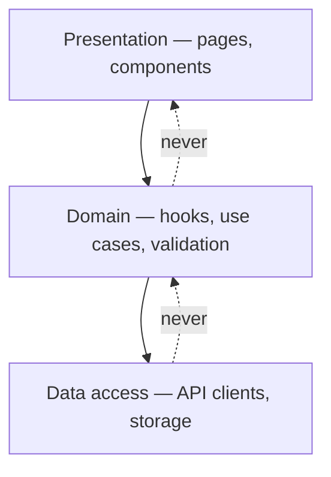

# Frontend Architecture Pattern {#ch-frontend-architecture-patterns}

> বড় client app-এ এমনভাবে boundary বসান, যাতে একটি বদল পাঁচ জায়গায় নয়, এক জায়গায় হয়।

**এই অধ্যায়ে:** architecture আসলে কী দেয় · component-based · layered · clean architecture · কোনটা বাছবেন · review-এ যে ভুলগুলো ধরা পড়ে

## 💡 মূল ধারণা

Architecture হলো কিছু নিয়ম: **কোন file কোন file-কে import করতে পারবে**। এর বেশি কিছু নয়। বাকি সবকিছু আছে শুধু এই
নিয়মগুলো চোখে পড়ার মতো করতে, আর ভুল করে ভাঙা কঠিন করতে। Folder-এর নাম, layer-এর diagram, dependency-injection
container, সবই এর মধ্যে পড়ে।

এটা জরুরি সৌন্দর্যের জন্য নয়, বদলের খরচের জন্য। যে codebase-এ boundary নেই, সেখানে API response-এর shape বদলালে হাত
দিতে হয় component-এ, test-এ, আর সম্পর্কহীন তিনটি screen-এ। Boundary থাকলে বদলাতে হয় একটি file। Senior interview-এ
এটা যাচাই করা হয় বদলটা কোথায় গিয়ে পড়ে জিজ্ঞেস করে, কোনো pattern-এর নাম জানতে চেয়ে নয়।

## কীভাবে কাজ করে

প্রায় সব বাস্তব frontend তিনটি pattern-এই ধরা পড়ে। এরা একটি আরেকটির বিকল্প নয়, একটির ওপর আরেকটি বসে।

| Pattern | যে নিয়ম যোগ করে | খরচ |
| ------- | ---------------- | ---- |
| **Component-based** | UI তৈরি হয় স্বাধীন, typed টুকরো দিয়ে | প্রায় শূন্য — এটাই default |
| **Layered** | Import চলে এক দিকে: UI → logic → data | একটি folder-এর নিয়ম আর একটি lint rule |
| **Clean architecture** | Domain code কোনো framework-ই import করে না | সব জায়গায় interface আর indirection |

### Component-based

React, Svelte, Vue, Angular, সবার ভিত্তি এটাই। এখানে একটিই সিদ্ধান্ত নেওয়ার মতো: data fetching কোথায় থাকবে। কারণ
component-টা test করা যাবে কি না, তা এটাই ঠিক করে।

**যে অংশ fetch করে আর যে অংশ render করে, তাদের আলাদা করুন:**

```tsx
interface User {
  id: string;
  name: string;
}

// Presentational — no data fetching, no router, no store. Trivial to test and to reuse.
interface UserCardProps {
  user: User;
  onEdit: () => void;
}

function UserCard({ user, onEdit }: UserCardProps) {
  return (
    <div className="card">
      <h3>{user.name}</h3>
      <button onClick={onEdit}>Edit</button>
    </div>
  );
}

// Container — owns the data and the side effects, renders no markup of its own.
function UserCardContainer({ userId }: { userId: string }) {
  const { data, isLoading } = useUser(userId);
  const router = useRouter();

  if (isLoading || !data) return <Skeleton />;
  return <UserCard user={data} onEdit={() => router.push(`/users/${userId}/edit`)} />;
}
```

> ⚠️ React 19-এ container/presentational ভাগটা আগের মতো testability-র জন্য অতটা জরুরি নয়। Server Component এমনিতেই
> fetching-কে interactive tree-র বাইরে রাখে। তবে টেকসই নীতিটা থেকে যায়: যে component fetch করে আর যে component
> render করে, তাদের বদলানোর কারণ আলাদা।

### Layered

Layer তিনটি, নিয়ম একটি: **import সবসময় শুধু নিচের দিকে যায়।**



**Import চলে এক দিকে। Dotted arrow মানে নিয়ম ভাঙা, যা lint rule-এর আটকে দেওয়া উচিত।**

```tsx
// Data access — knows about HTTP, knows nothing about React
export const userApi = {
  getById: async (id: string): Promise<User> => {
    const res = await fetch(`/api/users/${id}`);
    if (!res.ok) throw new Error(`User ${id}: ${res.status}`);
    return res.json() as Promise<User>;
  },
};

// Domain — knows about caching and TanStack Query, knows nothing about the URL
export function useUser(id: string) {
  return useQuery({ queryKey: ["user", id], queryFn: () => userApi.getById(id) });
}

// Presentation — knows nothing about either
function UserPage({ id }: { id: string }) {
  const { data } = useUser(id);
  return data ? <UserCard user={data} onEdit={() => {}} /> : <Skeleton />;
}
```

Layer ভাগ তখনই টেকে, যখন কিছু একটা তা enforce করে। বাস্তবে সেটা একটি ESLint rule
(`import/no-restricted-paths`), কিংবা আপনার monorepo tool-এর boundary plugin। Code review-এর অভ্যাস দিয়ে এটা হয় না।

### Clean architecture

Framework-কে একদম কিনারায় ঠেলে দিন, যাতে domain তার ওপর নির্ভর না করে। তত্ত্বে, React সরিয়ে Svelte বসালেও core-এ
হাত দিতে হবে না।

**এমন একটি use case, যাকে UI call করে:**

```typescript
// Domain — plain TypeScript, no imports from any framework
interface AuthGateway {
  login(email: string, password: string): Promise<{ token: string }>;
}

export class LoginUseCase {
  constructor(private readonly gateway: AuthGateway) {}

  async execute(email: string, password: string): Promise<User> {
    if (!email.includes("@")) throw new Error("Invalid email");
    const { token } = await this.gateway.login(email, password);
    return decodeUser(token);
  }
}

// Presentation — depends on the use case, which depends on an interface, not on fetch
function LoginPage() {
  const useCase = useMemo(() => new LoginUseCase(new HttpAuthGateway()), []);
  // …
}
```

Team-গুলো সবচেয়ে বেশি এই pattern-টাই সময়ের আগে নিয়ে আসে। এটা লাভ দেয় দীর্ঘদিন চলা app-এ, যেখানে সত্যিকারের domain
rule আছে, যেমন pricing, entitlement বা নিয়ন্ত্রিত workflow। CRUD dashboard-এ এটা শুধুই বোঝা।

## কখন ব্যবহার করবেন

| পরিস্থিতি | কী ব্যবহার করবেন | কেন |
| --------- | --------- | --- |
| যেকোনো নতুন app | শুধু component-based | যে layer দরকার নেই, তা শুধু তর্ক করার মতো কিছু folder |
| একই business logic তিনটি component-এ | Layered | সংকেতটা হলো duplication, মানুষের সংখ্যা নয় |
| Domain rule framework-এর চেয়ে বেশিদিন বাঁচে | Clean architecture | Rewrite-এর পরেও rule টিকে থাকে, component টেকে না |
| Deploy নিয়ে team-গুলো একে অপরকে আটকে রাখছে | Micro-frontend — দেখুন [Chapter ?? — Micro-Frontend](#ch-micro-frontends) | আটকটা organisation-এর, architecture-এর নয় |
| আলাদা আলাদা frontend-এ shared code | নতুন pattern নয়, একটি monorepo — দেখুন [Chapter ?? — Monorepo](#ch-monorepos) | Architecture-এর চেয়ে tooling এটা সস্তায় মেটায় |

Interview-এ সৎ উত্তরটা একটি ক্রম, একটি বাছাই নয়। শুরু করুন component-based দিয়ে। Logic বারবার আসতে শুরু করলে layer
যোগ করুন। এর চেয়ে ভারী কিছুর কথা ভাবুন তখনই, যখন কোনো নির্দিষ্ট কষ্টের নাম দিতে পারছেন।

## সাধারণ ভুল

❌ **Component-এর ভেতরে business logic।** JSX file-এ থাকা price-এর হিসাব render না করে test করা যায় না। Server-এ
আবার ব্যবহার করা যায় না, আর দ্বিতীয় কোনো screen-এ দরকার হলে সেটা copy হয়ে যায়।
✅ এটাকে একটি সাধারণ function-এ বা hook-এ সরিয়ে নিন, যাকে component call করবে।

❌ **Enforce না করা layer।** যে `data/` folder থেকে component সরাসরি import করে, সেটা নাম রাখার একটি নিয়ম মাত্র,
architecture নয়।
✅ যেদিন folder যোগ করবেন, সেদিনই lint rule-টাও যোগ করুন।

❌ **CRUD app-এ clean architecture।** User-এর একটি list আনতে তিনটি interface আর একটি use-case class মানে লাভহীন
indirection।
✅ এটা আনুন তখন, যখন রক্ষা করার মতো কোনো domain rule আছে।

❌ **Feature ধরে নয়, file-এর ধরন ধরে folder।** `components/`, `hooks/` আর `utils/` 200 file-এ পৌঁছালে প্রতিটি
feature পুরো tree জুড়ে ছড়িয়ে থাকে। নিরাপদে কিছুই মোছা যায় না।
✅ Feature ধরে group করুন, আর shared folder-এ রাখুন শুধু সত্যিকারের shared code।

## 🔑 মূল শিক্ষা

- Architecture হলো import-এর কিছু নিয়ম। বাকি সবকিছু সেই নিয়মগুলো দেখানোর উপায়।
- Component-based-ই ঠিক default, আর এটা আপনাকে একটিই সিদ্ধান্ত নিতে বাধ্য করে: fetching কোথায় থাকবে।
- Business logic একাধিক component-এ দেখা দেওয়ার মুহূর্ত থেকেই layer ভাগের খরচ পুষিয়ে যায়।
- Clean architecture domain rule-কে framework থেকে রক্ষা করে। Domain rule না থাকলে এটা শুধুই বোঝা।
- যে boundary কেউ enforce করে না, সেটা নাম রাখার একটি নিয়ম, যা ছয় মাসের মধ্যে হারিয়ে যাবে।

## Interview-এর প্রশ্ন

**Q: চল্লিশজন engineer কাজ করেন, এমন frontend কীভাবে সাজাবেন?**

File-এর ধরন ধরে নয়, feature ধরে, নিচে ছোট একটি shared layer রেখে। সঙ্গে থাকবে enforce করা একটি নিয়ম, import কোন দিকে
যেতে পারবে। কারণটা মোছা: একটি feature folder এক commit-এই সরিয়ে ফেলা যায়। কিন্তু `components/`, `hooks/` আর
`utils/` জুড়ে ছড়ানো feature নিরাপদে সরানোই যায় না। Enforce করার ব্যবস্থাটার নাম বলুন, যেমন lint rule বা build-graph
boundary। তাতে উত্তরটা বাস্তব শোনায়, শুধু আশার কথা নয়।

**Q: React app-এ business logic কোথায় রাখবেন, আর component-এ কেন নয়?**

সাধারণ function-এ, কিংবা সেগুলো call করা hook-এ। Component ভুল জায়গা, কারণ component চলতে পারে শুধু render-এর ভেতরে।
ফলে logic-টা renderer ছাড়া test করা যায় না, server-এ ব্যবহার করা যায় না, আর খুঁজে পাওয়াও কঠিন হয়। Logic
component-এ থাকার যোগ্য কি না, যাচাই করতে নিজেকে জিজ্ঞেস করুন: UI যদি একটি CLI হতো, তবুও কি এর মানে থাকত?

**Q: কখন layered architecture *আনবেন না*?**

যখন layer করার মতো কোনো business logic নেই। যে dashboard শুধু fetch করে আর দেখায়, তার জন্য পাশেই রাখা data fetching
ভালো, তিনটি folder আর প্রতিটি call-এ একটি করে indirection নয়। Layer ভাগ আসে duplication-এর জবাবে, আর এমন logic-এর
জবাবে, যা একটি screen ছাপিয়ে গেছে। তার আগে এটা শুধু খুঁজে বেড়ানোর খাটুনি বাড়ায়, বিনিময়ে কিছু দেয় না।

**Q: একটি API response-এর shape বদলাতে নয়টি file-এ হাত দিতে হলো। ভুলটা কোথায়?**

Response type-টা data-access boundary পেরিয়ে বেরিয়ে গেছে, আর UI সেটাকেই সরাসরি render করছে। সমাধান হলো একটি mapping
ধাপ। Wire-এর shape-এর মালিক data layer, আর data layer-ই সেটাকে একটি domain type-এ map করে। ওপরের দিকে যেতে পারে শুধু domain
type। তাহলে পরের বার shape বদলালে হাত দিতে হবে একটিই file-এ, আর boundary-র আসল উদ্দেশ্য এটাই।

## এরপর কী পড়বেন

- [Chapter ?? — Micro-Frontend](#ch-micro-frontends) — যখন আটকটা code-এর গঠনে নয়, team-এর স্বাধীনতায়, তখনকার pattern
- [Chapter ?? — Design System, Dependency ও Upgrade](#ch-design-systems-at-scale) — feature ধরে সাজানো tree-র নিচের shared layer
- [Chapter ?? — চার ধরনের State](#ch-four-kinds-of-state) — ওপরের প্রতিটি layer boundary-র ভেতরে যে সিদ্ধান্ত বসে আছে
