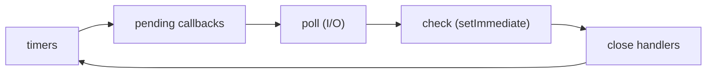

# Node.js Event Loop, Async ও Error {#ch-event-loop-async}

> ব্যাখ্যা করুন একটি thread কীভাবে হাজার হাজার connection সামলায়, সেই line-টার নাম বলুন যেটা সবাইকে আটকে দেয়, আর ঠিক করুন কোন failure-এর উত্তর দেবেন আর কোনটার জন্য restart করবেন।

**এই অধ্যায়ে:** loop-এর phase-গুলো · microtask বনাম macrotask · যে concurrency scale করে · operational বনাম programmer error · পরিচ্ছন্নভাবে crash আর shutdown

## 💡 মূল ধারণা

Node আপনার JavaScript **একটি thread-এ** চালায়। এটা দ্রুত থাকে, কারণ সেই thread কখনো অপেক্ষা করে না। একটি query, একটি
file read বা একটি HTTP call চলে যায় operating system-এ, বা ছোট একটি thread pool-এ। Result তৈরি হলে Node আপনার callback
চালায়। এটা parallel নয়, শুধু কখনো অলস বসে থাকে না। এর দুটি ফল আছে। **Inline যেকোনো CPU কাজ সবাইকে আটকে দেয়:** একটি
200 ms-এর JSON parse প্রতিটি খোলা request-এ 200 ms যোগ করে। আর **একটি process প্রতিটি user-কে সেবা দেয়**, তাই যে error
আপনি ব্যাখ্যা করতে পারেন না, তার মানে সবার জন্য অজানা state। নিরাপদ উত্তর হলো সেটা log করে restart করা।

## কীভাবে কাজ করে

Event loop হলো phase-গুলোর একটি নির্দিষ্ট চক্র। প্রতিটি phase তার নিজের callback queue খালি করে। একটি server তার জীবনের
বেশিরভাগ সময় কাটায় **poll**-এ, I/O-র জন্য অপেক্ষা করে। **Timers** মেয়াদ শেষ হওয়া `setTimeout` callback চালায়, আর
**check** চালায় `setImmediate`।

**Loop-এর phase-গুলো:**



**Event loop-এর একটি পাক। প্রতিটি তীরের মাঝে Node microtask queue খালি করে।**

### Microtask সবকিছুর আগে

দুটি queue phase-গুলোর **বাইরে** থাকে, আর প্রতিটি callback-এর পরে খালি হয়: আগে `process.nextTick`, তারপর promise
reaction।

**ক্রম, একেবারে শুরু থেকে:**

```typescript
setTimeout((): void => console.log('1 timeout'), 0);
setImmediate((): void => console.log('2 immediate'));
Promise.resolve().then((): void => console.log('3 promise'));
process.nextTick((): void => console.log('4 nextTick'));
console.log('5 sync');

// 5 sync → 4 nextTick → 3 promise → then 1 timeout and 2 immediate, in either order
// Sync code runs before the loop even starts its first turn.
```

> ⚠️ Recursive `process.nextTick` loop-কে অভুক্ত রাখে, কারণ তার queue কখনো খালি হয় না। Recursive `setImmediate` প্রতিটি
> পাকের মাঝে জায়গা ছেড়ে দেয়, তাই নিরাপদ।

### Thread pool ছোট আর ভাগাভাগি করা

`fs`, `dns.lookup`, `zlib` আর `crypto.pbkdf2` libuv-এর **চারটি thread**-এর pool ভাগ করে নেয় (libuv হলো Node-এর নিচের C
library)। পঞ্চম একটি ধীর `bcrypt.hash` অপেক্ষা করে। Socket এটা ব্যবহার করে না। `UV_THREADPOOL_SIZE` দিয়ে এটা বাড়ানো যায়।

## কখন ব্যবহার করবেন

| আপনার আছে | কী ব্যবহার করবেন | কেন |
| -------- | --- | --- |
| স্বাধীন call, সবগুলোকে সফল হতে হবে | `Promise.all` | N-টা নয়, একটি round trip-এর সমান latency |
| স্বাধীন call, আংশিক failure চলবে | `Promise.allSettled` | প্রতিটি result আর প্রতিটি কারণ পান |
| একাধিক source, প্রথম উত্তরই জেতে | `Promise.race` | Timeout আর hedged request |
| বড় একটি list, একটি shared downstream | Bounded pool | আপনার নিজের fan-out থেকে database-কে রক্ষা করে |

**Bounded concurrency — যে pattern বেশিরভাগ মানুষ ভুল করে:**

```typescript
async function mapLimit<T, R>(
  items: readonly T[],
  limit: number,
  fn: (item: T) => Promise<R>,
): Promise<R[]> {
  const results: R[] = new Array(items.length);
  let cursor = 0;
  // `limit` workers share one cursor, so at most `limit` calls are ever open.
  const worker = async (): Promise<void> => {
    while (cursor < items.length) {
      const index = cursor++;
      results[index] = await fn(items[index]);
    }
  };
  await Promise.all(Array.from({ length: limit }, worker));
  return results;
}
```

5,000টি id দিয়ে `Promise.all(ids.map(fetchUser))` 5,000টি socket খোলে আর connection pool শেষ করে ফেলে।
`mapLimit(ids, 10, fetchUser)` খোলে দশটি।

## দুই ধরনের Error

Node service-এর প্রতিটি error দুই ধরনের একটি। এদের আলাদা করতে পারা থেকেই পুরো design আসে।

| ধরন | উদাহরণ | প্রতিক্রিয়া |
| ---- | ------- | -------- |
| **Operational** | Row পাওয়া যায়নি, token-এর মেয়াদ শেষ, provider timeout করেছে | Request-এর উত্তর দিন আর চালু থাকুন |
| **Programmer** | `undefined`-এর property, ভাঙা invariant, ভুল config key | Log করুন, তারপর process-কে মরতে দিন আর restart করুন |

একটি bug-কে operational ধরলে আপনি ঘণ্টার পর ঘণ্টা নষ্ট response দেন। Crash করলে কয়েক সেকেন্ডে restart হয়।

**একটি typed error base:**

```typescript
export class AppError extends Error {
  constructor(
    message: string,
    readonly status: number,
    readonly code: string,
    readonly expose: boolean = true, // Safe to show the client?
    options?: { cause?: unknown },
  ) {
    super(message, options);
    this.name = new.target.name;
  }
}

export class UpstreamError extends AppError {
  // The client gets a generic message; the log keeps the detail through `cause`.
  constructor(service: string, cause?: unknown) {
    super(`${service} unavailable`, 502, 'upstream_unavailable', false, { cause });
  }
}
```

`status` আর `code` একটি handler-কে প্রতিটি error-এর উত্তর দিতে দেয়। `expose` throw-এর সময়েই ঠিক করে message-টা পাঠানো
নিরাপদ কি না, কারণ upstream message-এ একটি hostname বা connection string থাকতে পারে।

### সবকিছুর জন্য একটি handler

Express প্রতিটি error একটি চার-argument-এর middleware-এ পাঠায়। Express 5-এ, একটি `async` handler থেকে reject হওয়া
promise নিজে থেকেই সেখানে পৌঁছায়। Express 4-এ পৌঁছায় না, আর request ঝুলে থাকে।

**একমাত্র error handler, প্রতিটি route-এর পরে register করা:**

```typescript
app.use((err: unknown, req: Request, res: Response, _next: NextFunction): void => {
  const known = err instanceof AppError ? err : undefined;
  const status = known?.status ?? 500;
  req.log.error({ err, status, requestId: req.id }, 'request failed');

  res.status(status).json({
    error: {
      code: known?.code ?? 'internal_error',
      message: known?.expose ? known.message : 'Internal server error',
      requestId: req.id,
    },
  });
});
```

অচেনা error default-ভাবে 500 আর একটি সাধারণ message পায়। এটা একটি bug, আর bug তথ্য ফাঁস করে।

### পরিচ্ছন্নভাবে crash আর shutdown

Unhandled rejection হলো এমন একটি promise, যেটা fail করেছে অথচ কেউ শুনছিল না। Node 15 থেকে এটা default-ভাবে process
crash করায়। এটা রেখে দিন, আর handler যোগ করুন শুধু আগে log করার জন্য।

**Process-level handler আর graceful shutdown:**

```typescript
process.on('unhandledRejection', (reason: unknown): void => {
  logger.fatal({ err: reason }, 'unhandled rejection');
  throw reason; // Turns it into an uncaught exception, so there is one exit path.
});

process.on('uncaughtException', (err: Error): void => {
  logger.fatal({ err }, 'uncaught exception');
  shutdown(1);
});

process.on('SIGTERM', (): void => shutdown(0)); // The orchestrator is stopping the container.

function shutdown(code: number): void {
  server.close((): void => process.exit(code));
  setTimeout((): void => process.exit(code), 10_000).unref(); // Backstop.
}
```

> ⚠️ এই handler-গুলো আছে **log করে exit করার** জন্য, কখনো recover করার জন্য নয়। Uncaught exception-এর পরে একটি
> transaction খোলা থাকতে পারে, বা একটি lock ধরা থাকতে পারে। পরের request সেই অর্ধেক-প্রয়োগ হওয়া state দেখবে।

## সাধারণ ভুল

**❌ Request handler-এ inline CPU কাজ।** `map` আর `join` দিয়ে 200k-row-এর CSV বানাতে 400 ms লাগে, আর বাকি প্রতিটি
request অপেক্ষা করে। **✅ এটা stream করুন**, যাতে প্রতিটি chunk loop-কে জায়গা ছেড়ে দেয়, বা worker thread-এ সরিয়ে দিন।
প্রতি request-এ মোটামুটি 10 ms-এর বেশি টানা CPU কাজ loop-এর বাইরে থাকা উচিত।

**❌ এমন `catch`, যেটা log করে কাজ চালিয়ে যায়।** Order save হয়নি, অথচ client 200 পায়।
**✅ রূপান্তর করে আবার throw করুন** `throw new UpstreamError('orders', e)` দিয়ে, যাতে handler উত্তর দেয়।

**❌ ভুলে যাওয়া `await`।** Response পাঠানোর পরে error-টা একটি unhandled rejection হয়ে যায়।
`@typescript-eslint/no-floating-promises` চালু করুন।

## 🔑 মূল শিক্ষা

- Node-এর গতি আসে নিজের thread-এ কখনো অপেক্ষা না করা থেকে, parallelism থেকে নয়।
- প্রতিটি callback-এর পরে microtask খালি হয়, আগে `process.nextTick`, তারপর promise।
- বড় একটি list-এর ওপর সীমাহীন `Promise.all` হলো আপনার database-এর ওপর নিজের হাতে করা denial of service।
- Operational error উত্তর পায়, আর programmer error পায় একটি log line আর একটি restart।
- Process-level handler আছে log করে পরিচ্ছন্নভাবে shutdown করার জন্য, কখনো ভাঙা process বাঁচিয়ে রাখার জন্য নয়।

## Interview-এর প্রশ্ন

**Q: Node single-threaded, তাহলে এটা 10,000 concurrent connection কীভাবে সামলায়?**

JavaScript একটি thread-এ চলে, কিন্তু অপেক্ষাটা চলে না। Node প্রতিটি socket `epoll` (Linux) বা `kqueue` (macOS)-এ register
করে, আর OS জানায় কোনগুলো প্রস্তুত। Node শুধু সেই callback-গুলো চালায়, তাই সীমাটা file descriptor আর memory, thread নয়।

**Q: কোনটা আগে log হয় — `setTimeout(fn, 0)` নাকি `setImmediate(fn)`?**

Synchronous code থেকে সাধারণত `setTimeout` জেতে, কিন্তু Node এর নিশ্চয়তা দেয় না। একটি I/O callback-এর ভেতর থেকে সবসময়
`setImmediate` জেতে, কারণ **poll**-এর পরেই আসে **check**।

**Q: একটি `uncaughtException`-এর পরে কি process বাঁচিয়ে রাখা উচিত?**

না। একটি transaction খোলা থাকতে পারে, বা একটি cache অর্ধেক লেখা, তাই state অজানা। পূর্ণ context-সহ log করুন, নতুন
connection নেওয়া বন্ধ করুন, চলমান কাজকে অল্প সময় শেষ হতে দিন, তারপর non-zero দিয়ে exit করুন।

**Q: কাজটা async না করে কখন worker thread-এ সরাবেন?**

শুধু যখন কাজটা CPU-bound, যেমন parsing, image resize বা hashing। CPU কাজকে `async` চিহ্নিত করলে কিছুই বদলায় না, কারণ
সেটা তখনো সেই একটি thread-এই চলে। Worker-এর খরচ আছে startup time আর message copy-তে, তাই এটা লাভজনক শুধু প্রতি task-এ
কয়েক millisecond-এর বেশি হলে।

## এরপর কী পড়বেন

- [Chapter ?? — Promise, Async/Await ও Error](#ch-promises-async) — rejection-এর ভাষাগত নিয়ম, যার ওপর এই অধ্যায় দাঁড়িয়ে
- [Chapter ?? — Node.js Performance, Stream ও Scaling](#ch-nodejs-performance) — blocking call খুঁজে বের করা, আর প্রতিটি core ব্যবহার করা
- [Chapter ?? — REST Best Practice ও Versioning](#ch-rest-best-practices) — এমন একটি error shape, যেটা client parse করতে পারে
