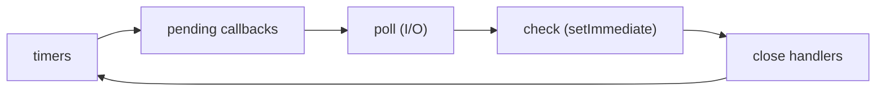

# Node.js Event Loop, Async ও Error {#ch-event-loop-async}

> একটি thread কীভাবে হাজার হাজার connection সামলায়, তা ব্যাখ্যা করুন। কোন line সবাইকে আটকে দেয়, সেটা চিহ্নিত করুন। আর ঠিক করুন, কোন failure-এ উত্তর দেবেন আর কোনটায় process restart করবেন।

**এই অধ্যায়ে:** loop-এর phase · microtask বনাম macrotask · যে concurrency scale করে · operational বনাম programmer error · ঠিকভাবে crash আর shutdown

## 💡 মূল ধারণা

Node আপনার JavaScript চালায় **একটি thread-এ**। তবু দ্রুত থাকে, কারণ সেই thread কখনো অপেক্ষা করে না। Query, file
পড়া বা HTTP call চলে যায় operating system-এর কাছে, নয়তো ছোট একটি thread pool-এ। ফল তৈরি হলে Node আপনার callback
চালায়। মানে Node parallel নয়, শুধু কখনো বসে থাকে না। এর দুটি ফল আছে। **Inline যে CPU-র কাজই করুন, তা সবাইকে আটকে
দেয়:** 200 ms-এর একটি JSON parse খোলা প্রতিটি request-এ 200 ms যোগ করে। আর **একটি process-ই সব user-কে serve করে**,
তাই যে error-এর ব্যাখ্যা নেই, তার মানে সবার জন্যই অজানা state। নিরাপদ পথ হলো log করে restart করা।

## কীভাবে কাজ করে

Event loop হলো কয়েকটি phase-এর একটি নির্দিষ্ট চক্র। প্রতিটি phase নিজের callback queue খালি করে। একটি server জীবনের
বেশিরভাগ সময় কাটায় **poll**-এ, I/O-র অপেক্ষায়। **Timers** চালায় মেয়াদ ফুরানো `setTimeout` callback, আর **check**
চালায় `setImmediate`।

**Loop-এর phase-গুলো:**



**Event loop-এর এক পাক। প্রতিটি তীরের মাঝে Node microtask queue খালি করে নেয়।**

### Microtask সবার আগে

দুটি queue phase-গুলোর **বাইরে** থাকে, আর প্রতিটি callback-এর পরে খালি হয়: প্রথমে `process.nextTick`, তারপর
promise reaction।

**ক্রম, cold start থেকে:**

```typescript
setTimeout((): void => console.log('1 timeout'), 0);
setImmediate((): void => console.log('2 immediate'));
Promise.resolve().then((): void => console.log('3 promise'));
process.nextTick((): void => console.log('4 nextTick'));
console.log('5 sync');

// 5 sync → 4 nextTick → 3 promise → then 1 timeout and 2 immediate, in either order
// Sync code runs before the loop even starts its first turn.
```

> ⚠️ Recursive `process.nextTick` loop-কে না খাইয়ে রাখে, কারণ তার queue কখনো খালি হয় না। Recursive
> `setImmediate` প্রতি পাকের মাঝে loop-কে জায়গা ছেড়ে দেয়, তাই সেটা নিরাপদ।

### Thread pool ছোট, আর সবাই মিলে ব্যবহার করে

`fs`, `dns.lookup`, `zlib` আর `crypto.pbkdf2` সবাই libuv-এর **চারটি thread**-এর pool ভাগ করে নেয় (libuv হলো Node-এর
নিচের C library)। পঞ্চম ধীর `bcrypt.hash`-কে অপেক্ষা করতে হয়। Socket এই pool ব্যবহার করে না। `UV_THREADPOOL_SIZE`
দিয়ে pool বড় করা যায়।

## কখন ব্যবহার করবেন

| আপনার কাছে আছে | কী ব্যবহার করবেন | কেন |
| -------- | --- | --- |
| পরস্পর-নিরপেক্ষ call, সবগুলোকেই সফল হতে হবে | `Promise.all` | Latency লাগে একটি round trip-এর সমান, N-টির নয় |
| পরস্পর-নিরপেক্ষ call, কয়েকটি ব্যর্থ হলেও চলে | `Promise.allSettled` | প্রতিটি ফল আর প্রতিটি ব্যর্থতার কারণ হাতে পান |
| কয়েকটি উৎস, যার উত্তর আগে আসে সেটাই জেতে | `Promise.race` | Timeout আর hedged request |
| বড় একটি তালিকা, downstream একটিই | সীমিত pool | আপনার নিজের fan-out থেকে database-কে বাঁচায় |

**সীমিত concurrency — যে pattern বেশিরভাগ মানুষ ভুল করেন:**

```typescript
async function mapLimit<T, R>(
  items: readonly T[],
  limit: number,
  fn: (item: T) => Promise<R>,
): Promise<R[]> {
  const results: R[] = new Array(items.length);
  let cursor = 0;
  // `limit` workers share one cursor, so at most `limit` calls are ever open.
  const worker = async (): Promise<void> => {
    while (cursor < items.length) {
      const index = cursor++;
      results[index] = await fn(items[index]);
    }
  };
  await Promise.all(Array.from({ length: limit }, worker));
  return results;
}
```

5,000টি id নিয়ে `Promise.all(ids.map(fetchUser))` চালালে 5,000টি socket খোলে, আর connection pool ফাঁকা হয়ে যায়।
`mapLimit(ids, 10, fetchUser)` খোলে মাত্র দশটি।

## দুই ধরনের Error

Node service-এর প্রতিটি error দুই ধরনের একটি। এ দুটিকে আলাদা করে চিনতে পারলেই পুরো design দাঁড়িয়ে যায়।

| ধরন | উদাহরণ | কী করবেন |
| ---- | ------- | -------- |
| **Operational** | Row পাওয়া যায়নি, token-এর মেয়াদ শেষ, provider timeout করেছে | Request-এর উত্তর দিন, process চালু রাখুন |
| **Programmer** | `undefined`-এর property, ভাঙা invariant, ভুল config key | Log করুন, তারপর process মরতে দিন আর restart হতে দিন |

Bug-কে operational ধরে নিলে ঘণ্টার পর ঘণ্টা নষ্ট response পাঠাতে থাকবেন। Crash করলে কয়েক সেকেন্ডেই restart হয়ে যায়।

**Typed error-এর base:**

```typescript
export class AppError extends Error {
  constructor(
    message: string,
    readonly status: number,
    readonly code: string,
    readonly expose: boolean = true, // Safe to show the client?
    options?: { cause?: unknown },
  ) {
    super(message, options);
    this.name = new.target.name;
  }
}

export class UpstreamError extends AppError {
  // The client gets a generic message; the log keeps the detail through `cause`.
  constructor(service: string, cause?: unknown) {
    super(`${service} unavailable`, 502, 'upstream_unavailable', false, { cause });
  }
}
```

`status` আর `code` থাকায় একটি handler-ই সব error-এর উত্তর দিতে পারে। Message পাঠানো নিরাপদ কি না, `expose` তা ঠিক
করে throw করার সময়েই। কারণ upstream-এর message-এ hostname বা connection string থাকতে পারে।

### সবকিছুর জন্য একটি handler

Express প্রতিটি error পাঠায় চার argument-এর একটি middleware-এ। Express 5-এ `async` handler-এর rejected promise
নিজে থেকেই সেখানে পৌঁছায়। Express 4-এ পৌঁছায় না, ফলে request ঝুলে থাকে।

**একমাত্র error handler, সব route-এর পরে register করা:**

```typescript
app.use((err: unknown, req: Request, res: Response, _next: NextFunction): void => {
  const known = err instanceof AppError ? err : undefined;
  const status = known?.status ?? 500;
  req.log.error({ err, status, requestId: req.id }, 'request failed');

  res.status(status).json({
    error: {
      code: known?.code ?? 'internal_error',
      message: known?.expose ? known.message : 'Internal server error',
      requestId: req.id,
    },
  });
});
```

অচেনা error হলে default হিসেবে 500 আর সাধারণ একটি message যায়। ওটা bug, আর bug-এর message থেকে তথ্য ফাঁস হয়।

### ঠিকভাবে crash আর shutdown

Unhandled rejection হলো এমন promise, যা ব্যর্থ হয়েছে কিন্তু কেউ শুনছিল না। Node 15 থেকে এতে default হিসেবে process
crash করে। এটা বদলাবেন না। Handler যোগ করুন শুধু আগে log করার জন্য।

**Process-স্তরের handler আর graceful shutdown:**

```typescript
process.on('unhandledRejection', (reason: unknown): void => {
  logger.fatal({ err: reason }, 'unhandled rejection');
  throw reason; // Turns it into an uncaught exception, so there is one exit path.
});

process.on('uncaughtException', (err: Error): void => {
  logger.fatal({ err }, 'uncaught exception');
  shutdown(1);
});

process.on('SIGTERM', (): void => shutdown(0)); // The orchestrator is stopping the container.

function shutdown(code: number): void {
  server.close((): void => process.exit(code));
  setTimeout((): void => process.exit(code), 10_000).unref(); // Backstop.
}
```

> ⚠️ এই handler-গুলো আছে **log করে বেরিয়ে যাওয়ার** জন্য, কখনো recover করার জন্য নয়। Uncaught exception-এর পরে
> হয়তো কোনো transaction খোলা আছে, বা কোনো lock ধরা আছে। পরের request সেই আধা-প্রয়োগ হওয়া state দেখবে।

## সাধারণ ভুল

**❌ Request handler-এর ভেতরে inline CPU-র কাজ।** `map` আর `join` দিয়ে 200k row-এর CSV বানাতে 400 ms লাগে, আর
বাকি সব request অপেক্ষায় থাকে। **✅ Stream করুন**, যাতে প্রতিটি chunk-এর পরে loop জায়গা পায়, নয়তো worker thread-এ
সরিয়ে দিন। একটি request-এ মোটামুটি 10 ms-এর বেশি টানা CPU-র কাজ হলে সেটা loop থেকে সরানো উচিত।

**❌ এমন `catch`, যা log করে চুপচাপ এগিয়ে যায়।** Order save হয়নি, অথচ client পায় 200। **✅ অনুবাদ করে আবার
throw করুন**, যেমন `throw new UpstreamError('orders', e)`, যাতে handler উত্তরটা দেয়।

**❌ ভুলে যাওয়া `await`।** Response চলে যাওয়ার পরে error-টা unhandled rejection হয়ে দাঁড়ায়।
`@typescript-eslint/no-floating-promises` চালু করুন।

## 🔑 মূল শিক্ষা

- Node-এর গতি parallelism থেকে আসে না, আসে নিজের thread-এ কখনো অপেক্ষা না করা থেকে।
- প্রতিটি callback-এর পরে microtask খালি হয়: আগে `process.nextTick`, তারপর promise।
- বড় তালিকার ওপর সীমাহীন `Promise.all` মানে নিজের database-এর ওপর নিজেই denial of service চালানো।
- Operational error পায় উত্তর, আর programmer error পায় একটি log line আর restart।
- Process-স্তরের handler আছে log করে ঠিকভাবে বন্ধ হওয়ার জন্য, ভাঙা process বাঁচিয়ে রাখার জন্য কখনো নয়।

## Interview-এর প্রশ্ন

**Q: Node single-threaded, তাহলে 10,000টি concurrent connection কীভাবে সামলায়?**

JavaScript চলে একটি thread-এ, কিন্তু অপেক্ষাটা ওই thread-এ হয় না। Node প্রতিটি socket `epoll` (Linux) বা `kqueue`
(macOS)-এ register করে, আর কোনগুলো তৈরি, তা OS জানিয়ে দেয়। Node শুধু সেগুলোর callback চালায়। তাই সীমা ঠিক হয় file
descriptor আর memory দিয়ে, thread দিয়ে নয়।

**Q: কোনটা আগে log হয় — `setTimeout(fn, 0)` নাকি `setImmediate(fn)`?**

Synchronous code থেকে ডাকলে সাধারণত `setTimeout` জেতে, তবে Node এর নিশ্চয়তা দেয় না। I/O callback-এর ভেতর থেকে ডাকলে
সবসময় `setImmediate` জেতে, কারণ **poll**-এর পরেই আসে **check**।

**Q: `uncaughtException`-এর পরে কি process চালু রাখা উচিত?**

না। হয়তো কোনো transaction খোলা, বা cache আধা লেখা, তাই state অজানা। পুরো context দিয়ে log করুন, নতুন connection নেওয়া
বন্ধ করুন, চলতি কাজকে অল্প সময় দিন শেষ করতে, তারপর non-zero code দিয়ে exit করুন।

**Q: কখন কাজটা async না বানিয়ে worker thread-এ সরাবেন?**

শুধু যখন কাজটা CPU-bound, যেমন parsing, image resize বা hashing। CPU-র কাজকে `async` লিখলে কিছুই বদলায় না, কারণ
সেটা তখনো ওই একটি thread-এই চলে। Worker-এর খরচ আছে: চালু হতে সময় লাগে, message copy করতে হয়। তাই প্রতিটি task-এ কয়েক
millisecond-এর বেশি লাগলে তবেই এটা লাভজনক।

## এরপর কী পড়বেন

- [Chapter ?? — Promise, Async/Await ও Error](#ch-promises-async) — rejection-এর ভাষাগত নিয়ম, যার ওপর এই অধ্যায় দাঁড়িয়ে
- [Chapter ?? — Node.js Performance, Stream ও Scaling](#ch-nodejs-performance) — blocking call খুঁজে বের করা, আর প্রতিটি core কাজে লাগানো
- [Chapter ?? — REST Best Practice ও Versioning](#ch-rest-best-practices) — error-এর একটিই shape, যা client parse করতে পারে
