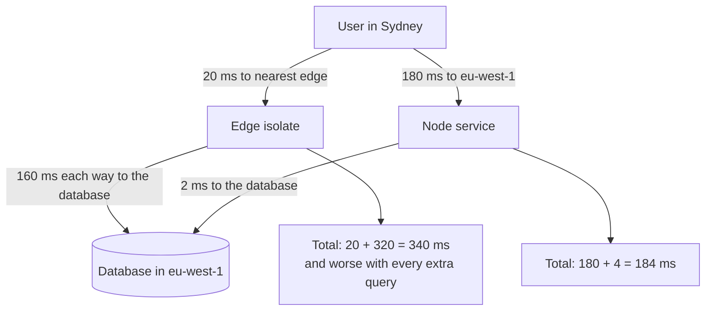

# Express, Hono ও Edge Runtime {#ch-express}

> দীর্ঘ সময় চলা একটি Node server আর edge-এ চলা একটি Web-standard handler-এর মধ্যে বাছাই করুন, আর প্রতিটির দাম কী, তা ব্যাখ্যা করুন।

**এই অধ্যায়ে:** একটি ক্রমানুসারী pipeline হিসেবে Express · Express 5 কী বদলেছে · `Request` আর `Response`-এর ওপর Hono · একটি edge runtime কী কেড়ে নেয় · latency আসলে কোথায় যায়

## 💡 মূল ধারণা

আজ একটি JavaScript server সাজানোর দুটো উপায় আছে। **Express** দীর্ঘ সময় চলা একটি Node process। এটা একটি
function-এর list ক্রম অনুযায়ী চালায়, একটি mutable `req` আর `res`-এর ওপর। **Hono** হলো একটি function, যেটা একটি
Web `Request` নিয়ে একটি Web `Response` দেয়। Browser-এর `fetch` ঠিক এই object-গুলোই ব্যবহার করে। তাই Hono Node-এ
চলে, আবার Cloudflare Workers-এর মতো edge runtime-এও চলে।

সিদ্ধান্তে framework ছোট অংশ। বড় অংশ হলো **code কোথায় চলে**। একটি edge runtime আপনার code-কে user-এর কাছে নিয়ে
যায়, আর সেই কারণেই database থেকে দূরে। যে handler তিনটি database call করে, সেটা user-এর কাছে সরালে ধীর হয়ে যায়।
এখানে সিদ্ধান্ত নেয় data round trip-এর সংখ্যা, framework নয়।

## কীভাবে কাজ করে

### Express একটি list, আর ক্রমই হলো configuration

`app.use` একটি function-কে list-এ ঢোকায়। একটি request list-এর ওপর থেকে হাঁটতে থাকে, যতক্ষণ না কেউ response দেয়
বা list শেষ হয়ে যায়। কোনো container নেই, কোনো lifecycle নেই। তাই Express কিছুই লুকায় না।

**Register করার ক্রমে একটি pipeline:**

```typescript
import express, { type Request, type Response, type NextFunction } from "express";

const app = express();

app.use(express.json({ limit: "100kb" })); // 1. parse the body before any route needs it
app.use(requestId); // 2. attach an id used by every log line below
app.use("/api", authenticate); // 3. path-scoped: /api only
app.use("/api/orders", ordersRouter); // 4. a Router is a mountable pipeline
app.use(notFound); // 5. nothing matched
app.use(errorHandler); // 6. four arguments: the error pipeline
```

Express-এর বেশিরভাগ bug আসলে ক্রমের bug। Body parser route-গুলোর পরে রাখলে `req.body` হয় `undefined`। Auth একটি
route-এর পরে রাখলে route-টি আগেই চলে গেছে।

`Router` হলো Express-এর একমাত্র composition tool। Prefix দিয়ে এটা mount করুন, আর prefix-টি এর ভেতরে রাখবেন না।

### Handler আর error-এর type

`Request` params, response body, request body আর query-এর ওপর generic। এদের নাম একবারই দিন।

**একটি typed handler, যেটা error format না করে throw করে:**

```typescript
interface OrderParams {
  id: string;
}

async function getOrder(req: Request<OrderParams, Order>, res: Response<Order>): Promise<void> {
  const order = await orders.find(req.params.id); // string, not any
  if (!order) throw new NotFoundError("order", req.params.id);
  res.json(order);
}

// Exactly four parameters, or Express treats it as ordinary middleware.
function errorHandler(err: unknown, req: Request, res: Response, next: NextFunction): void {
  const status = err instanceof HttpError ? err.status : 500;
  req.log.error({ err, requestId: req.id }, "request failed");
  res.status(status).json({
    error: status === 500 ? "Internal Server Error" : (err as HttpError).message,
  });
}
```

Handler ঠিক করে *কী* ভুল হয়েছে। একমাত্র error handler-টি ঠিক করে status code আর body।

> ⚠️ **যা বদলাতে থাকে:** দশ বছর 4.x-এর পর Express 5 এসেছে 2024-এ, আর বেশিরভাগ tutorial এখনো 4.x-এর। টেকসই
> নীতি হলো, Express একটি middleware list। নিচের দুটো পরিবর্তনই upgrade-এর সময় আসল code ভাঙে।

| Express 5-এ পরিবর্তন | ফলাফল |
| ------------------- | ----------- |
| Handler থেকে reject হওয়া promise `next()`-এ পাঠানো হয় | `asyncHandler` wrapper আর `.catch(next)` আর লাগে না |
| Wildcard-এর নাম দিতে হয়: `'*'`-এর জায়গায় `'/*splat'` | `app.all('*')` boot-এর সময় throw করে, তাই catch-all route আবার লিখতে হয় |

প্রথমটিই সবচেয়ে গুরুত্বপূর্ণ। Express 4-এ একটি `async` handler throw করলে request ঝুলে থাকত। Express কোনো
validation বা observability-ও দেয় না, তাই প্রতিটি project নিজেরটা যোগ করে।

### Hono: `Request` আর `Response`-এর ওপর একই route

Hono হলো Web-standard object-এর ওপর একটি router। একই source Workers, Deno, Bun আর Node-এ চলে।

**Typed binding-সহ একটি Hono service:**

```typescript
import { Hono } from "hono";

// Bindings are typed, so a handler cannot reach for config that does not exist.
type Env = {
  Bindings: {
    DATABASE_URL: string;
  };
};

const app = new Hono<Env>();

app.get("/api/orders/:id", async (c) => {
  // c.env, not process.env: in an isolate, config arrives per request.
  const order = await fetchOrder(c.env.DATABASE_URL, c.req.param("id"));
  return c.json(order);
});

export default app;
```

`c` হলো context: request, response helper, binding আর প্রতি-request state। কোনো mutable `req` আর `res` জোড়া নেই।
Handler তার response *return* করে, তাই দুটো middleware একটি field নিয়ে লড়াই করতে পারে না।

**Route-গুলো chain করুন, তাহলে `hc` server-এর type থেকে একটি typed client বানিয়ে দেয়:**

```typescript
// server.ts: each .get() returns a new type that carries the route
const routes = app.get("/orders/:id", (c) => c.json({ id: c.req.param("id"), total: 0 }));
export type AppType = typeof routes;

// client.ts, in the frontend: full types and no code generation
import { hc } from "hono/client";
const client = hc<AppType>("/api");
const res = await client.orders[":id"].$get({ param: { id: "42" } });
const order = await res.json(); // typed from the handler's return
```

এটা [Chapter ?? — GraphQL, tRPC ও Typed API বাছাই](#ch-graphql)-এর একই নিশ্চয়তা, কিন্তু সাধারণ HTTP-র ওপর।
Endpoint-গুলো `curl` দিয়ে, আর TypeScript নয় এমন client দিয়েও call করা যায়।

### একটি edge runtime কী কেড়ে নেয়

একটি edge runtime code চালায় একটি **isolate**-এ: আগে থেকেই চলা একটি runtime-এর ভেতরে একটি নতুন JavaScript
context। শুরু হতে প্রায় এক millisecond লাগে। দামটা হলো sandbox।

| Node-এ | Edge-এ | কেন গুরুত্বপূর্ণ |
| ------- | ----------- | -------------- |
| `fs`, `path`, `require` | পাওয়া যায় না | Asset bundle করুন, disk থেকে কিছুই পড়বেন না |
| TCP-র ওপর `pg`, `mysql2` | HTTP-ভিত্তিক একটি database client | Raw socket নেই: port করার সবচেয়ে বড় বাধা |
| Import-এর সময় `process.env` | Handler-এ পাঠানো binding | Module scope-এর config `undefined` পড়ে |
| লম্বা CPU-র কাজ, বড় cache | CPU time আর memory-তে কড়া সীমা | Isolate যেকোনো মুহূর্তে recycle হয় |

> ⚠️ **যা বদলাতে থাকে:** Cloudflare একটি Node compatibility mode যোগ করেছে। Vercel-এর edge আর Node function
> কাছাকাছি চলে এসেছে। Deno আর Bun প্রত্যেকে Node-এর একটি বাড়তে থাকা অংশ support করে। টেকসই নীতি হলো **Web
> `Request`/`Response` ঢোকে, কোনো filesystem নেই, কোনো raw TCP নেই, config আসে argument হিসেবে।** Port-এর পরিকল্পনা
> করার আগে বর্তমান compatibility list দেখে নিন।

### Latency আসলে কোথায় যায়

**Database থেকে পড়ে এমন একটি request, দুই জায়গায় বসানো:**



**একই handler, দুই জায়গায়: user-এর কাছে বনাম data-র কাছে।**

## কখন ব্যবহার করবেন

| পরিস্থিতি | বাছাই | কেন |
| --------- | ------ | --- |
| একটি React app-এর পাশে backend-for-frontend, একটি regional database-সহ | Node-এ Express | ছোট surface, TCP driver, আর পুরো team এটা পড়তে পারে |
| Auth, redirect, A/B assignment, একটি model response stream করা | Edge-এ Hono | শূন্য বা একটি data round trip, তাই লাভটা user latency-তে |
| একটি regional database-এর ওপর পরপর কয়েকটি query | Database-এর region-এ Node | Edge-এ প্রতিটি hop edge থেকে origin-এর latency দেয় |
| একটি codebase, যেটা Node আর Workers-এর মধ্যে সরতে পারে | Node-এ Hono | Web-standard handler পরে সরানোটা সস্তা রাখে |
| কয়েকটি endpoint দরকার এমন একটি Next.js app | কোনোটাই নয় | Route handler-ই server — [Chapter ?? — Route Handler ও BFF](#ch-route-handlers-and-the-bff) |

## সাধারণ ভুল

❌ **Route-গুলোর পরে body parser register করা।** `req.body` হয় `undefined`, আর handler-এর কিছুই কারণটা দেখায়
না।
✅ আগে parser, তারপর route, শেষে 404 আর error handler।

❌ **তিনটি parameter-সহ একটি error handler।** Express এটাকে সাধারণ middleware ধরে, আর client পায় Express-এর
default HTML stack trace।
✅ চারটি parameter-ই declare করুন, `next` ব্যবহার না হলেও।

❌ **Edge-এ module scope-এ configuration পড়া।** File-এর ওপরে `const url = process.env.DATABASE_URL` একটি
isolate-এ `undefined` পড়ে।
✅ Binding handler context দিয়ে পাঠান, আর সেগুলোর type দিন।

## 🔑 মূল শিক্ষা

- Express হলো একটি mutable request-এর ওপর function-এর একটি ক্রমানুসারী list, তাই register করার ক্রমই configuration।
- Express 5 reject হওয়া promise `next()`-এ পাঠায়, আর error middleware চেনা যায় ঠিক চারটি parameter থাকা দিয়ে।
- Hono Web `Request` আর `Response`-কে লক্ষ্য করে, তাই একই source Node, Deno, Bun আর Workers-এ চলে, আর `hc` এটা থেকে একটি typed client বানায়।
- একটি edge isolate-এ কোনো filesystem নেই, raw TCP নেই, module scope-এর config নেই। বদলে পাওয়া যায় প্রায় শূন্য startup।
- Code edge-এ সরালে user-এর hop ছোট হয় আর data-র hop লম্বা হয়। তাই কিছু সরানোর আগে data round trip গুনে নিন।

## Interview-এর প্রশ্ন

**Q: একটি async Express handler throw করে আর client ঝুলে থাকে। কী হয়েছে?**

এটা Express 4-এর আচরণ। Router handler-টি call করেছে, একটি promise ফেরত পেয়েছে আর সেটা উপেক্ষা করেছে। তাই
rejection-এর যাওয়ার কোনো জায়গা ছিল না। সমাধান হলো `.catch(next)`, এটা করে দেয় এমন একটি wrapper, অথবা Express 5,
যেটা নিজেই rejection পাঠিয়ে দেয়। Version-এর নাম বললে বোঝা যায়, আপনি production-এ এটার মুখোমুখি হয়েছেন।

**Q: একটি Cloudflare Worker-এ কেন `pg` ব্যবহার করা যায় না?**

`pg` একটি raw TCP socket-এর ওপর PostgreSQL protocol-এ কথা বলে, আর একটি isolate-এর কাছে আছে `fetch`, socket নয়।
উপায় তিনটি: HTTP-ভিত্তিক একটি driver, HTTP-তে কথা বলা একটি pooling proxy, অথবা data layer Node-এ রেখে দেওয়া।
তিনটিই একটি hop যোগ করে, আর সেই খরচটার নাম বলাই আসল কথা।

**Q: আপনি একটি API route edge-এ সরালেন আর সেটা ধীর হয়ে গেল। কেন?**

প্রায় সবসময় কারণ হলো, handler-টি একটি regional database-এর সাথে কথা বলে। User-এর hop ছোট হয়েছে, আর প্রতিটি data
hop অনেক লম্বা হয়েছে। তাই একাধিক query আছে এমন যেকোনো endpoint হারে। ভাগ করে ফেলুন: request সাজানো edge-এ, আর
data-নির্ভর handler database-এর region-এ।

**Q: একটি নতুন backend-for-frontend: Express, নাকি edge-এ Hono?**

এটা data নিয়ে বিচারের প্রশ্ন, framework নিয়ে নয়। এটা যদি একটি regional database-এর ওপর কয়েকটি query চালায়, তাহলে
সেই region-এ একটি Node server জেতে, আর Express-ই সঠিক মাপের। এটা যদি মূলত token যাচাই, redirect বা stream করে,
তাহলে edge জেতে। Node-এ Hono একটি ভালো মাঝামাঝি পথ, কারণ এর handler পরে rewrite ছাড়াই সরানো যায়।

## এরপর কী পড়বেন

- [Chapter ?? — Node.js Event Loop, Async ও Error](#ch-event-loop-async) — এই অধ্যায় যে error handler register করে, তার ভেতরে কী থাকা উচিত
- [Chapter ?? — Middleware, Runtime ও Deployment](#ch-nextjs-middleware-and-the-edge) — একটি Next.js app-এর ভেতরে একই edge runtime
- [Chapter ?? — Serverless Function](#ch-serverless-functions) — একটি isolate একটি regional function-এর তুলনায় কেমন
