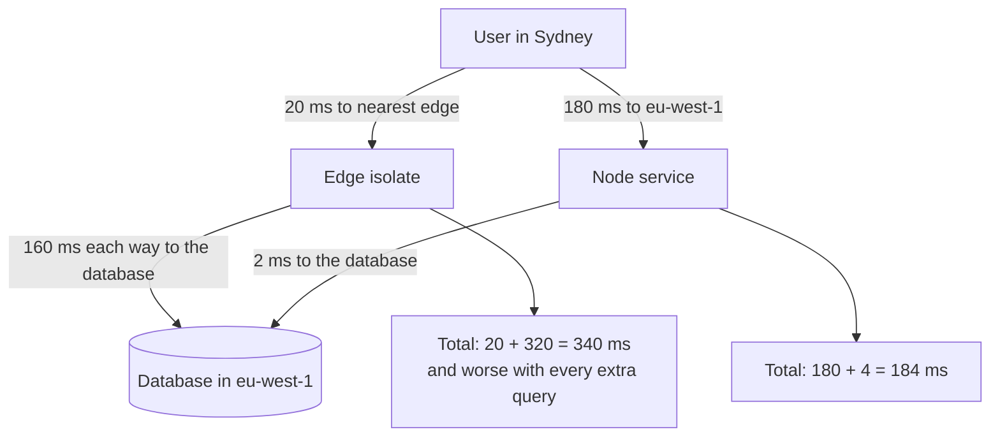

# Express, Hono ও Edge Runtime {#ch-express}

> দীর্ঘক্ষণ চলা Node server আর edge-এ চলা Web-standard handler-এর মধ্যে বেছে নিন, আর ব্যাখ্যা করুন প্রতিটির জন্য কী দাম দিতে হয়।

**এই অধ্যায়ে:** ক্রম-মানা pipeline হিসেবে Express · Express 5-এ কী বদলেছে · `Request` আর `Response`-এর ওপর Hono · edge runtime কী কেড়ে নেয় · latency আসলে কোথায় যায়

## 💡 মূল ধারণা

আজকের দিনে JavaScript server গড়ার দুটি উপায়। **Express** হলো দীর্ঘক্ষণ চলা একটি Node process। একটি mutable `req` আর
`res`-এর ওপর এটি একটার পর একটা function চালায়, তালিকার ক্রমে। **Hono** হলো এমন একটি function, যা Web `Request` নিয়ে
Web `Response` ফেরত দেয়। Browser-এর `fetch` ঠিক এই object-গুলোই ব্যবহার করে, তাই Hono Node-এ চলে, আবার Cloudflare
Workers-এর মতো edge runtime-এও চলে।

সিদ্ধান্তের ছোট অংশটা হলো framework। বড় অংশটা হলো **code কোথায় চলবে**। Edge runtime আপনার code-কে user-এর কাছে নিয়ে
যায়, আর সেই কারণেই database থেকে দূরে। যে handler database-এ তিনবার call করে, user-এর কাছে সরালে সেটা আরও ধীর হয়ে
যায়। সিদ্ধান্ত ঠিক করে data round trip-এর সংখ্যা, framework নয়।

## কীভাবে কাজ করে

### Express একটি তালিকা, আর ক্রমই হলো configuration

`app.use` তালিকায় একটি function যোগ করে। Request তালিকার ওপর থেকে নামতে থাকে, যতক্ষণ না কেউ উত্তর দেয় বা তালিকা ফুরিয়ে
যায়। কোনো container নেই, কোনো lifecycle নেই, তাই Express কিছুই লুকায় না।

**Register করার ক্রমে সাজানো pipeline:**

```typescript
import express, { type Request, type Response, type NextFunction } from "express";

const app = express();

app.use(express.json({ limit: "100kb" })); // 1. parse the body before any route needs it
app.use(requestId); // 2. attach an id used by every log line below
app.use("/api", authenticate); // 3. path-scoped: /api only
app.use("/api/orders", ordersRouter); // 4. a Router is a mountable pipeline
app.use(notFound); // 5. nothing matched
app.use(errorHandler); // 6. four arguments: the error pipeline
```

Express-এর বেশিরভাগ bug আসলে ক্রমের bug। Body parser route-এর পরে রাখলে `req.body` হয় `undefined`। Auth route-এর পরে
রাখলে route ততক্ষণে চলেই গেছে।

Express-এ জোড়া লাগানোর একমাত্র tool হলো `Router`। Prefix দিয়ে mount করুন, আর router-এর ভেতরে prefix লিখবেন না।

### Handler আর error-এর type

`Request` generic: params, response body, request body আর query, চারটির ওপর। নামগুলো একবার দিয়ে দিন।

**Typed handler, যা নিজে error format না করে throw করে:**

```typescript
interface OrderParams {
  id: string;
}

async function getOrder(req: Request<OrderParams, Order>, res: Response<Order>): Promise<void> {
  const order = await orders.find(req.params.id); // string, not any
  if (!order) throw new NotFoundError("order", req.params.id);
  res.json(order);
}

// Exactly four parameters, or Express treats it as ordinary middleware.
function errorHandler(err: unknown, req: Request, res: Response, next: NextFunction): void {
  const status = err instanceof HttpError ? err.status : 500;
  req.log.error({ err, requestId: req.id }, "request failed");
  res.status(status).json({
    error: status === 500 ? "Internal Server Error" : (err as HttpError).message,
  });
}
```

*কী* ভুল হয়েছে, তা ঠিক করে handler। Status code আর body ঠিক করে একমাত্র error handler।

> ⚠️ **যা বদলাতে থাকে:** দশ বছর 4.x চলার পরে Express 5 এসেছে 2024-এ, অথচ বেশিরভাগ tutorial এখনো 4.x-এর। টেকসই নীতি
> হলো, Express একটি middleware-এর তালিকা। নিচের দুটি বদলই upgrade করার সময় আসল code ভাঙে।

| Express 5-এ বদল | ফল |
| ------------------- | ----------- |
| Handler-এর rejected promise `next()`-এ পাঠানো হয় | `asyncHandler` wrapper আর `.catch(next)` আর লাগে না |
| Wildcard-এর নাম দিতে হয়: `'*'`-এর জায়গায় `'/*splat'` | `app.all('*')` চালু হওয়ার সময়েই throw করে, তাই catch-all route আবার লিখতে হয় |

প্রথমটাই সবচেয়ে জরুরি। Express 4-এ `async` handler throw করলে request ঝুলে থাকত। Express validation বা observability-ও
দেয় না, তাই প্রতিটি project নিজের মতো যোগ করে।

### Hono: `Request` আর `Response`-এর ওপর একই route

Hono হলো Web-standard object-এর ওপর একটি router। একই source চলে Workers, Deno, Bun আর Node-এ।

**Typed binding-সহ একটি Hono service:**

```typescript
import { Hono } from "hono";

// Bindings are typed, so a handler cannot reach for config that does not exist.
type Env = {
  Bindings: {
    DATABASE_URL: string;
  };
};

const app = new Hono<Env>();

app.get("/api/orders/:id", async (c) => {
  // c.env, not process.env: in an isolate, config arrives per request.
  const order = await fetchOrder(c.env.DATABASE_URL, c.req.param("id"));
  return c.json(order);
});

export default app;
```

`c` হলো context: request, response-এর helper, binding আর request-প্রতি state। কোনো mutable `req` আর `res` জোড়া নেই।
Handler নিজের response *return* করে, তাই দুটি middleware একই field নিয়ে টানাটানি করতে পারে না।

**Route-গুলো chain করুন, আর `hc` server-এর type থেকে একটি typed client বানিয়ে দেয়:**

```typescript
// server.ts: each .get() returns a new type that carries the route
const routes = app.get("/orders/:id", (c) => c.json({ id: c.req.param("id"), total: 0 }));
export type AppType = typeof routes;

// client.ts, in the frontend: full types and no code generation
import { hc } from "hono/client";
const client = hc<AppType>("/api");
const res = await client.orders[":id"].$get({ param: { id: "42" } });
const order = await res.json(); // typed from the handler's return
```

এটা [Chapter ?? — GraphQL, tRPC ও Typed API বাছাই](#ch-graphql)-এর মতো একই নিশ্চয়তা, তবে সাধারণ HTTP-র ওপর। Endpoint-গুলো
`curl` দিয়েও call করা যায়, আর TypeScript নয় এমন client দিয়েও।

### Edge runtime কী কেড়ে নেয়

Edge runtime code চালায় একটি **isolate**-এ: আগে থেকে চলতে থাকা runtime-এর ভেতরে একটি নতুন JavaScript context। চালু হতে
লাগে মোটামুটি এক millisecond। দামটা দিতে হয় sandbox-এ।

| Node-এ | Edge-এ | কেন জরুরি |
| ------- | ----------- | -------------- |
| `fs`, `path`, `require` | পাওয়া যায় না | Asset bundle করুন, disk থেকে কিছুই পড়বেন না |
| TCP-র ওপর `pg`, `mysql2` | HTTP-ভিত্তিক database client | Raw socket নেই: port করার পথে সবচেয়ে বড় বাধা |
| Import-এর সময় `process.env` | Handler-এ পাঠানো binding | Module scope-এ পড়া config হয় `undefined` |
| লম্বা CPU-র কাজ, বড় cache | CPU time আর memory-তে কড়া সীমা | Isolate যেকোনো মুহূর্তে recycle হতে পারে |

> ⚠️ **যা বদলাতে থাকে:** Cloudflare একটি Node compatibility mode যোগ করেছে। Vercel-এর edge আর Node function প্রায়
> এক হয়ে এসেছে। Deno আর Bun দুটিই Node-এর ক্রমশ বড় একটি অংশ support করে। টেকসই নীতি হলো **ভেতরে আসে Web
> `Request`/`Response`, filesystem নেই, raw TCP নেই, config আসে argument হিসেবে।** Port করার পরিকল্পনার আগে বর্তমান
> compatibility তালিকা দেখে নিন।

### Latency আসলে কোথায় যায়

**Database থেকে পড়া একটি request, দুই জায়গায় বসিয়ে:**



**একই handler, দুই জায়গায়: user-এর কাছে বনাম data-র কাছে।**

## কখন ব্যবহার করবেন

| পরিস্থিতি | বেছে নিন | কেন |
| --------- | ------ | --- |
| React app-এর পাশে একটি backend-for-frontend, database একটি region-এ | Node-এ Express | Surface ছোট, TCP driver চলে, আর পুরো team পড়তে পারে |
| Auth, redirect, A/B assignment, model-এর response stream করা | Edge-এ Hono | Data round trip শূন্য বা একটি, তাই লাভটা user-এর latency-তে |
| একটি regional database-এ পরপর কয়েকটি query | Database-এর region-এ Node | Edge-এ প্রতিটি hop-এ edge থেকে origin-এর latency দিতে হয় |
| এমন একটি codebase, যা Node আর Workers-এর মধ্যে সরতে পারে | Node-এ Hono | Web-standard handler থাকলে পরে সরানো সস্তা হয় |
| এমন Next.js app, যার কয়েকটি endpoint দরকার | কোনোটিই নয় | Route handler নিজেই server — [Chapter ?? — Route Handler ও BFF](#ch-route-handlers-and-the-bff) |

## সাধারণ ভুল

❌ **Route-এর পরে body parser register করা।** `req.body` হয় `undefined`, আর handler দেখে কারণটা বোঝার উপায় থাকে না।
✅ আগে parser, তারপর route, সবশেষে 404 আর error handler।

❌ **তিন parameter-এর error handler।** Express এটাকে সাধারণ middleware ধরে নেয়, আর client পায় Express-এর default HTML
stack trace।
✅ চারটি parameter-ই declare করুন, `next` ব্যবহার না করলেও।

❌ **Edge-এ module scope-এ configuration পড়া।** File-এর ওপরে `const url = process.env.DATABASE_URL` লিখলে isolate-এ
পড়া হয় `undefined`।
✅ Binding পাঠান handler-এর context দিয়ে, আর সেগুলোর type দিন।

## 🔑 মূল শিক্ষা

- Express হলো একটি mutable request-এর ওপর ক্রমে সাজানো function-এর তালিকা, তাই register করার ক্রমই configuration।
- Express 5 rejected promise `next()`-এ পাঠায়, আর error middleware চেনা যায় ঠিক চারটি parameter দেখে।
- Hono-র লক্ষ্য Web `Request` আর `Response`, তাই একই source চলে Node, Deno, Bun আর Workers-এ, আর `hc` তা থেকে typed client বানায়।
- Edge isolate-এ filesystem নেই, raw TCP নেই, module scope-এ config নেই। বদলে চালু হতে প্রায় কোনো সময়ই লাগে না।
- Code edge-এ সরালে user-এর hop ছোট হয়, data-র hop লম্বা হয়। তাই কিছু সরানোর আগে data round trip গুনে নিন।

## Interview-এর প্রশ্ন

**Q: একটি async Express handler throw করল, আর client ঝুলে রইল। কী হয়েছে?**

এটা Express 4-এর আচরণ। Router handler call করেছে, ফেরত পেয়েছে একটি promise, আর সেটা উপেক্ষা করেছে। ফলে rejection-এর
যাওয়ার কোনো জায়গা ছিল না। সমাধান `.catch(next)`, অথবা এমন একটি wrapper যা সেটাই করে, অথবা Express 5, যা নিজেই rejection
পাঠিয়ে দেয়। Version-এর নাম বললে বোঝা যায়, production-এ আপনি এতে ধাক্কা খেয়েছেন।

**Q: Cloudflare Worker-এ `pg` ব্যবহার করা যায় না কেন?**

`pg` raw TCP socket-এর ওপর PostgreSQL protocol-এ কথা বলে, আর isolate-এ আছে `fetch`, socket নেই। উপায় তিনটি:
HTTP-ভিত্তিক driver, HTTP-তে কথা বলা একটি pooling proxy, অথবা data layer-কে Node-এই রেখে দেওয়া। তিনটিতেই একটি বাড়তি hop
যোগ হয়, আর সেই খরচের কথাটাই বলতে হবে।

**Q: একটি API route edge-এ সরালেন, আর সেটা ধীর হয়ে গেল। কেন?**

প্রায় সবসময় কারণ হলো handler একটি regional database-এর সঙ্গে কথা বলে। User-এর hop ছোট হয়েছে, কিন্তু প্রতিটি data hop
অনেক লম্বা হয়ে গেছে, তাই একাধিক query-ওয়ালা যেকোনো endpoint হারে। ভাগ করে ফেলুন: request সাজানোর কাজ edge-এ, data-ভারী
handler database-এর region-এ।

**Q: নতুন একটি backend-for-frontend: Express, নাকি edge-এ Hono?**

এটা data দেখে বিচারের প্রশ্ন, framework দেখে নয়। যদি একটি regional database-এ কয়েকটি query চালায়, তাহলে সেই region-এ
Node server জেতে, আর Express-ই সঠিক মাপের। যদি বেশিরভাগ সময় token যাচাই, redirect বা stream করে, তাহলে edge জেতে।
Node-এ Hono একটি ভালো মাঝামাঝি পথ, কারণ এর handler পরে আবার না লিখেই সরানো যায়।

## এরপর কী পড়বেন

- [Chapter ?? — Node.js Event Loop, Async ও Error](#ch-event-loop-async) — এই অধ্যায়ে register করা error handler-এ কী থাকা উচিত
- [Chapter ?? — Middleware, Runtime ও Deployment](#ch-nextjs-middleware-and-the-edge) — Next.js app-এর ভেতরে একই edge runtime
- [Chapter ?? — Serverless Function](#ch-serverless-functions) — regional function-এর সঙ্গে isolate-এর তুলনা
