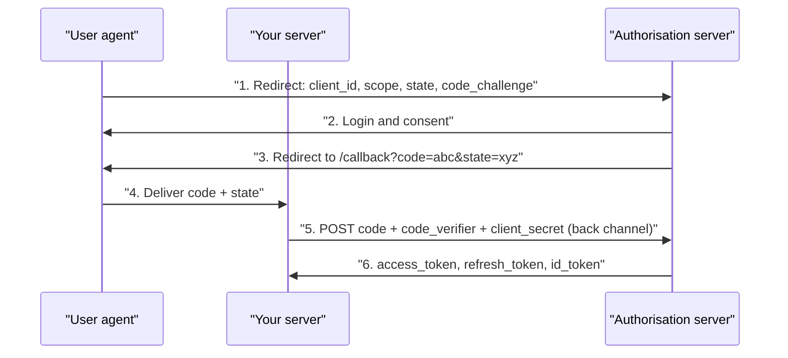

# OAuth, OIDC ও Authorisation {#ch-oauth}

> PKCE-সহ authorisation code flow ধাপে ধাপে বুঝিয়ে বলুন, তারপর ঠিক করুন sign in করা user কী করতে পারবেন — server-এ, আর object ধরে।

**এই অধ্যায়ে:** PKCE-সহ authorisation code · OAuth বনাম OIDC বনাম JWT · RBAC, ABAC আর ACL · route নয়, object যাচাই · scope কেন permission নয়

## 💡 মূল ধারণা

প্রতিটি request-কে রক্ষা করে দুটি প্রশ্ন। **Authentication** জানতে চায় *আপনি কে?* **Authorisation** জানতে চায় *আপনি কি
এই জিনিসটার ওপর এই কাজটা করতে পারেন?* দুটি আলাদা ভাবে, আলাদা জায়গায় ব্যর্থ হয়।

**OAuth** দিয়ে একজন user password না দিয়েই কোনো application-কে তার data-য় সীমিত access দিতে পারেন। এটা উত্তর দেয়
"এই application কী করতে পারে?" **OpenID Connect (OIDC)** তার ওপরে একটি `id_token` যোগ করে, আর উত্তর দেয় "এই user কে?"
Login-এর জন্য শুধু OAuth ব্যবহার করা একটি চেনা ভুল: access token প্রমাণ করে অনুমতি আছে, কিন্তু অনুমতিটা কে দিয়েছে তা নয়।

Authentication **request**-এর বিষয়, তাই একটি middleware-ই সেটা সেট করে দিতে পারে। Authorisation **request আর object
দুটির একসঙ্গে** বিষয়, তাই শুধু route guard দিয়ে সেটা ঠিক করা যায় না। প্রতিটি check থাকে server-এ। Button লুকানো user
experience, security নয়।

> ⚠️ **যা বদলাতে থাকে:** OAuth 2.1 PKCE বাধ্যতামূলক করে, আর implicit ও password grant তুলে দেয়। টেকসই নীতি: credential
> যায় back-channel দিয়ে (server থেকে server), আর code বাঁধা থাকে সেই client-এর সঙ্গে, যে সেটা চেয়েছিল। Grant-এর নাম আর
> endpoint বদলাতেই থাকবে।

## PKCE-সহ Authorisation Code



**Authorisation code flow। Browser পেরোয় শুধু code। Token কখনো পেরোয় না।**

বাড়তি round trip-টাই আসল কথা। ধাপ 3-এর code যায় URL-এ, তাই সেটা history আর log-এ জমা হয়। শুধু code দিয়ে কিছুই হয় না:
সেটা ভাঙাতে client secret বা PKCE verifier লাগে।

**PKCE** (Proof Key for Code Exchange) code-কে বেঁধে দেয় তার সঙ্গে, যে flow শুরু করেছে। Client আগে পাঠায় `SHA256(verifier)`,
পরে আসল `verifier`। তাই যে চোরের হাতে শুধু code আছে, সে ব্যর্থ হয়।

**Flow শুরু করা আর callback সামলানো:**

```typescript
import crypto from 'node:crypto';
import type { Request, RequestHandler, Response } from 'express';

export function startLogin(req: Request, res: Response): void {
  const verifier = crypto.randomBytes(32).toString('base64url');
  const challenge = crypto.createHash('sha256').update(verifier).digest('base64url');
  const state = crypto.randomBytes(16).toString('hex');
  req.session.pkceVerifier = verifier;
  req.session.oauthState = state;

  const params = new URLSearchParams({
    client_id: process.env.OAUTH_CLIENT_ID!,
    redirect_uri: 'https://app.example.com/auth/callback',
    response_type: 'code',
    scope: 'openid email profile', // Ask for the least you need.
    state,
    code_challenge: challenge,
    code_challenge_method: 'S256',
  });
  res.redirect(`https://accounts.google.com/o/oauth2/v2/auth?${params}`);
}

export async function handleCallback(req: Request, res: Response): Promise<void> {
  const { code, state } = req.query as { code?: string; state?: string };
  // 1. A mismatched state is login CSRF — reject it.
  if (!code || !state || state !== req.session.oauthState) {
    return void res.status(400).json({ error: 'Invalid OAuth state' });
  }
  // 2. Exchange the code back-channel, with the verifier and the client secret.
  const tokens = await exchangeCode(code, req.session.pkceVerifier!);
  // 3. Issue *your own* session. The browser never receives provider tokens.
  req.session.userId = await upsertUserFromIdToken(tokens.id_token!);
  res.redirect('/dashboard');
}
```

> ⚠️ Provider-এর access বা refresh token কখনো frontend-এ পাঠাবেন না। সেগুলো server-এ রাখুন, encrypt করে, আপনার নিজের
> session-এর key ধরে। Provider-এর refresh token password-এর মতোই স্পর্শকাতর।

## Grant, Token, আর যে Check-গুলো জরুরি

| Grant | কীসের জন্য | অবস্থা |
| ----- | --- | ------ |
| **Authorisation code + PKCE** | Web app, SPA, mobile | ✅ সব কিছুর default |
| **Client credentials** | Service থেকে service, কোনো user নেই | ✅ Machine auth-এর জন্য সঠিক |
| **Implicit** | পুরনো SPA-র একটি জোড়াতালি | ❌ 2.1-এ বাদ — token থাকে URL fragment-এ |
| **Resource owner password** | App নিজেই password নেয় | ❌ 2.1-এ বাদ — delegation নেই, provider-এর MFA নেই |

**OAuth** একটি authorisation framework, **OIDC** একটি identity layer, আর **JWT** শুধু token-এর একটি *format*। যে opaque
access token আপনি lookup করে দেখেন, সেটা প্রায়ই JWT-র চেয়ে ভালো, কারণ সেটা revoke করা যায়।

- ✅ **সবসময় `state` যাচাই করুন।** এটা না থাকলে attacker তার নিজের provider account victim-এর session-এর সঙ্গে জুড়ে দেয়।
- ✅ **Redirect URI মেলান হুবহু একটি allowlist-এর সঙ্গে।** `*.example.com`-এর মতো wildcard থাকলে যেকোনো subdomain takeover মানেই code চুরি।
- ✅ **`id_token` verify করুন।** Provider-এর JWKS দিয়ে signature যাচাই করুন, তারপর `iss`, `aud`, `exp` আর `nonce`।

## Authorisation: তিনটি Model

| Model | কীসের ভিত্তিতে ঠিক করে | কোথায় মানায় |
| ----- | ------------ | ---- |
| **RBAC** — role-based | User-এর role | বেশিরভাগ app; ছোট, স্থির permission-এর set |
| **ABAC** — attribute-based | User, resource আর context-এর attribute | "নিজের department", "শুধু অফিসের সময়ে" |
| **ACL** — access control list | প্রতিটি object-এর নিজস্ব অনুমতির তালিকা | User-দের মধ্যে sharing: document, folder, calendar |

**RBAC, ঠিকভাবে করা:** role থেকে permission-এ map হয়, আর code যাচাই করে permission — কখনো role নয়।

```typescript
type Permission = 'order:read' | 'order:write' | 'order:refund';

const ROLE_PERMISSIONS: Record<Role, readonly Permission[]> = {
  viewer: ['order:read'],
  agent: ['order:read', 'order:write'],
  manager: ['order:read', 'order:write', 'order:refund'],
};

export function requirePermission(permission: Permission): RequestHandler {
  return (req, res, next) => {
    const granted = ROLE_PERMISSIONS[req.user.role] ?? [];
    if (!granted.includes(permission)) {
      return void res.status(403).json({ error: { code: 'forbidden' } });
    }
    next();
  };
}
```

Handler-জুড়ে ছড়িয়ে থাকা `if (user.role === 'admin')` হলো anti-pattern: নতুন একটি role এলেই প্রতিটি শর্ত খুঁজে খুঁজে দেখতে
হয়। কোনো requirement-এ "নিজের" বা "শুধু যখন" কথাটা থাকলে ABAC-এর দিকে যান।

## Route নয়, Object যাচাই করুন

Valid token থাকলেও `GET /orders/9`-এ যাচাই করতে হবে যে order 9 সত্যিই caller-এর। এটা বাদ পড়লে হয় **broken object-level
authorisation**। এটা OWASP-এর তালিকায় API-র এক নম্বর ঝুঁকি, অথচ আসলে শুধু একটি `WHERE` clause বাদ পড়া।

**Check-টাকে query-রই অংশ করুন:**

```typescript
// ❌ Route guard only. Any authenticated user reads any order.
app.get('/orders/:id', requireAuth, async (req, res) => {
  res.json(await db.orders.findUnique({ where: { id: req.params.id } }));
});

// ✅ The tenant is part of the query, so a forgotten check returns nothing.
app.get('/orders/:id', requireAuth, requirePermission('order:read'), async (req, res) => {
  const order = await db.orders.findFirst({
    where: { id: req.params.id, tenantId: req.user.tenantId },
  });
  // 404, not 403 — a 403 confirms the order exists, which is itself a leak.
  if (!order) return void res.status(404).json({ error: { code: 'not_found' } });
  res.json(order);
});
```

Multi-tenant system-এ একটি `tenantId` বাদ পড়লেই এক customer-এর data আরেক customer-এর কাছে চলে যায়। প্রতিরক্ষাগুলো, সবচেয়ে
দুর্বলটা আগে:

| পদ্ধতি | নিশ্চয়তা | খরচ |
| -------- | --------- | ---- |
| রীতি মেনে প্রতিটি query-তে `tenantId` | কিছুই না — একবার বাদ পড়লেই breach | বিনা খরচে, আর যথেষ্ট নয় |
| একটি repository layer, যা `tenantId` যোগ করে দেয় | কোনো handler এটা ছাড়া query বানাতে পারে না | রক্ষণাবেক্ষণের জন্য একটি বাড়তি layer |
| Postgres-এ row-level security (RLS) | Database নিজেই অন্য tenant-এর data পড়তে দেয় না | প্রতিটি connection-এ একটি session variable; transaction pooling-এর সঙ্গে ঝামেলার |

## OAuth Scope মানে Permission নয়

Scope বলে একটি **application** user-এর হয়ে কী চাইতে পারে। Permission বলে **user** নিজে কী করতে পারেন। `orders:write`-ওয়ালা
token থাকা মানে এই নয় যে এই user এই order-এ লিখতে পারেন।

**দুটিই যাচাই করুন, এই ক্রমে:**

```typescript
if (!token.scope.includes('orders:write')) return res.status(403).json({ error: { code: 'insufficient_scope' } });
if (!(await canEdit(req.user, order))) return res.status(403).json({ error: { code: 'forbidden' } });
```

Scope-কে permission হিসেবে ব্যবহার করলে একটি integration যেকোনো order-এ লিখতে পারে, মালিক যে-ই হোক। কয়েক ডজনের বেশি নিয়ম
হয়ে গেলে, বা কয়েকটি service-কে একই নিয়মে একমত হতে হলে, নিয়মগুলো OPA বা Cedar-এর মতো একটি policy engine-এ সরিয়ে নিন।

## সাধারণ ভুল

- ❌ **Client-এর পাঠানো `tenantId` বা `userId` বিশ্বাস করা।** ✅ দুটিই নিন verify করা session বা token থেকে।
- ❌ **Client-এ সিদ্ধান্ত নেওয়া।** ✅ UX-এর জন্য button লুকান, তারপর প্রতিটি check server-এ আবার করুন।
- ❌ **Error হলে দরজা খুলে দেওয়া।** ✅ Policy lookup-এ error হলে অনুমতি দেবেন না। ঢিলেঢালা default নিজেই একটি vulnerability।

## 🔑 মূল শিক্ষা

- কোনো application কী করতে পারে, তার উত্তর দেয় OAuth। User কে, তার উত্তর দেয় OIDC-র `id_token`। আর সেই user কী ছুঁতে পারবেন, ঠিক করে আপনার নিজের authorisation।
- ব্যবহার করার মতো flow একটিই: PKCE-সহ authorisation code। `state` আর PKCE আলাদা কাজ করে, তাই দুটিই লাগে।
- Provider-এর token থাকে server-এ। Browser-এর হাতে থাকে শুধু আপনার নিজের session।
- Tenant আর owner query-তেই রাখুন, যাতে কোনো check ভুলে গেলে সব নয়, কিছুই ফেরত না আসে।
- OAuth scope application-কে সীমিত করে, user-কে নয়। তাই আগে scope যাচাই করুন, তারপর object-এর ওপর user-এর permission।

## Interview-এর প্রশ্ন

**Q: PKCE-সহ authorisation code flow ধাপে ধাপে বুঝিয়ে বলুন।**

App redirect করে তার client id, scope, random একটি `state` আর একটি PKCE challenge দিয়ে। User sign in করেন, আর server অল্প
মেয়াদের একটি code দিয়ে আবার redirect করে ফেরত পাঠায়। এরপর backend code, verifier আর client secret দিয়ে token নেয়, server
থেকে server-এ। Code browser পেরোয়। Token পেরোয় না।

**Q: `state` কীসের জন্য, আর সেটা কি PKCE-র মতোই?**

না। `state` হলো flow-এর CSRF প্রতিরক্ষা। এটা session-এ রাখা একটি random value, যা callback-এ মিলতেই হবে। ফলে attacker
victim-কে দিয়ে attacker-এর নিজের code-ওয়ালা flow শেষ করাতে পারে না। PKCE আটকায় যাতে চুরি করা code অন্য কেউ ভাঙাতে না
পারে। OAuth 2.1 confidential client-এর জন্যও PKCE বাধ্যতামূলক করে।

**Q: Broken object-level authorisation কী, আর কাঠামোগতভাবে কীভাবে আটকাবেন?**

Caller authenticated, আর তার role সাধারণভাবে কাজটার অনুমতি দেয়, কিন্তু কেউ যাচাই করে না যে এই object-টা তার। তখন URL-এ
একটি id বদলালেই অন্য কারও data পড়া যায়। সমাধান হলো ownership-কে query-রই অংশ করা, একটি repository layer বা row-level
security দিয়ে, যাতে check বাদ পড়লে কোনো row ফেরত না আসে।

**Q: যে resource user দেখতে পারবেন না, তার জন্য 403 নাকি 404?**

Caller-এর যদি জানাই উচিত না হয় যে resource-টা আছে, তাহলে 404। ক্রমিক id-তে 403 দিলে attacker আপনার data গুনে ফেলতে পারে।
403 তখন, যখন তিনি আগে থেকেই জানেন যে সেটা আছে, যেমন দলের একটি document, যা তিনি পড়তে পারেন কিন্তু edit করতে পারেন না।

**Q: কখন ABAC বা policy engine-এর দিকে যাবেন না?**

Permission ছোট আর স্থির হলে RBAC নিয়ে ভাবা আর audit করা সহজ। Policy engine-এর খরচ পোষায় তখন, যখন নিয়ম code-এর চেয়ে দ্রুত
বদলায়, বা কয়েকটি service-কে একমত হতে হয়। একটি দল আর এক ডজন নিয়মের জন্য এটা একটি বাড়তি network hop আর নতুন একটি
language যোগ করে, অথচ লাভ সামান্য।

## এরপর কী পড়বেন

- [Chapter ?? — Credential, Session, CORS ও CSRF](#ch-credentials-and-sessions) — callback-এর পরে আপনি যে session issue করেন, আর যে cookie সেটা ধরে রাখে তার সুরক্ষা
- [Chapter ?? — REST Best Practice ও Versioning](#ch-rest-best-practices) — status code-এর মানচিত্রে 403 আর 404-এর জায়গা
