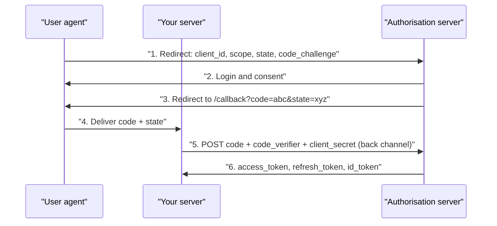

# OAuth, OIDC ও Authorisation {#ch-oauth}

> PKCE সহ authorisation code flow-টি ধাপে ধাপে দেখুন, তারপর ঠিক করুন signed-in user কী করতে পারবেন — server-এ, object-এর বিপরীতে।

**এই অধ্যায়ে:** PKCE সহ authorisation code · OAuth বনাম OIDC বনাম JWT · RBAC, ABAC আর ACL · route নয়, object check করা · scope কেন permission নয়

## 💡 মূল ধারণা

প্রতিটি request-কে দুটি প্রশ্ন রক্ষা করে। **Authentication** জিজ্ঞেস করে, *আপনি কে?* **Authorisation** জিজ্ঞেস করে,
*এই জিনিসটার ওপর আপনি কি এটা করতে পারেন?* এরা আলাদাভাবে ব্যর্থ হয়, আর আলাদা জায়গায়।

**OAuth** একজন user-কে password শেয়ার না করেই একটি application-কে তার data-তে সীমিত access দিতে দেয়। এটা উত্তর দেয়
"এই application কী করতে পারবে?" **OpenID Connect (OIDC)** তার ওপরে একটি `id_token` যোগ করে, আর উত্তর দেয় "এই user
কে?" Login-এর জন্য খালি OAuth একটি পরিচিত ভুল: একটি access token permission প্রমাণ করে, কে সেটা দিয়েছে তা নয়।

Authentication **request**-এর অংশ, তাই একটি middleware এটা set করতে পারে। Authorisation **request আর object
দুটির একসাথে** অংশ, তাই শুধু একটি route guard এটা ঠিক করতে পারে না। প্রতিটি check থাকে server-এ। একটি button
লুকানো হলো user experience, security নয়।

> ⚠️ **যা বদলাতে থাকে:** OAuth 2.1 PKCE-কে বাধ্যতামূলক করে, আর implicit ও password grant সরিয়ে দেয়। টেকসই নীতি:
> credential যায় back-channel দিয়ে (server থেকে server), আর code বাঁধা থাকে সেই client-এর সাথে, যে এটা চেয়েছিল।
> Grant-এর নাম আর endpoint বদলাতেই থাকবে।

## PKCE সহ Authorisation Code



**Authorisation code flow। Browser পার হয় শুধু code। Token কখনো হয় না।**

বাড়তি round trip-টিই আসল কথা। ধাপ 3-এর code একটি URL-এ যায়, তাই এটা history আর log-এ জমা হয়। একা এটা অকেজো:
এটা redeem করতে client secret বা PKCE verifier লাগে।

**PKCE** (Proof Key for Code Exchange) code-টিকে বাঁধে তার সাথে, যে flow শুরু করেছিল। Client আগে পাঠায়
`SHA256(verifier)`, আর পরে খালি `verifier`, তাই শুধু code হাতে থাকা একজন চোর ব্যর্থ হয়।

**Flow শুরু করা আর callback সামলানো:**

```typescript
import crypto from 'node:crypto';
import type { Request, RequestHandler, Response } from 'express';

export function startLogin(req: Request, res: Response): void {
  const verifier = crypto.randomBytes(32).toString('base64url');
  const challenge = crypto.createHash('sha256').update(verifier).digest('base64url');
  const state = crypto.randomBytes(16).toString('hex');
  req.session.pkceVerifier = verifier;
  req.session.oauthState = state;

  const params = new URLSearchParams({
    client_id: process.env.OAUTH_CLIENT_ID!,
    redirect_uri: 'https://app.example.com/auth/callback',
    response_type: 'code',
    scope: 'openid email profile', // Ask for the least you need.
    state,
    code_challenge: challenge,
    code_challenge_method: 'S256',
  });
  res.redirect(`https://accounts.google.com/o/oauth2/v2/auth?${params}`);
}

export async function handleCallback(req: Request, res: Response): Promise<void> {
  const { code, state } = req.query as { code?: string; state?: string };
  // 1. A mismatched state is login CSRF — reject it.
  if (!code || !state || state !== req.session.oauthState) {
    return void res.status(400).json({ error: 'Invalid OAuth state' });
  }
  // 2. Exchange the code back-channel, with the verifier and the client secret.
  const tokens = await exchangeCode(code, req.session.pkceVerifier!);
  // 3. Issue *your own* session. The browser never receives provider tokens.
  req.session.userId = await upsertUserFromIdToken(tokens.id_token!);
  res.redirect('/dashboard');
}
```

> ⚠️ Provider-এর access বা refresh token কখনো frontend-এ পাঠাবেন না। এগুলো server-side রাখুন, encrypted, আপনার
> নিজের session-এর key দিয়ে। একটি provider refresh token একটি password-এর মতোই সংবেদনশীল।

## Grant, Token আর যে Check-গুলো জরুরি

| Grant | কীসের জন্য | অবস্থা |
| ----- | --- | ------ |
| **Authorisation code + PKCE** | Web app, SPA, mobile | ✅ সবকিছুর জন্য default |
| **Client credentials** | Service থেকে service, কোনো user নেই | ✅ Machine auth-এর জন্য সঠিক |
| **Implicit** | একটি পুরনো SPA workaround | ❌ 2.1-এ সরানো হয়েছে — URL fragment-এ token |
| **Resource owner password** | App নিজেই password নেয় | ❌ 2.1-এ সরানো হয়েছে — কোনো delegation নেই, provider-এর MFA নেই |

**OAuth** একটি authorisation framework, **OIDC** একটি identity layer, আর একটি **JWT** শুধু একটি token-এর
*format*। যে opaque access token আপনি lookup করেন, সেটা প্রায়ই JWT-র চেয়ে ভালো, কারণ সেটা revoke করা যায়।

- ✅ **সবসময় `state` validate করুন।** এটা না থাকলে একজন attacker তার provider account-কে victim-এর session-এর সাথে জুড়ে দেয়।
- ✅ **Redirect URI একটি নির্দিষ্ট allowlist-এর সাথে মেলান।** `*.example.com`-এর মতো একটি wildcard যেকোনো subdomain takeover-কে চুরি হওয়া code-এ পরিণত করে।
- ✅ **`id_token` verify করুন।** Provider-এর JWKS দিয়ে signature check করুন, তারপর `iss`, `aud`, `exp` আর `nonce`।

## Authorisation: তিনটি Model

| Model | কী দেখে ঠিক করে | কোথায় মানায় |
| ----- | ------------ | ---- |
| **RBAC** — role-ভিত্তিক | User-এর role | বেশিরভাগ app; ছোট, স্থির permission set |
| **ABAC** — attribute-ভিত্তিক | User, resource আর context-এর attribute | "নিজের department", "শুধু অফিস সময়ে" |
| **ACL** — access control list | প্রতিটি object-এর জন্য grant-এর একটি তালিকা | User-দের মধ্যে sharing: document, folder, calendar |

**ঠিকভাবে করা RBAC:** role map হয় permission-এ, আর code check করে permission — কখনো role নয়।

```typescript
type Permission = 'order:read' | 'order:write' | 'order:refund';

const ROLE_PERMISSIONS: Record<Role, readonly Permission[]> = {
  viewer: ['order:read'],
  agent: ['order:read', 'order:write'],
  manager: ['order:read', 'order:write', 'order:refund'],
};

export function requirePermission(permission: Permission): RequestHandler {
  return (req, res, next) => {
    const granted = ROLE_PERMISSIONS[req.user.role] ?? [];
    if (!granted.includes(permission)) {
      return void res.status(403).json({ error: { code: 'forbidden' } });
    }
    next();
  };
}
```

Handler-গুলোর মধ্যে ছড়ানো `if (user.role === 'admin')` হলো anti-pattern: একটি নতুন role মানে প্রতিটি conditional
audit করা। কোনো requirement "নিজের" বা "শুধু যখন" বললে ABAC-এর দিকে যান।

## Route নয়, Object Check করুন

একটি valid token সহ `GET /orders/9`-কেও check করতে হবে যে order 9 caller-এর নিজের। এটা বাদ পড়লে সেটা
**broken object-level authorisation**। এটা OWASP-এর এক নম্বর API ঝুঁকি, আর আসলে শুধু একটি হারিয়ে যাওয়া `WHERE` clause।

**Check-টিকে query-র অংশ করুন:**

```typescript
// ❌ Route guard only. Any authenticated user reads any order.
app.get('/orders/:id', requireAuth, async (req, res) => {
  res.json(await db.orders.findUnique({ where: { id: req.params.id } }));
});

// ✅ The tenant is part of the query, so a forgotten check returns nothing.
app.get('/orders/:id', requireAuth, requirePermission('order:read'), async (req, res) => {
  const order = await db.orders.findFirst({
    where: { id: req.params.id, tenantId: req.user.tenantId },
  });
  // 404, not 403 — a 403 confirms the order exists, which is itself a leak.
  if (!order) return void res.status(404).json({ error: { code: 'not_found' } });
  res.json(order);
});
```

একটি multi-tenant system-এ, একটি বাদ পড়া `tenantId` একজন customer-এর data অন্যজনের কাছে leak করে। Defence-গুলো, সবচেয়ে দুর্বলটা আগে:

| পদ্ধতি | Guarantee | খরচ |
| -------- | --------- | ---- |
| নিয়ম মেনে প্রতিটি query-তে `tenantId` | নেই — একবার বাদ পড়লেই breach | বিনা খরচে, আর যথেষ্ট নয় |
| একটি repository layer, যেটা `tenantId` যোগ করে | কোনো handler এটা ছাড়া query বানাতে পারে না | Maintain করার জন্য একটি layer |
| Postgres-এ row-level security (RLS) | Database cross-tenant read অস্বীকার করে | প্রতিটি connection-এ একটি session variable; transaction pooling-এর সাথে ঝামেলার |

## OAuth Scope Permission নয়

একটি scope বলে, একটি **application** user-এর হয়ে কী চাইতে পারে। একটি permission বলে, **user** কী করতে পারেন।
`orders:write` সহ একটি token-এর মানে এই নয় যে এই user এই order-এ write করতে পারেন।

**দুটিই check করুন, ক্রম মেনে:**

```typescript
if (!token.scope.includes('orders:write')) return res.status(403).json({ error: { code: 'insufficient_scope' } });
if (!(await canEdit(req.user, order))) return res.status(403).json({ error: { code: 'forbidden' } });
```

Permission হিসেবে ব্যবহার করা একটি scope একটি integration-কে যেকোনো order-এ write করতে দেয়, মালিক যে-ই হোক। কয়েক
ডজন rule পেরিয়ে গেলে, বা যখন service-গুলোকে একমত হতে হয়, rule-গুলো OPA বা Cedar-এর মতো একটি policy engine-এ সরিয়ে নিন।

## সাধারণ ভুল

- ❌ **Client-এর দেওয়া `tenantId` বা `userId`-কে বিশ্বাস করা।** ✅ দুটিই verified session বা token থেকে নিন।
- ❌ **Client-এ সিদ্ধান্ত নেওয়া।** ✅ UX-এর জন্য button লুকান, তারপর প্রতিটি check server-এ আবার করুন।
- ❌ **Fail open করা।** ✅ Policy lookup-এ error হলে deny করুন। একটি permissive default একটি vulnerability।

## 🔑 মূল শিক্ষা

- OAuth উত্তর দেয় একটি application কী করতে পারবে, OIDC-র `id_token` উত্তর দেয় user কে, আর আপনার নিজের authorisation ঠিক করে সেই user কী ছুঁতে পারবেন।
- PKCE সহ authorisation code-ই ব্যবহার করার একমাত্র flow, আর `state` ও PKCE আলাদা কাজ করে, তাই দুটিই লাগবে।
- Provider-এর token server-এই থাকে। Browser কখনো শুধু আপনার নিজের session ধরে রাখে।
- Tenant আর owner-কে query-তে রাখুন, যাতে একটি ভুলে যাওয়া check সবকিছু নয়, কিছুই return না করে।
- একটি OAuth scope application-কে সীমিত করে, user-কে নয়, তাই scope check করুন, তারপর object-এর ওপর user-এর permission।

## Interview-এর প্রশ্ন

**Q: PKCE সহ authorisation code flow-টি আমাকে ধাপে ধাপে বুঝিয়ে বলুন।**

App তার client id, scope, একটি random `state` আর একটি PKCE challenge নিয়ে redirect করে। User sign in করেন, আর server
একটি স্বল্পস্থায়ী code নিয়ে redirect করে ফেরত পাঠায়। Backend code, verifier আর client secret দিয়ে token নেয়, server
থেকে server। Code browser পার হয়। Token হয় না।

**Q: `state` কীসের জন্য, আর এটা কি PKCE-র মতোই?**

না। `state` হলো flow-টির জন্য CSRF protection। এটা session-এ রাখা একটি random value, যেটা callback-এ মিলতে হবে, যাতে
একজন attacker কোনো victim-কে দিয়ে attacker-এর code দিয়ে একটি flow শেষ করাতে না পারে। PKCE একটি চুরি হওয়া code অন্য
কাউকে redeem করতে দেয় না। OAuth 2.1 confidential client-এর জন্যও PKCE বাধ্যতামূলক করে।

**Q: Broken object-level authorisation কী, আর structure দিয়ে কীভাবে এটা আটকাবেন?**

Caller authenticated, আর তার role সাধারণভাবে action-টির অনুমতি দেয়, কিন্তু কেউ check করে না যে এই object-টি তার।
তখন URL-এ একটি id বদলালেই অন্য কারো data পড়া যায়। সমাধান হলো মালিকানাকে query-র অংশ করা, একটি repository layer বা
row-level security দিয়ে, যাতে একটি বাদ পড়া check কোনো row return না করে।

**Q: যে resource user দেখতে পারেন না, তার জন্য 403 নাকি 404?**

404, যখন caller-এর জানা উচিত নয় যে এটা আছে। Sequential id-তে একটি 403 একজন attacker-কে আপনার data গুনতে দেয়। 403,
যখন তারা আগে থেকেই জানেন এটা আছে, যেমন একটি team document, যেটা তারা পড়তে পারেন কিন্তু edit করতে পারেন না।

**Q: কখন আপনি ABAC বা একটি policy engine-এর দিকে যাবেন না?**

যখন permission ছোট আর স্থির, তখন RBAC নিয়ে ভাবা আর audit করা সহজ। একটি policy engine তার খরচ পুষিয়ে দেয়, যখন
rule code-এর চেয়ে দ্রুত বদলায়, বা কয়েকটি service-কে একমত হতে হয়। একটি team আর এক ডজন rule-এর জন্য এটা সামান্য লাভের
বিনিময়ে একটি network hop আর একটি নতুন ভাষা যোগ করে।

## এরপর কী পড়বেন

- [Chapter ?? — Credential, Session, CORS ও CSRF](#ch-credentials-and-sessions) — callback-এর পরে আপনি যে session issue করেন, আর যে cookie সেটা ধরে রাখে তাকে রক্ষা করা
- [Chapter ?? — REST Best Practice ও Versioning](#ch-rest-best-practices) — status code-এর map-এ 403 আর 404 কোথায় বসে
