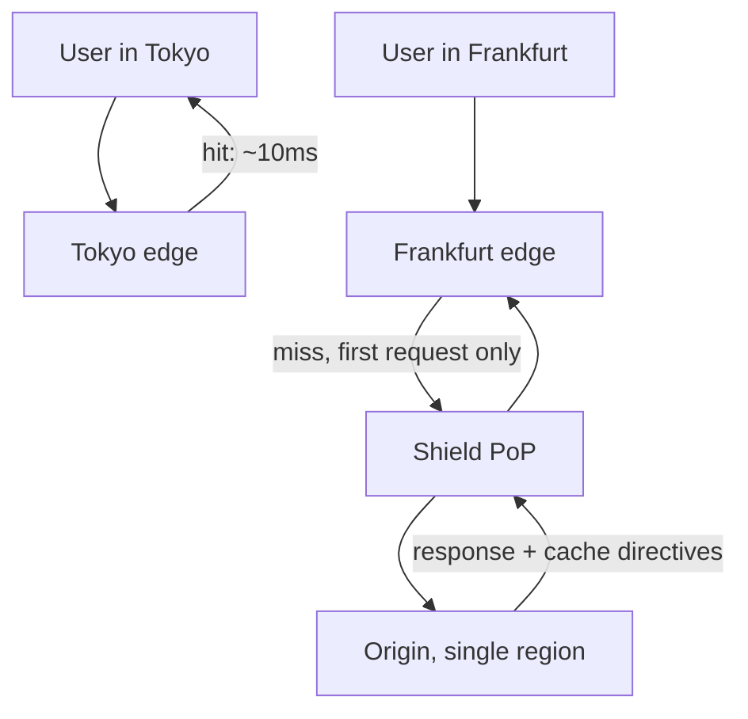

# Content Delivery Network {#ch-cdn}

> User-এর কাছ থেকে byte serve করুন, কতগুলো কখনো আপনার origin-এ পৌঁছায় না তা গুনুন, আর TTL-এর জন্য অপেক্ষা না করে URL বদলে দিন।

**এই অধ্যায়ে:** একটি CDN আসলে কী offload করে · anycast আর edge routing · edge-এ কী থাকা উচিত · origin shielding · purge ছাড়াই invalidation

## 💡 মূল ধারণা

CDN হলো একটি map-ওয়ালা cache। এটা আপনার response-এর copy শত শত জায়গায় রাখে, আর প্রতিটি user-কে সবচেয়ে কাছেরটা
থেকে উত্তর দেয়। এর দুটি ফল আছে, আর বিখ্যাত কেবল একটি।

বিখ্যাতটি হলো latency। যে request-এর একটি মহাসাগর পার হওয়ার কথা ছিল, তার উত্তর আসে কয়েক millisecond দূর থেকে।
বেশি মূল্যবানটি হলো offload। Edge-এ serve হওয়া প্রতিটি response এমন একটি request, যা আপনার server কখনো দেখে না।
তাই CDN হলো সবচেয়ে সস্তা capacity, যা আপনি কিনতে পারেন। আপনি origin (আপনার নিজের server) scale করছেন না; তার
ওপর থেকে traffic সরিয়ে দিচ্ছেন।

## কীভাবে কাজ করে

### Anycast আর edge

Anycast-এ প্রতিটি edge location একই address ঘোষণা করে। Internet routing request-টিকে যেটা সবচেয়ে কাছে সেখানে
পৌঁছে দেয়। সেই edge-এর কাছে হয় response-টি আছে, নয়তো সে একবার fetch করে রেখে দেয়।



**একটি miss-এ origin-এর খরচ একটি request; সেই region-এর পরের প্রতিটি user উত্তর পায় স্থানীয়ভাবে।**

CDN না থাকলে, Tokyo-র সেই user প্রতিটি asset-এর জন্য US origin পর্যন্ত 150-millisecond round trip-এর দাম দেন।
থাকলে, স্থানীয় edge পর্যন্ত দশ দেন। Origin-এর অবস্থান তখন আর product-এর সিদ্ধান্ত থাকে না।

### Offload-এর হিসাব

Origin-এর load হলো মোট traffic গুণ miss rate। তাই তর্ক করার মতো সংখ্যা হলো hit ratio:

```typescript
function originRps(totalRps: number, hitRatio: number): number {
  return Math.round(totalRps * (1 - hitRatio));
}

originRps(50_000, 0.8); // 10,000 req/s reach the origin
originRps(50_000, 0.9); //  5,000 req/s — ten more points halve the origin load
```

কতটা hit ratio পৌঁছাতে পারবেন, তা পুরোপুরি নির্ভর করে আপনি কী serve করছেন তার ওপর:

| Content | যে hit ratio পাওয়া যায় | কেন |
| --- | --- | --- |
| Content-hash করা asset — JS, CSS, image | 95–99% | Byte বদলালে URL বদলায়, তাই এক বছরের জন্য cache করা যায় |
| Media segment | 95%+ | Publish হওয়ার পর অপরিবর্তনীয়, আর যারা দেখছে সবাই চায় |
| ছোট TTL-সহ public HTML | 60–80% | User-দের মধ্যে shared, কিন্তু প্রায়ই expire হয় |
| Public JSON API | 70–90% | Response যদি কে চাইল তার ওপর নির্ভর না করে, তবে cache করা যায় |
| Personalised যেকোনো কিছু | 0% | প্রতিটি response আলাদা, আর shared cache এটা leak করবে |

> ⚠️ Asset-এ hit ratio 70%-এর নিচে মানে সাধারণত cache key-তে এমন কিছু আছে যা প্রতি user-এ বদলায়, যেমন একটি
> cookie বা tracking query parameter। সমাধান cache key-তে, TTL-এ নয়।

### Edge-এ কী থাকা উচিত

| Path | Directive | যুক্তি |
| --- | --- | --- |
| `/assets/app.7f3c9a.js` | `max-age=31536000, immutable` | Hash করা filename; নতুন build মানে নতুন URL |
| `/` আর অন্যান্য public HTML | `s-maxage=300, stale-while-revalidate=60` | Shared, কিন্তু deploy দ্রুত প্রতিফলিত হতে হবে |
| `/api/products` | `s-maxage=60, stale-while-revalidate=30` | Public list; এক মিনিটের দেরি চোখে পড়ে না |
| `/api/me`, login-এর পেছনের যেকোনো কিছু | `private, no-store` | Shared cache এটা ধরে রাখলে সেটা data leak |

`max-age` browser-এর সঙ্গে কথা বলে, আর `s-maxage` shared cache-এর সঙ্গে। `stale-while-revalidate` expiry-র
সময়ের latency spike সরিয়ে দেয়। Edge সঙ্গে সঙ্গে stale copy থেকে উত্তর দেয়, আর request-এর পেছনে সেটা refresh
করে। এই directive-গুলোর পুরো খুঁটিনাটি আছে
[Chapter ?? — Cloud-এর মূল কথা, Storage ও Delivery](#ch-cloud-fundamentals)-এ।

### Origin shielding

Edge-গুলো cache share করে না। একটি ঠান্ডা object সারা বিশ্ব থেকে চাওয়া হলে প্রতিটি edge একসঙ্গে miss করে। Origin
তখন একটি file-এর জন্য শত শত একই রকম request পায়। Shield হলো একটি বাছাই করা PoP (point of presence, একটি CDN
site), যার মধ্য দিয়ে প্রতিটি edge fetch করে, ফলে একটি global miss-এ origin-এর খরচ একটি request।

এটা সবচেয়ে বেশি দরকার বড়, জনপ্রিয়, অপরিবর্তনীয় object-এর জন্য, যেমন একটি video segment বা launch-এর দিনের
bundle। সেখানেই fan-out সবচেয়ে চওড়া, আর object-টি serve করা ব্যয়বহুল।

### Invalidation, আর কেন hashing purging-কে হারায়

Path purge করা ধীর, সাধারণত মেপে টাকা নেওয়া হয়, আর eventually consistent। আরও খারাপ, deploy-এর পরে "সব purge
করুন" সেই cache ফেলে দেয়, যা ভরতে আপনি সারা দিন কাটিয়েছেন। পরের কয়েক মিনিটের traffic সরাসরি origin-এর হাতে
তুলে দেয়।

বিকল্প হলো, বরং URL বদলে দেওয়া। Content-hash করা filename থাকলে নতুন build এমন URL তৈরি করে, যা edge আগে কখনো
দেখেনি। পুরোনো object আর কেউ চায় না, তাই purge নেই, stale থাকার কোনো সময়ও নেই। Invalidate করার জন্য বাকি থাকে
শুধু ছোট HTML entry point, যা এগুলোকে reference করে। সেটা একটি path, wildcard নয়।

```typescript
// The only purge a healthy deploy needs: the entry points, by exact path.
async function purgeEntryPoints(cdn: CdnClient, distributionId: string): Promise<void> {
  await cdn.purge({ distributionId, paths: ["/", "/index.html", "/sitemap.xml"] });
}
```

### Media আর range request

Streaming একটি video-কে কয়েক সেকেন্ড করে segment-এ ভাগ করে। Edge প্রতিটি segment আলাদাভাবে cache করে, আর যে
দর্শক সামনে টেনে যান, তিনি শুধু যা দেখেন তা-ই আনেন। Player-রা byte-range request-ও পাঠায়, যার উত্তর edge-কে
partial content দিয়ে দিতে হয়, পুরো object দিয়ে নয়। যেকোনো গুরুতর CDN-এ দুটিই default। Interview-এ এদের নাম
বলুন: এরাই ব্যাখ্যা করে, একটি platform কীভাবে একটি origin থেকে লাখ লাখ একসঙ্গে দেখা দর্শককে serve করে।

## কখন ব্যবহার করবেন

| পরিস্থিতি | CDN কী এনে দেয় |
| --- | --- |
| যেকোনো ধরনের static asset | প্রায় পুরো offload, এই list-এর সবকিছুর মধ্যে সবচেয়ে কম পরিশ্রমে |
| একাধিক মহাদেশ জুড়ে user | দ্বিতীয় region ছাড়াই তিন থেকে দশ গুণ কম latency |
| একটি launch বা traffic spike | Edge এটা শুষে নেয়; origin দেখে miss rate, spike নয় |
| বড় media file | Bandwidth-এর সাশ্রয়, সঙ্গে segment আর range handling, যা নইলে আপনাকেই বানাতে হতো |
| শত্রুভাবাপন্ন traffic | Attack-এর চাপ edge-এই থেমে যায়, আপনার server থেকে অনেক দূরে |

**এটা ব্যবহার করবেন না** যখন response personalised, যখন data একটি কাজের TTL-এর চেয়ে দ্রুত বদলায়, বা write-এর
জন্য। একটি POST-এর cache করার কিছু নেই, পায় শুধু একটি বাড়তি hop।

## সাধারণ ভুল

❌ **`Set-Cookie` বহন করা response cache করা।** Edge একজন user-এর session store করে আর পরের জনকে দিয়ে দেয়।
✅ Authenticated যেকোনো কিছুতে `private, no-store` দিন। দেখে নিন cache key-তে কখনো session cookie নেই।

❌ **Static filename।** এক বছরের জন্য cache করা `main.js` মানে এমন একটি deploy, যা কখনো user-দের কাছে পৌঁছায়
না। ✅ Build-কে content hash করে filename-এ বসাতে দিন।

❌ **প্রতিটি deploy-এ পুরো বিশ্ব purge করা।** Cache খালি হয়, আবার ভরার চাপ origin নেয়, আর deploy-টা একটি
incident-এর মতো দেখায়। ✅ Entry point-গুলো exact path দিয়ে purge করুন। বাকিটা hash করা URL সামলাক।

❌ **বিশ্বজুড়ে জনপ্রিয় object-এ shield নেই।** একটি ঠান্ডা object শত শত একসঙ্গে origin request হয়ে যায়।
✅ বড় অপরিবর্তনীয় asset-এর জন্য shielding চালু করুন।

❌ **CDN-এর পেছনে publicly readable origin।** User-রা সরাসরি URL খুঁজে পান আর cache এড়িয়ে যান। আপনার hit ratio
আর access rule দুটিরই আর কোনো মানে থাকে না। ✅ Origin-কে শুধু CDN-এর identity-র জন্য সীমিত করুন।

## 🔑 মূল শিক্ষা

- Latency-র চেয়ে offload বেশি গুরুত্বপূর্ণ: edge-এ serve হওয়া response এমন একটি, যা আপনার origin কখনো দেখে না।
- Origin-এর load হলো traffic গুণ miss rate, তাই যত ওপরে যাবেন, hit ratio-র প্রতিটি point-এর দাম তত বেশি।
- কী cache করা যায় তা ঠিক হয় response সবার জন্য এক কি না তা দিয়ে, তার size দিয়ে নয়।
- Content-hash করা URL invalidation-এর জায়গা নেয়। Purging entry point-এর জন্য একটি fallback, deploy-এর ধাপ নয়।
- Origin shielding-ই একটি global cache miss-কে global origin stampede হতে দেয় না।

## Interview-এর প্রশ্ন

**Q: CDN কেন শুধু performance-এর নয়, scaling-এর tool?**

কারণ এটা বদলে দেয়, আপনার origin কতটা traffic দেখে। 90% hit ratio-তে প্রতি দশটি request-এর নয়টির উত্তর আসে আপনার
infrastructure স্পর্শ না করেই, তাই একই server দশ গুণ traffic সামলায়। Origin-এর capacity বাড়াতে server আর
operational কাজের খরচ লাগে। Hit ratio বাড়াতে লাগে cache header-এ একটি পরিবর্তন। এ কারণেই caching-এর প্রশ্ন
capacity-র প্রশ্নের আগে আসে।

**Q: Deploy-এর পরেও user-রা পুরোনো JavaScript পাচ্ছেন। কী ভুল হয়েছে?**

হয় asset-এর filename বদলায়নি, তাই edge এখনো সেই byte serve করছে, যা সে ঠিকভাবেই current বলে মনে করে। নয়তো যে
HTML এগুলোকে reference করে, সেটাই খুব বেশিক্ষণ cache হয়ে আছে। কাঠামোগত সমাধান হলো asset-এ content hashing,
এক বছরের TTL-সহ। HTML entry point-কে একটি ছোট `s-maxage` দিন, আর একমাত্র এটাকেই কখনো purge করুন।

**Q: Origin shielding কী, আর কখন দরকার?**

একটি বাছাই করা মাঝের PoP, যার মধ্য দিয়ে সব edge fetch করে। পঞ্চাশটি location-এ cache miss পঞ্চাশটি নয়, একটি
origin request হয়ে যায়। এটা দরকার যখন object বড়, বিশ্বজুড়ে জনপ্রিয় আর প্রায়ই ঠান্ডা, যেমন media segment বা
একটি launch bundle। এক region-এর audience-এর জন্য ছোট, গরম asset-এ
এটা সামান্য লাভের বিনিময়ে একটি hop যোগ করে।

**Q: কখন CDN ভুল উত্তর?**

যখন response personalised। Logged-in user-এর dashboard ধরে রাখা একটি shared cache হলো data leak, performance-এর
জয় নয়। এটাকে cacheable চিহ্নিত করা সেই অল্প কয়েকটি CDN ভুলের একটি, যা শুধু একটি stale page নয়, একটি security
incident ঘটায়। ঠিক চাল হলো shared অংশগুলো cache করা, আর personalised অংশটা origin-এর হাতে রাখা, তার data-র কাছে।

## এরপর কী পড়বেন

- [Chapter ?? — Caching](#ch-caching) — একই ধারণা এক layer ভেতরে, যেখানে data public নয়
- [Chapter ?? — Cloud-এর মূল কথা, Storage ও Delivery](#ch-cloud-fundamentals) — বাস্তবে edge আর তার origin configure করা
- [Chapter ?? — Load Balancing](#ch-load-balancing) — যে traffic আপনার কাছে পৌঁছায়, তা কে সামলায়
