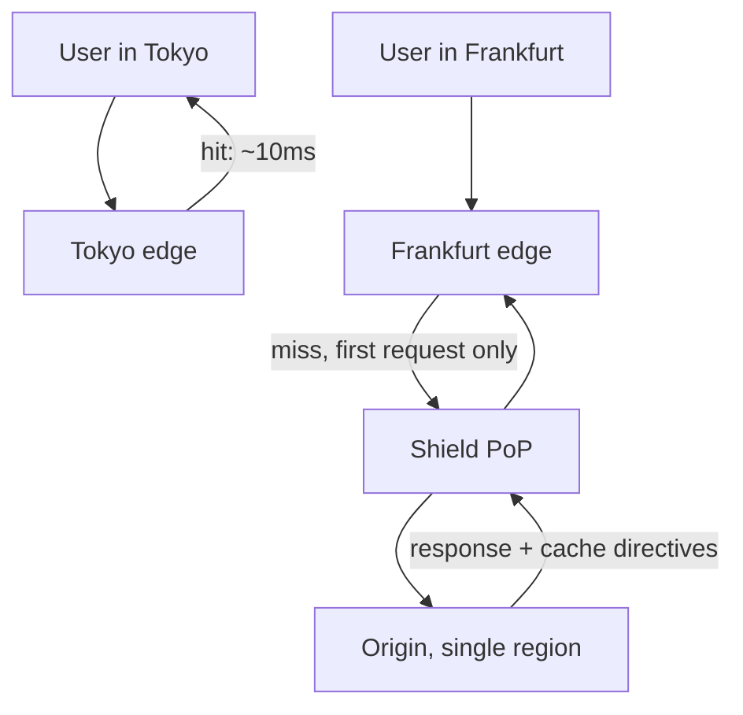

# Content Delivery Network {#ch-cdn}

> Byte পাঠান user-এর কাছ থেকে, গুনে দেখুন কতগুলো request আপনার origin পর্যন্ত পৌঁছায়ই না, আর TTL-এর অপেক্ষা না করে URL বদলে দিন।

**এই অধ্যায়ে:** CDN আসলে কোন load সরিয়ে নেয় · anycast আর edge routing · কী edge-এ থাকা উচিত · origin shielding · purge না করে invalidation

## 💡 মূল ধারণা

CDN হলো একটি cache, সঙ্গে একটি মানচিত্র। CDN আপনার response-এর copy শত শত জায়গায় রেখে দেয়, আর প্রতিটি user-কে উত্তর দেয়
সবচেয়ে কাছের জায়গা থেকে। এ থেকে দুটি জিনিস পাওয়া যায়, আর বিখ্যাত কেবল একটি।

বিখ্যাতটা হলো latency। যে request-কে সমুদ্র পার হতে হতো, তার উত্তর আসে কয়েক millisecond দূর থেকে। বেশি দামিটা হলো
offload। Edge থেকে যে response যায়, সেই request আপনার server কখনো দেখেই না। তাই CDN হলো সবচেয়ে সস্তা capacity, যা
কেনা যায়। আপনি origin-কে (আপনার নিজের server) scale করছেন না; origin থেকে traffic সরিয়ে নিচ্ছেন।

## কীভাবে কাজ করে

### Anycast আর edge

Anycast-এ প্রতিটি edge location একই address ঘোষণা করে। Internet routing request-টা পৌঁছে দেয় যেটা সবচেয়ে কাছে, তার
কাছে। সেই edge-এর কাছে হয় response আগে থেকেই আছে, নয়তো একবার এনে রেখে দেয়।



**একটি miss-এ origin-এর খরচ একটি request; ওই অঞ্চলের পরের সব user উত্তর পায় কাছ থেকেই।**

CDN না থাকলে Tokyo-র ওই user প্রতিটি asset-এর জন্য US origin পর্যন্ত 150 millisecond-এর round trip দেন। CDN থাকলে দেন
দশ, কাছের edge পর্যন্ত। Origin কোথায় বসানো, সেটা তখন আর product-এর সিদ্ধান্ত থাকে না।

### Offload-এর হিসাব

Origin-এর load হলো মোট traffic গুণ miss rate। তাই তর্ক করার মতো সংখ্যা আসলে hit ratio:

```typescript
function originRps(totalRps: number, hitRatio: number): number {
  return Math.round(totalRps * (1 - hitRatio));
}

originRps(50_000, 0.8); // 10,000 req/s reach the origin
originRps(50_000, 0.9); //  5,000 req/s — ten more points halve the origin load
```

কতটা hit ratio পাওয়া যাবে, তা পুরোপুরি নির্ভর করে আপনি কী পাঠাচ্ছেন তার ওপর:

| Content | যতটা hit ratio পাওয়া যায় | কেন |
| --- | --- | --- |
| Content-hashed asset — JS, CSS, image | 95–99% | Byte বদলালে URL-ও বদলায়, তাই এক বছর cache রাখা যায় |
| Media segment | 95%+ | Publish হওয়ার পর আর বদলায় না, আর যারা দেখছে সবাই চায় |
| ছোট TTL-এর public HTML | 60–80% | User-দের মধ্যে shared, কিন্তু ঘন ঘন expire হয় |
| Public JSON API | 70–90% | Cache করা যায়, যদি কে চাইছে তার ওপর response নির্ভর না করে |
| Personalised যেকোনো কিছু | 0% | প্রতিটি response আলাদা, আর shared cache সেটা ফাঁস করে দেবে |

> ⚠️ Asset-এ hit ratio 70%-এর নিচে হলে সাধারণত বুঝতে হবে, cache key-তে এমন কিছু আছে যা প্রতি user-এ বদলায়, যেমন
> cookie বা tracking-এর query parameter। সমাধান cache key-তে, TTL-এ নয়।

### কী edge-এ থাকা উচিত

| Path | Directive | যুক্তি |
| --- | --- | --- |
| `/assets/app.7f3c9a.js` | `max-age=31536000, immutable` | Filename-এ hash আছে; নতুন build মানে নতুন URL |
| `/` আর অন্য public HTML | `s-maxage=300, stale-while-revalidate=60` | Shared, কিন্তু deploy দ্রুত দেখাতে হবে |
| `/api/products` | `s-maxage=60, stale-while-revalidate=30` | Public list; এক মিনিটের দেরি কারও চোখে পড়ে না |
| `/api/me`, login-এর পেছনের যেকোনো কিছু | `private, no-store` | Shared cache-এ এটা থাকা মানেই data leak |

`max-age` কথা বলে browser-এর সঙ্গে, আর `s-maxage` shared cache-এর সঙ্গে। `stale-while-revalidate` expire-এর মুহূর্তের
latency-র লাফটা সরিয়ে দেয়। Edge তখনই stale copy থেকে উত্তর দিয়ে দেয়, আর request-এর পেছনে চুপচাপ সেটা refresh করে।
এই directive-গুলোর পুরো খুঁটিনাটি আছে
[Chapter ?? — Cloud-এর মূল কথা, Storage ও Delivery](#ch-cloud-fundamentals)-এ।

### Origin shielding

Edge-গুলো নিজেদের মধ্যে cache ভাগ করে না। কোনো cold object সারা পৃথিবী থেকে চাওয়া হলে প্রতিটি edge একসঙ্গে miss করে।
তখন একটি file-এর জন্য origin-এর কাছে আসে শত শত একই রকম request। Shield হলো বেছে নেওয়া একটি PoP (point of presence,
মানে CDN-এর একটি site), যার মধ্য দিয়ে সব edge data আনে। ফলে সারা পৃথিবীর miss-এ origin-এর খরচ হয় একটি request।

এটা সবচেয়ে বেশি কাজে লাগে বড়, জনপ্রিয় আর অপরিবর্তনীয় object-এ, যেমন video segment বা launch-এর দিনের bundle।
সেখানে fan-out সবচেয়ে বেশি, আর object পাঠানোর খরচও বেশি।

### Invalidation, আর purge-এর চেয়ে hashing কেন ভালো

Path purge করা ধীর, সাধারণত তার জন্য টাকা গুনতে হয়, আর ফল আসে eventually consistent ভাবে। আরও খারাপ হলো, deploy-এর
পরে "purge everything" করলে সারাদিন ধরে ভরানো cache-টা ফেলে দেওয়া হয়। পরের কয়েক মিনিটের traffic সোজা গিয়ে পড়ে
origin-এর ওপর।

বিকল্প হলো URL-টাই বদলে দেওয়া। Content-hashed filename থাকলে নতুন build এমন URL তৈরি করে, যা edge আগে কখনো দেখেনি।
পুরনো object আর কেউ চায় না, তাই purge লাগে না, stale থাকার কোনো সময়ও থাকে না। Invalidate করার মতো বাকি থাকে শুধু
ছোট HTML entry point, যেটা ওই URL-গুলোর উল্লেখ করে। সেটা একটি path, কোনো wildcard নয়।

```typescript
// The only purge a healthy deploy needs: the entry points, by exact path.
async function purgeEntryPoints(cdn: CdnClient, distributionId: string): Promise<void> {
  await cdn.purge({ distributionId, paths: ["/", "/index.html", "/sitemap.xml"] });
}
```

### Media আর range request

Streaming একটি video-কে কয়েক সেকেন্ডের segment-এ ভাগ করে। Edge প্রতিটি segment আলাদা করে cache করে, আর যে দর্শক সামনে
এগিয়ে যান, তিনি টানেন শুধু যা দেখছেন সেটুকু। Player byte-range request-ও পাঠায়, আর edge-কে তার উত্তর দিতে হয় partial
content দিয়ে, পুরো object দিয়ে নয়। যেকোনো ভালো CDN-এ দুটিই default। Interview-এ এগুলোর নাম বলুন: একটি origin থেকে একটি
platform কীভাবে একসঙ্গে লাখ লাখ দর্শককে সার্ভ করে, তার ব্যাখ্যা এখানেই।

## কখন ব্যবহার করবেন

| পরিস্থিতি | CDN কী এনে দেয় |
| --- | --- |
| যেকোনো ধরনের static asset | প্রায় পুরো offload, এই তালিকার সবচেয়ে কম পরিশ্রমে |
| একাধিক মহাদেশে ছড়ানো user | দ্বিতীয় region ছাড়াই তিন থেকে দশ গুণ কম latency |
| Launch বা হঠাৎ traffic-এর লাফ | Edge সেটা সামলে নেয়; origin দেখে miss rate, লাফটা নয় |
| বড় media file | Bandwidth-এর সাশ্রয়, আর segment ও range-এর ব্যবস্থা, যা নাহলে নিজেকে বানাতে হতো |
| আক্রমণাত্মক traffic | Attack-এর চাপ থেমে যায় edge-এই, আপনার server থেকে অনেক দূরে |

**এটা ব্যবহার করবেন না** যখন response personalised, যখন data কাজের মতো কোনো TTL-এর চেয়েও দ্রুত বদলায়, অথবা write-এর
জন্য। POST-এ cache করার কিছু নেই, শুধু একটি বাড়তি hop যোগ হয়।

## সাধারণ ভুল

❌ **`Set-Cookie` বহন করা response cache করা।** Edge একজন user-এর session রেখে দেয় আর পরের জনকে দিয়ে দেয়। ✅ Authenticated
যেকোনো কিছুতে `private, no-store` দিন। দেখে নিন, cache key-তে কখনো session cookie না থাকে।

❌ **Static filename।** এক বছরের জন্য cache হওয়া `main.js` মানে এমন deploy, যা কখনো user-এর কাছে পৌঁছায় না। ✅ Build-কে
content-এর hash filename-এ বসিয়ে দিতে দিন।

❌ **প্রতিটি deploy-এ সবকিছু purge করা।** Cache খালি হয়, origin আবার ভরানোর পুরো চাপ নেয়, আর deploy-টা দেখতে লাগে
incident-এর মতো। ✅ Entry point-গুলো exact path দিয়ে purge করুন। বাকিটা hashed URL সামলাবে।

❌ **সারা পৃথিবীতে জনপ্রিয় object-এ shield নেই।** একটি cold object থেকে একসঙ্গে শত শত origin request তৈরি হয়। ✅ বড়
অপরিবর্তনীয় asset-এর জন্য shielding চালু করুন।

❌ **CDN-এর পেছনে এমন origin, যা সবাই পড়তে পারে।** User-রা সরাসরি URL খুঁজে পান আর cache এড়িয়ে যান। তখন আপনার hit
ratio আর access-এর নিয়ম, দুটিরই কোনো মানে থাকে না। ✅ Origin-কে শুধু CDN-এর identity-র জন্য খোলা রাখুন।

## 🔑 মূল শিক্ষা

- Latency-র চেয়ে offload বেশি গুরুত্বপূর্ণ: edge থেকে যাওয়া response আপনার origin কখনো দেখে না।
- Origin-এর load হলো traffic গুণ miss rate, তাই hit ratio যত ওপরে, প্রতিটি point-এর দাম তত বেশি।
- কী cache করা যাবে, তা ঠিক হয় response সবার জন্য একই কি না তা দিয়ে, তার size দিয়ে নয়।
- Content-hashed URL invalidation-এর জায়গা নেয়। Purge হলো entry point-এর শেষ উপায়, deploy-এর ধাপ নয়।
- Origin shielding-ই সারা পৃথিবীর cache miss-কে সারা পৃথিবীর origin stampede হতে দেয় না।

## Interview-এর প্রশ্ন

**Q: CDN শুধু performance-এর নয়, scaling-এর হাতিয়ার কেন?**

কারণ আপনার origin কতটা traffic দেখে, সেটাই CDN বদলে দেয়। 90% hit ratio-তে প্রতি দশটি request-এর নয়টির উত্তর যায় আপনার
infrastructure না ছুঁয়েই। ফলে একই server দশ গুণ traffic সামলাতে পারে। Origin-এর capacity বাড়াতে server লাগে, operational
কাজও লাগে। Hit ratio বাড়াতে লাগে cache header-এ একটি পরিবর্তন। এজন্যই capacity-র প্রশ্নের আগে আসে caching-এর প্রশ্ন।

**Q: Deploy-এর পরেও user-রা পুরনো JavaScript পাচ্ছেন। কী ভুল হয়েছে?**

হয় asset-এর filename বদলায়নি, তাই edge এখনো সেই byte পাঠাচ্ছে যেগুলোকে edge ঠিকভাবেই হালনাগাদ মনে করছে। নয়তো যে HTML
ওগুলোর উল্লেখ করে, সেটা নিজেই অনেকক্ষণ cache হয়ে আছে। কাঠামোগত সমাধান হলো asset-এ content hashing, সঙ্গে এক বছরের
TTL। HTML entry point-কে ছোট `s-maxage` দিন, আর purge করুন শুধু সেটাই।

**Q: Origin shielding কী, আর কখন লাগে?**

বেছে নেওয়া একটি মাঝের PoP, যার মধ্য দিয়ে সব edge data আনে। পঞ্চাশটি location-এ cache miss হলে origin-এ যায় একটি
request, পঞ্চাশটি নয়। এটা লাগে যখন object বড়, সারা পৃথিবীতে জনপ্রিয় আর প্রায়ই cold, যেমন media segment বা launch-এর
bundle। এক region-এর দর্শকের জন্য ছোট, warm asset-এ এটা সামান্য লাভের বিনিময়ে একটি বাড়তি hop যোগ করে।

**Q: CDN কখন ভুল সমাধান?**

যখন response personalised। Login করা user-এর dashboard shared cache-এ থাকলে সেটা performance-এর জয় নয়, data leak। এটাকে
cacheable চিহ্নিত করা সেই অল্প কয়েকটি CDN ভুলের একটি, যা শুধু stale page নয়, security incident ঘটায়। সঠিক চাল হলো shared
অংশগুলো cache করা, আর personalised অংশটা origin-এর হাতে ছেড়ে দেওয়া, তার data-র কাছে।

## এরপর কী পড়বেন

- [Chapter ?? — Caching](#ch-caching) — একই ধারণা, এক layer ভেতরে, যেখানে data public নয়
- [Chapter ?? — Cloud-এর মূল কথা, Storage ও Delivery](#ch-cloud-fundamentals) — বাস্তবে edge আর তার origin configure করা
- [Chapter ?? — Load Balancing](#ch-load-balancing) — যে traffic আপনার কাছে পৌঁছায়, তা কে সামলায়
