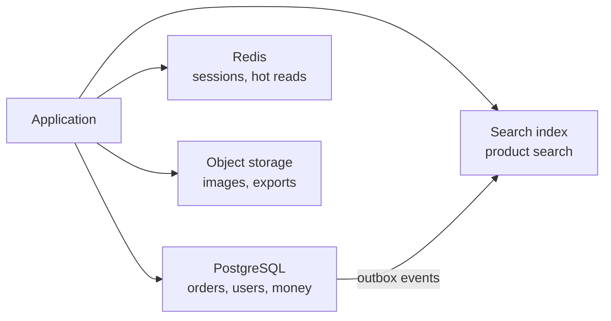

# Datastore বাছাই ও তার Replication {#ch-choosing-a-datastore}

> Access pattern দেখে একটি store বাছুন, সেটাকে কয়েকটি machine-এ copy করুন, আর copy-গুলো যখন মেলে না তখন একজন reader ঠিক কী দেখে, তা স্পষ্ট করে বলুন।

**এই অধ্যায়ে:** schema-র আগে access pattern · ACID আর BASE · প্রতিটি তথ্যের একজনই মালিক · leader, lag আর failover · read routing

## 💡 মূল ধারণা

প্রতিটি datastore আসলে একগুচ্ছ trade-off, একটি product-এর ভেতরে বসানো। Relational database নমনীয় query আর
correctness-এর জন্য write-এর খরচ দেয়। Key-value store latency জেতার জন্য querying ছেড়ে দেয়। Document store
সম্পর্কিত data একসাথে রাখার জন্য join ছেড়ে দেয়। তাই প্রশ্নটা কখনোই "কোনটা সেরা" নয়। প্রশ্ন হলো "কোন trade-off-গুলো
এই system সবচেয়ে বেশি যা করে, তার সাথে মেলে"।

বাছাই হয়ে গেলে আপনি data একাধিক machine-এ copy করেন। এটাই **replication**, আর এটা দুটো আলাদা জিনিস দেয়।
**Durability** মানে একটি machine হারালে data হারায় না। **Read capacity** মানে কয়েকটি machine query-র উত্তর দিতে
পারে। এর খরচ একটাই: একই মুহূর্তে copy-গুলো কখনো হুবহু এক থাকে না, তাই কেউ এমন value পড়তে পারে যেটা ইতিমধ্যে পুরোনো।

> Relational-ই default, আর সেটা ছাড়তে হলে এক বাক্যের একটি কারণ লাগে। "হয়তো scale করতে হবে" সেই বাক্য নয়।

## কীভাবে কাজ করে

### Family-গুলো

| Family      | যেখানে শক্তিশালী                             | যেখানে দুর্বল                               | উদাহরণ             |
| ----------- | ----------------------------------------- | ------------------------------------ | -------------------- |
| Relational  | Join, transaction, ad-hoc query            | একাধিক machine জুড়ে write scale করা       | PostgreSQL, MySQL    |
| Document    | একবারে একটি পুরো aggregate পড়া                | Document-গুলোর মধ্যে join আর consistency | MongoDB            |
| Key-value   | Sub-millisecond read, বিপুল throughput     | Key ছাড়া অন্য যেকোনো query               | Redis, DynamoDB      |
| Wide-column | বিশাল write volume, সময়ের ক্রমে সাজানো range | Ad-hoc query, join                | Cassandra, ScyllaDB  |
| Graph       | অনেক hop গভীর traversal                    | Reporting, bulk write               | Neo4j                |

### Schema-র আগে access pattern

Relational modelling শুরু হয় entity থেকে, আর বাকিটা query planner-এর ওপর ছেড়ে দেয়। অন্য প্রতিটি family কাজ
করে উল্টো দিক থেকে। **Primary key-ই query plan**, আর ভুল key মানে একটি migration, নতুন index নয়।

**DynamoDB-ধাঁচের single-table key:**

```typescript
interface OrderItem {
  pk: string; // "USER#42" — everything for one user lives in one partition
  sk: string; // "ORDER#2026-09-02#8821" — sorted, so newest-first ranges are free
  status: "pending" | "shipped";
  total: number;
}

// "The last 20 orders for user 42" is one query against one partition.
// "All orders over £500 across all users" is a full scan. If you need it, this is the wrong store.
```

### ACID আর BASE

|          | ACID (relational)                 | BASE (বেশিরভাগ NoSQL)                        |
| -------- | --------------------------------- | ---------------------------------------- |
| Write   | Row আর table জুড়ে atomic     | একটি document বা partition-এর ভেতরে atomic  |
| Read    | একটি consistent snapshot             | Stale হতে পারে                             |
| যা দেয়     | বাড়তি code ছাড়াই correctness    | Availability আর write throughput        |
| খরচ    | Coordination, যেটা write সীমিত করে | Correctness আপনার code-এর দায়িত্ব হয়ে যায়      |

BASE-এ যে নিয়মগুলো আগে database নিজে মানাত, সেগুলো আপনার code-এ চলে আসে। Uniqueness, foreign key আর "balance
negative হতে পারবে না" — প্রতিটিই একটি race condition হয়ে যায়, যেটা আপনাকে নিজে সামলাতে হবে।

### প্রতিটি তথ্যের একজনই মালিক

Default হিসেবে normalise করুন। কোনো একটি read path মেপে দেখা গেলে যে সেটা সত্যিই খুব ধীর, শুধু তখনই সেটা
denormalise করুন, আর বলে দিন copy-গুলো মিলিয়ে রাখার দায়িত্ব কার।

> ⚠️ Denormalisation হলো schema-র পোশাক পরা একটি cache। এটা একইভাবে fail করে, stale data দিয়ে, কিন্তু এর কোনো
> expiry নেই। প্রতিটি duplicate field-এর জন্য একটি নিয়ম দিন, কখন সেটা refresh হবে।

বেশিরভাগ বাস্তব system দুই-তিনটি store ব্যবহার করে, প্রতিটি যে কাজে ভালো সেই কাজে।

**একটি system-এ polyglot persistence:**



**প্রতিটি তথ্যের মালিক একটি store; বাকিগুলো সেখান থেকে derive করা, আর আবার তৈরি করা যায়।**

দুটো store যদি একই তথ্যের মালিকানা দাবি করে, তারা ধীরে ধীরে আলাদা হয়ে যায়, আর কোনটা ঠিক তা কিছুই আপনাকে
বলে না। একটিতে write করুন, বাকিগুলো derive করুন।

### Leader আর topology

| Topology      | Write যায়                          | Conflict                  | কোথায় ব্যবহার করবেন                              |
| ------------- | ------------------------------------- | -------------------------- | ------------------------------------ |
| Single-leader | একটি node-এ, সেখান থেকে বাইরে copy হয়             | অসম্ভব                 | প্রায় সবকিছু — এটাই default      |
| Multi-leader  | যেকোনো leader-এ, কয়েকটি region-এ        | নিশ্চিত, resolve করতেই হবে  | দুই region-এ write, offline client |
| Leaderless    | একসাথে কয়েকটি replica-য়, quorum দিয়ে   | সম্ভাবনা বেশি, read-এর সময় resolve হয়   | Cassandra-ধাঁচের store               |

Single-leader write conflict দূর করে দেয়, তাই requirement অন্য কিছু করতে বাধ্য না করলে এটাই জেতে।

### Synchronous না asynchronous

|                        | Synchronous                           | Asynchronous                 |
| ---------------------- | ------------------------------------- | ---------------------------- |
| Write latency          | Leader আর সবচেয়ে ধীর replica       | শুধু leader                   |
| Leader মারা গেলে ক্ষতি | Acknowledge হওয়া write-এর ক্ষেত্রে কিছুই না        | যা এখনো পাঠানো হয়নি, সবটুকু   |
| Availability           | একটি আটকে থাকা replica write আটকে দেয়       | Replica write আটকাতে পারে না |

Production সাধারণত **semi-synchronous** চলে। প্রতিটি write একটি replica confirm করে, বাকিগুলো পরে পিছু নেয়।
আপনি একটি নিরাপদ দ্বিতীয় copy পান, আর কোনো একটি ধীর replica পুরো system থামিয়ে দিতে পারে না।

### Replica lag

Leader-এ একটি write commit হওয়া আর replica-য় সেটা দেখা দেওয়ার মাঝের দেরিটাই lag। সাধারণত এটা কয়েক
millisecond, আর replica rebuild হওয়ার সময় কয়েক মিনিট। User এটাকে তিনটি আলাদা bug হিসেবে দেখে।

| Anomaly          | User যা দেখে                          | সমাধান                                     |
| ---------------- | ------------------------------------------- | --------------------------------------- |
| Read-your-writes | "আমি save করলাম, কিন্তু save হয়নি"            | কিছুক্ষণের জন্য সেই user-কে leader-এ পাঠান    |
| Monotonic reads  | একটি value দেখা দেয়, তারপর refresh করলে উধাও   | একটি session-কে একটি replica-য় আটকে রাখুন            |
| Causal order     | যে comment-এর উত্তর, তার আগেই reply দেখা যায় | দুটোই একই replica থেকে পড়ুন         |

**Lag কতটা সহ্য করা যায়, সেই অনুযায়ী read route করা:**

```typescript
interface ReplicaHealth { name: string; lagMs: number }

function pickReplica(replicas: ReplicaHealth[], toleranceMs: number): string | null {
  const fresh = replicas.filter((r: ReplicaHealth) => r.lagMs <= toleranceMs);
  if (fresh.length === 0) return null; // fall back to the leader rather than serve stale data
  return fresh[Math.floor(Math.random() * fresh.length)].name;
}
```

প্রতিটি read-এর default করুন replica, আর অল্প কয়েকটি endpoint চিহ্নিত করুন যেগুলোর leader লাগে: একজন user-এর
নিজের সাম্প্রতিক write, আর টাকা, stock বা permission নিয়ে যেকোনো কিছু। উল্টো default কখনোই পরে পরিষ্কার করা
হয় না।

### Failover আর split brain

Leader মারা গেলে আপনি একটি replica-কে promote করেন। Heartbeat timeout দিয়ে failure ধরেন, সবচেয়ে নতুন log
position-ওয়ালা replica বাছেন, আর client-দের সেটার দিকে পাঠান। তারপর নিশ্চিত করেন যে পুরোনো leader আর leader
হিসেবে ফিরে আসতে **পারবে না**।

> ⚠️ মানুষ এই শেষ ধাপটাই ভুলে যায়। পুরোনো leader সেরে উঠে যদি এখনো নিজেকে primary ভাবে, দুটো node write নেয়
> আর data দুই ভাগ হয়ে যায়। এটাই **split brain**। Fencing এটা ঠেকায়: একটি ক্রমশ বাড়তে থাকা term number, যেটা
> storage প্রতিটি write-এ যাচাই করে। Fencing ছাড়া automatic failover data হারায়।

Asynchronous replication-এ failover আরও হারায় সেই সব write, যেগুলো পুরোনো leader confirm করেছিল কিন্তু পাঠায়নি।
তাই "failover কি data হারায়?" প্রশ্নের সৎ উত্তর আছে: হ্যাঁ, replication lag পর্যন্ত।

## কখন ব্যবহার করবেন

| Requirement                                   | বাছাই                                    | কেন                                     |
| --------------------------------------------- | ----------------------------------------- | --------------------------------------- |
| একাধিক entity জুড়ে transaction, টাকা, stock    | Relational                                | নিজে না লিখেই ACID        |
| খুব কম latency-তে key দিয়ে read              | Key-value                                 | একই range-এ আর কিছু নেই       |
| সেকেন্ডে লাখ লাখ সময়-ক্রমিক write      | Wide-column                               | ঠিক এই write pattern-এর জন্যই তৈরি    |
| Ranked full-text search                       | Search engine, মূল store থেকে derive করা | Inverted index আর relevance scoring   |
| একটি database, uptime গুরুত্বপূর্ণ                  | একটি leader আর অন্য zone-এ একটি sync replica | Write না হারিয়ে একটি zone হারানো সামলায় |
| দুই region-এ write সত্যিই দরকার        | Conflict নিয়মসহ multi-leader         | একমাত্র উপায়, তাই এর খরচের দায় নিন        |

## সাধারণ ভুল

**❌ যে scale নেই, তার জন্য NoSQL বাছা**

> "আমরা Cassandra নিয়েছি, কারণ হয়তো বড় হয়ে যাব।"

একটি PostgreSQL instance সেকেন্ডে কয়েক দশ হাজার transaction আর terabyte-এর data সামলায়।
বেশিরভাগ product কখনো এই সীমা ছাড়ায় না, আর যারা ছাড়ায়, তাদের migrate করার সামর্থ্য থাকে।

**✅ আসলে যে access pattern আছে, তার জন্য বাছা**

> "সেকেন্ডে write 400টি, আর প্রতিটি query user ID আর একটি date range দিয়ে। Composite index-সহ একটি Postgres-ই
> ঠিক, আর write 5,000 পেরোলে আমি আবার ভেবে দেখব।"

**❌ Replica-কে backup ভাবা**

Replication ভুলও নিখুঁতভাবে copy করে। `WHERE` ছাড়া একটি `DELETE` কয়েক millisecond-এ প্রতিটি replica-য় পৌঁছে
যায়।

**✅ Availability-র জন্য replica, recovery-র জন্য backup**

Replica সামলায় একটি machine বা zone মারা যাওয়া। Point-in-time backup সামলায় খারাপ data, আর নিয়মিত restore
প্রমাণ করে যে সেগুলো কাজ করে।

## 🔑 মূল শিক্ষা

- Access pattern থেকে শুরু করুন, কারণ প্রতিটি non-relational store-এ primary key-ই query plan।
- Relational-ই default, আর সেটা ছাড়তে access shape বা write volume নিয়ে নির্দিষ্ট কারণ লাগে।
- প্রতিটি তথ্যের মালিক ঠিক একটি store, আর বাকি প্রতিটি copy একটি projection, যেটা আবার তৈরি করা যায়।
- Replication durability আর read capacity দেয়, আর দুটোর বদলেই staleness নেয়।
- Asynchronous failover এখনো না পাঠানো প্রতিটি write হারায়, আর fencing ছাড়া failover split brain-এর ঝুঁকি তৈরি করে।

## Interview-এর প্রশ্ন

**Q: এই system-এর জন্য SQL না NoSQL — দ্বিধা না করে কীভাবে উত্তর দেবেন?**

প্রথমে access pattern বলুন, তারপর consistency requirement, তারপর বাছুন। নানা রকম query, সম্পর্কিত data আর টাকা
মানে relational। প্রতিটি query জানা key দিয়ে, বিশাল write volume আর স্বয়ংসম্পূর্ণ record মানে key-value বা
wide-column। কোন write volume-এ আপনি আবার ভাববেন, সেটাও বলুন।

**Q: PostgreSQL থেকে DynamoDB-তে গেলে আসলে কী হারান?**

Join, ad-hoc query আর সাধারণ multi-entity transaction। বদলে পান অনুমেয় low-latency read আর প্রায় সীমাহীন write
scaling। আসল খরচ হলো, নতুন একটি query pattern-এর জন্য নতুন index বা data migration লাগতে পারে, কারণ key-টি
শুরুতে আপনি যে query-গুলোর কথা ভেবেছিলেন সেগুলোই encode করে।

**Q: আপনার primary মারা গেল। কী হারাল?**

Asynchronous replication-এ leader যে write-গুলো confirm করেছিল কিন্তু পাঠায়নি, সবগুলো হারান। সাধারণত এটা এক
সেকেন্ডের কম, replica পিছিয়ে থাকলে বেশি। Synchronous replica থাকলে confirm হওয়া কিছুই হারায় না। Semi-synchronous
replication ঠিক এই trade-টা ভারসাম্যে রাখার জন্যই আছে।

**Q: একজন user বলছেন তাঁর profile update "save হয়নি"। Diagnose করুন।**

প্রায় নিশ্চিতভাবে replica lag। Write গিয়েছিল leader-এ, আর পরের read পড়েছে এমন একটি replica-য়, যেটা তখনো সেটা
apply করেনি। সেই সময়ের lag দেখে নিশ্চিত হন, তারপর read-your-writes routing দিয়ে ঠিক করুন, পুরো system-এর
consistency বদলে নয়।

**Q: কখন multi-leader replication মেনে নেবেন?**

শুধু তখন, যখন write-কে একাধিক region-এ সফল হতেই হবে আর cross-region latency গ্রহণযোগ্য নয়, অথবা যখন client
offline-এ write করে পরে sync করে। তখন conflict নিশ্চিত, তাই আমি এমন একটি resolution নিয়ম চাইব, যেটা domain মেনে
নেয়। সেটা হতে পারে একটি CRDT (এমন data type, যেটা নিজে নিজেই merge হওয়ার জন্য তৈরি) বা একটি business merge
নিয়ম। গুরুত্বপূর্ণ data-র ওপর last-write-wins সেই নিয়ম নয়।

## এরপর কী পড়বেন

- [Chapter ?? — বড় পরিসরে Sharding ও Transaction](#ch-sharding) — অন্য অক্ষটি: data copy না করে ভাগ করা
- [Chapter ?? — Reliability, Consistency ও CAP](#ch-consistency-and-cap) — একটি replica কী দেখাতে পারে তার ভাষা, আর একটি availability target-এ failover কোথায় বসে
