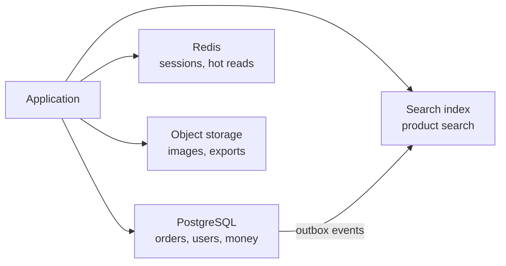

# Datastore বাছাই ও তার Replication {#ch-choosing-a-datastore}

> Access pattern দেখে store বেছে নিন, একাধিক machine-এ তার copy রাখুন, আর copy-গুলোর মধ্যে অমিল থাকার সময় reader ঠিক কী দেখেন, তা স্পষ্ট করে বলুন।

**এই অধ্যায়ে:** schema-র আগে access pattern · ACID আর BASE · প্রতিটি তথ্যের একজনই মালিক · leader, lag আর failover · read-এর routing

## 💡 মূল ধারণা

প্রতিটি datastore আসলে একটি product-এ বসানো কিছু trade-off-এর সমষ্টি। Relational database নমনীয় query আর নির্ভুলতার জন্য
write-এ বাড়তি দাম দেয়। Key-value store latency জিততে querying ছেড়ে দেয়। Document store সম্পর্কিত data একসঙ্গে রাখতে join
ছেড়ে দেয়। তাই প্রশ্নটা কখনো "কোনটা সবচেয়ে ভালো" নয়। প্রশ্ন হলো, "কোন trade-off-গুলো এই system সবচেয়ে বেশি যা করে, তার
সঙ্গে মেলে"।

বাছাইয়ের পর আপনি data একাধিক machine-এ copy করেন। এটাই **replication**, আর এটা দুটি আলাদা জিনিস এনে দেয়। **Durability**
মানে একটি machine হারালেও data হারায় না। **Read capacity** মানে কয়েকটি machine মিলে query-র উত্তর দিতে পারে। দাম একটিই:
copy-গুলো কখনো একই মুহূর্তে হুবহু এক থাকে না, তাই কেউ এমন value পড়তে পারেন, যা এর মধ্যেই পুরনো হয়ে গেছে।

> Relational-ই default, আর সেটা ছাড়তে হলে এক বাক্যের একটি কারণ লাগে। "হয়তো scale করতে হবে" সেই বাক্য নয়।

## কীভাবে কাজ করে

### Store-এর পরিবার

| পরিবার      | যেখানে শক্ত                                 | যেখানে দুর্বল                              | উদাহরণ             |
| ----------- | ----------------------------------------- | ------------------------------------ | -------------------- |
| Relational  | Join, transaction, ad-hoc query        | Machine জুড়ে write scale করা       | PostgreSQL, MySQL    |
| Document    | একবারে একটি পুরো aggregate পড়া           | Document জুড়ে join আর consistency | MongoDB            |
| Key-value   | Millisecond-এর কমে read, বিশাল throughput     | Key দিয়ে নয় এমন যেকোনো query         | Redis, DynamoDB      |
| Wide-column | বিপুল পরিমাণ write, সময়ের ক্রমে সাজানো range | Ad-hoc query, join                | Cassandra, ScyllaDB  |
| Graph       | অনেক hop গভীর traversal                  | Reporting, একসঙ্গে বিপুল write               | Neo4j                |

### Schema-র আগে access pattern

Relational modelling শুরু হয় entity থেকে, বাকিটা query planner সামলায়। বাকি সব পরিবার কাজ করে উল্টো দিক থেকে। **Primary
key-ই query plan**, আর key ভুল হলে নতুন index দিয়ে চলে না, migration লাগে।

**DynamoDB-ধাঁচের single-table key:**

```typescript
interface OrderItem {
  pk: string; // "USER#42" — everything for one user lives in one partition
  sk: string; // "ORDER#2026-09-02#8821" — sorted, so newest-first ranges are free
  status: "pending" | "shipped";
  total: number;
}

// "The last 20 orders for user 42" is one query against one partition.
// "All orders over £500 across all users" is a full scan. If you need it, this is the wrong store.
```

### ACID আর BASE

|          | ACID (relational)                 | BASE (বেশিরভাগ NoSQL)                        |
| -------- | --------------------------------- | ---------------------------------------- |
| Write   | Row আর table জুড়ে atomic     | একটি document বা partition-এর ভেতরে atomic  |
| Read    | একটি consistent snapshot             | Stale হতে পারে                             |
| যা পাওয়া যায়     | বাড়তি code ছাড়াই নির্ভুলতা    | Availability আর write throughput        |
| দাম    | Coordination, যা write-কে সীমিত করে | নির্ভুলতার দায় আপনার code-এর      |

BASE-এ database যে নিয়মগুলো মানাত, সেগুলো চলে আসে আপনার code-এ। Uniqueness, foreign key আর "balance negative হতে পারবে না",
প্রতিটিই হয়ে যায় একটি race condition, যা আপনাকেই সামলাতে হয়।

### প্রতিটি তথ্যের একজনই মালিক

Default হিসেবে normalise করুন। কোনো একটি read path মেপে দেখার মতো ধীর হলে তবেই শুধু সেটা denormalise করুন, আর বলে দিন
copy-গুলো মিলিয়ে রাখার দায় কার।

> ⚠️ Denormalisation হলো schema-র পোশাক পরা একটি cache। এটাও একই ভাবে ব্যর্থ হয়, stale data দিয়ে, কিন্তু এর কোনো expiry নেই।
> প্রতিটি duplicate field-এর জন্য নিয়ম রাখুন, কখন সেটা refresh হবে।

বাস্তবের বেশিরভাগ system দুটি বা তিনটি store ব্যবহার করে, প্রতিটি যে কাজে ভালো সেই কাজে।

**একটি system-এ polyglot persistence:**



**প্রতিটি তথ্যের মালিক একটি store; বাকিগুলো সেখান থেকে বানানো, আর আবার বানিয়ে নেওয়া যায়।**

দুটি store যদি একই তথ্যের দাবি করে, তারা ধীরে ধীরে আলাদা হয়ে যায়, আর কোনটা ঠিক তা কিছুই বলে দেয় না। একটিতে লিখুন, আর বাকিগুলো
সেখান থেকে বানান।

### Leader আর topology

| Topology      | Write যায়                          | Conflict                  | কাজে লাগে                              |
| ------------- | ------------------------------------- | -------------------------- | ------------------------------------ |
| Single-leader | একটি node-এ, সেখান থেকে বাইরে copy হয়             | অসম্ভব                 | প্রায় সবকিছুতে — এটাই default      |
| Multi-leader  | যেকোনো leader-এ, কয়েকটি region-এ        | নিশ্চিত, সমাধান করতেই হবে  | দুটি region-এ write, offline client |
| Leaderless    | একসঙ্গে কয়েকটি replica-য়, quorum দিয়ে   | সম্ভাবনা বেশি, read-এর সময় সমাধান   | Cassandra-ধাঁচের store               |

Single-leader write conflict পুরোপুরি সরিয়ে দেয়, তাই চাহিদা অন্য কিছু করতে বাধ্য না করলে এটাই জেতে।

### Synchronous নাকি asynchronous

|                        | Synchronous                           | Asynchronous                 |
| ---------------------- | ------------------------------------- | ---------------------------- |
| Write latency          | Leader আর সবচেয়ে ধীর replica       | শুধু leader                  |
| Leader মারা গেলে কী হারায় | কিছুই না, acknowledge হওয়া write-এর ক্ষেত্রে        | যা এখনো পাঠানো হয়নি, সবই   |
| Availability           | একটি আটকে থাকা replica write আটকে দেয়       | Replica write আটকাতে পারে না |

Production-এ সাধারণত চলে **semi-synchronous**। একটি replica প্রতিটি write নিশ্চিত করে, বাকিগুলো পরে আসে। এতে নিরাপদ একটি
দ্বিতীয় copy পাওয়া যায়, আর কোনো একটি ধীর replica পুরো system থামিয়ে দিতে পারে না।

### Replica lag

Lag হলো leader-এ write commit হওয়া আর replica-য় সেটা দেখা দেওয়ার মাঝের দেরি। সাধারণত এটা কয়েক millisecond, আর কোনো replica
নতুন করে তৈরি হওয়ার সময় কয়েক মিনিট। User-রা এটা দেখেন তিনটি আলাদা bug হিসেবে।

| অস্বাভাবিকতা          | User কী দেখেন                          | সমাধান                                     |
| ---------------- | ------------------------------------------- | --------------------------------------- |
| Read-your-writes | "Save করলাম, কিন্তু save হয়নি"            | কিছুক্ষণের জন্য ওই user-কে leader-এ পাঠান    |
| Monotonic reads  | একটি value দেখা দেয়, refresh করলে উধাও হয়ে যায়   | একটি session-কে একটি replica-য় বেঁধে দিন            |
| Causal order     | যে comment-এর উত্তর, তার আগেই reply দেখা যায় | দুটিই একই replica থেকে পড়ুন         |

**Lag কতটা সহ্য করা যায়, তা দেখে read route করা:**

```typescript
interface ReplicaHealth { name: string; lagMs: number }

function pickReplica(replicas: ReplicaHealth[], toleranceMs: number): string | null {
  const fresh = replicas.filter((r: ReplicaHealth) => r.lagMs <= toleranceMs);
  if (fresh.length === 0) return null; // fall back to the leader rather than serve stale data
  return fresh[Math.floor(Math.random() * fresh.length)].name;
}
```

Default হিসেবে প্রতিটি read পাঠান replica-য়, আর যে অল্প কয়েকটি endpoint-এর leader লাগে, সেগুলো চিহ্নিত করুন: user-এর নিজের
সাম্প্রতিক write, আর টাকা, stock বা permission নিয়ে যেকোনো কিছু। উল্টো default রাখলে সেটা আর কখনো পরিষ্কার করা হয় না।

### Failover আর split brain

Leader মারা গেলে একটি replica-কে promote করা হয়। Heartbeat timeout দিয়ে failure ধরা হয়, সবচেয়ে নতুন log position-এর replica
বেছে নেওয়া হয়, আর client-দের সেদিকে পাঠানো হয়। তারপর নিশ্চিত করতে হয়, পুরনো leader যেন leader হিসেবে **ফিরে আসতে না পারে**।

> ⚠️ শেষ ধাপটাই মানুষ ভুলে যায়। পুরনো leader সেরে উঠে যদি এখনো নিজেকে primary ভাবে, তাহলে দুটি node write নেয়, আর data দুই
> ভাগ হয়ে যায়। একেই বলে **split brain**। Fencing এটা ঠেকায়: ক্রমশ বাড়তে থাকা একটি term number, যা storage প্রতিটি write-এ
> যাচাই করে। Fencing ছাড়া automatic failover data হারায়।

Asynchronous replication-এ failover আরও হারায় সেই সব write, যা পুরনো leader নিশ্চিত করেছিল কিন্তু পাঠায়নি। তাই "failover-এ
কি data হারায়?" প্রশ্নের সৎ উত্তর হলো: হ্যাঁ, replication lag-এর পরিমাণ পর্যন্ত।

## কখন ব্যবহার করবেন

| চাহিদা                                   | বাছাই                                    | কেন                                     |
| --------------------------------------------- | ----------------------------------------- | --------------------------------------- |
| Entity জুড়ে transaction, টাকা, stock    | Relational                                | নিজে না লিখেই ACID        |
| খুব কম latency-তে key দিয়ে read              | Key-value                                 | এই পরিসরে আর কিছু নেই       |
| সেকেন্ডে লাখ লাখ সময়-ক্রমিক write      | Wide-column                               | ঠিক এই write pattern-এর জন্যই বানানো    |
| Rank করা full-text search                       | Search engine, মূল store থেকে বানানো | Inverted index আর relevance scoring   |
| একটি database, uptime গুরুত্বপূর্ণ                  | একটি leader, সঙ্গে অন্য zone-এ একটি sync replica | Write না হারিয়ে একটি zone হারানো সামলে নেয় |
| সত্যিই দুটি region-এ write লাগে        | Conflict-এর নিয়মসহ multi-leader         | এটাই একমাত্র উপায়, তাই এর খরচের দায় নিন        |

## সাধারণ ভুল

**❌ যে scale নেই, তার জন্য NoSQL বেছে নেওয়া**

> "আমরা Cassandra নিয়েছি, কারণ হয়তো আমরা বড় হব।"

একটি PostgreSQL instance সেকেন্ডে কয়েক দশ হাজার transaction আর terabyte-এর পর terabyte data সামলায়। বেশিরভাগ product কখনো এই
পরিসর ছাড়ায় না, আর যারা ছাড়ায়, তাদের migrate করার সামর্থ্য থাকে।

**✅ আসলে যে access pattern আছে, তার জন্য বাছাই করা**

> "Write সেকেন্ডে 400, আর প্রতিটি query user ID আর একটি date range দিয়ে। Composite index-সহ একটি Postgres-ই ঠিক, আর
> write 5,000 পেরোলে আবার ভেবে দেখব।"

**❌ Replica-কে backup ভাবা**

Replication ভুলও নিখুঁতভাবে copy করে। `WHERE` ছাড়া একটি `DELETE` কয়েক millisecond-এ প্রতিটি replica-য় পৌঁছে যায়।

**✅ Availability-র জন্য replica, recovery-র জন্য backup**

Replica সামলায় একটি machine বা zone মারা যাওয়া। Point-in-time backup সামলায় খারাপ data, আর নির্ধারিত সময়ে restore করে দেখলে
প্রমাণ হয় যে backup কাজ করে।

## 🔑 মূল শিক্ষা

- শুরু করুন access pattern থেকে, কারণ প্রতিটি non-relational store-এ primary key-ই query plan।
- Relational-ই default, আর সেটা ছাড়তে access-এর ধরন বা write-এর পরিমাণ নিয়ে নির্দিষ্ট একটি কারণ লাগে।
- প্রতিটি তথ্যের মালিক ঠিক একটি store, আর বাকি প্রতিটি copy একটি projection, যা আবার বানানো যায়।
- Replication durability আর read capacity এনে দেয়, আর দুটির দামই নেয় staleness দিয়ে।
- Asynchronous failover এখনো না পাঠানো সব write হারায়, আর fencing ছাড়া failover-এ split brain-এর ঝুঁকি থাকে।

## Interview-এর প্রশ্ন

**Q: এই system-এর জন্য SQL নাকি NoSQL — দোনোমনা না করে কীভাবে উত্তর দেবেন?**

আগে access pattern-গুলোর নাম বলুন, তারপর consistency-র চাহিদা, তারপর বেছে নিন। নানা রকম query, সম্পর্কিত data আর টাকা মানে
relational। প্রতিটি query জানা key দিয়ে, বিপুল write আর স্বয়ংসম্পূর্ণ record মানে key-value বা wide-column। কতটা write হলে
আবার ভেবে দেখবেন, সেটাও বলে দিন।

**Q: PostgreSQL থেকে DynamoDB-তে গেলে আসলে কী হারান?**

Join, ad-hoc query, আর একাধিক entity জুড়ে সাধারণ transaction। পান অনুমানযোগ্য কম latency-র read আর প্রায় সীমাহীন write
scaling। আসল দাম হলো, নতুন কোনো query pattern এলে নতুন index বা data migration লাগতে পারে। কারণ key-তে লেখা থাকে শুধু সেই
query-গুলো, যেগুলোর কথা আপনি শুরুতে ভেবেছিলেন।

**Q: আপনার primary মারা গেল। কী হারাল?**

Asynchronous replication-এ হারায় সেই সব write, যা leader নিশ্চিত করেছিল কিন্তু পাঠায়নি। সাধারণত সেটা এক সেকেন্ডের কম, replica
পিছিয়ে থাকলে আরও বেশি। Synchronous replica থাকলে নিশ্চিত হওয়া কিছুই হারায় না। Semi-synchronous replication আছেই ঠিক এই
trade-off-এর ভারসাম্য রাখতে।

**Q: একজন user বলছেন তাঁর profile update "save হয়নি"। সমস্যাটা ধরুন।**

প্রায় নিশ্চিতভাবেই replica lag। Write গেছে leader-এ, আর পরের read পড়েছে এমন replica-য়, যেটা তখনো সেটা apply করেনি। ওই সময়ের
lag দেখে নিশ্চিত হোন, তারপর read-your-writes routing দিয়ে ঠিক করুন। পুরো system-এর consistency বদলে দিয়ে নয়।

**Q: কখন multi-leader replication মেনে নেবেন?**

শুধু তখন, যখন write-কে একাধিক region-এ সফল হতেই হবে আর region জুড়ে latency মেনে নেওয়া যায় না। অথবা যখন client offline অবস্থায়
লেখে আর পরে sync করে। তখন conflict নিশ্চিত, তাই আমি এমন একটি সমাধানের নিয়ম চাইব, যা domain মেনে নেয়। সেটা হতে পারে একটি CRDT
(এমন data type, যা নিজে থেকেই merge হওয়ার জন্য বানানো) বা business-এর একটি merge-এর নিয়ম। গুরুত্বপূর্ণ data-য় last-write-wins
সেই নিয়ম নয়।

## এরপর কী পড়বেন

- [Chapter ?? — বড় পরিসরে Sharding ও Transaction](#ch-sharding) — অন্য অক্ষ: data copy না করে ভাগ করা
- [Chapter ?? — Reliability, Consistency ও CAP](#ch-consistency-and-cap) — replica কী দেখাতে পারে তার শব্দভান্ডার, আর availability target-এ failover-এর জায়গা
