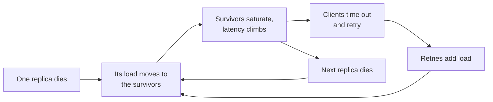

# Reliability, Consistency ও CAP {#ch-consistency-and-cap}

> একটি system কত ঘন ঘন down বা stale থাকতে পারে, তার একটি সংখ্যা ঠিক করুন, আর সেই দাম মেটায় এমন redundancy বাছুন।

**এই অধ্যায়ে:** nine-গুলো আর তাদের খরচ · system কীভাবে fail করে · CAP আর PACELC · consistency-র spectrum · quorum আর consensus

## 💡 মূল ধারণা

একটি system-এর প্রতিটি অংশ ভাঙে। Disk fail করে, network ভাগ হয়ে যায়, আর deploy ভুল হয়। Reliability মানে
*অংশগুলো* fail করার সময়ও *system* সেবা দিতে থাকে। উত্তর হলো redundancy: প্রতিটি জিনিসের একাধিক copy।

কিন্তু copy একটি দ্বিতীয় সমস্যা আনে। Data একাধিক machine-এ থাকলে copy-গুলো একমত না-ও হতে পারে। এই অমিল নিয়ে একটি
system যে প্রতিশ্রুতিগুলো দেয়, সেগুলোই consistency। শক্ত প্রতিশ্রুতির জন্য coordination লাগে, আর coordination-এর খরচ
latency আর availability। এই অধ্যায়ের দুটো অর্ধেকই budget।

> কিছু design করার আগে দুটো প্রশ্ন করুন। এটা মাসে কত মিনিট down থাকতে পারে? আর কোন feature-এর কোন read কতটা stale
> হতে পারে?

## কীভাবে কাজ করে

### Nine-গুলো

| Availability | বছরে downtime      | মাসে       | যা লাগে                                      |
| ------------ | ----------------- | --------- | ------------------------------------------ |
| 99%          | 3.65 দিন           | 7.2 h     | একটি machine, কেউ একজন on call               |
| 99.9%        | 8.8 h             | 43 min    | Redundant instance, automated deploy       |
| 99.99%       | 52 min            | 4.3 min   | Multi-zone, automatic failover, কোনো হাতের ধাপ নেই |
| 99.999%      | 5.3 min           | 26 s      | Multi-region active-active, আর তার উপযুক্ত budget |

প্রতিটি বাড়তি nine-এর খরচ আগেরটার চেয়ে মোটামুটি দশ গুণ। বেশিরভাগ internal tool-এর three nine লাগে না। বেশিরভাগ
payment path-এর four লাগে। সবচেয়ে বড়টার নাম বলার চেয়ে সঠিক target-এর নাম বলা শক্তিশালী উত্তর।

**Dependency গুণ হয়।** যে service-এর তিনটি dependency লাগে, প্রতিটি 99.9%-এ, সেটা প্রায় **99.7%**-এর বেশি হতে পারে
না। এটা বছরে মোটামুটি 26 ঘণ্টা downtime।

**Serial আর redundant availability:**

```typescript
// Serial dependencies multiply down; independent copies of one thing multiply up.
const serial = (...availabilities: number[]): number =>
  availabilities.reduce((acc: number, a: number) => acc * a, 1);

const redundant = (single: number, copies: number): number => 1 - Math.pow(1 - single, copies);

serial(0.999, 0.999, 0.999); // 0.997    — three hard dependencies
redundant(0.99, 3);          // 0.999999 — three independent copies
```

মূল শব্দটা **independent**। এক rack-এ থাকা তিনটি replica একই power supply ভাগ করে। এগুলো কোনো কিছুর তিনটি copy নয়।

### Target, আর এটা আপনাকে যে budget দেয়

আপনি যে availability বাছেন, সেটা হয় একটি **SLO**, আপনার internal target। এটা এরপরও যতটুকু failure অনুমতি দেয়,
অর্থাৎ 100% বিয়োগ SLO, সেটাই **error budget**। 30 দিনে 99.9%-এ এটা প্রায় 43 মিনিট। Budget "এই ঝুঁকির change-টা কি
ship করব?"-কে তর্ক থেকে পাটিগণিতে পরিণত করে। অক্ষত থাকলে ship করুন। খরচ হয়ে গেলে পরের কাজ reliability। মাপার
পদ্ধতি কীভাবে বাছবেন, contract-এর নিচে target কীভাবে রাখবেন আর budget কীভাবে খরচ করবেন, তা শেখানো হয়েছে
[Chapter ?? — Monitoring ও Observability-র মূল কথা](#ch-monitoring-fundamentals)-এ।

### System কীভাবে fail করে

**Single point of failure** হলো এমন যেকোনো অংশ, যার কোনো replica নেই। মানুষ load balancer, primary database, একটি
shared session cache, একটি DNS zone, আর renewal job ছাড়া একটি certificate গুনতে ভুলে যায়। Diagram-এ এদের খুঁজুন:
প্রতিটি box-এর দিকে আঙুল দিয়ে জিজ্ঞেস করুন, এটা হারিয়ে গেলে কী হয়।

একটি **cascading failure** ছোট একটি সমস্যাকে outage-এ পরিণত করে।



**Cascade একটি feedback loop: failure-এর জবাবই আরও failure-এর কারণ হয়ে ওঠে।**

Timeout, retry budget, circuit breaker আর load shedding এই loop ভাঙে। এগুলো শেখানো হয়েছে
[Chapter ?? — Resilience Pattern](#ch-resilience-patterns)-এ। এখানে যেটা প্রাসঙ্গিক, তা হলো headroom। Capacity-র 80%-এ
থাকা একটি tier একটি হারানো replica সামলাতে পারে না। কমপক্ষে N+1, আর zone জুড়ে N+2 ধরে পরিকল্পনা করুন।

**Readiness** check অগভীর রাখুন। Database ধীর হলেই যদি এটা fail করে, তাহলে প্রতিটি instance একসাথে pool ছেড়ে যায়,
আর একটি ধীর database পুরো outage হয়ে যায়।

### Redundancy আর recovery

Active-passive একটি অলস standby রাখে, আর কয়েক সেকেন্ড থেকে কয়েক মিনিটে failover করে। Active-active প্রতিটি node
ব্যবহার করে, আর সাথে সাথে failover করে। দুটোরই খরচ একটি copy-র প্রায় দ্বিগুণ। Recovery-র দুটো সংখ্যা আছে, আলাদাভাবে
ঠিক করা:

- **RPO (recovery point objective)** হলো আপনি কতটা data হারাতে পারেন। রাতের backup মানে 24 ঘণ্টা।
- **RTO (recovery time objective)** হলো recovery কতক্ষণ নিতে পারে। 2 TB restore করতে কয়েক ঘণ্টা লাগে।

> ⚠️ High availability আর disaster recovery আলাদা বিনিয়োগ। HA একটি node বা zone-এর failure স্বয়ংক্রিয়ভাবে টিকিয়ে
> রাখে। DR একটি হারানো region বা নষ্ট data টিকিয়ে রাখে, সাধারণত একজন মানুষকে জড়িয়ে। একটি highly available system-ও
> `WHERE` ছাড়া একটি `DELETE`-এ সবকিছু হারাতে পারে।

### CAP আসলে কী বলে

Redundant data দ্বিতীয় budget-টি আনে। CAP একটি distributed system-কে বর্ণনা করে একটি **network partition**-এর সময়:
এমন একটি বিচ্ছেদ, যেটা node-গুলোকে একে অপরের কাছে পৌঁছাতে দেয় না। Partition-এর সময় system-কে বাছতে হয়:

| পছন্দ   | Partition-এর সময় আচরণ                                  | উদাহরণ store                          |
| ------ | ------------------------------------------------------- | ------------------------------------ |
| **CP** | যে request ঠিকভাবে সামলাতে পারে না, সেটা প্রত্যাখ্যান করে       | etcd, ZooKeeper, Spanner             |
| **AP** | যেকোনো পৌঁছানো যায় এমন node থেকে উত্তর দেয়, পরে মিলিয়ে নেয়      | Cassandra, DynamoDB (eventual read)  |

Network সত্যিই partition হয়, তাই "CA" কোনো design পছন্দ নয়। সেটা একটি single machine।

> ⚠️ CAP-কে স্থায়ী label হিসেবে ধরবেন না। একটি CP system অনুপলব্ধ শুধু *ক্ষতিগ্রস্ত key-গুলোর জন্য, একটি
> partition-এর সময়*। Partition বিরল। প্রতিদিন যে trade-off আপনি টের পান, সেটা PACELC।

### PACELC: প্রতিদিনের trade-off

**যদি** একটি **P**artition থাকে, **A**vailability বা **C**onsistency বাছুন। **E**lse (নইলে), **L**atency বা
**C**onsistency বাছুন।

"Else" শাখাটাই প্রতিদিনের। তিনটি zone জুড়ে একটি quorum দিয়ে confirm করা write, একটি node দিয়ে confirm করা write-এর
চেয়ে ধীর। আপনি একমত হওয়ার জন্য millisecond খরচ করছেন। DynamoDB আর Cassandra default-এ latency-কে প্রাধান্য দেয়।
Spanner global consistency-র জন্য latency দিয়ে দাম দেয়।

### Consistency-র spectrum

Model বাছুন প্রতিটি feature-এর জন্য, পুরো system-এর জন্য নয়। বেশিরভাগ product-এর একসাথে তিন-চারটি লাগে।

| Model                | প্রতিশ্রুতি                                        | যার জন্য ব্যবহার করবেন                           |
| -------------------- | ----------------------------------------------- | ---------------------------------------------- |
| **Linearisable**     | প্রতিটি read সর্বশেষ write দেখে, একটি ক্রমে          | Balance, seat booking, unique username         |
| **Causal**           | নির্ভরশীল operation ক্রম অনুযায়ী দেখা যায়           | Comment thread: parent-এর আগে কোনো reply নয়     |
| **Read-your-writes** | একজন client সবসময় নিজের write দেখে               | একজন user তাঁর profile edit করছেন               |
| **Eventual**         | Write থামলে copy-গুলো একমত হয়                    | Feed, view count, like                         |

Linearisable-এর খরচ প্রতিটি write-এ একটি consensus round। Eventual-এর খরচ প্রায় কিছুই না, যতক্ষণ না একটি stale read
একটি নিয়ম ভাঙে। **সবচেয়ে সাধারণ অভিযোগের সবচেয়ে সস্তা সমাধান হলো read-your-writes।** একটি write-এর পরে replica
lag-এর চেয়ে বেশি সময় ধরে সেই user-এর read-গুলো primary-তে পাঠান। এটা একটি routing change, এর বেশি কিছু নয়।

### Quorum আর consensus

একটি leaderless store তিনটি সংখ্যা দিয়ে consistency ঠিক করে। **N** হলো replica-র সংখ্যা। **W** হলো কতগুলোকে একটি
write confirm করতে হবে। **R** হলো একটি read কতগুলোকে জিজ্ঞেস করে। **যখন W + R > N, read set আর write set একে অপরকে
ছেদ করে**, তাই একটি read সর্বশেষ write দেখে। N=3, W=2, R=2 হলো সাধারণ ভারসাম্য: দুটো path-ই একটি হারানো node সামলে
টিকে থাকে।

তবে ছেদ মানে কোনো global ক্রম নয়। দুটো একযোগে হওয়া write ভিন্ন set-এ পড়ে conflict করতে পারে।

**Consensus** (Raft, Paxos) সেই ক্রম দেয়। একটি leader প্রতিটি write তার log-এ যোগ করে, আর majority confirm করলে
commit করে। পাঁচ node-এর একটি cluster তিনটি দিয়ে commit করে, আর দুটো failure সামলে টিকে থাকে। Vote সমান-সমান ভাগ
হওয়া এড়াতে বিজোড় সংখ্যক node ব্যবহার করুন। Majority না থাকলে cluster write নেওয়া বন্ধ করে। এটা design অনুযায়ীই CP।

Replica-রা যখন সত্যিই conflicting write নেয়, তখন কাউকে সিদ্ধান্ত নিতে হয়। **Last write wins** নতুন timestamp-টা
রাখে আর অন্য write-টা চুপচাপ ফেলে দেয়। অনেক store-এ এটাই default, তাই এটা প্রস্তাব করার সময় সেটা বলুন। **Version
vector** conflict ধরে, আর দুটো version-ই app-এর হাতে দেয়। **CRDT** হলো এমন data type, যেগুলো সবসময় একইভাবে merge হয়।

## কখন ব্যবহার করবেন

| পরিস্থিতি                              | যা বাছবেন                                    | কেন                                          |
| ----------------------------------- | ------------------------------------------ | ------------------------------------------- |
| Internal admin tool                 | 99%, এক zone, দৈনিক backup                 | Downtime বিরক্তিকর, কিন্তু আয় হারানো নয়        |
| Consumer read path                  | 99.9%, multi-zone, eventual replica        | পৌঁছানো সস্তা, না পৌঁছালে চোখে পড়ে              |
| Payment, inventory, uniqueness      | 99.99%, linearisable, CP                   | ভুল উত্তরের খরচ একটি error page-এর চেয়ে বেশি   |
| একজন user নিজের data edit করছেন      | Eventual-এর ওপর read-your-writes            | সস্তা, আর চোখে পড়া অভিযোগটা ঠিক করে            |

## সাধারণ ভুল

**❌ এমন backup, যেটা কখনো restore করা হয়নি**

আপনার কাছে backup নেই। আপনার কাছে একটি file আছে। প্রথম restore-এই বেরিয়ে আসে বাদ পড়া grant, ভুল Postgres version,
আর আসলে যে চার ঘণ্টা লাগে সেটা।

**✅ প্রতি quarter-এ সময় মেপে একটি restore drill, ঘোষিত RTO-র বিপরীতে লিখে রাখা**

**❌ পুরো system-কে "eventually consistent" বলা**

তারপর checkout দুবার টাকা কাটে। পুরো system-এর জন্য একটিমাত্র label মানে design-টা করাই হয়নি।

**✅ প্রতিটি feature-এর জন্য একটি table**

> "Feed আর counter eventual। Profile read হলো read-your-writes। Payment আর seat linearisable, আর primary-তে যায়।"

## 🔑 মূল শিক্ষা

- Availability হলো একটি খরচের curve-সহ budget, আর প্রতিটি বাড়তি nine-এর খরচ মোটামুটি দশ গুণ।
- Serial dependency availability নামিয়ে দেয়, আর শুধু independent redundancy সেটা বাড়ায়।
- Error budget reliability-কে তর্ক থেকে পাটিগণিতে পরিণত করে: ship করবেন কি না।
- CAP খাটে শুধু একটি partition-এর সময়। PACELC-এর latency বনাম consistency-র trade-off-টাই আপনি প্রতিদিন দেন।
- Consistency বাছা হয় প্রতিটি feature-এর জন্য, আর read-your-writes প্রায় বিনা খরচে staleness-এর সবচেয়ে সাধারণ অভিযোগ ঠিক করে।

## Interview-এর প্রশ্ন

**Q: আপনার service চারটি dependency call করে, প্রতিটি 99.9% available। আপনার সর্বোচ্চ সীমা কত?**

প্রতিটি call বাধ্যতামূলক হলে প্রায় 99.6%। এটা বছরে মোটামুটি 35 ঘণ্টা downtime। এর চেয়ে ভালো করতে হলে service-এর চারটিই
লাগা চলবে না। যা পারেন cache করুন, অপ্রয়োজনীয় call-গুলো একটি degraded response দিয়ে ঐচ্ছিক করুন, আর timeout ছোট
রাখুন, যাতে একটি ধীর dependency request-এর budget খেয়ে না ফেলে।

**Q: High availability আর disaster recovery-র পার্থক্য কী?**

HA একটি node বা zone failure-এর মধ্যেও সেবা দিতে থাকে, স্বয়ংক্রিয়ভাবে, কয়েক সেকেন্ডে। DR পুরো একটি environment বা
data নিজেই হারানোর পরে সেবা ফিরিয়ে আনে, প্রায়ই একজন মানুষকে জড়িয়ে। এরা ভিন্ন ঘটনা থেকে রক্ষা করে, তাই একটি থাকা
মানে অন্যটি থাকা নয়।

**Q: একটি eventually consistent system-এ একজন user বলছেন তাঁর profile edit "save হয়নি"। আপনি কী করবেন?**

প্রায় নিশ্চিতভাবেই এটা save হয়েছে, আর read-টা একটি পিছিয়ে থাকা replica-তে পড়েছে। Read-your-writes যোগ করুন: পর্যবেক্ষণ
করা lag-এর চেয়ে বেশি সময় ধরে সেই user-এর read-গুলো primary-তে route করুন। এটা একটি routing change, নতুন কোনো
consistency model নয়।

**Q: কখন eventual consistency গ্রহণযোগ্য নয়?**

যখন একটি stale read-এর ভিত্তিতে কাজ করলে এমন একটি নিয়ম ভাঙে যেটা system-কে রাখতেই হবে। দুজন মানুষ শেষ seat-টা
কেনেন, একটি account শূন্যের নিচে নামে, বা দুজন user একটি username দাবি করেন। পরীক্ষাটা এই নয় যে staleness চোখে
পড়ে কি না। পরীক্ষাটা হলো, stale data এমন একটি অবস্থা তৈরি করতে পারে কি না যেটাকে system অবৈধ বলে।

## এরপর কী পড়বেন

- [Chapter ?? — Resilience Pattern](#ch-resilience-patterns) — timeout, retry আর circuit breaker, যেগুলো একটি cascade থামায়
- [Chapter ?? — Datastore বাছাই ও তার Replication](#ch-choosing-a-datastore) — যে mechanism এই অধ্যায়ে মাপা staleness তৈরি করে
- [Chapter ?? — বড় পরিসরে Sharding ও Transaction](#ch-sharding) — একটি operation যখন কয়েকটি store জুড়ে ছড়ায়, তখন কী হয়
