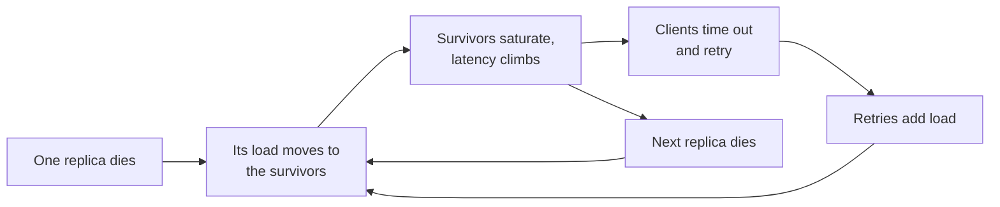

# Reliability, Consistency ও CAP {#ch-consistency-and-cap}

> একটি system কত ঘন ঘন down বা stale হতে পারবে, তা সংখ্যায় বলুন, আর সেই খরচ মেটায় এমন redundancy বেছে নিন।

**এই অধ্যায়ে:** nine-গুলো আর তাদের দাম · system কীভাবে ভাঙে · CAP আর PACELC · consistency-র বর্ণালি · quorum আর consensus

## 💡 মূল ধারণা

System-এর প্রতিটি অংশই একদিন ভাঙে। Disk নষ্ট হয়, network ভাগ হয়ে যায়, deploy ভুল হয়। Reliability মানে *অংশগুলো*
ভাঙার মধ্যেও *system* সেবা দিয়ে যায়। উত্তর হলো redundancy: প্রতিটি জিনিসের একাধিক copy।

কিন্তু copy আনে দ্বিতীয় একটি সমস্যা। Data একাধিক machine-এ থাকলে copy-গুলো না মিলতে পারে। এই অমিল নিয়ে system যে
প্রতিশ্রুতিগুলো দেয়, সেগুলোই consistency। প্রতিশ্রুতি যত কড়া, তত coordination লাগে, আর coordination-এর দাম দিতে হয়
latency আর availability দিয়ে। এই অধ্যায়ের দুটি অর্ধেকই আসলে budget।

> কিছু design করার আগে দুটি প্রশ্ন করুন। মাসে কত মিনিট এটা down থাকতে পারবে? আর কোন feature-এর কোন read কতটা stale
> হলে চলবে?

## কীভাবে কাজ করে

### Nine-গুলো

| Availability | বছরে downtime | মাসে | কী লাগে |
| ------------ | ------------ | ---- | ------ |
| 99% | 3.65 দিন | 7.2 h | একটি machine, আর on call-এ একজন মানুষ |
| 99.9% | 8.8 h | 43 min | Redundant instance, automated deploy |
| 99.99% | 52 min | 4.3 min | Multi-zone, automatic failover, কোনো manual ধাপ নেই |
| 99.999% | 5.3 min | 26 s | Multi-region active-active, আর তার মাপের budget |

প্রতিটি বাড়তি nine-এর খরচ আগেরটার মোটামুটি দশ গুণ। বেশিরভাগ internal tool-এর three nines লাগে না। বেশিরভাগ payment
path-এর লাগে four। সবচেয়ে উঁচু লক্ষ্যের চেয়ে সঠিক লক্ষ্যের নাম বলাই জোরালো উত্তর।

**Dependency গুণ হয়।** যে service-এর তিনটি dependency লাগে, প্রত্যেকটি 99.9%, সেটা প্রায় **99.7%**-এর বেশি যেতে পারে
না। মানে বছরে মোটামুটি 26 ঘণ্টা downtime।

**Serial আর redundant availability:**

```typescript
// Serial dependencies multiply down; independent copies of one thing multiply up.
const serial = (...availabilities: number[]): number =>
  availabilities.reduce((acc: number, a: number) => acc * a, 1);

const redundant = (single: number, copies: number): number => 1 - Math.pow(1 - single, copies);

serial(0.999, 0.999, 0.999); // 0.997    — three hard dependencies
redundant(0.99, 3);          // 0.999999 — three independent copies
```

মূল শব্দ হলো **independent**। একই rack-এ তিনটি replica একই power supply ভাগ করে। সেগুলো আসলে কোনো কিছুরই তিনটি copy
নয়।

### লক্ষ্য, আর তা থেকে পাওয়া budget

যে availability বেছে নেন, সেটাই হয় **SLO**, আপনার ভেতরের লক্ষ্য। এরপরও যতটা failure চলে, মানে 100% থেকে SLO বাদ দিলে
যা থাকে, সেটাই **error budget**। 30 দিনে 99.9% ধরলে সেটা প্রায় 43 মিনিট। এই budget "ঝুঁকিপূর্ণ এই change ship করব
কি?" প্রশ্নটাকে তর্ক থেকে সরিয়ে হিসাবে নিয়ে আসে। Budget অটুট থাকলে ship করুন। ফুরিয়ে গেলে পরের কাজ reliability। কী
মাপবেন, contract-এর চেয়ে নিচে লক্ষ্য কীভাবে রাখবেন, আর budget কীভাবে খরচ করবেন, তা শেখানো হয়েছে
[Chapter ?? — Monitoring ও Observability-র মূল কথা](#ch-monitoring-fundamentals)-এ।

### System কীভাবে ভাঙে

**Single point of failure** মানে এমন যেকোনো অংশ, যার কোনো replica নেই। মানুষ গুনতে ভুলে যায় load balancer, primary
database, একটি shared session cache, একটি DNS zone, আর renewal job ছাড়া একটি certificate। Diagram-এ এগুলো খুঁজে বের
করুন: প্রতিটি box-এর দিকে আঙুল রেখে জিজ্ঞেস করুন, এটা উধাও হলে কী হবে।

**Cascading failure** একটি ছোট সমস্যাকে outage বানিয়ে দেয়।



**Cascade একটি feedback loop: failure-এর প্রতিক্রিয়াই আরও failure-এর কারণ হয়ে দাঁড়ায়।**

Timeout, retry budget, circuit breaker আর load shedding এই loop ভাঙে। এগুলো শেখানো হয়েছে
[Chapter ?? — Resilience Pattern](#ch-resilience-patterns)-এ। এখানে যা দরকার, তা হলো বাড়তি জায়গা। যে tier capacity-র
80%-এ চলছে, সেটা একটি replica হারানোর ধাক্কা সামলাতে পারে না। কমপক্ষে N+1 ধরে পরিকল্পনা করুন, আর zone জুড়ে N+2।

**Readiness** check অগভীর রাখুন। Database ধীর হলেই যদি এটা fail করে, তাহলে প্রতিটি instance একসঙ্গে pool থেকে বেরিয়ে
যায়, আর একটি ধীর database পুরো outage হয়ে দাঁড়ায়।

### Redundancy আর recovery

Active-passive একটি অলস standby রাখে, আর কয়েক সেকেন্ড থেকে কয়েক মিনিটে failover করে। Active-active প্রতিটি node ব্যবহার
করে, আর সঙ্গে সঙ্গে failover করে। দুটিরই খরচ একটি copy-র প্রায় দ্বিগুণ। Recovery-র দুটি সংখ্যা আছে, আলাদা আলাদা ঠিক
করতে হয়:

- **RPO (recovery point objective)** মানে কতটা data হারালে চলবে। রাতে একবার backup মানে 24 ঘণ্টা।
- **RTO (recovery time objective)** মানে recovery-তে কত সময় লাগতে পারবে। 2 TB restore করতে কয়েক ঘণ্টা লাগে।

> ⚠️ High availability আর disaster recovery আলাদা বিনিয়োগ। HA একটি node বা zone নষ্ট হলে নিজে থেকেই টিকে থাকে। DR
> টিকিয়ে রাখে পুরো region হারালে বা data নষ্ট হলে, সাধারণত একজন মানুষের হাত লাগিয়ে। একটি highly available system-ও
> `WHERE` ছাড়া একটি `DELETE`-এ সবকিছু হারাতে পারে।

### CAP আসলে কী বলে

Redundant data আনে দ্বিতীয় budget। CAP একটি distributed system-কে বর্ণনা করে **network partition**-এর সময়, মানে এমন
একটি ভাঙন, যাতে node-গুলো একে অপরের কাছে পৌঁছাতে পারে না। Partition চলাকালীন system-কে বেছে নিতে হয়:

| পছন্দ | Partition-এর সময় আচরণ | উদাহরণ store |
| ----- | -------------------- | ----------- |
| **CP** | যে request ঠিকভাবে সামলাতে পারবে না, তা ফিরিয়ে দেয় | etcd, ZooKeeper, Spanner |
| **AP** | নাগালের যেকোনো node থেকে উত্তর দেয়, পরে মিলিয়ে নেয় | Cassandra, DynamoDB (eventual read) |

Network সত্যিই partition হয়, তাই "CA" কোনো design-এর পছন্দ নয়। ওটা একটি single machine।

> ⚠️ CAP-কে স্থায়ী একটি তকমা ভাববেন না। একটি CP system অচল থাকে শুধু *প্রভাবিত key-গুলোর জন্য, partition চলাকালীন*।
> Partition কালেভদ্রে হয়। প্রতিদিন যে লেনদেনটা টের পান, সেটা PACELC।

### PACELC: প্রতিদিনের লেনদেন

**যদি** **P**artition হয়, বেছে নিন **A**vailability না **C**onsistency। **নইলে** (**E**lse), বেছে নিন **L**atency না
**C**onsistency।

"নইলে" শাখাটাই প্রতিদিনের। তিনটি zone জুড়ে quorum যে write নিশ্চিত করে, সেটা একটি node-এর নিশ্চিত করা write-এর চেয়ে
ধীর। আপনি মতৈক্যের জন্য millisecond খরচ করছেন। DynamoDB আর Cassandra default-এ latency-কে প্রাধান্য দেয়। Spanner
global consistency-র জন্য latency-র দাম দেয়।

### Consistency-র বর্ণালি

Model বেছে নিন feature ধরে, পুরো system ধরে নয়। বেশিরভাগ product-এ একসঙ্গে তিন-চারটি লাগে।

| Model | প্রতিশ্রুতি | কীসে ব্যবহার করবেন |
| ----- | --------- | ---------------- |
| **Linearisable** | প্রতিটি read সর্বশেষ write দেখে, একটিই ক্রমে | Balance, seat booking, অনন্য username |
| **Causal** | নির্ভরশীল operation-গুলো ক্রম মেনে দেখা দেয় | Comment thread: parent-এর আগে কোনো reply নয় |
| **Read-your-writes** | একটি client সবসময় নিজের write দেখে | নিজের profile edit করছেন এমন user |
| **Eventual** | Write থামলে copy-গুলো মিলে যায় | Feed, view count, like |

Linearisable-এ প্রতিটি write-এর জন্য একটি consensus round লাগে। Eventual-এর খরচ প্রায় কিছুই না, যতক্ষণ না একটি stale
read কোনো নিয়ম ভাঙে। **সবচেয়ে সাধারণ অভিযোগের সবচেয়ে সস্তা সমাধান read-your-writes।** Write-এর পর সেই user-এর read
primary-তে পাঠান, replica lag-এর চেয়ে বেশি সময় ধরে। এটা শুধু routing-এর একটি change, এর বেশি কিছু নয়।

### Quorum আর consensus

Leader ছাড়া একটি store তিনটি সংখ্যা দিয়ে consistency ঠিক করে। **N** হলো replica-র সংখ্যা। **W** হলো কতগুলোকে একটি
write নিশ্চিত করতে হবে। **R** হলো একটি read কতগুলোকে জিজ্ঞেস করে। **W + R > N হলে read-এর set আর write-এর set একে
অপরের ওপর পড়ে**, তাই read সর্বশেষ write দেখতে পায়। N=3, W=2, R=2 হলো সাধারণ ভারসাম্য: একটি node হারালেও দুটি পথই টিকে
থাকে।

তবে overlap মানে global ক্রম নয়। একই সময়ের দুটি write আলাদা set-এ পড়ে conflict করতে পারে।

**Consensus** (Raft, Paxos) সেই ক্রম দেয়। একজন leader প্রতিটি write নিজের log-এ যোগ করে, আর majority নিশ্চিত করলে commit
করে। পাঁচ node-এর একটি cluster তিনটি দিয়ে commit করে, আর দুটি failure সামলাতে পারে। ভোট সমান সমান ভাগ হওয়া এড়াতে
node-এর সংখ্যা বিজোড় রাখুন। Majority না থাকলে cluster write নেওয়া বন্ধ করে দেয়। এটা design অনুযায়ীই CP।

Replica-রা সত্যিই conflict করা write নিলে কাউকে না কাউকে সিদ্ধান্ত নিতে হয়। **Last write wins** নতুন timestamp-টা রাখে,
আর অন্য write-টা চুপচাপ ফেলে দেয়। অনেক store-এ এটাই default, তাই প্রস্তাব করার সময় সেটা বলে দিন। **Version vector**
conflict ধরে ফেলে, আর দুটি version-ই app-এর হাতে দেয়। **CRDT** এমন data type, যা সবসময় একইভাবে merge হয়।

## কখন ব্যবহার করবেন

| পরিস্থিতি | কী বেছে নেবেন | কেন |
| -------- | ----------- | --- |
| Internal admin tool | 99%, এক zone, দৈনিক backup | Downtime বিরক্তিকর, কিন্তু আয় হারানো নয় |
| Consumer read path | 99.9%, multi-zone, eventual replica | পৌঁছানো সস্তা, আর না পৌঁছালে চোখে পড়ে |
| Payment, inventory, অনন্যতা | 99.99%, linearisable, CP | ভুল উত্তরের দাম error page-এর চেয়ে বেশি |
| নিজের data edit করছেন এমন user | Eventual-এর ওপর read-your-writes | সস্তা, আর চোখে পড়া অভিযোগটা মিটিয়ে দেয় |

## সাধারণ ভুল

**❌ এমন backup, যা কখনো restore করা হয়নি**

আপনার কাছে backup নেই, আছে একটি file। প্রথম restore-এই ধরা পড়ে হারানো grant, ভুল Postgres version, আর আসলে যে চার
ঘণ্টা লাগে সেটা।

**✅ প্রতি quarter-এ সময় মেপে restore-এর মহড়া, ঘোষিত RTO-র পাশে লিখে রাখা**

**❌ পুরো system-কে "eventually consistent" বলা**

তারপর checkout দুবার টাকা কাটে। পুরো system-এর জন্য একটিই তকমা মানে design-এর কাজটাই হয়নি।

**✅ Feature ধরে একটি table**

> "Feed আর counter eventual। Profile read হলো read-your-writes। Payment আর seat linearisable, আর সেগুলো primary-তে যায়।"

## 🔑 মূল শিক্ষা

- Availability একটি budget, যার একটি খরচের বাঁক আছে। প্রতিটি বাড়তি nine-এর খরচ মোটামুটি দশ গুণ।
- Serial dependency availability নামিয়ে দেয়, আর শুধু independent redundancy সেটা ওপরে তোলে।
- Error budget reliability-কে তর্ক থেকে সরিয়ে ship করবেন কি না সেই হিসাবে নিয়ে আসে।
- CAP খাটে শুধু partition-এর সময়। PACELC-এর latency বনাম consistency-র লেনদেনটাই প্রতিদিন দাম দিয়ে করতে হয়।
- Consistency বেছে নেওয়া হয় feature ধরে, আর read-your-writes প্রায় বিনা খরচে staleness-এর সবচেয়ে সাধারণ অভিযোগটা মেটায়।

## Interview-এর প্রশ্ন

**Q: আপনার service চারটি dependency call করে, প্রত্যেকটি 99.9% available। আপনার সর্বোচ্চ সীমা কত?**

প্রতিটি call বাধ্যতামূলক হলে প্রায় 99.6%। মানে বছরে মোটামুটি 35 ঘণ্টা downtime। এর চেয়ে ভালো করতে হলে service-এর চারটিই
লাগা চলবে না। যা পারেন cache করুন। অপ্রধান call-গুলো ঐচ্ছিক করুন, সঙ্গে একটি কমানো মানের response। আর timeout ছোট
রাখুন, যাতে একটি ধীর dependency পুরো request-এর budget খেয়ে না ফেলে।

**Q: High availability আর disaster recovery-র পার্থক্য কী?**

HA একটি node বা zone নষ্ট হলেও নিজে থেকে, কয়েক সেকেন্ডে, সেবা চালিয়ে যায়। DR পুরো একটি environment বা data-ই হারানোর
পর সেবা ফিরিয়ে আনে, প্রায়ই একজন মানুষের হাত লাগিয়ে। দুটি আলাদা ঘটনা থেকে রক্ষা করে, তাই একটি থাকলেই অন্যটি থাকে না।

**Q: Eventually consistent একটি system-এ একজন user বলছেন তাঁর profile edit "save হয়নি"। কী করবেন?**

প্রায় নিশ্চিতভাবে save হয়েছে, আর read গিয়ে পড়েছে পিছিয়ে থাকা একটি replica-তে। Read-your-writes যোগ করুন: সেই user-এর
read primary-তে পাঠান, দেখা lag-এর চেয়ে বেশি সময় ধরে। এটা routing-এর একটি change, নতুন কোনো consistency model নয়।

**Q: কখন eventual consistency মেনে নেওয়া যায় না?**

যখন stale read-এর ভিত্তিতে কাজ করলে এমন নিয়ম ভাঙে, যা system-কে রক্ষা করতেই হবে। দুজন মানুষ শেষ seat-টা কিনে ফেলেন,
একটি account শূন্যের নিচে নামে, কিংবা দুজন user একই username দাবি করেন। পরীক্ষাটা এই নয় যে staleness চোখে পড়ে কি না।
পরীক্ষা হলো, stale data এমন কোনো অবস্থা তৈরি করতে পারে কি না, যাকে system অবৈধ বলে।

## এরপর কী পড়বেন

- [Chapter ?? — Resilience Pattern](#ch-resilience-patterns) — যে timeout, retry আর circuit breaker cascade থামায়
- [Chapter ?? — Datastore বাছাই ও তার Replication](#ch-choosing-a-datastore) — যে mechanism থেকে এই অধ্যায়ে মাপা staleness তৈরি হয়
- [Chapter ?? — বড় পরিসরে Sharding ও Transaction](#ch-sharding) — একটি operation কয়েকটি store জুড়ে ছড়ালে কী হয়
