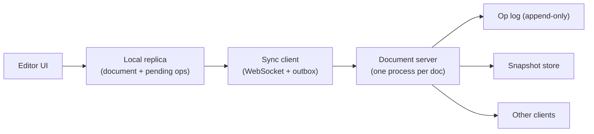

# একটি Collaborative Document Editor Design করুন {#ch-design-collaborative-editor}

> পঞ্চাশজন মানুষকে একই paragraph-এ type করতে দিন, তাদের কেউ কেউ offline, আর শেষে প্রতিটি screen যেন হুবহু এক হয়।

**এই অধ্যায়ে:** convergence-এর সমস্যা · OT বনাম CRDT · document-এর data model · sync protocol · shared document-এ undo

## 💡 মূল ধারণা

কঠিন অংশটা socket দিয়ে keystroke পাঠানো নয়। কঠিন হলো, দুজন মানুষ একই মুহূর্তে **একই জায়গায়** edit করেন, তাঁদের
একজন হয়তো signal ছাড়া ট্রেনে, আর দুটি edit-কেই টিকে থাকতে হবে। একটি lock এটা সমাধান করত, আর product-টাকে শেষ
করে দিত। তাই প্রতিটি replica একসাথে edit করতে পারে, আর merge-এর নিয়মটা গাণিতিক, দর-কষাকষি করে ঠিক করা নয়।

একটি constraint বাকি সব ঠিক করে দেয়: **server জানার আগেই local edit render হয়**। Client-এর কাছে একটি পূর্ণ
replica থাকে, আর server হলো একটি log-সহ relay। একমাত্র খোলা প্রশ্ন হলো, আপনি কোন merge rule বাছবেন।

> এটা একটি frontend round, যে distributed system-এর পোশাক পরে আছে। এটা শুরুতেই জোরে বলুন।

## কীভাবে কাজ করে

### Requirement

**Functional:** কয়েকজন মানুষ একটি document-এ type করেন, আর কয়েকশো millisecond-এর মধ্যে একে অপরের লেখা আর
cursor দেখেন। Offline-এ করা edit আবার connect হলে merge হয়। Undo আপনার নিজের শেষ পরিবর্তন ফেরায়, সহকর্মীর নয়।

**Scope-এর বাইরে:** comment, suggestion mode, media embed, permission।

**Non-functional:** একটি local keystroke 16 ms-এর কম সময়ে paint হয়, কখনো round trip-এর পেছনে নয়। যে replica-গুলো
একই edit দেখেছে, তারা একই document দেখায়। একদিন offline থাকা client-ও merge করতে পারে।

**Scale:** বেশিরভাগ document-এ একসাথে 1–5 জন editor থাকেন। 50 জনের জন্য design করুন, সাথে কিছু document-এর
একটি tail ধরে রাখুন, যেগুলোতে 5 MB লেখা আর দশ বছরের history আছে।

### Architecture



**প্রতিটি edit আগে locally apply হয়, তারপর queue-তে যায়; server কখনো typing path-এ থাকে না।**

Server ইচ্ছা করেই সাদামাটা। সে operation-গুলো অন্য client-দের কাছে route করে, একটি log-এ যোগ করে, আর মাঝে মাঝে
একটি snapshot নেয়। সে **প্রতি document-এ stateful**: এক document, এক process। এতে ক্রম ঠিক করার একটিই জায়গা
থাকে, আর fan-out (প্রতিটি edit বাকি সব client-কে পাঠানো) খুব সহজ হয়ে যায়।

### Convergence-এর নিয়ম: OT নাকি CRDT

| | **Operational Transformation** | **CRDT** |
| --- | --- | --- |
| কীভাবে merge করে | আগত operation-কে সেইসব operation-এর সাপেক্ষে নতুন করে লেখে, যেগুলো সে দেখেনি | প্রতিটি অক্ষরের একটি identity আছে; merge হলো set union |
| Central server লাগে | হ্যাঁ — সে operation-এর ক্রম ঠিক করে | না |
| Disk-এ খরচ | কম: লেখা আর একটি log | বেশি: প্রতি অক্ষরে metadata, সাথে tombstone |
| ঘণ্টার পর ঘণ্টা offline | কষ্টকর — transform chain বড় হতে থাকে | স্বাভাবিক |

এখানে **CRDT** (conflict-free replicated data type) বাছুন। Requirement-এ "offline edit merge হয়" আছে, আর OT ঠিক
এই শর্তেই হিমশিম খায়। খরচটার নাম বলুন: প্রতি অক্ষরে metadata, আর tombstone (মুছে ফেলা অক্ষরের চিহ্ন), যা কখনো
পুরোপুরি যায় না।

> ⚠️ কোনোটাই শূন্য থেকে বানানোর দাবি করবেন না। Senior উত্তর একটি library-র নাম বলে, যেমন Yjs বা Automerge। সে
> কোন property দরকার সেটা বলে, আর সময় দেয় সেই জিনিসে, যা library সমাধান করে না।

### Data model

একটি CRDT sequence offset নয়, অক্ষর store করে। ওপরে কোনো remote edit এসে পড়লেই offset অর্থহীন হয়ে যায়।

**Document-এর একক:**

```typescript
interface CharId {
  readonly replica: string; // one per tab, not per user
  readonly counter: number; // monotonic within that replica
}

interface Char {
  readonly id: CharId;
  readonly value: string;
  readonly after: CharId | null; // the character this one was inserted after
  deleted: boolean;              // a tombstone, never a splice
}
```

Delete করা মানে একটি flag set করা। Element-টা সরিয়ে দিলে যেকোনো concurrent insert, যা ওটার দিকে point করে, ভেঙে
যেত। তাই অক্ষরটা থেকে যায়, আর renderer সেটা বাদ দিয়ে যায়। একই অক্ষরের পরে দুটি insert-এর ক্রম replica-গুলো ঠিক করে
`CharId` তুলনা করে। নিয়মটা খেয়ালখুশি মতো, কিন্তু প্রতিটি replica-তে **হুবহু এক**, আর পুরো কৌশল এটুকুই।

### Interface

একটি socket, আর presence-এর জন্য আলাদা একটি lane:

```typescript
type ClientMessage =
  | { type: "ops"; docId: string; ops: readonly Op[]; since: number }
  | { type: "awareness"; cursor: { anchor: CharId; head: CharId } };

type ServerMessage =
  | { type: "ops"; ops: readonly Op[]; seq: number }
  | { type: "snapshot"; state: Uint8Array; seq: number } // on join, or when far behind
  | { type: "awareness"; peers: readonly Peer[] };
```

Awareness (cursor, selection, কে আছেন) **ফেলে দেওয়ার মতো**। এটা অনেক ঘন ঘন আসে, এক সেকেন্ড পরেই মূল্যহীন, আর কখনো
log-এ লেখা হয় না। এটাকে স্থায়ী channel-এ রাখুন, তাহলে 5 KB-র একটি document-এর log 40 MB হয়ে যাবে।

### যে undo আপনার নিজের

`Ctrl+Z` যেন সহকর্মীর বাক্য মুছে না দেয়, তাই undo কোনো global stack নয়। প্রতিটি replica নিজের inverse operation-এর
একটি stack রাখে। সে inverse-টা একটি **নতুন edit** হিসেবে apply করে, যা তারপর অন্য যেকোনো edit-এর মতোই merge হয়।
History শুধু সামনের দিকে বাড়ে। কিছুই পেছনে ফেরে না।

### Optimisation

**Snapshot আর compact।** একটি document খুলতে দশ বছরের operation replay করা চলে না। প্রতি কয়েক হাজার operation-এ
একটি snapshot নিন। নতুন যোগ দেওয়া client পায় snapshot আর তার পরের tail।

**Tick-এ batch করুন।** পঞ্চাশজন মানুষ সেকেন্ডে 8টি অক্ষর type করলে সেকেন্ডে 400 message যায়, আর 49 জন peer-এ
fan-out করলে সেটা প্রায় 20,000। Client আর fan-out দুই জায়গাতেই 50 ms-এর tick-এ একত্র করুন, তাহলে type-এর গতি যা-ই
হোক, প্রতিটি peer সেকেন্ডে 20টি message পায়। CRDT একটি batch-কে হুবহু একইভাবে merge করে।

## কখন ব্যবহার করবেন

| Requirement যদি বলে…            | Design বদলে হয়…                                            |
| ----------------------------------- | ------------------------------------------------------------------ |
| Conflict কম, offline দরকার নেই | প্রতি field-এ last-write-wins — CRDT এখানে over-engineering        |
| প্রতিটি edit server-কে অনুমোদন করতে হবে  | Server-authoritative, বা OT; local-first আর চলবে না          |
| খোলা লেখা নয়, structured record   | প্রতি field-এ একটি map CRDT, sequence-এর চেয়ে অনেক সস্তা                   |

## সাধারণ ভুল

**❌ Cursor-এর অবস্থান integer offset হিসেবে পাঠানো**

> `{ cursor: 412 }`

ওপরে একটি remote insert পড়ার মুহূর্তেই 412 নম্বর অক্ষরটা অন্য একটি অক্ষর হয়ে যায়। Cursor অন্য সবকিছুর মতোই
একটি `CharId`-তে নোঙর করে। Acknowledgement-এর জন্য keystroke আটকে রাখা সময়ের দিক থেকে একই ভুল। যে typing
server-এর জন্য অপেক্ষা করে, সেটা 80 ms-এ ভাঙা মনে হয়, আর 300 ms-এ ব্যবহারের অযোগ্য।

**✅ প্রতি document-এ একটি process**

> `docId` দিয়ে route করুন, যাতে একটিমাত্র process log-এর tail-এর মালিক হয়। ক্রম আর fan-out সহজ হয়ে যায়, আর
> system নিখুঁতভাবে shard হয়, কারণ document-গুলো কখনো একে অপরের সাথে কথা বলে না।

## 🔑 মূল শিক্ষা

- যে requirement architecture ঠিক করে, সেটা হলো "server দেখার আগেই local edit render হয়"।
- CRDT offline merge কিনে দেয়, আর তার দাম দেয় প্রতি অক্ষরের metadata আর কখনো না যাওয়া tombstone দিয়ে।
- Shared document-এ অবস্থান মানে অক্ষরের identity, কখনো integer offset নয়।
- Presence ফেলে দেওয়ার মতো traffic, আর durable operation-এর সাথে একই channel-এ থাকা চলবে না।
- Undo প্রতি replica-র নিজের, আর একটি inverse operation সামনের দিকে apply করে; shared history কখনো পেছনে ফেরায় না।

## Interview-এর প্রশ্ন

**Q: দুজন মানুষ একই মুহূর্তে একই অবস্থানে একটি অক্ষর insert করলেন। ক্রম কী ঠিক করে?**

দুটি insert-ই একই আগের অক্ষরের নাম দেয়। তাই replica-গুলো দুটি identifier (replica id আর counter) তুলনা করে, এমন
একটি total order দিয়ে, যা প্রতিটি replica একইভাবে হিসাব করে। এটা খেয়ালখুশি মতো, কিন্তু deterministic, আর
convergence-এর এটুকুই দরকার। একটি অক্ষর আগে বসে, আর সবাই একই অক্ষরকে আগে দেখে।

**Q: কখন আপনি CRDT ব্যবহার করবেন না?**

যখন কিছুই offline নয়, আর data খোলা লেখা নয়, structured। আলাদা আলাদা field-ওয়ালা একটি form প্রতি field-এ
last-write-wins দিয়েই ঠিকঠাক converge করে। একটি server-authoritative model নিয়ে যুক্তি দেওয়া আর audit করাও সহজ।
CRDT তার metadata-র খরচ পুষিয়ে দেয় শুধু তখন, যখন একটি sequence-এ concurrent edit স্বাভাবিক ঘটনা।

**Q: একটি client এক সপ্তাহ offline থেকে আবার connect করল। কী হয়?**

সে তার queue-তে থাকা operation-গুলো পাঠায়, আর তার শেষ sequence number-এর পর থেকে সবকিছু চায়। Tail বড় হলে
server বদলে একটি snapshot পাঠায়, আর client তার ওপর নিজের pending edit-গুলো merge করে। এটা নিরাপদ, কারণ merge
ক্রমের ওপর নির্ভর করে না। যে ঝুঁকির নাম বলতে হবে, সেটা হলো outbox। এটা শুধু memory-তে থাকলে এক সপ্তাহের কাজ
হারিয়ে যায়, তাই এর জায়গা IndexedDB-তে।

## এরপর কী পড়বেন

- [Chapter ?? — Offline-First Architecture](#ch-offline-first-architecture) — এই design যে storage আর sync queue ধরে নেয়
- [Chapter ?? — Queue, Async কাজ ও WebSocket](#ch-message-queues) — transport বাছাই, আর connection ধরে রাখার খরচ
- [Chapter ?? — Reliability, Consistency ও CAP](#ch-consistency-and-cap) — CRDT কেন একটি availability-র সিদ্ধান্ত, চালাকির সিদ্ধান্ত নয়
