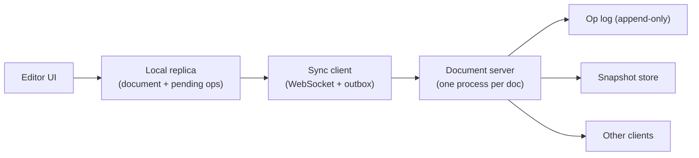

# একটি Collaborative Document Editor Design করুন {#ch-design-collaborative-editor}

> পঞ্চাশজন মানুষ একই paragraph-এ type করবেন, কয়েকজন offline থেকে, আর শেষে প্রতিটি screen-এ হুবহু একই জিনিস দেখা যাবে।

**এই অধ্যায়ে:** সবাইকে এক জায়গায় মেলানোর সমস্যা · OT না CRDT · document-এর data model · sync protocol · shared document-এ undo

## 💡 মূল ধারণা

কঠিন অংশটা socket দিয়ে keystroke পাঠানো নয়। কঠিন হলো, দুজন মানুষ একই মুহূর্তে **একই জায়গায়** edit করছেন, তাঁদের
একজন আবার signal-হীন ট্রেনে, আর দুটি edit-ই টিকে থাকতে হবে। Lock দিলে সমস্যা মিটে যেত, সঙ্গে product-টাও শেষ হয়ে
যেত। তাই প্রতিটি replica একসঙ্গে edit করতে পারে, আর merge-এর নিয়মটা গাণিতিক, আলোচনা করে ঠিক করা নয়।

একটা শর্তই বাকি সব ঠিক করে দেয়: **server খবর পাওয়ার আগেই local edit render হয়ে যায়**। Client-এর কাছে থাকে পুরো
একটা replica, আর server হলো log-ওয়ালা একটা relay। খোলা প্রশ্ন একটাই: কোন merge-এর নিয়ম বেছে নেবেন।

> এটা আসলে frontend round, distributed system-এর সাজ পরে আছে। এ কথা শুরুতেই জোরে বলে দিন।

## কীভাবে কাজ করে

### Requirement

**Functional:** কয়েকজন মানুষ একটা document-এ type করেন, আর কয়েকশো millisecond-এর মধ্যে একে অন্যের text আর cursor
দেখতে পান। Offline-এ করা edit reconnect হলে merge হয়। Undo আপনার নিজের শেষ পরিবর্তন ফেরায়, সহকর্মীর নয়।

**Scope-এর বাইরে:** comment, suggestion mode, media embed, permission।

**Non-functional:** local keystroke 16 ms-এর মধ্যে screen-এ ফোটে, কখনো আসা-যাওয়ার অপেক্ষায় থাকে না। যে replica-গুলো একই
edit দেখেছে, সেগুলো একই document দেখায়। একদিন offline থাকা client-ও merge করতে পারে।

**Scale:** বেশিরভাগ document-এ একসঙ্গে 1–5 জন edit করেন। Design করুন 50 জনের জন্য, সঙ্গে এমন কিছু document-এর লেজ, যাতে আছে
5 MB text আর দশ বছরের history।

### Architecture



**প্রতিটি edit আগে local-এ apply হয়, তারপর queue-তে যায়; typing-এর পথে server কখনো থাকে না।**

Server ইচ্ছে করেই একঘেয়ে। এটা operation অন্য client-দের কাছে পাঠায়, log-এ যোগ করে, আর মাঝে মাঝে snapshot নেয়। Server
**প্রতিটি document-এর জন্য stateful**: একটা document, একটা process। এতে ক্রম ঠিক করার জায়গা থাকে একটাই, আর fan-out
(প্রতিটি edit বাকি সব client-এ পাঠানো) একেবারে সহজ হয়ে যায়।

### মেলানোর নিয়ম: OT না CRDT

| | **Operational Transformation** | **CRDT** |
| --- | --- | --- |
| কীভাবে merge করে | আসা operation-কে সেইসব operation অনুযায়ী নতুন করে লেখে, যা সেটা দেখেনি | প্রতিটি অক্ষরের নিজস্ব পরিচয় আছে; merge মানে set union |
| কেন্দ্রীয় server লাগে | হ্যাঁ — server operation-এর ক্রম ঠিক করে | না |
| Disk-এ খরচ | কম: text আর একটা log | বেশি: প্রতিটি অক্ষরের metadata, সঙ্গে tombstone |
| কয়েক ঘণ্টা offline | কষ্টের — transform-এর শিকল লম্বা হতে থাকে | স্বাভাবিক |

এখানে **CRDT** (conflict-free replicated data type) বেছে নিন। Requirement-এ আছে "offline edit merge হয়", আর ঠিক এই শর্তেই
OT হিমশিম খায়। খরচটা নাম ধরে বলুন: প্রতিটি অক্ষরের metadata, আর tombstone (মুছে ফেলা অক্ষরের চিহ্ন), যা কখনো পুরোপুরি
যায় না।

> ⚠️ কোনোটাই শূন্য থেকে বানাবেন বলে দাবি করবেন না। Senior উত্তর একটা library-র নাম বলে, যেমন Yjs বা Automerge। কোন
> বৈশিষ্ট্যটা দরকার, সেটা বলে, আর সময় দেয় সেই অংশে, যা library সমাধান করে না।

### Data model

CRDT sequence রাখে অক্ষর, offset নয়। ওপরে কোনো remote edit এসে বসলেই offset অর্থহীন হয়ে যায়।

**Document-এর একক:**

```typescript
interface CharId {
  readonly replica: string; // one per tab, not per user
  readonly counter: number; // monotonic within that replica
}

interface Char {
  readonly id: CharId;
  readonly value: string;
  readonly after: CharId | null; // the character this one was inserted after
  deleted: boolean;              // a tombstone, never a splice
}
```

Delete করলে শুধু একটা flag বসে। Element-টা সরিয়ে দিলে সেটার দিকে নির্দেশ করা যেকোনো একসঙ্গে-চলা insert ভেঙে যেত। তাই
অক্ষরটা থেকে যায়, আর renderer সেটা এড়িয়ে যায়। একই অক্ষরের পরে দুটি insert এলে replica-রা `CharId` তুলনা করে ক্রম ঠিক
করে। নিয়মটা খেয়ালখুশির, কিন্তু প্রতিটি replica-য় **হুবহু এক**, আর পুরো কৌশলটা এটুকুই।

### Interface

একটা socket, আর presence-এর জন্য আলাদা একটা লেন:

```typescript
type ClientMessage =
  | { type: "ops"; docId: string; ops: readonly Op[]; since: number }
  | { type: "awareness"; cursor: { anchor: CharId; head: CharId } };

type ServerMessage =
  | { type: "ops"; ops: readonly Op[]; seq: number }
  | { type: "snapshot"; state: Uint8Array; seq: number } // on join, or when far behind
  | { type: "awareness"; peers: readonly Peer[] };
```

Awareness (cursor, selection, কে এখানে আছেন) **ফেলে দেওয়ার মতো**। এটা ঘন ঘন আসে, এক সেকেন্ড পরেই মূল্যহীন, আর কখনো
log-এ লেখা হয় না। টেকসই channel-এ রাখলে 5 KB-র একটা document-এর log 40 MB হয়ে যায়।

### যে undo শুধু আপনার

`Ctrl+Z` সহকর্মীর বাক্য মুছে দিতে পারবে না, তাই undo কোনো global stack নয়। প্রতিটি replica উল্টো operation-এর নিজস্ব
একটা stack রাখে। উল্টো operation-টা apply হয় **নতুন একটা edit** হিসেবে, যা তারপর অন্য যেকোনো edit-এর মতোই merge হয়।
History শুধু সামনে বাড়ে। কিছুই পেছনে ফেরে না।

### Optimisation

**Snapshot আর compact।** একটা document খুলতে দশ বছরের operation আবার চালানো চলে না। প্রতি কয়েক হাজার operation-এ
snapshot নিন। নতুন যোগ দেওয়া client পায় snapshot, সঙ্গে তার পরের লেজটুকু।

**Tick ধরে batch।** পঞ্চাশজন মানুষ সেকেন্ডে 8টি অক্ষর type করলে সেকেন্ডে 400 message যায়, আর 49 জন peer-এ fan-out করলে
সেটা দাঁড়ায় প্রায় 20,000-এ। Client আর fan-out, দুই জায়গাতেই 50 ms-এর tick ধরে একসঙ্গে জুড়ে দিন। তাহলে type যত দ্রুতই
হোক, প্রতিটি peer সেকেন্ডে 20টি message পায়। CRDT একটা batch-কেও হুবহু একইভাবে merge করে।

## কখন ব্যবহার করবেন

| Requirement যদি বলে…            | Design বদলে হয়…                                            |
| ----------------------------------- | ------------------------------------------------------------------ |
| Conflict কম হয়, offline দরকার নেই | প্রতিটি field-এ last-write-wins — CRDT এখানে বাড়াবাড়ি        |
| প্রতিটি edit server-কে অনুমোদন করতে হবে  | Server-authoritative, বা OT; local-first বাদ          |
| মুক্ত text নয়, গোছানো record   | প্রতিটি field-এ একটা map CRDT, sequence-এর চেয়ে অনেক সস্তা                   |

## সাধারণ ভুল

**❌ Cursor-এর অবস্থান integer offset হিসেবে পাঠানো**

> `{ cursor: 412 }`

ওপরে কোনো remote insert এসে বসার মুহূর্তেই 412 নম্বর অক্ষরটা অন্য অক্ষর হয়ে যায়। বাকি সবকিছুর মতো cursor-ও বাঁধা থাকে
একটা `CharId`-এ। Acknowledgement-এর জন্য keystroke আটকে রাখা একই ভুল, শুধু সময়ের হিসেবে। Server-এর অপেক্ষায় থাকা typing
80 ms-এ ভাঙা মনে হয়, আর 300 ms-এ ব্যবহারের অযোগ্য।

**✅ প্রতিটি document-এর জন্য একটা process**

> `docId` ধরে route করুন, যাতে log-এর শেষ অংশের মালিক থাকে একটাই process। ক্রম আর fan-out একেবারে সহজ হয়ে যায়, আর
> system নিখুঁতভাবে shard হয়, কারণ document-গুলো কখনো একে অন্যের সঙ্গে কথা বলে না।

## 🔑 মূল শিক্ষা

- যে requirement architecture ঠিক করে, সেটা হলো "server দেখার আগেই local edit render হয়"।
- CRDT দিয়ে offline merge পাওয়া যায়, আর তার দাম দিতে হয় প্রতিটি অক্ষরের metadata আর কখনো না যাওয়া tombstone দিয়ে।
- Shared document-এ অবস্থান মানে অক্ষরের পরিচয়, কখনো integer offset নয়।
- Presence ফেলে দেওয়ার মতো traffic, টেকসই operation-এর সঙ্গে এক channel-এ চলতে পারে না।
- Undo প্রতিটি replica-র নিজস্ব, আর উল্টো operation-টা সামনের দিকে apply করে; shared history কখনো পেছনে ফেরায় না।

## Interview-এর প্রশ্ন

**Q: দুজন মানুষ একই মুহূর্তে একই জায়গায় একটা করে অক্ষর insert করলেন। ক্রম ঠিক করে কী?**

দুটি insert-ই একই আগের অক্ষরের নাম বলে। তাই replica-রা দুটি identifier (replica id আর counter) তুলনা করে, এমন একটা পূর্ণ
ক্রম দিয়ে, যা প্রতিটি replica একইভাবে হিসাব করে। এটা খেয়ালখুশির, কিন্তু নির্দিষ্ট, আর সবাইকে এক জায়গায় মেলাতে এটুকুই
দরকার। একটা অক্ষর আগে বসে, আর সবাই একই অক্ষরকে আগে দেখে।

**Q: কখন CRDT ব্যবহার করবেন না?**

যখন কিছুই offline নয়, আর data মুক্ত text না হয়ে গোছানো। স্বাধীন field-ওয়ালা form প্রতিটি field-এ last-write-wins দিয়েই
ঠিকঠাক মিলে যায়। Server-authoritative model নিয়ে ভাবা আর audit করাও সহজ। CRDT তার metadata-র খরচ উশুল করে কেবল তখন,
যখন একটা sequence-এ একসঙ্গে edit হওয়া স্বাভাবিক ব্যাপার।

**Q: একটা client এক সপ্তাহ offline থেকে reconnect করল। কী হয়?**

Client তার queue-তে জমা operation পাঠায়, আর শেষ sequence number-এর পর থেকে সবকিছু চায়। সেই লেজ বড় হলে server তার বদলে
একটা snapshot পাঠায়, আর client নিজের বাকি edit-গুলো তার ওপর merge করে। এটা নিরাপদ, কারণ merge ক্রমের ওপর নির্ভর করে না।
যে ঝুঁকির নাম বলা উচিত, সেটা outbox। Outbox শুধু memory-তে থাকলে পুরো সপ্তাহের কাজ হারিয়ে যায়, তাই এর জায়গা IndexedDB-তে।

## এরপর কী পড়বেন

- [Chapter ?? — Offline-First Architecture](#ch-offline-first-architecture) — এই design যে storage আর sync queue ধরে নেয়
- [Chapter ?? — Queue, Async কাজ ও WebSocket](#ch-message-queues) — transport বাছাই, আর connection ধরে রাখার খরচ
- [Chapter ?? — Reliability, Consistency ও CAP](#ch-consistency-and-cap) — CRDT কেন availability-র সিদ্ধান্ত, চালাকির নয়
