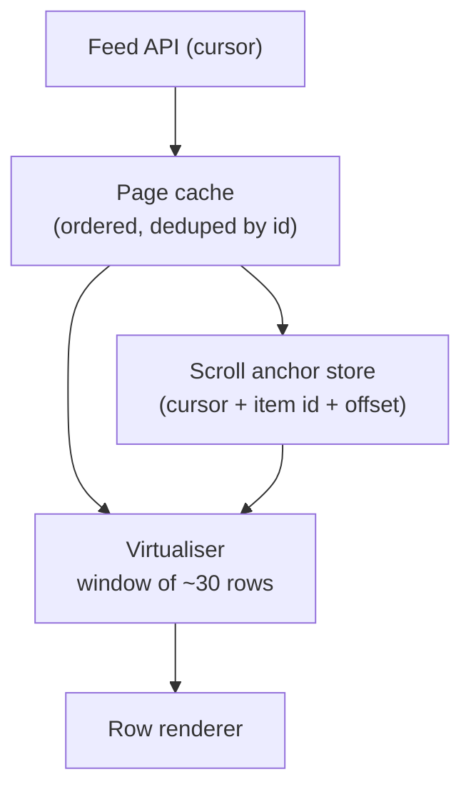

# একটি Infinite Feed Design করুন {#ch-design-infinite-feed}

> তিন বছরের পুরনো একটা Android-এ এক ঘণ্টা scroll করুন, অথচ tab ফুলে উঠবে না, আটকে আটকে চলবে না, আর আপনি কোথায় ছিলেন তাও হারাবে না।

**এই অধ্যায়ে:** দুটি budget · cursor pagination · virtualisation আর scroll anchoring · layout shift ছাড়া image · navigation-এর পর অবস্থান ফিরিয়ে আনা

## 💡 মূল ধারণা

Feed-এর কোনো শেষ নেই, কিন্তু device-এর সীমা আছে। দুটি আলাদা budget একসঙ্গে মানতে হয়, আর দুটিকে গুলিয়ে ফেলাই চিরচেনা
ভুল। **Network budget** হলো কতটা data আনছেন। **Render budget** হলো কতগুলো DOM node আছে। "Load more" শুধু প্রথমটা
সামলায়। দুই হাজার post-এর পর page ধীর হয়, কারণ *document-এর ভেতরে* দুই হাজার post আছে, JSON বড় ছিল বলে নয়। তাই
design DOM-এ row-এর একটা সরতে থাকা জানালা রাখে। Scroll-এর অবস্থানকেও data হিসেবে দেখে, যা জেনে-বুঝে জমা রাখা আর
ফিরিয়ে আনা হয়। Browser ঘটনাচক্রে ঠিক করে দেবে, এমন ভরসায় রাখা হয় না।

> এখানে senior হওয়ার লক্ষণ হলো, কেউ performance নিয়ে জিজ্ঞেস করার আগেই render budget-এর কথা তোলা।

## কীভাবে কাজ করে

### Requirement

**Functional:** text আর image মেশানো post-এর ওপর শেষহীন vertical scroll। User পড়ার সময়েই নতুন post আসে। একটা post
খুলে back চাপলে ঠিক একই row-তে ফেরা যায়।

**Scope-এর বাইরে:** ranking, বিজ্ঞাপন, comment, লেখা।

**Non-functional:** scroll চলার সময় interaction 200 ms-এর নিচে থাকে (INP), cumulative layout shift (CLS) 0.1-এর নিচে,
আর দুই হাজার item-এর পরেও memory সমান থাকে। মাঝারি মানের phone-এ প্রথম screen 2 সেকেন্ডের কম সময়ে ব্যবহারযোগ্য।

**Scale:** একটা session-এ 200–3,000 item। প্রতি page-এ 20টি। ধরে নিন, পড়ার সময়েই feed বদলাচ্ছে।

### Architecture



**Page cache বাড়ে; DOM বাড়ে না। Navigation পেরিয়ে টিকে থাকে anchor store।**

### Pagination: offset নয়, cursor

পাঠকের নিচে feed বদলানোর মুহূর্তেই offset ভুল হয়ে যায়।

| | **Offset** (`?page=3`) | **Cursor** (`?after=eyJzIjo...`) |
| --- | --- | --- |
| মাথায় একটা post যোগ হলো | পরের প্রতিটি page সরে যায় — user একটা post দুবার দেখেন | কোনো প্রভাব নেই: cursor একটা অবস্থানের নাম বলে, সংখ্যা নয় |
| একটা post মুছে গেল | একটা item নিঃশব্দে বাদ পড়ে | কোনো প্রভাব নেই |
| Server-এ খরচ | `OFFSET 60` 60টি row scan করে ফেলে দেয় | Cursor-এর key থেকে index seek |

Client-এর কাছে cursor অস্বচ্ছ। এর ভেতরে থাকে sort key আর সমতা ভাঙার জন্য একটা id, ফলে ক্রমটা পূর্ণ, আর paging কখনো
ঘুরপাক খেতে পারে না:

```typescript
interface FeedPage {
  readonly items: readonly FeedItem[];
  readonly nextCursor: string | null; // null means the end, not an error
}

interface FeedItem {
  readonly id: string;
  readonly kind: "text" | "image";
  readonly width: number;  // intrinsic media size, sent by the server
  readonly height: number; // so the client can reserve space before loading
}
```

`width` আর `height` দেখতে বাড়তি জঞ্জাল মনে হয়, কিন্তু এগুলোর জন্যই feed লাফায় না। এগুলো না থাকলে client জায়গা আগে থেকে
রাখতে পারে না। তখন প্রতিটি image load হওয়ার সঙ্গে সঙ্গে পাঠক যে text পড়ছেন, সেটা page-এর নিচে ঠেলে নামিয়ে দেয়।

### Virtualisation আর anchoring-এর সমস্যা

মোটামুটি একটা viewport-এর সমান row render করুন, সঙ্গে দুই পাশে এক screen করে overscan (screen-এর বাইরের বাড়তি row):
সব মিলিয়ে 30-এর মতো। Scroller-কে একটা spacer দিন, যার মাপ আসে মেপে নেওয়া উচ্চতা থেকে। যে row এখনো দেখা হয়নি,
তার জন্য একটা আন্দাজ ধরুন।

সূক্ষ্ম অংশটা হলো, আন্দাজ ভুল প্রমাণিত হলে কী হয়। Viewport-এর **ওপরের** কোনো row-এর উচ্চতা ঠিক করলে তার নিচের সবকিছু
সরে যায়, আর পাঠকের আঙুলের নিচের content লাফিয়ে ওঠে।

**উচ্চতা ঠিক করুন, তারপর সরে যাওয়াটা কাটাকাটি করে দিন:**

```typescript
function applyHeightCorrection(el: HTMLElement, deltaAbove: number): void {
  if (deltaAbove === 0) return;
  // The row above grew or shrank; move the scroll by the same amount so the
  // visible content stays exactly where it was.
  el.scrollTop += deltaAbove;
}
```

হাতে বানানো virtual list ভাঙা মনে হওয়ার সবচেয়ে সাধারণ কারণ হলো এই সমাধান ছাড়া বিভিন্ন উচ্চতার row।

> ⚠️ CSS `content-visibility: auto` rendering-এর কাজ এড়িয়ে যায়, কিন্তু node সরায় না। এটা render budget কমায়, memory-র
> budget কমায় না। তাই এটা virtualisation-এর জায়গা নেয় না, বরং পাশে থেকে সাহায্য করে।

### Image

Byte আসার আগেই box-টা জায়গা নিয়ে রাখুক, server-এর পাঠানো মাপ থেকে পাওয়া `aspect-ratio` দিয়ে। Fold-এর নিচেরগুলো load
করুন `loading="lazy"` দিয়ে, আর `fetchpriority="high"` দিন শুধু প্রথম একটি বা দুটিতে। সব মিলিয়ে CLS প্রায় শূন্যে থাকে,
ছোট ছোট সরে যাওয়া জমে বড় হয় না।

### অবস্থান ফিরিয়ে আনা

Browser-এর scroll restoration কাজ করে নির্দিষ্ট উচ্চতার document-এ, আর virtualised feed তেমন নয়। তার বদলে anchor জমা
রাখুন: কোন cursor load হয়েছিল, সবচেয়ে ওপরে দেখা item-এর id, আর তার ভেতরে কত pixel নিচে। ফিরে এলে সেই page আবার fetch
করুন, **item**-এ scroll করুন, তারপর offset-টা বসান। Pixel anchor-এর মতো নয়, id anchor তখনো কাজ করে, যখন user দূরে
থাকার সময় feed বদলে গেছে।

### Optimisation

**এক page আগেই prefetch করুন।** শেষ load হওয়া row viewport-এ ঢুকলে নয়, যখন সেটা প্রায় দুই screen দূরে, তখনই পরের
fetch শুরু করুন। তাহলে সাধারণ scroll-এ loader কখনো চোখেই পড়ে না।

**Viewport-এর ওপরে কখনো কিছু ঢোকাবেন না।** নতুন post যায় cache-এ, আর দেখা দেয় "12টি নতুন post" লেখা একটা pill হয়ে।
পাঠকের ওপরে DOM-এ ঢোকালে তাঁর নিচের page সরে যায়, আর সেটা bug বলে মনে হয়।

## কখন ব্যবহার করবেন

| Requirement যদি বলে…                | Design বদলে হয়…                                       |
| --------------------------------------- | ------------------------------------------------------------- |
| List-টা crawl করা বা link করা যেতে হবে  | আসল URL-সহ সংখ্যা দেওয়া page — infinite scroll-এর কোনো SEO গল্প নেই |
| Row-গুলোর উচ্চতা নির্দিষ্ট                 | মাপজোখ পুরো বাদ; হিসাবটা গুণ হয়ে যায়      |
| ~200-এর কম row, সব text          | সবগুলো render করুন — virtualisation এমন জটিলতা, যা আপনার দরকার নেই   |

## সাধারণ ভুল

**❌ Live feed-এ `page` আর `limit` দিয়ে pagination**

> `GET /feed?page=3&limit=20`

মাথায় একটা insert হলেই page 3 এখন page 2-এর একটা item আবার দেখায়। User-রা report করেন "একই post দুবার", আর শান্ত
একটা test account-এ এটা কখনো ধরা যায় না।

**✅ নিজস্ব মাপ থেকে জায়গা রেখে দিন**

> প্রতিটি media item-এর সঙ্গে `width` আর `height` পাঠান, সেগুলো থেকে `aspect-ratio` set করুন। তাহলে layout shift আর এমন
> সমস্যা থাকে না, যার পেছনে পরে দৌড়াতে হয়।

## 🔑 মূল শিক্ষা

- Network-এর খরচ আর DOM-এর খরচ আলাদা budget। কম data আনলেই লম্বা list দ্রুত হয় না।
- নিচের list পড়ার সময়েই বদলাতে পারলে cursor pagination পছন্দের বিষয় নয়, বাধ্যতামূলক।
- Viewport-এর ওপরে উচ্চতা ঠিক করলে সমান মাপের scroll adjustment দিয়ে কাটাকাটি করতে হবে, নইলে page লাফায়।
- Server-এর পাঠানো media-র মাপই layout shift-কে সমাধান হয়ে যাওয়া সমস্যা বানায়, পেছনে দৌড়ানোর সমস্যা নয়।
- Scroll restoration বাঁধা থাকে item id-তে, virtualised document-এ কখনো pixel offset-এ নয়।

## Interview-এর প্রশ্ন

**Q: User-রা বলছেন scroll করার সময় post দুবার দেখা যাচ্ছে। কী হচ্ছে?**

প্রায় নিশ্চিতভাবে API offset দিয়ে pagination করছে, আর তার মধ্যেই feed বদলাচ্ছে। মাথায় নতুন একটা post সবকিছুকে এক ঘর
নিচে ঠেলে দেয়। ফলে পরের page এক row আগে শুরু হয়, আর একটা item আবার দেখায়। Delete হলে ঠিক উল্টো bug হয়: একটা post
নিঃশব্দে বাদ পড়ে। Cursor pagination এটা ঠিক করে, আর page cache-এ id ধরে duplicate সরানো হলো সস্তা একটা নিরাপত্তা জাল।

**Q: List virtualised, তবু Android-এ আটকে আটকে চলে। কোথায় খুঁজবেন?**

কতগুলো row আছে তা নয়, প্রতিটি row কী করছে তা দেখুন। একটা সাধারণ কারণ হলো জায়গা না রাখা image, যা প্রতিটি load-এ
layout করতে বাধ্য করে। আরেকটা হলো এমন row, যা প্রতিটি scroll frame-এ আবার render হয়, কারণ handler state update করে।
তৃতীয়টা হলো খরচের কাজ, যেমন তারিখ format করা, যা cache করার সময় একবার না করে প্রতিটি render-এ করা হচ্ছে। একটা scroll
profile করুন, আর দেখুন লম্বা frame-গুলো layout না script, কারণ সমাধান দুই রকম।

**Q: কখন infinite scroll একেবারেই বানাবেন না?**

যখন content খুঁজে পাওয়া যেতে হবে (search result, documentation, crawl করা যায় এমন যেকোনো কিছু), বা যখন user-দের
footer দরকার। Infinite scroll link করা যায়, পৌঁছানো যায় এমন page ছেড়ে দিয়ে engagement কেনে। এটা product-এর সিদ্ধান্ত,
technical নয়। এই কথাটা বলাই সেই উত্তর, যা interviewer শুনতে চাইছেন।

## এরপর কী পড়বেন

- [Chapter ?? — Performance, Transition ও Compiler](#ch-react-performance-and-the-compiler) — virtualiser যে frame budget রক্ষা করছে
- [Chapter ?? — Caching ও Asset Delivery](#ch-asset-delivery) — এই row-গুলোর media-র format, মাপ আর priority
- [Chapter ?? — Core Web Vitals](#ch-core-web-vitals) — requirement-এর INP আর CLS-এর সংখ্যাগুলো কোথা থেকে আসে
