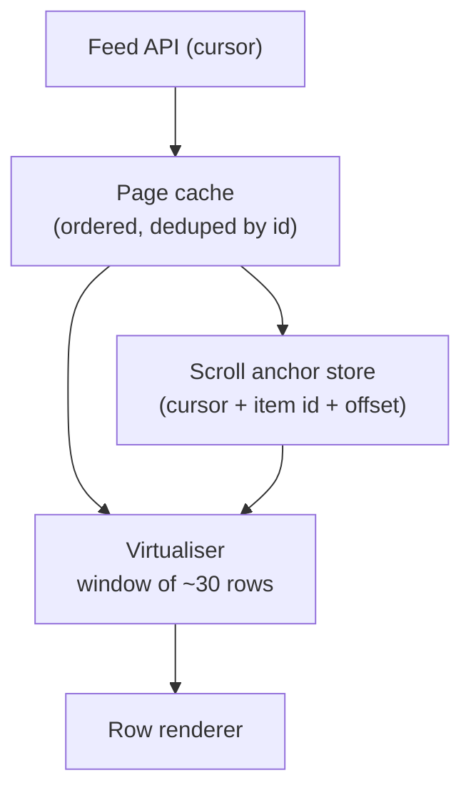

# একটি Infinite Feed Design করুন {#ch-design-infinite-feed}

> তিন বছরের পুরোনো একটি Android-এ এক ঘণ্টা scroll করুন, tab ফুলে না উঠে, আটকে না গিয়ে, বা আপনি কোথায় ছিলেন তা না হারিয়ে।

**এই অধ্যায়ে:** দুটি budget · cursor pagination · virtualisation আর scroll anchoring · layout shift ছাড়া image · navigation-এর পর অবস্থান ফিরিয়ে আনা

## 💡 মূল ধারণা

Feed-এর কোনো শেষ নেই, আর device-এর সীমা আছে। দুটো আলাদা budget একসাথে ঠিক রাখতে হয়, আর দুটো গুলিয়ে ফেলাই পরিচিত
ভুল। **Network budget** হলো আপনি কতটা data fetch করেন। **Render budget** হলো কতগুলো DOM node আছে। "Load more"
শুধু প্রথমটা নিয়ে কাজ করে। দুই হাজার post-এর পর page ধীর হয়, কারণ *document-এর ভেতরে* দুই হাজার post আছে, JSON বড়
ছিল বলে নয়। তাই design DOM-এ row-এর একটি সরে যাওয়া window রাখে। সে scroll position-কেও data হিসেবে দেখে, যা
ইচ্ছাকৃতভাবে store আর restore করা হয়, browser কাকতালীয়ভাবে ঠিক করে দেয় এমন কিছু হিসেবে নয়।

> এখানে senior হওয়ার সংকেত হলো, performance নিয়ে কেউ জিজ্ঞেস করার আগেই render budget-এর নাম বলা।

## কীভাবে কাজ করে

### Requirement

**Functional:** text আর image মেশানো post-এর ওপর অফুরন্ত vertical scroll। User পড়ার সময়েই নতুন post দেখা দেয়।
একটি post খুলে back চাপলে একই row-তে ফিরে আসে।

**Scope-এর বাইরে:** ranking, বিজ্ঞাপন, comment, লেখা।

**Non-functional:** scroll চলাকালীন interaction 200 ms-এর নিচে থাকে (INP), cumulative layout shift (CLS) 0.1-এর
নিচে, আর দুই হাজার item-এর পরেও memory সমান থাকে। মাঝারি মানের একটি phone-এ প্রথম screen 2 সেকেন্ডের কম সময়ে
ব্যবহারযোগ্য হয়।

**Scale:** একটি session-এ 200–3,000 item। প্রতি page-এ 20টি। ধরে নিন, পড়ার সময়েই feed বদলাচ্ছে।

### Architecture



**Page cache বাড়ে; DOM বাড়ে না। Navigation-এর পর যা টিকে থাকে, সেটা হলো anchor store।**

### Pagination: offset নয়, cursor

পাঠকের নিচে feed বদলানোর মুহূর্তেই offset ভুল হয়ে যায়।

| | **Offset** (`?page=3`) | **Cursor** (`?after=eyJzIjo...`) |
| --- | --- | --- |
| শুরুতে একটি post insert হলো | পরের প্রতিটি page সরে যায় — user একটি duplicate দেখেন | প্রভাব নেই: cursor একটি অবস্থানের নাম দেয়, সংখ্যা নয় |
| একটি post delete হলো | একটি item চুপচাপ বাদ পড়ে যায় | প্রভাব নেই |
| Server-এ খরচ | `OFFSET 60` 60টি row scan করে ফেলে দেয় | Cursor-এর key থেকে index seek |

Client-এর কাছে cursor opaque। এর ভেতরে থাকে sort key আর একটি tiebreaker id, যাতে ক্রমটা total হয় আর paging কখনো
loop-এ না পড়ে:

```typescript
interface FeedPage {
  readonly items: readonly FeedItem[];
  readonly nextCursor: string | null; // null means the end, not an error
}

interface FeedItem {
  readonly id: string;
  readonly kind: "text" | "image";
  readonly width: number;  // intrinsic media size, sent by the server
  readonly height: number; // so the client can reserve space before loading
}
```

`width` আর `height` দেখতে বাড়তি জঞ্জাল মনে হয়, কিন্তু এদের কারণেই feed লাফায় না। এগুলো না থাকলে client জায়গা
আগে থেকে রাখতে পারে না, আর প্রতিটি image load হলে পাঠক যে লেখা দেখছেন সেটা page-এর নিচে ঠেলে দেয়।

### Virtualisation আর anchoring-এর সমস্যা

মোটামুটি এক viewport-এর row render করুন, সাথে দুই পাশে এক screen overscan (screen-এর বাইরে বাড়তি row): সব মিলিয়ে
প্রায় 30টি। Scroller-কে একটি spacer দিন, যার আকার মাপা height থেকে আসে, আর যে row এখনো দেখা হয়নি তার জন্য একটি
আনুমানিক মান।

সূক্ষ্ম অংশটা হলো, একটি আন্দাজ ভুল প্রমাণ হলে কী হয়। Viewport-এর **ওপরের** কোনো row-এর height ঠিক করলে তার নিচের
সবকিছু সরে যায়, আর পাঠকের আঙুলের নিচের content লাফ দেয়।

**Height ঠিক করুন, তারপর shift-টা বাতিল করুন:**

```typescript
function applyHeightCorrection(el: HTMLElement, deltaAbove: number): void {
  if (deltaAbove === 0) return;
  // The row above grew or shrank; move the scroll by the same amount so the
  // visible content stays exactly where it was.
  el.scrollTop += deltaAbove;
}
```

হাতে বানানো virtual list ভাঙা মনে হওয়ার একক সবচেয়ে সাধারণ কারণ হলো এই fix ছাড়া variable-height row।

> ⚠️ CSS `content-visibility: auto` render-এর কাজ বাদ দেয়, কিন্তু node সরায় না। এটা render budget কমায়, memory
> budget কমায় না। তাই এটা virtualisation-এর পরিপূরক, বিকল্প নয়।

### Image

Byte আসার আগেই box-টা রেখে দিন, server-এর পাঠানো মাপ থেকে `aspect-ratio` দিয়ে। Fold-এর নিচের image
`loading="lazy"` দিয়ে load করুন, আর শুধু প্রথম একটি বা দুটিতে `fetchpriority="high"` দিন। একসাথে এগুলো CLS শূন্যের
কাছাকাছি রাখে, ছোট ছোট shift-এর এমন স্রোত নয়, যা যোগ হয়ে বড় হয়।

### অবস্থান ফিরিয়ে আনা

Browser-এর scroll restoration fixed-height document-এ কাজ করে, আর virtualised feed তা নয়। তার বদলে anchor store
করুন: যে cursor load হয়েছিল, ওপরের দৃশ্যমান item-এর id, আর তার ভেতরে pixel offset। ফেরার সময় সেই page আবার fetch
করুন, **item**-এ scroll করুন, তারপর offset apply করুন। Pixel anchor-এর বিপরীতে id anchor তখনো কাজ করে, যদি user
দূরে থাকার সময় feed বদলে গিয়ে থাকে।

### Optimisation

**এক page আগে prefetch করুন।** শেষ load হওয়া row viewport-এ ঢুকলে নয়, প্রায় দুই screen দূরে থাকতেই পরের fetch শুরু
করুন। তাহলে স্বাভাবিক scroll-এ loader কখনো দেখা যায় না।

**কখনো viewport-এর ওপরে inject করবেন না।** নতুন post cache-এ যায়, আর একটি "12 new posts" pill হিসেবে দেখা দেয়।
পাঠকের ওপরে DOM-এ সেগুলো insert করলে তাঁর নিচের page সরে যায়, যা একটি bug মনে হয়।

## কখন ব্যবহার করবেন

| Requirement যদি বলে…                | Design বদলে হয়…                                       |
| --------------------------------------- | ------------------------------------------------------------- |
| List-টি crawl বা link করা যেতে হবে  | আসল URL-সহ নম্বর দেওয়া page — infinite scroll-এর কোনো SEO গল্প নেই |
| Row-গুলোর height নির্দিষ্ট                 | মাপজোখ পুরোপুরি বাদ দিন; হিসাবটা শুধু গুণ হয়ে যায়      |
| ~200-এর কম row, সব text          | সবগুলো render করুন — virtualisation এমন জটিলতা, যা আপনার দরকার নেই   |

## সাধারণ ভুল

**❌ Live feed-এ `page` আর `limit` দিয়ে pagination**

> `GET /feed?page=3&limit=20`

শুরুতে একটি insert, আর page 3 এখন page 2-এর একটি item আবার দেখায়। User-রা বলেন "একই post দুবার", আর একটি শান্ত
test account-এ এটা কখনো reproduce হয় না।

**✅ Intrinsic মাপ থেকে জায়গা রেখে দিন**

> প্রতিটি media item-এর সাথে `width` আর `height` পাঠান, সেগুলো থেকে `aspect-ratio` set করুন, তাহলে layout shift আর
> এমন সমস্যা থাকে না, যার পেছনে পরে দৌড়াতে হয়।

## 🔑 মূল শিক্ষা

- Network-এর খরচ আর DOM-এর খরচ আলাদা budget। কম data load করলে একটি লম্বা list দ্রুত হয় না।
- নিচের list পড়ার সময় বদলাতে পারলে cursor pagination পছন্দের নয়, বাধ্যতামূলক।
- Viewport-এর ওপরের height সংশোধন সমান একটি scroll adjustment দিয়ে বাতিল করতে হবে, নইলে page লাফায়।
- Server-এর পাঠানো media মাপই layout shift-কে এমন সমস্যা বানায়, যা সমাধান হয়ে গেছে, পেছনে দৌড়াতে হয় না।
- Scroll restoration একটি item id-তে নোঙর করে, virtualised document-এ কখনো pixel offset-এ নয়।

## Interview-এর প্রশ্ন

**Q: User-রা বলছেন scroll করার সময় post দুবার দেখা যাচ্ছে। কী ঘটছে?**

প্রায় নিশ্চিতভাবেই API offset দিয়ে paginate করছে, আর feed বদলাচ্ছে। শুরুতে একটি নতুন post সবকিছুকে এক ঘর নিচে
ঠেলে দেয়, তাই পরের page এক row আগে শুরু হয় আর একটি item আবার দেখায়। Delete হলে ঠিক উল্টো bug হয়: একটি post চুপচাপ
বাদ পড়ে। Cursor pagination এটা ঠিক করে, আর page cache-এ id দিয়ে deduplicate করা সস্তা safety net।

**Q: List virtualised, তবুও Android-এ আটকে আটকে চলে। কোথায় খুঁজবেন?**

কতগুলো row আছে তাতে নয়, প্রতিটি row কী করে তাতে। একটি সাধারণ কারণ হলো জায়গা না রাখা image, যা প্রতিটি load-এ
layout করতে বাধ্য করে। আরেকটি হলো এমন row, যা প্রতিটি scroll frame-এ re-render হয়, কারণ handler state update
করে। তৃতীয়টি হলো দামি কাজ, যেমন date formatting, যা cache-এ রাখার সময় একবার না করে প্রতিটি render-এ করা হয়। একটি
scroll profile করুন আর দেখুন লম্বা frame-গুলো layout নাকি script, কারণ fix আলাদা।

**Q: কখন আপনি infinite scroll একেবারেই বানাবেন না?**

যখন content খুঁজে পাওয়া যেতে হবে (search result, documentation, crawl করা যায় এমন যেকোনো কিছু), বা যখন user-দের
footer দরকার। Infinite scroll link করা যায়, পৌঁছানো যায় এমন page-এর বদলে engagement কেনে। এটা product-এর
সিদ্ধান্ত, technical নয়। এটা বলাটাই সেই উত্তর, যেটা interviewer শুনতে চান।

## এরপর কী পড়বেন

- [Chapter ?? — Performance, Transition ও Compiler](#ch-react-performance-and-the-compiler) — virtualiser যে frame budget রক্ষা করছে
- [Chapter ?? — Caching ও Asset Delivery](#ch-asset-delivery) — এই row-গুলোর media-র format, আকার আর priority
- [Chapter ?? — Core Web Vitals](#ch-core-web-vitals) — requirement-এর INP আর CLS সংখ্যা কোথা থেকে আসে
