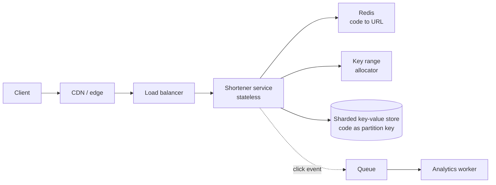

# একটি URL Shortener Design করুন {#ch-design-url-shortener}

> কোনো coordination-এর bottleneck ছাড়া ছোট একটা unique key বানান, তারপর প্রায় সব read cache থেকে দিন।

**এই অধ্যায়ে:** requirement আর scale · architecture · key তৈরি · data model · caching আর redirect-এর অর্থ

## 💡 মূল ধারণা

URL shortener দেখতে খুব সাধারণ, আর ঠিক সে কারণেই interview-র জন্য এটা ভালো সমস্যা: লুকানোর কোনো জায়গা নেই।
পুরো design দাঁড়িয়ে আছে দুটি সিদ্ধান্তের ওপর। **সবাই যার পেছনে লাইন দেয়, এমন কোনো কেন্দ্রীয় counter ছাড়া সাত
অক্ষরের unique key কীভাবে বানাবেন?** আর **database না ছুঁয়ে দিনে এক হাজার কোটি redirect কীভাবে দেবেন?** বাকি সব
নিছক পাইপলাইনের কাজ।

> এটা আসলে read-বেশি একটা key-value সমস্যা, যা web application-এর পোশাক পরে আছে। প্রথম মিনিটেই এটা ধরে ফেলুন,
> বাকি round নিজে থেকেই এগোবে।

## কীভাবে কাজ করে

### Requirement

**Functional:** লম্বা URL ছোট করা, short code থেকে সেই URL-এ redirect করা, ইচ্ছে হলে custom alias, ইচ্ছে হলে
expiry, click-এর হিসাব।

**Scope-এর বাইরে, জোরে বলে দিন:** user account, analytics dashboard, link preview, spam ধরা।

**Non-functional:** p99-এ (99th percentile) redirect 100 ms-এর নিচে, আর short link কখনো ভাঙবে না বা অন্য কাউকে
দেওয়া হবে না। Consistency-র চেয়ে availability বেশি জরুরি। নতুন link সব জায়গায় একসঙ্গে দেখা যাওয়ার চেয়ে
redirect কাজ করাটা বেশি দামি।

**Scale:** দিনে 100 million নতুন link আর 10 billion redirect, অর্থাৎ read আর write-এর অনুপাত 100:1। গড়ে সেকেন্ডে
মোটামুটি 1,000 write আর 100,000 read, peak-এ তার প্রায় তিনগুণ। প্রতি row 500 byte ধরলে storage দিনে 50 GB, মানে
replication-এর আগেই বছরে প্রায় 18 TB।

### Architecture



**Read থেমে যায় Redis-এ; datastore দেখে শুধু miss আর write।**

Click গোনা যায় একটা queue দিয়ে। প্রতিটি redirect-এ একটা row update করলে write path হয়ে যেত create path-এর চেয়ে
একশো গুণ ব্যস্ত। অথচ ওই data কেউ real time-এ পড়ে না।

### Key তৈরি

Round-টা আসলে এই সিদ্ধান্ত নিয়েই।

| পদ্ধতি                     | চলে?                                            | সমস্যা                                    |
| ---------------------------- | ------------------------------------------------- | ------------------------------------------ |
| URL hash করে 7টি অক্ষর নেওয়া   | হ্যাঁ, আর একই URL দুবার জমা হয় না            | Collision ধরতে হয়, তারপর আবার চেষ্টা করতে হয়    |
| এলোমেলো 7টি অক্ষর          | হ্যাঁ                                                | প্রতিটি write-এ unique কি না যাচাই লাগে    |
| Auto-increment, base62       | হ্যাঁ                                                | একটাই global counter মানে write bottleneck, আর code আন্দাজ করা যায় |
| **আগে থেকে ভাগ করা key range** | **হ্যাঁ — এই উত্তরটাই দেবেন**                       | Instance মারা গেলে কিছু key নষ্ট হয়          |

`[a-zA-Z0-9]`-এর ওপর base62 দেয় 62⁷ ≈ **3.5 trillion** code। দিনে 100 million হারে এটা চলবে 95 বছর। সাত অক্ষরই
সঠিক দৈর্ঘ্য, আর কেন, সেটা বলাও উত্তরের অংশ।

```typescript
const ALPHABET = "0123456789abcdefghijklmnopqrstuvwxyzABCDEFGHIJKLMNOPQRSTUVWXYZ";

function toBase62(n: number): string {
  let out = "";
  do {
    out = ALPHABET[n % 62] + out;
    n = Math.floor(n / 62);
  } while (n > 0);
  return out.padStart(7, "0");
}

// Each instance claims a block of one million ids, then mints locally with no coordination.
class KeyAllocator {
  private next = 0;
  private limit = 0;
  constructor(private readonly claimBlock: () => Promise<{ from: number; to: number }>) {}

  async take(): Promise<string> {
    if (this.next >= this.limit) {
      const block = await this.claimBlock(); // one round trip per million keys
      this.next = block.from;
      this.limit = block.to;
    }
    return toBase62(this.next++);
  }
}
```

কোনো instance মারা গেলে তার block-এর বাকিটা নষ্ট হয়। 3.5 trillion key-র সামনে এটা সমাধান করার মতো কোনো সমস্যাই নয়।

### Data model

```typescript
interface Link {
  code: string;       // partition key — every read is a point lookup
  longUrl: string;
  createdAt: number;
  expiresAt?: number; // TTL handled by the store, not by a cleanup job
  ownerId?: string;
}
```

Access pattern একটাই query: code দিলে URL ফেরত দাও। তাই `code` ধরে shard করা key-value বা wide-column store-ই এর
সঠিক জায়গা। Relational store-এর পক্ষেও যুক্তি দেওয়া যায়, তবে দরকার নেই।

Custom alias-এর জন্য unique কি না যাচাই লাগে। Conditional write জরুরি কেবল এই একটা জায়গায়। আগে পড়ে তারপর লেখার
বদলে "if not exists" দিয়ে insert করুন, আর আগে থেকে থাকলে 409 ফেরত দিন।

### Interface

| Operation                     | মন্তব্য                                              |
| ----------------------------- | -------------------------------------------------- |
| `POST /links`                 | Body-তে থাকে লম্বা URL আর ইচ্ছে হলে একটা alias; code-সহ 201 ফেরত দেয় |
| `GET /{code}`                 | Hot path — একটা redirect, এর বেশি কিছু নয়         |
| `GET /links/{code}/stats`     | পড়া হয় analytics store থেকে, hot path থেকে কখনো নয়   |

### Optimisation

**Caching।** Hit ratio 95% হলে সেকেন্ডে 100,000 read-এর মধ্যে মাত্র 5,000 store পর্যন্ত পৌঁছায়। Traffic খুব একপেশে:
অল্প কিছু link-ই বেশিরভাগ traffic টানে। তাই কয়েকশো gigabyte Redis-এর ওপর LRU (least recently used) eviction
working set আরামে ধরে রাখে।

**Redirect status code।** এটা default নয়, একটা দর-কষাকষি।

| Code | Browser কী করে        | ফল                                          |
| ---- | ------------------------ | ---------------------------------------------------- |
| 301  | Redirect cache করে রাখে       | User-এর জন্য সবচেয়ে দ্রুত, আর পরের click আর আপনার কাছে আসেই না — তাই click গোনা যায় না, target-ও বদলানো যায় না |
| 302  | প্রতিবার আবার জিজ্ঞেস করে        | প্রতিটি click মাপা যায়, target বদলানো যায়; প্রতিটি request-এর খরচ আপনাকে দিতে হয় |

Requirement-এ analytics বা বদলানো যায় এমন target থাকলে **302** ব্যবহার করুন, আর সাধারণত সেগুলো থাকেই। কেন, তা বলুন।

**Multi-region।** একবার তৈরি হলে code আর বদলায় না। তাই replica যেকোনো জায়গা থেকে read দিতে পারে, consistency-র কোনো
সমস্যা ছাড়াই। Write যায় একটা region-এ। নতুন link অন্য জায়গায় দেখা দিতে এক সেকেন্ড লাগতে পারে। যিনি link-টা বানালেন,
তাঁর নিজের read যতক্ষণ write region-এ যাচ্ছে, তিনি কিছু টেরই পান না।

## কখন ব্যবহার করবেন

এই ধাঁচটা (একটা অস্বচ্ছ key বানাও, একবার লেখো, বিপুল পরিমাণে পড়ো) shortener ছাড়িয়ে আরও অনেক জায়গায় ফিরে আসে।
Invite-code service, file-share link, public asset URL বা feature-flag lookup — সবই একই design। যা এটাকে বদলাবে:

| Requirement-এ যদি যোগ হয়…              | Design বদলে হয়…                                |
| ------------------------------------- | ------------------------------------------------------ |
| Real-time click analytics              | Streaming aggregation, queue আর batch worker নয় |
| বদলানো যায় এমন target                       | শুধু 302, আর update হলে cache invalidation             |
| আন্দাজ করা যায় এমন code চলবে না       | ক্রমিক base62-এর বদলে লম্বা এলোমেলো code      |
| কয়েক সেকেন্ডে expire হওয়া link              | Store-এর মতো cache-এও TTL                  |

## সাধারণ ভুল

**❌ একটাই auto-increment counter**

> `nextId = SELECT MAX(id) + 1 FROM links`

System-এর প্রতিটি write এখন একটা row-এর পেছনে লাইন দেয়। Code-গুলো ক্রমানুসারে আন্দাজ করাও সহজ, তাই যে কেউ পুরো
link database ঘুরে দেখতে পারে।

**✅ আগে থেকে ভাগ করা range, local-ভাবে বানানো**

> প্রতিটি instance একবারের আসা-যাওয়ায় দশ লাখ id-র একটা block নিয়ে নেয়, তারপর কোনো coordination ছাড়াই code বানায়।

**❌ Click একই সঙ্গে, synchronous-ভাবে গোনা**

Redirect path-এ counter update করলে system-এর সবচেয়ে ব্যস্ত path-টা write path হয়ে যায়। অথচ ওই সংখ্যা সেই সেকেন্ডেই
কেউ পড়ে না।

**❌ Redirect status code নিয়ে মাথা না ঘামানো**

301 দ্রুততর, আর চুপচাপ আপনার click গোনা বা target বদলানোর ক্ষমতা কেড়ে নেয়। এটা সত্যিকারের একটা সিদ্ধান্ত। যে
candidate এর কথা তোলেন না, তিনি product নিয়ে ভাবেননি।

## 🔑 মূল শিক্ষা

- যে দুটি সিদ্ধান্ত আসল: coordination ছাড়া key তৈরি, আর cache থেকে read দেওয়া।
- আগে থেকে ভাগ করা key range unique code দেয়, প্রতি দশ লাখ write-এ একবার আসা-যাওয়ায়, কোনো কেন্দ্রীয় bottleneck ছাড়া।
- সাত অক্ষরের base62 মানে 3.5 trillion code। সংখ্যাটা বলুন, কারণ দৈর্ঘ্যের যুক্তি ওটাই।
- 301 না 302, সেটা analytics আর বদলানোর সুযোগ নিয়ে product-এর সিদ্ধান্ত, performance-এর খুঁটিনাটি নয়।
- Click গোনার জায়গা queue-তে; redirect path-এ রাখলে system-এর read/write অনুপাত উল্টে যায়।

## Interview-এর প্রশ্ন

**Q: সেকেন্ডে 1,000 write-এ collision ছাড়া short code কীভাবে বানাবেন?**

Range আগে থেকে ভাগ করে দিয়ে। একটা coordination service প্রতিটি instance-কে দশ লাখ integer-এর একটা block দেয়, আর instance
সেগুলো local-ভাবে base62-এ বদলে নেয়। মানে প্রতি দশ লাখ key-তে একবার আসা-যাওয়া, প্রতি write-এ একবার নয়, আর collision
যাচাইয়েরও দরকার নেই। একমাত্র খরচ হলো instance মারা গেলে কিছু id নষ্ট হওয়া, যা 3.5 trillion-এর সামনে কিছুই না।

**Q: Deploy-এর পর cache cold, আর store ভেঙে পড়ল। কী ভুল হয়েছিল?**

একই মুহূর্তে প্রতিটি request miss হয়ে গেছে। ফলে store-কে পুরো সেকেন্ডে 100,000 read নিতে হয়েছে, অথচ ওই মাপের জন্য সেটা
কখনো বানানোই হয়নি। সমাধান তিনটি। Warm-up: instance traffic নেওয়ার আগে সবচেয়ে বেশি চাওয়া code-গুলো আবার চালিয়ে নেয়।
Request coalescing: একটা code-এর জন্য একসঙ্গে আসা হাজারটা miss-কে একটা store read-এ নামিয়ে আনে। আর rolling deploy
মানে পুরো cache tier কখনো একসঙ্গে খালি হয় না।

**Q: এই database কি shard করবেন? করলে কী ধরে?**

হ্যাঁ, code ধরেই। প্রতিটি read code দিয়ে একটা point lookup, তাই প্রতিটি একটা shard-এই থাকে। কোনো range query নেই,
কোনো join নেই, তাই hash-ভিত্তিক বণ্টন একদম উপযুক্ত। Consistent hashing থাকলে capacity বাড়ালে key-র শুধু একটা ভগ্নাংশ
সরে, সবগুলো নয়।

## এরপর কী পড়বেন

- [Chapter ?? — Caching](#ch-caching) — এই design যে stampede আর hit ratio-র হিসাবের ওপর দাঁড়িয়ে
- [Chapter ?? — বড় পরিসরে Sharding ও Transaction](#ch-sharding) — `code` কেন প্রায় নিখুঁত একটা shard key
- [Chapter ?? — Back-of-Envelope Estimation](#ch-back-of-envelope-estimation) — 100:1 অনুপাত আর storage-এর সংখ্যাগুলো কোথা থেকে আসে
