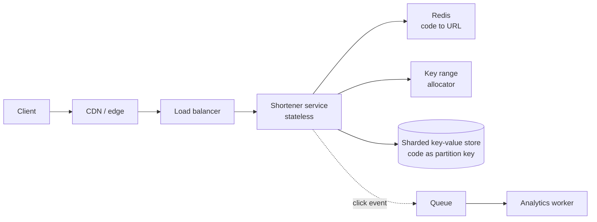

# একটি URL Shortener Design করুন {#ch-design-url-shortener}

> কোনো coordination bottleneck ছাড়া একটি ছোট unique key তৈরি করুন, তারপর প্রায় সব read cache থেকে serve করুন।

**এই অধ্যায়ে:** requirement আর scale · architecture · key generation · data model · caching আর redirect-এর অর্থ

## 💡 মূল ধারণা

URL shortener দেখতে খুব সহজ। ঠিক এই কারণেই এটা একটি ভালো interview সমস্যা: লুকানোর কোনো জায়গা নেই। পুরো
design দুটো সিদ্ধান্তের ওপর দাঁড়িয়ে। **এমন একটি central counter ছাড়া কীভাবে সাত অক্ষরের একটি unique key তৈরি
করবেন, যার পেছনে সবকিছু queue-তে দাঁড়ায়?** আর **database না ছুঁয়ে কীভাবে দিনে দশ billion redirect serve
করবেন?** বাকি সব plumbing।

> এটা একটি read-heavy key-value সমস্যা, যে web application-এর পোশাক পরে আছে। প্রথম মিনিটেই এটা চিনে ফেলুন,
> তাহলে round-এর বাকিটা নিজে থেকেই এগোয়।

## কীভাবে কাজ করে

### Requirement

**Functional:** একটি লম্বা URL ছোট করা, একটি short code থেকে সেখানে redirect করা, ঐচ্ছিক custom alias, ঐচ্ছিক
expiry, click-এর সংখ্যা।

**Scope-এর বাইরে, জোরে বলে:** user account, analytics dashboard, link preview, spam detection।

**Non-functional:** p99-এ (99th percentile) redirect 100 ms-এর নিচে, আর short link কখনো ভাঙবে না বা অন্য কাউকে
দেওয়া হবে না। Consistency-র চেয়ে availability বেশি জরুরি। একটি কাজ করা redirect-এর দাম এমন একটি নতুন link-এর
চেয়ে বেশি, যেটা একসাথে সব জায়গায় দেখা যায়।

**Scale:** দিনে 100 million নতুন link আর 10 billion redirect, read আর write-এর অনুপাত 100:1। গড়ে সেটা প্রতি
সেকেন্ডে প্রায় 1,000 write আর 100,000 read, আর peak-এ মোটামুটি তার তিন গুণ। প্রতি row 500 byte ধরলে storage
দিনে 50 GB, অর্থাৎ replication-এর আগে বছরে প্রায় 18 TB।

### Architecture



**Read Redis-এ থেমে যায়; datastore শুধু miss আর write দেখে।**

Click গোনা হয় একটি queue দিয়ে। প্রতিটি redirect-এ একটি row update করলে write path create path-এর চেয়ে একশো গুণ
ব্যস্ত হয়ে যেত। আর ওই data কেউ real time-এ পড়ে না।

### Key generation

Round-টা আসলে এই সিদ্ধান্ত নিয়েই।

| পদ্ধতি                     | কাজ করে?                                            | সমস্যা                                    |
| ---------------------------- | ------------------------------------------------- | ------------------------------------------ |
| URL hash করে 7 অক্ষর নেওয়া   | হ্যাঁ, আর একই URL-গুলোকে deduplicate করে            | Collision ধরে retry করতে হয়    |
| Random 7 অক্ষর          | হ্যাঁ                                                | প্রতিটি write-এ uniqueness check লাগে    |
| Auto-increment, base62       | হ্যাঁ                                                | একটি global counter write bottleneck, আর code-গুলো আন্দাজ করা যায় |
| **আগে থেকে বরাদ্দ করা key range** | **হ্যাঁ — এই উত্তরটাই দিন**                       | কোনো instance মারা গেলে key নষ্ট হয়          |

`[a-zA-Z0-9]`-এর ওপর base62 দেয় 62⁷ ≈ **3.5 trillion** code। দিনে 100 million হারে সেটা 95 বছর চলে। সাত অক্ষরই
সঠিক দৈর্ঘ্য, আর কেন সেটা বলাও উত্তরের অংশ।

```typescript
const ALPHABET = "0123456789abcdefghijklmnopqrstuvwxyzABCDEFGHIJKLMNOPQRSTUVWXYZ";

function toBase62(n: number): string {
  let out = "";
  do {
    out = ALPHABET[n % 62] + out;
    n = Math.floor(n / 62);
  } while (n > 0);
  return out.padStart(7, "0");
}

// Each instance claims a block of one million ids, then mints locally with no coordination.
class KeyAllocator {
  private next = 0;
  private limit = 0;
  constructor(private readonly claimBlock: () => Promise<{ from: number; to: number }>) {}

  async take(): Promise<string> {
    if (this.next >= this.limit) {
      const block = await this.claimBlock(); // one round trip per million keys
      this.next = block.from;
      this.limit = block.to;
    }
    return toBase62(this.next++);
  }
}
```

যে instance মারা যায়, সে তার block-এর বাকিটা নষ্ট করে। 3.5 trillion key থাকলে এটা সমাধান করার মতো সমস্যা নয়।

### Data model

```typescript
interface Link {
  code: string;       // partition key — every read is a point lookup
  longUrl: string;
  createdAt: number;
  expiresAt?: number; // TTL handled by the store, not by a cleanup job
  ownerId?: string;
}
```

Access pattern একটাই query: একটি code দিলে একটি URL ফেরত দাও। তাই `code`-এর ওপর shard করা একটি key-value বা
wide-column store-ই সঠিক জায়গা। Relational store-এর পক্ষেও যুক্তি দেওয়া যায়, কিন্তু দরকার নেই।

Custom alias-এর জন্য uniqueness check লাগে। এই একটি জায়গাতেই conditional write গুরুত্বপূর্ণ। আগে read করে তারপর
write না করে, "if not exists" দিয়ে insert করুন আর 409 ফেরত দিন।

### Interface

| Operation                     | Note                                              |
| ----------------------------- | -------------------------------------------------- |
| `POST /links`                 | Body-তে থাকে লম্বা URL আর একটি ঐচ্ছিক alias; code-সহ 201 ফেরত দেয় |
| `GET /{code}`                 | Hot path — একটি redirect, আর কিছু নয়         |
| `GET /links/{code}/stats`     | Analytics store থেকে পড়া হয়, কখনো hot path থেকে নয়   |

### Optimisation

**Caching.** 95% hit ratio থাকলে প্রতি সেকেন্ডের 100,000 read-এর মধ্যে মাত্র 5,000 store-এ পৌঁছায়। Traffic খুব
একপেশে: অল্প কিছু link-ই বেশিরভাগ traffic নেয়। তাই কয়েকশো gigabyte Redis-এর ওপর LRU (least recently used)
eviction working set-কে আরামে ধরে রাখে।

**Redirect status code।** এটা একটি trade-off, কোনো default নয়।

| Code | Browser-এর আচরণ        | ফলাফল                                          |
| ---- | ------------------------ | ---------------------------------------------------- |
| 301  | Redirect cache করে       | User-এর জন্য সবচেয়ে দ্রুত, কিন্তু পরের click আর আপনার কাছে পৌঁছায় না — তাই click গোনা যায় না, target-ও বদলানো যায় না |
| 302  | প্রতিবার আবার জিজ্ঞেস করে        | প্রতিটি click মাপা যায়, target বদলানো যায়; প্রতিটি request-এর খরচ আপনি দেন |

Requirement-এ analytics বা editable target থাকলে **302** ব্যবহার করুন, আর সাধারণত থাকেই। কেন, সেটা বলুন।

**Multi-region।** একবার তৈরি হওয়ার পর code কখনো বদলায় না। তাই replica যেকোনো জায়গা থেকে read serve করতে পারে,
কোনো consistency সমস্যা ছাড়া। Write যায় একটি region-এ। একটি নতুন link অন্য জায়গায় দেখা দিতে এক সেকেন্ড লাগতে
পারে। যিনি তৈরি করলেন তিনি সেটা টেরই পান না, যতক্ষণ তাঁর নিজের read write region-এ route করা হয়।

## কখন ব্যবহার করবেন

এই ধরন (একটি opaque key তৈরি করা, একবার write, বিপুল পরিমাণ read) shortener ছাড়িয়ে অনেক জায়গায় ফিরে আসে।
Invite-code service, file-share link, public asset URL বা feature-flag lookup — সবই একই design। কী এটাকে বদলে দেবে:

| Requirement-এ যদি যোগ হয়…              | Design বদলে হয়…                                |
| ------------------------------------- | ------------------------------------------------------ |
| Real-time click analytics              | Queue আর batch worker নয়, একটি streaming aggregation |
| Editable target                       | শুধু 302, আর update-এ cache invalidation             |
| আন্দাজ করা যায় এমন code চলবে না       | Sequential base62-এর বদলে লম্বা random code      |
| কয়েক সেকেন্ডে expire হওয়া link              | Store-এর পাশাপাশি cache-এও TTL                  |

## সাধারণ ভুল

**❌ একটি মাত্র auto-increment counter**

> `nextId = SELECT MAX(id) + 1 FROM links`

এখন system-এর প্রতিটি write একটি row-এর পেছনে queue-তে দাঁড়ায়। Code-গুলোও ক্রমানুসারে সহজে আন্দাজ করা যায়।
ফলে যে কেউ পুরো link database ঘুরে দেখতে পারে।

**✅ আগে থেকে বরাদ্দ করা range, locally তৈরি**

> প্রতিটি instance এক round trip-এ এক million id-র একটি block দাবি করে, তারপর coordination ছাড়াই key তৈরি করে।

**❌ Synchronously click গোনা**

Redirect path-এ counter update করলে system-এর সবচেয়ে ব্যস্ত path একটি write path হয়ে যায়। আর ওই সংখ্যা এক
সেকেন্ডের মধ্যে কেউ পড়ে না।

**❌ Redirect status code উপেক্ষা করা**

301 দ্রুততর, আর চুপচাপ আপনার click গোনা বা target বদলানোর ক্ষমতা কেড়ে নেয়। এটা একটি সত্যিকারের সিদ্ধান্ত। যে
candidate এটা উল্লেখ করেন না, তিনি product নিয়ে ভাবেননি।

## 🔑 মূল শিক্ষা

- যে দুটো সিদ্ধান্ত গুরুত্বপূর্ণ: coordination ছাড়া key generation, আর cache থেকে read serve করা।
- আগে থেকে বরাদ্দ করা key range প্রতি million write-এ একটি round trip দিয়ে unique code দেয়, কোনো central bottleneck ছাড়া।
- সাত অক্ষরের base62 মানে 3.5 trillion code। সংখ্যাটা বলুন, কারণ এটাই দৈর্ঘ্যের যুক্তি।
- 301 বনাম 302 analytics আর editability নিয়ে একটি product সিদ্ধান্ত, performance-এর খুঁটিনাটি নয়।
- Click গোনার জায়গা queue-তে; redirect path-এ রাখলে system-এর read/write অনুপাত উল্টে যায়।

## Interview-এর প্রশ্ন

**Q: প্রতি সেকেন্ডে 1,000 write-এ collision ছাড়া short code কীভাবে তৈরি করবেন?**

Range আগে থেকে বরাদ্দ করুন। একটি coordination service প্রতিটি instance-কে এক million integer-এর একটি block
দেয়, আর instance সেগুলো locally base62-এ রূপান্তর করে। সেটা প্রতি write-এ একটি নয়, প্রতি million key-তে একটি
round trip, আর কোনো collision check লাগে না। একমাত্র খরচ হলো instance মারা গেলে নষ্ট হওয়া id, যা 3.5 trillion-এর
সামনে কিছুই না।

**Q: Deploy-এর পর cache cold, আর store ভেঙে পড়ল। কী ভুল হয়েছিল?**

প্রতিটি request একই মুহূর্তে miss হয়ে গিয়েছিল। ফলে store পুরো প্রতি সেকেন্ডে 100,000 read নিল, যার জন্য তাকে
কখনো মাপা হয়নি। সমাধান তিনটি। Warm-up: instance traffic নেওয়ার আগে শীর্ষ code-গুলো replay করে। Request
coalescing: একটি code-এর জন্য একসাথে হাজারটা miss-কে একটি store read-এ পরিণত করে। আর rolling deploy মানে পুরো
cache tier কখনো একসাথে খালি হয় না।

**Q: এই database কি shard করবেন, আর কীসের ওপর?**

হ্যাঁ, code-এর ওপরেই। প্রতিটি read code দিয়ে একটি point lookup, তাই প্রতিটি একটি shard-এই থাকে। কোনো range
query নেই, কোনো join নেই, তাই hash-ভিত্তিক distribution আদর্শ। Consistent hashing-এর মানে capacity বাড়ালে সব key
নয়, শুধু একটি অংশ সরে।

## এরপর কী পড়বেন

- [Chapter ?? — Caching](#ch-caching) — stampede আর hit ratio-র হিসাব, যার ওপর এই design নির্ভর করে
- [Chapter ?? — বড় পরিসরে Sharding ও Transaction](#ch-sharding) — `code` কেন প্রায় নিখুঁত একটি shard key
- [Chapter ?? — Back-of-Envelope Estimation](#ch-back-of-envelope-estimation) — 100:1 অনুপাত আর storage-এর হিসাব কোথা থেকে আসে
