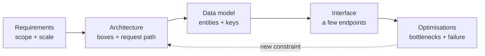

# Design Round চালানো, Backend ও Frontend {#ch-driving-the-round}

> Design round-কে এমন একটি আলোচনা হিসেবে চালান যেটা আপনি নেতৃত্ব দেন, উত্তর দেওয়ার কোনো quiz হিসেবে নয় — backend হোক বা frontend।

**এই অধ্যায়ে:** round-টি কী মাপে · RADIO framework · অস্পষ্ট prompt-কে requirement-এ পরিণত করা · frontend round-এ নম্বর কীভাবে আলাদাভাবে দেওয়া হয় · ব্যর্থ হওয়ার সাধারণ ধরন

## 💡 মূল ধারণা

Design round-এর কোনো সঠিক উত্তর নেই। URL shortener কীভাবে বানাতে হয়, interviewer আগে থেকেই জানেন। তিনি দেখছেন
আপনি এক লাইনের একটি prompt নিয়ে কীভাবে তার সীমানা টানেন, কাজ করে এমন কিছু প্রস্তাব করেন, আর তার খরচ নিয়ে সৎভাবে
যুক্তি দেন।

যে candidate বলেন "আমি user ID দিয়ে shard করব" আর থেমে যান, তিনি একটি উত্তর দিয়েছেন। যে candidate যোগ করেন
"এতে per-user read এক hop-এ হয়, আর global search হয়ে যায় scatter-gather (প্রতিটি shard-এ পাঠানো একটি query)। কিন্তু
search scope-এর বাইরে, তাই আমি এই trade-off নিচ্ছি", তিনি বিচারবুদ্ধি দেখিয়েছেন।

> Round-টি মাপে আপনি একটি খোলা সমস্যাকে কীভাবে **সংকুচিত** করেন। প্রতিটি senior signal আসলে সংকুচিত করারই একটি রূপ:
> scope ঠিক করা, estimation, trade-off-এর ভাষা, কখন থামতে হবে তা জানা।

## কীভাবে কাজ করে

**RADIO** হলো চলার ক্রম। এটাই একমাত্র framework নয়। কিন্তু এটা সবচেয়ে সাধারণ দুটি ব্যর্থতা থেকে বাঁচায়:
requirement জানার আগেই design শুরু করা, আর আসল মজার অংশে পৌঁছানোর আগেই সময় শেষ হয়ে যাওয়া।

| ধাপ | পুরো নাম       | আপনি যা দেন                                                    | মিনিট |
| --- | ------------- | ------------------------------------------------------------ | ----- |
| R   | Requirements  | Functional তালিকা, non-functional target, স্পষ্টভাবে বাদ দেওয়া scope | 8–10  |
| A   | Architecture  | একটি box diagram আর তার ভেতর দিয়ে request-এর পথ                  | 10–12 |
| D   | Data model    | Entity, key, আর প্রতিটির পেছনের store                           | 6–8   |
| I   | Interface     | তিন-চারটি endpoint বা event, পুরো API নয়                        | 4–6   |
| O   | Optimisations | Bottleneck, caching, scaling, failure handling               | 10–15 |

**একটি round-এর প্রবাহ:**



**RADIO একটি চলার ক্রম, একমুখী রাস্তা নয় — O-তে পাওয়া একটি bottleneck প্রায়ই আপনাকে A-তে ফেরত পাঠায়।**

### R — Requirements

**Functional** — একজন user কী করতে পারেন। তিন-চারটি ক্রিয়াতেই সীমাবদ্ধ রাখুন: "message post করা, feed পড়া,
একজন user-কে follow করা।" এর বাইরের যেকোনো কিছুর নাম বলুন, আর জোরে বলে বাদ দিন। যেমন: "আপনি না চাইলে search আর
direct message scope-এর বাইরে।"

**Non-functional** — যে গুণগুলো architecture বদলে দেয়। এর মধ্যে চারটি এত বেশি গুরুত্বপূর্ণ যে প্রতিবার জিজ্ঞেস
করা উচিত:

| গুণ           | যে প্রশ্নটি করবেন                                 | Design কেন বদলায়                        |
| ------------ | --------------------------------------------- | ------------------------------------ |
| Scale        | Daily active user, প্রতি সেকেন্ডে request         | এক box না fleet, সেটা ঠিক করে          |
| Latency      | Hot path-এর p99 target কত?                     | Caching আর data locality ঠিক করে      |
| Consistency  | একজন user কি পাঁচ সেকেন্ড stale data দেখতে পারেন? | Replication আর store বাছাই ঠিক করে     |
| Availability | এটা দশ মিনিট down থাকলে কী হয়?                  | Redundancy আর failover ঠিক করে        |

**Scale** হলো সংখ্যাটা। শুরুতেই একটি traffic-এর সংখ্যা নিন, আর বাকিটা সেখান থেকে হিসাব করুন। দেখুন
[Chapter ?? — Back-of-Envelope Estimation](#ch-back-of-envelope-estimation)।

> ⚠️ কখনো চুপচাপ কোনো requirement বানিয়ে নেবেন না। বলুন "আমি ধরে নিচ্ছি 10 million daily active user আর
> 100:1 read-to-write ratio — ভুল হলে থামাবেন।" যে assumption আপনি ঘোষণা করেন, সেটা একটি design সিদ্ধান্ত।
> যে assumption আপনি লুকান, সেটা একটি ভুল, যা ধরা পড়ার অপেক্ষায় আছে।

### A — Architecture

Request যে ক্রমে যায়, সেই ক্রমে box আঁকুন: client → edge → application → data। কোনো requirement দাবি করলে তবেই
box যোগ করুন। যে box-এর পক্ষে আপনি যুক্তি দিতে পারবেন না, interviewer ঠিক সেটার পক্ষেই যুক্তি চাইবেন।

তারপর diagram-এর ভেতর দিয়ে একটি write আর একটি read জোরে বলে trace করুন। Round-এর সবচেয়ে মূল্যবান দুই মিনিট এটাই।
ছবির দিকে যতক্ষণই তাকিয়ে থাকুন, এর চেয়ে দ্রুত বাদ পড়া component খুঁজে পাবেন না।

### D — Data model

প্রতিটি entity-র জন্য দরকারি field, primary key, access pattern আর store বলুন। চারটি column, পুরো schema নয়।

**একটি feed service, round আসলে যে রূপে চায়:**

```typescript
interface Post {
  postId: string;        // Snowflake ID — sortable by time, no central counter
  authorId: string;      // partition key: all of an author's posts land together
  body: string;
  createdAt: number;
}

// Access pattern drives the key. "Show me one author's posts, newest first"
// is a single partition scan if postId sorts by time within authorId.
type PostKey = { authorId: string; postId: string };
```

Key-টাই design। কেন এটা বেছে নিলেন, আর এটা কোন query-কে ব্যয়বহুল করে, তা বলুন।

### I — Interface

তিন-চারটি operation। এদের নাম দিন, দরকারি parameter-গুলো বলুন, আর প্রতিটি synchronous কি না বলুন। আপনি দেখাচ্ছেন
যে box-গুলোর একটি contract আছে, OpenAPI লিখছেন না।

### O — Optimisations

Senior signal এখানেই থাকে। প্রতিবার একই ক্রমে কাজ করুন:

1. **Bottleneck-এর নাম বলুন।** আপনার estimate করা scale-এ কোন component সবার আগে saturate হয়?
2. **কাজ করে এমন সবচেয়ে সস্তা জিনিস দিয়ে ঠিক করুন।** সাধারণত একটি cache বা একটি async queue, rewrite নয়।
3. **সমাধানের খরচ বলুন।** Cache latency কেনে আর দাম দেয় staleness দিয়ে। Queue throughput কেনে আর দাম দেয়
   eventual consistency আর একটি নতুন failure mode দিয়ে।
4. **একটি failure সামলান।** যে component হারালে সবচেয়ে বেশি ক্ষতি, সেটা বেছে নিন, আর সেটা মরে গেলে কী হয় তা বলুন।

## কখন ব্যবহার করবেন

| পরিস্থিতি                                       | যা করবেন                                     | কেন                                         |
| --------------------------------------------- | ------------------------------------------ | ------------------------------------------ |
| Prompt এক লাইনের ("design Twitter")            | পুরো 10 মিনিট R-এ দিন                        | Scope-টাই আসল সমস্যা                        |
| Prompt আগে থেকেই scope করা আর বিস্তারিত           | R-কে 4 মিনিটে নামান, সময়টা O-তে দিন            | Interviewer গভীরতা চান, scope ঠিক করা নয়     |
| Interviewer বারবার নতুন চাহিদা যোগ করছেন         | প্রতিটি একটি দৃশ্যমান "scope-এর বাইরে" তালিকায় রাখুন | জোরে বলে সময়ের budget রক্ষা করে            |
| 30 মিনিট পার, এখনো data model-এ                 | I বাদ দিন, সরাসরি O-তে যান                    | সবচেয়ে বেশি signal O-তে                      |
| Prompt একটি client application                 | RADIO রাখুন, কিন্তু frontend box-টি খুলুন        | Frontend round boundary দেখে নম্বর দেয়       |

## Frontend Round

Backend round-এ নম্বর দেওয়া হয় **capacity** দেখে — দশ million user-এ shard, queue আর replica। Frontend round-এ
নম্বর দেওয়া হয় **boundary** দেখে। Component-গুলো কোথায় ভাগ করলেন? প্রতিটি state কোথায় থাকে? Page কাজের
হওয়ার আগে browser কী download করে? Network fail করলে user কী দেখেন?

Load-এর সংখ্যা তখনো গুরুত্বপূর্ণ, কিন্তু সেগুলো একটি rendering strategy ঠিক করে, shard key নয়। সাধারণ ভুল হলো
React-এর শব্দ দিয়ে সাজানো একটি backend round: "frontend" লেখা একটি box, যেটা কখনো খোলা হয় না।

RADIO তখনো খাটে। শুধু ধাপগুলো যা দেয় তা বদলায়:

| ধাপ | Frontend round-এ আপনি যা দেন                                        |
| --- | ---------------------------------------------------------------- |
| R   | নিচের চারটি constraint, সাথে একটি LCP বা interaction target          |
| A   | Client-এর চারটি layer, আর প্রতিটি route-এর জন্য একটি rendering strategy |
| D   | প্রতিটি state কোথায় থাকে — সবচেয়ে মূল্যবান দশ মিনিট                    |
| I   | Client-এর দরকারি API-এর রূপ, auth boundary, retry                    |
| O   | Performance budget, loading, error আর empty state, accessibility   |

**যে requirement-গুলোর architecture-এ প্রভাব আছে:**

```typescript
interface DesignConstraints {
  scale: number;                       // 10K and 10M DAU are different designs
  discoverable: boolean;               // if true, content must be in the initial HTML
  realtime: "none" | "poll" | "push";  // decides the transport and the state model
  offline: boolean;                    // decides whether writes need a queue
}
```

Framework, CSS-এর পদ্ধতি আর component library হলো পছন্দের ব্যাপার। এটা বলাটাই নিজে একটি signal।

A ধাপে frontend box-টিকে চারটি layer-এ খুলুন। **Delivery**: CDN, rendering strategy, cache header। **App shell**:
routing, error আর loading boundary। **Data layer**: query cache, transport, retry। **Component tree**: boundary আর
local state। শুরুতেই এদের নাম বললে deep dive-এর একটি লক্ষ্য তৈরি হয়।

### State কোথায় থাকবে, তা ঠিক করা

প্রতিটি state-এর একটি সঠিক জায়গা আছে। ভুল জায়গা থেকেই bug আসে।

| State                          | যেখানে থাকে       | অন্য কোথাও কেন নয়                                           |
| ------------------------------ | --------------- | --------------------------------------------------------- |
| একটি form field-এর value        | Component state | ওপরে তুললে প্রতিটি keystroke-এ tree re-render হয়           |
| Theme, locale, feature flag    | Context         | অনেকে পড়ে, প্রায় কেউই লেখে না                              |
| Session, cart, খোলা modal       | একটি client store | যে screen তৈরি করেছে, তার চেয়ে বেশি দিন বাঁচে                  |
| Server যার মালিক এমন যেকোনো কিছু  | একটি query cache | এটা একটি *copy*, আর copy-র দরকার invalidation, reducer নয়    |
| Filter, tab, pagination        | URL             | নইলে back button আর শেয়ার করা link দুটিই মিথ্যা বলে            |

চতুর্থ সারিটি senior উত্তরকে আলাদা করে। Global store-এ রাখা server data একটি cache, যেটা কাউকে হাতে invalidate
করতে হবে, চিরকাল। পঞ্চম সারিটি সবচেয়ে সস্তায় পাওয়া নম্বর: একটি সিদ্ধান্তে deep link, back button আর refresh
তিনটিই ঠিক হয়ে যায়।

## সাধারণ ভুল

❌ **সমাধান দিয়ে শুরু করা।** "তাহলে আমরা Kafka আর Cassandra ব্যবহার করব, আর সামনে Redis বসাব।" এটা এমন প্রশ্নের
উত্তর দেয় যেটা কেউ করেনি। Scale জানার আগে নেওয়া সিদ্ধান্তে এটা আপনাকে আটকে ফেলে।
✅ Load-এর রূপ দিয়ে শুরু করুন: "এটা কি read-heavy? 100:1 আর 10k rps-এ আমি caching আর read replica-র ওপর ভর দেব,
আর সম্ভবত sharding এড়াতে পারব।"

❌ **Request path ছাড়া box।** নয়টি component আর একটিও trace করা request নেই — এটা একটি ছবি, design নয়।
✅ সবসময় একটি write আর একটি read trace করুন।

❌ **পুরো app-এর জন্য একটিই rendering strategy।** Catalogue page আর dashboard-এর চাহিদা একেবারে উল্টো।
✅ প্রতিটি route-এর জন্য আলাদা বাছুন — দেখুন [Chapter ?? — প্রতিটি Route-এর জন্য Rendering Strategy বাছাই, SEO সহ](#ch-choosing-per-route)।

❌ **কোনো error, empty বা loading state নেই।** Data fetch করে এমন প্রতিটি design-এ আরও তিনটি screen থাকে।
✅ Fetch আঁকার সময়ই এদের নাম বলুন, আর keyboard ও focus handling-এর কথা একবার নিজে থেকেই বলুন।

## 🔑 মূল শিক্ষা

- Round মাপে আপনি একটি খোলা সমস্যাকে কীভাবে সংকুচিত করেন, কোনো architecture মনে আছে কি না তা নয়।
- RADIO requirement-কে design-এর আগে রাখে, আর optimisation-এর জন্য সময় রাখে, যেখানে বেশিরভাগ signal থাকে।
- প্রতিটি assumption জোরে বলতে হবে, কারণ ঘোষণা করা assumption একটি সিদ্ধান্ত, আর লুকানোটা একটি ভুল।
- Frontend round-এ নম্বর আসে boundary আর state-এর জায়গা দেখে, আর চারটি constraint এর design বদলায়: scale, discoverability, real-time আর offline।
- প্রতিটি "it depends" শেষ করুন সেই সংখ্যা বা শর্ত দিয়ে যেটা সিদ্ধান্ত নেয়, আর প্রতিটি পছন্দের খরচ বলুন।

## Interview-এর প্রশ্ন

**Q: আপনার হাতে 45 মিনিট, আর prompt হলো "design Instagram"। প্রথম পাঁচ মিনিট কী করবেন?**

Product-টি এক বাক্যে আবার বলুন। Functional scope জোরে বলে মিলিয়ে নিন — photo upload, feed দেখা, user-কে follow
করা — আর কী বাদ দিলেন তার নাম বলুন, যেমন stories, search আর direct message। তারপর একটি scale-এর সংখ্যা আর একটি
consistency requirement চেয়ে নিন বা ধরে নিন। এখনো কিছু আঁকা হয় না।

**Q: Scale নিয়ে interviewer বলছেন "যা খুশি ধরে নিন"। আপনি কী করবেন?**

একটি সংখ্যা বাছুন, সেটা বলুন, আর আবার জিজ্ঞেস না করে সেখান থেকে হিসাব করুন। দশ million daily active user,
100:1 read-to-write ratio আর 3× peak multiplier প্রায় যেকোনো consumer product-এ মানায়। আসল কথা হলো সংখ্যাটা
দৃশ্যমান, যাতে আপনারা দুজনেই একই target-এর বিপরীতে design করেন।

**Q: Frontend round-এ state কোথায় যায়, আর আপনি কীভাবে ঠিক করেন?**

জিজ্ঞেস করুন কে এটা লেখে, আর এটা screen-এর চেয়ে কতদিন বেশি বাঁচে। Form field local, কারণ ওপরে তুললে প্রতিটি
keystroke-এ একটি re-render-এর খরচ। Cart যায় client store-এ, কারণ এটা navigation পেরিয়ে টিকে থাকে। Server-এর মালিকানার
data যায় query cache-এ, কারণ এটা একটি copy, যার আসল সমস্যা invalidation। Filter আর tab যায় URL-এ, যাতে refresh আর
back button কাজ করতে থাকে।

**Q: কখন আপনি RADIO ক্রম মেনে চলবেন না?**

যখন prompt-এ আগে থেকেই requirement থাকে, বা "এটাকে offline-এ কাজ করতে হবে"-এর মতো একটি constraint দিয়ে শুরু হয়।
তখন আসল কাজ architecture আর optimisation-এ। Requirement সংক্ষেপ করুন, যেখানে signal সেখানে সময় দিন, আর বলুন যে আপনি
সেটাই করছেন।

## এরপর কী পড়বেন

- [Chapter ?? — Back-of-Envelope Estimation](#ch-back-of-envelope-estimation) — যে সংখ্যাগুলো R ধাপকে বাস্তব করে
- [Chapter ?? — Scalability, Latency ও Throughput](#ch-scalability) — O ধাপে যে সিঁড়ি বেয়ে ওঠেন
- [Chapter ?? — একটি Infinite Feed Design করুন](#ch-design-infinite-feed) — শুরু থেকে শেষ পর্যন্ত প্রয়োগ করা frontend round
