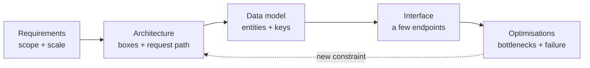

# Design Round চালানো, Backend ও Frontend {#ch-driving-the-round}

> Design round-কে প্রশ্নোত্তরের quiz ভাববেন না। এটা একটি আলোচনা, যা আপনি নিজে চালাবেন, backend হোক বা frontend।

**এই অধ্যায়ে:** round আসলে কী মাপে · RADIO framework · অস্পষ্ট prompt থেকে requirement বের করা · frontend round-এ নম্বর কেন অন্যভাবে দেওয়া হয় · কোথায় কোথায় ভুল হয়

## 💡 মূল ধারণা

Design round-এর কোনো সঠিক উত্তর নেই। URL shortener কীভাবে বানাতে হয়, interviewer তা আগে থেকেই জানেন। তিনি দেখছেন,
এক লাইনের একটি prompt পেয়ে আপনি কীভাবে তার সীমানা টানেন, কাজ চলে এমন কিছু প্রস্তাব করেন, আর তার খরচ নিয়ে সৎভাবে
যুক্তি দেন।

যে candidate বলেন "আমি user ID দিয়ে shard করব" আর থেমে যান, তিনি শুধু একটি উত্তর দিয়েছেন। আরেকজন যোগ করেন: "এতে
একজন user-এর read এক hop-এ হয়ে যায়, কিন্তু global search হয়ে যায় scatter-gather, মানে query যায় প্রতিটি shard-এ। তবে
search scope-এর বাইরে, তাই এই trade আমি নিচ্ছি।" দ্বিতীয়জন বিচারবুদ্ধি দেখিয়েছেন।

> Round মাপে, একটি খোলা সমস্যাকে আপনি কীভাবে **ছোট করে আনেন**। Senior-এর প্রতিটি লক্ষণই কোনো না কোনোভাবে এই ছোট
> করে আনা: scope ঠিক করা, estimation, trade-off-এর ভাষা, আর কখন থামতে হয় তা জানা।

## কীভাবে কাজ করে

**RADIO** হলো কাজের ক্রম। এটাই একমাত্র framework নয়। কিন্তু সবচেয়ে পরিচিত দুটি ভুল থেকে এটা বাঁচায়: requirement জানার
আগেই design শুরু করা, আর আসল মজার অংশে পৌঁছানোর আগেই সময় ফুরিয়ে যাওয়া।

| ধাপ | পুরো নাম | আপনি যা দেবেন | মিনিট |
| --- | ------- | ------------ | ----- |
| R | Requirements | Functional তালিকা, non-functional লক্ষ্য, কী বাদ দিলেন তা স্পষ্ট করে | 8–10 |
| A | Architecture | একটি box diagram, আর তার ভেতর দিয়ে request-এর পথ | 10–12 |
| D | Data model | Entity, key, আর প্রতিটির পেছনের store | 6–8 |
| I | Interface | তিন-চারটি endpoint বা event, পুরো API নয় | 4–6 |
| O | Optimisations | Bottleneck, caching, scaling, failure সামলানো | 10–15 |

**একটি round-এর প্রবাহ:**



**RADIO কাজের ক্রম, একমুখী রাস্তা নয়। O ধাপে কোনো bottleneck পেলে প্রায়ই আবার A-তে ফিরে যেতে হয়।**

### R — Requirements

**Functional** মানে user কী কী করতে পারেন। তিন-চারটি কাজের মধ্যে রাখুন: "message post করা, feed পড়া, কোনো user-কে
follow করা।" এর বাইরে যা আছে, তার নাম বলুন আর জোরে বলেই বাদ দিন। যেমন: "আপনি না চাইলে search আর direct message
scope-এর বাইরে রাখছি।"

**Non-functional** মানে সেই গুণগুলো, যা architecture বদলে দেয়। চারটি এত প্রায়ই গুরুত্বপূর্ণ যে প্রতিবারই জিজ্ঞেস করবেন:

| গুণ | কী জিজ্ঞেস করবেন | Design কেন বদলায় |
| --- | -------------- | ---------------- |
| Scale | দৈনিক active user কত, সেকেন্ডে কতটি request | এক machine না fleet, তা ঠিক হয় |
| Latency | Hot path-এর p99 লক্ষ্য কত? | Caching আর data কোথায় থাকবে, তা ঠিক হয় |
| Consistency | একজন user কি পাঁচ সেকেন্ড stale data দেখলে চলবে? | Replication আর কোন store, তা ঠিক হয় |
| Availability | দশ মিনিট এটা বন্ধ থাকলে কী হবে? | Redundancy আর failover ঠিক হয় |

**Scale** হলো সংখ্যা। শুরুতেই traffic-এর একটি সংখ্যা জেনে নিন, বাকিটা সেখান থেকে হিসাব করুন।
[Chapter ?? — Back-of-Envelope Estimation](#ch-back-of-envelope-estimation) দেখুন।

> ⚠️ চুপচাপ কোনো requirement বানিয়ে নেবেন না। বলুন: "ধরে নিচ্ছি দৈনিক 10 million active user, আর read-write অনুপাত
> 100:1। ভুল হলে থামিয়ে দিন।" যে assumption ঘোষণা করেন, সেটা একটি design সিদ্ধান্ত। যেটা লুকিয়ে রাখেন, সেটা একটি ভুল,
> ধরা পড়ার অপেক্ষায়।

### A — Architecture

Request যে ক্রমে চলে, box-ও সেই ক্রমে আঁকুন: client → edge → application → data। কোনো requirement দাবি করলে তবেই
একটি box যোগ করুন। যে box-এর পক্ষে যুক্তি দিতে পারবেন না, interviewer ঠিক সেটার যুক্তিই জানতে চাইবেন।

এরপর diagram-এর ভেতর দিয়ে একটি write আর একটি read জোরে বলে অনুসরণ করুন। Round-এর সবচেয়ে দামি দুই মিনিট এগুলোই।
ছবির দিকে যতক্ষণই তাকিয়ে থাকুন, এর চেয়ে দ্রুত কোনো অনুপস্থিত component চোখে পড়বে না।

### D — Data model

প্রতিটি entity-র জন্য বলুন: গুরুত্বপূর্ণ field, primary key, access pattern আর store। চারটি column, পুরো schema নয়।

**একটি feed service, ঠিক যে রূপে round-এ চাওয়া হয়:**

```typescript
interface Post {
  postId: string;        // Snowflake ID — sortable by time, no central counter
  authorId: string;      // partition key: all of an author's posts land together
  body: string;
  createdAt: number;
}

// Access pattern drives the key. "Show me one author's posts, newest first"
// is a single partition scan if postId sorts by time within authorId.
type PostKey = { authorId: string; postId: string };
```

Key-টাই design। কেন এটা বেছে নিলেন, আর কোন query এতে ব্যয়বহুল হয়ে যায়, তা বলুন।

### I — Interface

তিন-চারটি operation। নাম বলুন, গুরুত্বপূর্ণ parameter-গুলো দিন, আর প্রতিটি synchronous কি না জানান। আপনি দেখাচ্ছেন যে
box-গুলোর মধ্যে একটি contract আছে। OpenAPI লিখতে বসেননি।

### O — Optimisations

Senior-এর লক্ষণ আসলে থাকে এখানেই। প্রতিবার একই ক্রমে কাজ করুন:

1. **Bottleneck-এর নাম বলুন।** যে scale estimate করেছেন, তাতে কোন component সবার আগে ভরে যায়?
2. **কাজ চলে এমন সবচেয়ে সস্তা উপায়ে ঠিক করুন।** সাধারণত একটি cache বা async queue, পুরো rewrite নয়।
3. **সমাধানের দাম বলুন।** Cache latency কমায়, দাম দেয় staleness দিয়ে। Queue throughput বাড়ায়, দাম দেয় eventual
   consistency আর একটি নতুন failure mode দিয়ে।
4. **একটি failure সামলান।** যে component হারালে সবচেয়ে বেশি ক্ষতি, সেটা বেছে নিন, আর সেটা মারা গেলে কী হয় তা বলুন।

## কখন ব্যবহার করবেন

| পরিস্থিতি | কী করবেন | কেন |
| -------- | ------- | --- |
| Prompt এক লাইনের ("Twitter design করুন") | R-এ পুরো 10 মিনিট দিন | Scope-টাই আসল সমস্যা |
| Prompt আগে থেকেই scope করা, বিস্তারিত | R-কে 4 মিনিটে নামিয়ে আনুন, সময়টা O-তে দিন | Interviewer গভীরতা চান, scope ঠিক করা নয় |
| Interviewer বারবার নতুন চাহিদা যোগ করছেন | প্রতিটি সবার চোখের সামনে একটি "scope-এর বাইরে" তালিকায় লিখুন | জোরে বলেই সময়ের budget রক্ষা হয় |
| 30 মিনিট চলে গেছে, এখনো data model-এ | I বাদ দিয়ে সরাসরি O-তে যান | সবচেয়ে বেশি লক্ষণ থাকে O-তে |
| Prompt একটি client application | RADIO রাখুন, কিন্তু frontend box-টা খুলুন | Frontend round boundary দেখে নম্বর দেয় |

## Frontend Round

Backend round-এ নম্বর দেওয়া হয় **capacity** দেখে: দশ million user-এ shard, queue আর replica। Frontend round-এ নম্বর
দেওয়া হয় **boundary** দেখে। Component-গুলো কোথায় ভাগ করলেন? প্রতিটি state কোথায় থাকে? Page কাজের হওয়ার আগে browser
কী কী download করে? Network ব্যর্থ হলে user কী দেখেন?

Load-এর সংখ্যা এখানেও গুরুত্বপূর্ণ, কিন্তু সেগুলো ঠিক করে rendering strategy, shard key নয়। সাধারণ ভুল হলো React-এর
শব্দ দিয়ে সাজানো একটি backend round: "frontend" লেখা একটি box, যেটা কখনো খোলাই হয় না।

RADIO এখানেও খাটে। শুধু প্রতিটি ধাপে আপনি অন্য জিনিস দেন:

| ধাপ | Frontend round-এ আপনি যা দেবেন |
| --- | ---------------------------- |
| R | নিচের চারটি constraint, সঙ্গে একটি LCP বা interaction লক্ষ্য |
| A | Client-এর চারটি layer, আর প্রতিটি route-এর জন্য একটি rendering strategy |
| D | প্রতিটি state কোথায় থাকে। এটাই সবচেয়ে দামি দশ মিনিট |
| I | Client-এর যে API shape দরকার, auth boundary, retry |
| O | Performance budget, loading, error আর empty state, accessibility |

**যে requirement-গুলোর প্রভাব architecture পর্যন্ত যায়:**

```typescript
interface DesignConstraints {
  scale: number;                       // 10K and 10M DAU are different designs
  discoverable: boolean;               // if true, content must be in the initial HTML
  realtime: "none" | "poll" | "push";  // decides the transport and the state model
  offline: boolean;                    // decides whether writes need a queue
}
```

Framework, CSS-এর পদ্ধতি আর component library হলো পছন্দের ব্যাপার। এটা মুখে বলাটাই একটি লক্ষণ।

A ধাপে frontend box-টা খুলে চারটি layer দেখান। **Delivery**: CDN, rendering strategy, cache header। **App shell**:
routing, error আর loading boundary। **Data layer**: query cache, transport, retry। **Component tree**: boundary আর local
state। আগেভাগে এগুলোর নাম বললে পরে গভীরে যাওয়ার সময় একটি নির্দিষ্ট লক্ষ্য থাকে।

### State কোথায় থাকবে, তা ঠিক করা

প্রতিটি state-এর একটি সঠিক জায়গা আছে। ভুল জায়গায় রাখলেই bug আসে।

| State | কোথায় থাকে | অন্য কোথাও কেন নয় |
| ----- | --------- | ----------------- |
| Form field-এর value | Component state | ওপরে তুললে প্রতিটি keystroke-এ পুরো tree re-render হয় |
| Theme, locale, feature flag | Context | অনেকে পড়ে, লেখা হয় প্রায় কখনোই না |
| Session, cart, খোলা modal | একটি client store | যে screen তৈরি করেছে, তার চেয়ে বেশিদিন বাঁচে |
| Server যা কিছুর মালিক | একটি query cache | এটা একটি *copy*, আর copy-র দরকার invalidation, reducer নয় |
| Filter, tab, pagination | URL | নইলে back button আর শেয়ার করা link, দুটিই ভুল জিনিস দেখায় |

চতুর্থ সারিটাই senior উত্তরকে আলাদা করে। Global store-এ server data রাখা মানে এমন একটি cache, যা কাউকে চিরকাল হাতে
হাতে invalidate করতে হবে। পঞ্চম সারি থেকে সবচেয়ে সস্তায় নম্বর পাওয়া যায়: একটি সিদ্ধান্তেই deep link, back button আর
refresh, তিনটিই ঠিক হয়ে যায়।

## সাধারণ ভুল

❌ **সমাধান দিয়ে শুরু করা।** "তাহলে আমরা Kafka আর Cassandra ব্যবহার করব, সামনে Redis বসাব।" এটা এমন প্রশ্নের উত্তর, যা
কেউ জিজ্ঞেস করেনি। আর scale জানার আগেই নেওয়া সিদ্ধান্তে আপনাকে আটকে ফেলে।
✅ Load-এর ধরন দিয়ে শুরু করুন: "এটা কি read-heavy? 100:1 অনুপাত আর 10k rps হলে আমি caching আর read replica-র ওপর ভরসা
করব, sharding সম্ভবত এড়ানো যাবে।"

❌ **Request-এর পথ ছাড়া box।** নয়টি component, অথচ একটি request-ও অনুসরণ করা হয়নি: এটা ছবি, design নয়।
✅ সবসময় একটি write আর একটি read অনুসরণ করুন।

❌ **পুরো app-এর জন্য একটিই rendering strategy।** Catalogue page আর dashboard-এর দরকার একেবারে উল্টো।
✅ Route ধরে ধরে বেছে নিন। [Chapter ?? — প্রতিটি Route-এর জন্য Rendering Strategy বাছাই, SEO সহ](#ch-choosing-per-route) দেখুন।

❌ **Error, empty বা loading state না রাখা।** Data fetch করা প্রতিটি design-এ আরও তিনটি screen থাকে।
✅ Fetch আঁকার সময়েই এগুলোর নাম বলুন। আর কেউ জিজ্ঞেস না করলেও keyboard আর focus সামলানোর কথা একবার বলুন।

## 🔑 মূল শিক্ষা

- Round মাপে একটি খোলা সমস্যাকে আপনি কীভাবে ছোট করে আনেন। কোনো architecture মনে আছে কি না, তা নয়।
- RADIO requirement-কে design-এর আগে রাখে, আর optimisation-এর জন্য সময় বাঁচিয়ে রাখে। বেশিরভাগ লক্ষণ থাকে সেখানেই।
- প্রতিটি assumption জোরে বলতে হবে। ঘোষণা করা assumption একটি সিদ্ধান্ত, লুকানো assumption একটি ভুল।
- Frontend round-এ নম্বর আসে boundary আর state কোথায় রাখলেন তা থেকে। চারটি constraint এর design বদলায়: scale,
  discoverability, real-time আর offline।
- প্রতিটি "নির্ভর করে" শেষ করুন সেই সংখ্যা বা শর্ত দিয়ে, যা উত্তরটা ঠিক করে। আর প্রতিটি পছন্দের দাম বলুন।

## Interview-এর প্রশ্ন

**Q: হাতে 45 মিনিট, prompt হলো "Instagram design করুন"। প্রথম পাঁচ মিনিটে কী করবেন?**

এক বাক্যে product-টা নিজের ভাষায় বলুন। Functional scope জোরে বলে একমত হয়ে নিন: photo upload করা, feed দেখা, কোনো
user-কে follow করা। আর কী বাদ দিলেন তার নাম বলুন, যেমন story, search আর direct message। এরপর scale-এর একটি সংখ্যা আর
consistency-র একটি requirement জিজ্ঞেস করুন, বা ধরে নিন। এখনো কিছু আঁকা হয় না।

**Q: Scale নিয়ে interviewer বললেন "যা খুশি ধরে নিন"। কী করবেন?**

একটি সংখ্যা বেছে নিন, বলে দিন, আর আবার জিজ্ঞেস না করে সেখান থেকে হিসাব করুন। দৈনিক দশ million active user, 100:1
read-write অনুপাত আর 3× peak multiplier প্রায় যেকোনো consumer product-এ মানিয়ে যায়। আসল কথা হলো সংখ্যাটা সবার চোখের
সামনে থাকে, তাই দুজনেই একই লক্ষ্য ধরে design করেন।

**Q: Frontend round-এ state কোথায় যায়, আর সেটা কীভাবে ঠিক করেন?**

জিজ্ঞেস করুন, কে এটা লেখে, আর screen চলে যাওয়ার পরও এটা কতদিন বাঁচে। Form field local, কারণ ওপরে তুললে প্রতিটি
keystroke-এ একটি re-render-এর খরচ। Cart যায় client store-এ, কারণ navigation-এর পরেও এটা থাকে। Server-এর মালিকানার data
যায় query cache-এ, কারণ এটা একটি copy, আর এর আসল সমস্যা invalidation। Filter আর tab যায় URL-এ, যাতে refresh আর back
button ঠিকমতো কাজ করে।

**Q: কখন RADIO ক্রম মেনে চলবেন না?**

যখন prompt-এই requirement দেওয়া থাকে, বা শুরুতেই কোনো constraint থাকে, যেমন "এটা offline-এ চলতে হবে"। তখন আসল কাজ
architecture আর optimisation-এ। Requirement ধাপ ছোট করুন, সময়টা দিন যেখানে লক্ষণগুলো আছে, আর বলে দিন যে আপনি এটাই
করছেন।

## এরপর কী পড়বেন

- [Chapter ?? — Back-of-Envelope Estimation](#ch-back-of-envelope-estimation) — যে সংখ্যাগুলো R ধাপকে বাস্তব করে তোলে
- [Chapter ?? — Scalability, Latency ও Throughput](#ch-scalability) — O ধাপে যে মই বেয়ে ওঠেন
- [Chapter ?? — একটি Infinite Feed Design করুন](#ch-design-infinite-feed) — শুরু থেকে শেষ পর্যন্ত একটি frontend round
