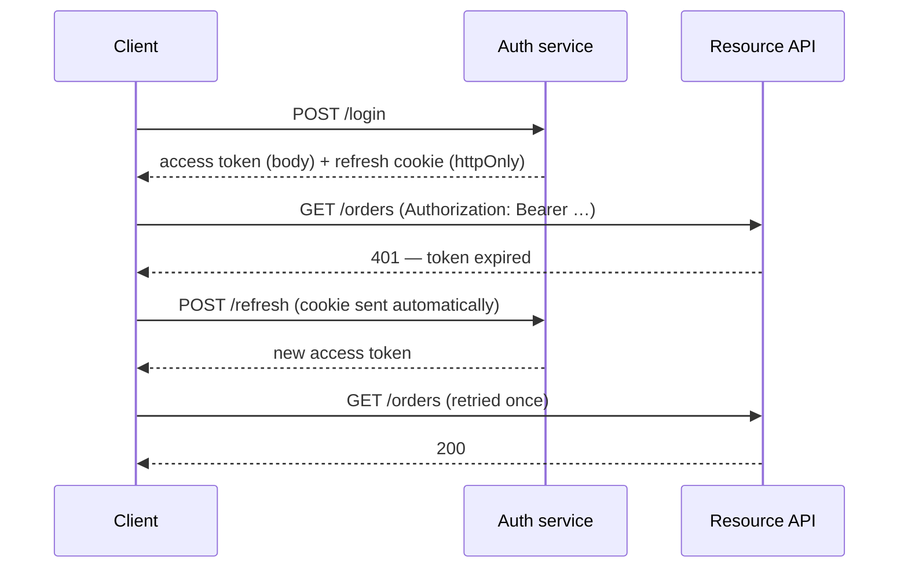

# Frontend Authentication {#ch-frontend-authentication}

> Credential কোথায় থাকবে তা ঠিক করুন, আর client আসলে কী enforce করতে পারে, সে বিষয়ে সৎ থাকুন।

**এই অধ্যায়ে:** credential রাখার তিনটি জায়গা · silent refresh আর thundering herd · মিথ্যা না বলে route guard করা · একাধিক tab-এ logout · client কখনো যা enforce করতে পারে না

## 💡 মূল ধারণা

Frontend auth design-এর বেশিরভাগটা দুটি বাক্যেই ধরা যায়।

**Browser-এ credential রাখার কোনো নিরাপদ জায়গা নেই।** আছে শুধু এমন জায়গা, যেগুলো আলাদা আলাদা ভাবে ব্যর্থ হয়।
Memory refresh হলেই মুছে যায়। `localStorage` পড়তে পারে inject হওয়া যেকোনো script। `httpOnly` cookie আপনার নিজের
code থেকে লুকানো থাকে, কিন্তু এমন request-এর সঙ্গেও চলে যায়, যা আপনি শুরু করেননি। এই ব্যর্থতাগুলোর মধ্যে বেছে নেওয়াটাই
design, আর বাকি সব এখান থেকেই আসে।

**Client যা-ই করুক, সেটা enforcement নয়।** Route guard, লুকানো button আর permission check, সবই user interface।
এগুলো product-কে সামঞ্জস্যপূর্ণ রাখে, কিন্তু কাউকে আটকায় না। Server এর প্রতিটি আবার যাচাই করে, নয়তো সেই check-এর কোনো
অস্তিত্বই নেই। যে candidate জিজ্ঞেস করার আগেই এটা বলেন, round-এর auth অংশে তিনি মোটামুটি পাস করে গেছেন।

Protocol-এর দিকটা (session design, token issue করা আর OAuth flow) আছে [Chapter ?? — Credential, Session, CORS ও CSRF](#ch-credentials-and-sessions)
আর [Chapter ?? — OAuth, OIDC ও Authorisation](#ch-oauth)-এ। এই অধ্যায় browser-এর অর্ধেক।

## কীভাবে কাজ করে

| Credential কোথায় থাকে | যা পেরিয়ে টিকে থাকে | কার নাগালে | কখন ব্যবহার করবেন |
| ------------------------- | -------- | ---------- | -------- |
| JavaScript memory | কিছুই না — refresh হলেই শেষ | শুধু চলমান code | স্বল্পায়ু access token |
| `localStorage` | Refresh, restart, অন্য tab | Inject হওয়া যেকোনো script | প্রায় কখনোই না |
| `httpOnly`, `Secure`, `SameSite` cookie | Refresh, restart, অন্য tab | মিলে যাওয়া request-এ নিজে থেকেই চলে যায় | দীর্ঘায়ু credential |

এই table যে pattern-এর দিকে ইঙ্গিত করে, সেটা হলো **memory-তে স্বল্পায়ু access token, আর `httpOnly` cookie-তে
দীর্ঘায়ু refresh token**। Cross-site scripting (XSS) cookie পড়তে পারে না, আর storage-এ পড়ে থাকা কোনো token-ও খুঁজে পায় না।
তবে page খোলা থাকা অবস্থায় inject হওয়া script তখনো user সেজে কাজ করতে পারে। Cross-site request forgery (CSRF)
access token ব্যবহার করতে পারে না, কারণ token-টা থাকে `Authorization` header-এ, যা জাল form set করতে পারে না।



**Silent refresh।** User কখনো 401 দেখেন না, আর দীর্ঘায়ু credential কখনো JavaScript-এর ভেতর দিয়ে যায় না।

> ⚠️ **`SameSite` একা কোনো CSRF strategy নয়।** `SameSite=Lax` তখনো top-level `GET` navigation হতে দেয়। তাই `GET` দিয়ে
> পৌঁছানো যায় এমন যেকোনো state পরিবর্তন তখনো জাল করা যায়। পরিবর্তনগুলো `POST`-এর মতো method-এ রাখুন, আর cookie-র
> সঙ্গে একটা token check জুড়ে দিন। দেখুন [Chapter ?? — Credential, Session, CORS ও CSRF](#ch-credentials-and-sessions)।

## কখন ব্যবহার করবেন

Memory-তে token রাখার pattern default, একমাত্র উত্তর নয়।

| Application | Credential design | কেন |
| --------------- | ----------------- | --- |
| নিজের API-র সঙ্গে কথা বলা single-page app | Memory-তে access token, cookie-তে refresh | XSS এটা পড়তে পারে না, CSRF এটা ব্যবহার করতে পারে না |
| Server-rendered app, একই origin | সাধারণ session cookie, client-এ কোনো token নেই | সহজ, সঙ্গে সঙ্গে revoke করা যায়, আর চুরি করার মতো কোনো client নেই |
| Mobile বা native client | Platform-এর secure storage, web-এর pattern নয় | Browser-এর সীমাবদ্ধতা এখানে খাটে না |
| Third party-রা ব্যবহার করে এমন public API | প্রতিটি client-এর জন্য আলাদা token-সহ OAuth | Client আপনি একা নন, তাই session-এর নিয়ম এখানে মানায় না |

Candidate-রা দ্বিতীয় row-টা কম ব্যবহার করেন। Application যদি আগে থেকেই server-এ render হয়, token যোগ করে কিছুই পাওয়া
যায় না, উল্টো revocation হারাতে হয়। Server একটা session মুছে দিতে পারে, কিন্তু একটা token ফেরত নিতে পারে না।

## হুড়োহুড়ি ছাড়া silent refresh

আসল মজার সমস্যা হলো concurrency। একটা dashboard আটটি request পাঠায়, token expire করে, আর একসঙ্গে আটটি 401 ফেরে।
সরল একটা interceptor আটটি refresh শুরু করে দেয়, আর সেগুলো একে অন্যের সঙ্গে দৌড়ায়। Refresh-token rotation থাকলে প্রথমটা
জেতে, বাকি সাতটি reject হয়, আর user logout হয়ে যান।

**Single-flight refresh — প্রতিটি caller একই promise-এর জন্য অপেক্ষা করে:**

```typescript
let token: string | null = null;
let inFlight: Promise<string> | null = null;

function refresh(): Promise<string> {
  // ✅ One refresh in flight; concurrent callers join it instead of starting another.
  inFlight ??= fetch("/auth/refresh", { method: "POST", credentials: "include" })
    .then((res) => {
      if (!res.ok) throw new Error("refresh failed");
      return res.json() as Promise<{ accessToken: string }>;
    })
    .then(({ accessToken }) => accessToken)
    .finally(() => { inFlight = null; });

  return inFlight;
}

async function authedFetch(input: RequestInfo, init: RequestInit = {}): Promise<Response> {
  const res = await fetch(input, withToken(init, token));
  if (res.status !== 401) return res;

  token = await refresh();
  return fetch(input, withToken(init, token)); // retried exactly once
}
```

তিনটি খুঁটিনাটি জরুরি। Promise-টা ভাগ করা, তাই একসঙ্গে আসা 401-গুলো মিলে একটাই refresh হয়। Retry হয় **একবার**।
দ্বিতীয় 401-এর পরও retry করা মানে expire হওয়া session-এর বিরুদ্ধে অনন্ত loop। আর `finally` `inFlight` খালি করে দেয়,
তাই একটা refresh fail করলে পরের সব request-এর হাতে reject হওয়া promise ধরিয়ে দেওয়া হয় না।

Expire হওয়ার ঠিক *আগে* refresh করে এমন timer কাজের বাড়তি জিনিস, কিন্তু এটার জায়গা নিতে পারে না। Expiry-র সময়
ঘুমিয়ে থাকা laptop জেগে ওঠে মরা token নিয়ে, তাই 401-এর পথটা তবু লাগে।

## মিথ্যা না বলে route guard করা

Authentication-এর তিনটি অবস্থা। যে design শুধু দুটি ধরে, সেটা এই এলাকার সবচেয়ে খারাপ দুটি bug তৈরি করে।

| অবস্থা | UI যা দেখায় | এই অবস্থা না থাকলে যে bug |
| ----- | ------------ | ---------------------------------- |
| অজানা | Skeleton, কোনো redirect নয় | প্রতিটি refresh-এ user login page-এ ছিটকে যান |
| Authenticated | Route-টা | — |
| Anonymous | Redirect, গন্তব্য মনে রেখে | User login করে গিয়ে পড়েন home page-এ |

প্রথম load-এ client এখনো জানে না user কে, কারণ refresh cookie বদলে নেওয়া এখনো হয়নি। এই অবস্থাকে "anonymous" ধরলে
প্রতিটি hard refresh-এ user logout হয়ে যান। "Authenticated" ধরলে redirect-এর আগে এক ঝলক সুরক্ষিত content দেখা যায়।

Login-এর পুরো আসা-যাওয়ার সময় কোথায় যাওয়ার কথা ছিল, সেটা মনে রাখুন, আর ফেরত পাঠানোর আগে সেটা যাচাই করুন। যাচাই না
করা `returnTo` parameter মানে open redirect। এমন জিনিস খোঁজে এমন প্রতিটি penetration test এটা report করে।

## একাধিক tab আর logout

Access token থাকে memory-তে, তাই প্রতিটি tab-এর কাছে নিজের একটা copy থাকে। একটায় logout করলে বাকিগুলো এমন session-এর
জন্য signed-in interface দেখাতে থাকে, যা আর নেই।

**অন্য tab-গুলোকে জানানো:**

```typescript
const channel = new BroadcastChannel("auth");

export function logout(): void {
  token = null;
  channel.postMessage({ type: "logout" }); // ✅ other tabs drop their copy immediately
  void fetch("/auth/logout", { method: "POST", credentials: "include" });
}

channel.onmessage = (event: MessageEvent<{ type: string }>) => {
  if (event.data.type === "logout") token = null;
};
```

এটা user experience-এর সমাধান, security control নয়। Cookie মুছে ফেলার মুহূর্তেই server-এ session মারা যায়। যে tab
broadcast-টা পায়নি, পরের request-এ সেটা এমনিতেই fail করে। Message শুধু ততক্ষণ পুরনো data দেখানো বন্ধ রাখে। উল্টো
ক্ষেত্রেও একই channel কাজে আসে। যে tab refresh করে, সেটা নতুন token ভাগ করে দিতে পারে, ফলে বাকিগুলোকে আলাদা আলাদা 401
খেতে হয় না।

## সাধারণ ভুল

❌ **`localStorage`-এ token।** Inject হওয়া একটা script-ই origin-এর সব credential পড়ে ফেলে।
✅ Memory-তে access token, `httpOnly` cookie-তে refresh token।

❌ **একসঙ্গে কয়েকটি refresh।** আটটি 401 আটটি refresh শুরু করে, আর rotation user-কে logout করে দেয়।
✅ Refresh single-flight করুন, আর প্রতিটি caller-কে একই promise-এর জন্য অপেক্ষা করান।

❌ **কাজ আটকানোর বদলে control লুকানো।** Button নেই; endpoint কিন্তু আছে।
✅ প্রতিটি permission server-এ আবার যাচাই করুন। Client-এর copy শুধু দেখানোর জন্য।

❌ **Auth-এর "অজানা" অবস্থা নেই।** হয় প্রতিটি refresh-এ login-এ ছিটকে যাওয়া, নয়তো এক ঝলক সুরক্ষিত content।
✅ তিনটি অবস্থা ধরুন, আর session ঠিক না হওয়া পর্যন্ত skeleton দেখান।

❌ **যাচাই না করা `returnTo`-তে redirect।** Open redirect, যা দিয়ে বিশ্বাসযোগ্য phishing করা হয়।
✅ চেনা তালিকা থেকে শুধু একই origin-এর relative path অনুমতি দিন।

❌ **ধরে নেওয়া যে একটা tab-এ logout করলে বাকিগুলোও logout হয়।** পাঁচটি tab revoke হওয়া session নিয়েই চলতে থাকে।
✅ পরিবর্তনটা সব tab-এ broadcast করুন, আর বাকি কাজটা পরের 401 শেষ করুক।

## 🔑 মূল শিক্ষা

- Browser-এ নিরাপদ credential store নেই, আছে শুধু আলাদা আলাদা ভাবে ব্যর্থ হওয়া store; যে ব্যর্থতা মেনে নিতে পারবেন, সেটা বাছুন।
- Memory-তে স্বল্পায়ু access token আর `httpOnly` refresh cookie, দুটিকেই XSS-এর চুরি আর CSRF-এর নাগালের বাইরে রাখে।
- Refresh হতে হবে single-flight, আর retry ঠিক একবার। নইলে token rotation একঝাঁক 401-কে logout বানিয়ে দেয়।
- Authentication-এর তিনটি অবস্থা। "অজানা" বাদ দিলে হয় login-এ ছিটকে যাওয়া, নয়তো এক ঝলক সুরক্ষিত content।
- Route guard আর লুকানো button হলো user interface, আর প্রতিটি নিয়ম enforce করে server, কোনো ব্যতিক্রম ছাড়া।

## Interview-এর প্রশ্ন

**Q: Token কোথায় রাখবেন, আর `localStorage`-এ কেন নয়?**

Access token যায় module-scope-এর একটা variable-এ, আর refresh token `httpOnly`, `Secure`, `SameSite` cookie-তে।
Origin-এ চলা যেকোনো script `localStorage` পড়তে পারে। তাই dependency বা tag manager থেকে inject হওয়া একটা script-ই সব
session চুরি করতে পারে। Cookie JavaScript থেকে লুকানো। Access token যায় `Authorization` header-এ, নিজে থেকে নয়,
তাই জাল cross-site request-ও সেটা ব্যবহার করতে পারে না।

**Q: একই মুহূর্তে আটটি request 401 পেল। কী হয়?**

একটাই refresh। Interceptor চলমান একটা promise ধরে রাখে, আর সেই সময়ে আসা caller-রা নিজেরা নতুন করে শুরু না করে ওই
promise-এর জন্যই অপেক্ষা করে। এটা না থাকলে আটটি refresh দৌড়ায়। Refresh-token rotation থাকলে প্রথমটা সেই token বাতিল
করে দেয়, যা বাকি সাতটি ব্যবহার করছে। ফলে user-এর নিজের dashboard-ই তাঁকে logout করে দেয়। Refresh শেষ হলে প্রতিটি
request ঠিক একবার retry করে। দ্বিতীয় 401 আসল ব্যর্থতা, আর সেটা login-এ যায়।

**Q: Admin নন এমন user-দের জন্য client delete button লুকিয়ে রাখে। এটা কি authorisation?**

না, এটা layout। শুধু admin-এর কাজ interface-এর বাইরে রাখে, সেটা করার মতোই। কিন্তু যে কেউ terminal থেকে endpoint-এ
পৌঁছাতে পারে, আর token-এর ভেতরের role claim এমন data, যা client দেখতে পায়। Authorisation হলো প্রতিটি request-এ
server-এর যাচাই। Client-এর permission map-কে আমি দেখব render করার জন্য policy-র একটা copy হিসেবে, কখনো policy হিসেবে
নয়।

**Q: কখন token একেবারেই ব্যবহার করবেন না?**

যখন application একটা origin-এ server-rendered। সাধারণ session cookie সহজ, আর client-এর কাছে ফাঁস হওয়ার মতো কিছুই রাখে
না। সাধারণত যে জিনিসটা সিদ্ধান্ত ঠিক করে দেয়: এটা সঙ্গে সঙ্গে revoke করা যায়, কারণ session row মুছলেই শেষ। Token ফেরত
নেওয়া যায় না। হয় তার মেয়াদ ফুরানো পর্যন্ত অপেক্ষা করতে হয়, নয়তো সেই denylist বানাতে হয়, stateless token যা এড়ানোর
জন্যই এসেছিল। Token আমি নেব কেবল তখন, যখন কয়েকটি client বা origin জড়িত।

## এরপর কী পড়বেন

- [Chapter ?? — Credential, Session, CORS ও CSRF](#ch-credentials-and-sessions) — server-এর অর্ধেক: issue করা, rotation আর revocation
- [Chapter ?? — OAuth, OIDC ও Authorisation](#ch-oauth) — permission আসলে কোথায় enforce হয়, আর model-টা কীভাবে design করা হয়
- [Chapter ?? — XSS প্রতিরোধ ও অবিশ্বস্ত Input](#ch-xss-prevention) — ওপরের পুরো storage-এর যুক্তি যে আক্রমণ ঠেকানোর জন্য
