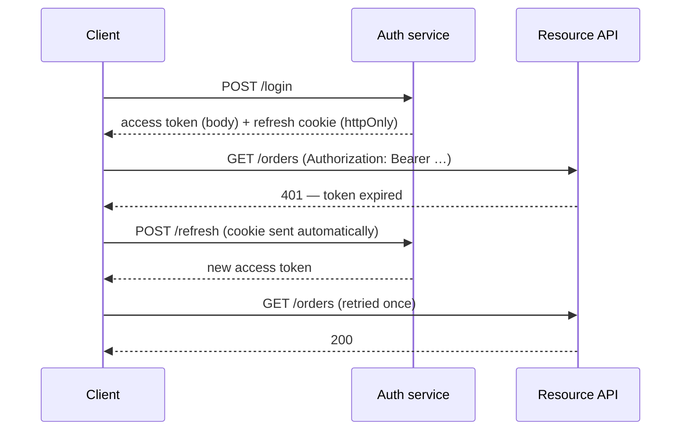

# Frontend Authentication {#ch-frontend-authentication}

> Credential কোথায় থাকবে তা ঠিক করুন, আর client কী enforce করতে পারে, সে বিষয়ে সৎ থাকুন।

**এই অধ্যায়ে:** একটি credential যে তিন জায়গায় থাকতে পারে · silent refresh আর thundering herd · মিথ্যা না বলে route guard করা · multi-tab logout · client যা কখনো enforce করতে পারে না

## 💡 মূল ধারণা

দুটি বাক্যেই frontend auth design-এর বেশিরভাগটা ধরা আছে।

**Browser-এ credential রাখার কোনো নিরাপদ জায়গা নেই।** আছে শুধু এমন জায়গা, যেগুলো আলাদা আলাদাভাবে fail করে। Memory refresh-এ মরে যায়। `localStorage` যেকোনো inject হওয়া script পড়তে পারে। একটি `httpOnly` cookie আপনার নিজের code থেকে লুকানো, কিন্তু এমন request-এর সাথেও যায় যেগুলো আপনি শুরু করেননি। এই failure-গুলোর মধ্যে বাছাই করাটাই design, আর বাকি সবকিছু এখান থেকেই আসে।

**Client যা করে, তার কিছুই enforcement নয়।** একটি route guard, একটি লুকানো button আর একটি permission check — সবই user interface। এগুলো product-কে সামঞ্জস্যপূর্ণ রাখে, কিন্তু কাউকে থামায় না। Server এর প্রতিটি আবার যাচাই করে, নয়তো check-টির কোনো অস্তিত্বই নেই। যে candidate কেউ জিজ্ঞেস না করতেই এটা বলেন, তিনি round-এর auth অংশ মোটামুটি পার করে ফেলেছেন।

Protocol-এর দিক (session design, token issue করা আর OAuth flow) আছে [Chapter ?? — Credential, Session, CORS ও CSRF](#ch-credentials-and-sessions) আর [Chapter ?? — OAuth, OIDC ও Authorisation](#ch-oauth)-এ। এই অধ্যায় browser-এর অর্ধেক।

## কীভাবে কাজ করে

| Credential কোথায় থাকে | যা পার করে টিকে থাকে | যার কাছে উন্মুক্ত | কখন ব্যবহার করবেন |
| ------------------------- | -------- | ---------- | -------- |
| JavaScript memory | কিছুই না — refresh-এ চলে যায় | শুধু চলমান code | স্বল্পায়ু access token |
| `localStorage` | Refresh, restart, অন্য tab | যেকোনো inject হওয়া script | প্রায় কখনোই না |
| `httpOnly`, `Secure`, `SameSite` cookie | Refresh, restart, অন্য tab | মিলে যাওয়া request-এ নিজে থেকেই যায় | দীর্ঘজীবী credential |

এই table যে pattern-এর দিকে ইঙ্গিত করে, সেটা হলো **memory-তে একটি স্বল্পায়ু access token, আর একটি `httpOnly` cookie-তে একটি দীর্ঘজীবী refresh token**। Cross-site scripting (XSS) cookie পড়তে পারে না, আর storage-এ বসে থাকা কোনো token-ও পায় না। Page খোলা থাকা অবস্থায় একটি inject হওয়া script তবুও user হিসেবে কাজ করতে পারে। Cross-site request forgery (CSRF) access token ব্যবহার করতে পারে না, কারণ সেটা থাকে একটি `Authorization` header-এ, যেটা একটি জাল form set করতে পারে না।



**Silent refresh।** User কখনো 401 দেখেন না, আর দীর্ঘজীবী credential কখনো JavaScript-এর ভেতর দিয়ে যায় না।

> ⚠️ **`SameSite` একা কোনো CSRF strategy নয়।** `SameSite=Lax` তবুও top-level `GET` navigation হতে দেয়, তাই `GET` দিয়ে পৌঁছানো যায় এমন যেকোনো state change এখনো জাল করা যায়। পরিবর্তনগুলো `POST`-এর মতো method-এ রাখুন, আর cookie-র সাথে একটি token check জুড়ে দিন। দেখুন [Chapter ?? — Credential, Session, CORS ও CSRF](#ch-credentials-and-sessions)।

## কখন ব্যবহার করবেন

Memory-তে token-এর pattern হলো default, একমাত্র উত্তর নয়।

| Application | Credential design | কেন |
| --------------- | ----------------- | --- |
| আপনার নিজের API-র বিপরীতে একটি single-page app | Memory-তে access token, cookie-তে refresh | XSS এটা পড়তে পারে না, আর CSRF ব্যবহার করতে পারে না |
| একটি server-rendered app, একই origin | সাধারণ session cookie, client-এ কোনো token নেই | সহজ, তাৎক্ষণিকভাবে revoke করা যায়, আর চুরি করার মতো কোনো client নেই |
| একটি mobile বা native client | Platform-এর secure storage, web pattern নয় | Browser-এর সীমাবদ্ধতা এখানে খাটে না |
| তৃতীয় পক্ষের ব্যবহার করা একটি public API | প্রতি client-এর token-সহ OAuth | আপনিই একমাত্র client নন, তাই session-এর অর্থ এখানে মেলে না |

দ্বিতীয় row-টাই candidate-রা কম ব্যবহার করেন। Application যদি ইতিমধ্যে server-এ render হয়, token যোগ করে কিছুই পাওয়া যায় না, আর revocation হারাতে হয়। Server একটি session মুছে দিতে পারে, কিন্তু একটি token ফিরিয়ে নিতে পারে না।

## হুড়োহুড়ি ছাড়া silent refresh

আগ্রহের সমস্যাটা হলো concurrency। একটি dashboard আটটি request পাঠায়, token expire করে, আর আটটি 401 একসাথে আসে। একটি সরল interceptor আটটি refresh শুরু করে, আর সেগুলো দৌড়ে প্রতিযোগিতা করে। Refresh-token rotation থাকলে প্রথমটি জেতে, বাকি সাতটি প্রত্যাখ্যাত হয়, আর user logout হয়ে যান।

**Single-flight refresh — প্রতিটি caller একই promise-এর জন্য await করে:**

```typescript
let token: string | null = null;
let inFlight: Promise<string> | null = null;

function refresh(): Promise<string> {
  // ✅ One refresh in flight; concurrent callers join it instead of starting another.
  inFlight ??= fetch("/auth/refresh", { method: "POST", credentials: "include" })
    .then((res) => {
      if (!res.ok) throw new Error("refresh failed");
      return res.json() as Promise<{ accessToken: string }>;
    })
    .then(({ accessToken }) => accessToken)
    .finally(() => { inFlight = null; });

  return inFlight;
}

async function authedFetch(input: RequestInfo, init: RequestInit = {}): Promise<Response> {
  const res = await fetch(input, withToken(init, token));
  if (res.status !== 401) return res;

  token = await refresh();
  return fetch(input, withToken(init, token)); // retried exactly once
}
```

তিনটি খুঁটিনাটি গুরুত্বপূর্ণ। Promise-টি share করা, তাই একসাথে আসা 401-গুলো একটি refresh-এ মিশে যায়। Retry হয় **একবারই**। দ্বিতীয় 401-এ retry করা মানে expire হওয়া session-এর বিপরীতে একটি অনন্ত loop। আর `finally` `inFlight` পরিষ্কার করে, তাই একটি fail করা refresh পরের প্রতিটি request-কে একটি rejected promise ধরিয়ে দেয় না।

Expire হওয়ার ঠিক *আগে* refresh করা একটি timer কাজের বাড়তি জিনিস, কিন্তু এটার বিকল্প নয়। যে laptop expiry-র সময়টা ঘুমিয়ে কাটিয়েছে, সেটা একটি মৃত token নিয়ে জাগে, আর তবুও 401 path-টা লাগে।

## মিথ্যা না বলে route guard করা

Authentication-এর তিনটি state আছে। যে design শুধু দুটি model করে, সেটা এই এলাকার সবচেয়ে খারাপ দুটি bug তৈরি করে।

| State | UI যা দেখায় | এই state না থাকলে যে bug |
| ----- | ------------ | ---------------------------------- |
| Unknown | একটি skeleton, কোনো redirect নয় | প্রতিটি refresh user-কে login page-এ ছুড়ে দেয় |
| Authenticated | Route-টি | — |
| Anonymous | একটি redirect, গন্তব্য মনে রেখে | User login করে home page-এ গিয়ে পড়েন |

প্রথম load-এ client এখনো জানে না user কে, কারণ সে এখনো refresh cookie বিনিময় করেনি। এটাকে "anonymous" ধরলে প্রতিটি hard refresh-এ user logout হন। "Authenticated" ধরলে redirect-এর আগে সুরক্ষিত content এক ঝলক দেখা যায়।

Login-এর round trip জুড়ে উদ্দিষ্ট গন্তব্যটি ধরে রাখুন, আর ফেরত redirect করার আগে সেটা validate করুন। Validate না করা একটি `returnTo` parameter হলো একটি open redirect। যে penetration test এটা খোঁজে, প্রতিটি সেটা report করে।

## Multi-tab আর logout

Access token memory-তে থাকে, তাই প্রতিটি tab-এর কাছে নিজের একটি copy থাকে। একটিতে logout করলে বাকিগুলো এমন একটি session-এর জন্য signed-in interface দেখাতে থাকে, যেটার আর অস্তিত্ব নেই।

**অন্য tab-গুলোকে জানানো:**

```typescript
const channel = new BroadcastChannel("auth");

export function logout(): void {
  token = null;
  channel.postMessage({ type: "logout" }); // ✅ other tabs drop their copy immediately
  void fetch("/auth/logout", { method: "POST", credentials: "include" });
}

channel.onmessage = (event: MessageEvent<{ type: string }>) => {
  if (event.data.type === "logout") token = null;
};
```

এটা user experience-এর একটি সমাধান, security control নয়। Cookie মুছে যাওয়ার মুহূর্তেই server-এ session মৃত। যে tab broadcast-টি পায়নি, সে তার পরের request-এ এমনিতেই fail করে। Message-টি শুধু ততক্ষণ পর্যন্ত তাকে stale data দেখানো থেকে থামায়। একই channel উল্টো ক্ষেত্রেও সাহায্য করে। যে tab refresh করে, সে নতুন token share করতে পারে, যাতে বাকিরা প্রত্যেকে নিজের 401 trigger না করে।

## সাধারণ ভুল

❌ **`localStorage`-এ token।** একটি inject হওয়া script origin-এর প্রতিটি credential পড়ে ফেলে।
✅ Memory-তে access token, একটি `httpOnly` cookie-তে refresh token।

❌ **একসাথে কয়েকটি refresh।** আটটি 401 আটটি refresh শুরু করে, আর rotation user-কে logout করে দেয়।
✅ Refresh-কে single-flight করুন, আর প্রতিটি caller-কে একই promise-এর জন্য await করান।

❌ **Action আটকানোর বদলে একটি control লুকানো।** Button চলে গেছে; endpoint যায়নি।
✅ প্রতিটি permission server-এ আবার যাচাই করুন। Client-এর copy শুধু উপস্থাপনা।

❌ **কোনো "unknown" auth state নেই।** হয় প্রতিটি refresh-এ login-এ ছুড়ে দেওয়া, নয়তো সুরক্ষিত content-এর এক ঝলক।
✅ তিনটি state model করুন, আর session resolve না হওয়া পর্যন্ত একটি skeleton render করুন।

❌ **Validate না করা একটি `returnTo`-তে redirect করা।** একটি open redirect, বিশ্বাসযোগ্য phishing-এ ব্যবহৃত।
✅ শুধু একটি জানা set থেকে same-origin relative path অনুমোদন করুন।

❌ **ধরে নেওয়া যে একটি tab-এ logout করলে বাকিগুলোও logout হয়।** পাঁচটি tab একটি revoke হওয়া session নিয়ে কাজ করে যায়।
✅ পরিবর্তনটি সব tab-এ broadcast করুন, আর পরের 401-কে কাজটা শেষ করতে দিন।

## 🔑 মূল শিক্ষা

- Browser-এ নিরাপদ কোনো credential store নেই, আছে শুধু আলাদাভাবে fail করা store; যে failure নিয়ে বাঁচতে পারবেন, সেটা বাছুন।
- Memory-তে একটি স্বল্পায়ু access token আর একটি `httpOnly` refresh cookie দুটিকেই XSS চুরি আর CSRF-এর নাগালের বাইরে রাখে।
- Refresh-কে single-flight হতে হবে আর ঠিক একবার retry হতে হবে, নাহলে token rotation একঝাঁক 401-কে একটি logout-এ পরিণত করে।
- Authentication-এর তিনটি state আছে, আর "unknown" বাদ দিলে হয় login-এ ছুড়ে দেওয়া, নয়তো সুরক্ষিত content-এর এক ঝলক ঘটে।
- Route guard আর লুকানো button হলো user interface, আর প্রতিটি নিয়ম server enforce করে, কোনো ব্যতিক্রম ছাড়া।

## Interview-এর প্রশ্ন

**Q: Token কোথায় রাখেন, আর `localStorage`-এ কেন নয়?**

Access token যায় একটি module-scoped variable-এ, আর refresh token একটি `httpOnly`, `Secure`, `SameSite` cookie-তে। Origin-এ চলা যেকোনো script `localStorage` পড়তে পারে। তাই একটি dependency বা একটি tag manager থেকে আসা একটি inject হওয়া script প্রতিটি session চুরি করতে পারে। Cookie JavaScript থেকে লুকানো। Access token যায় একটি `Authorization` header-এ, নিজে থেকে নয়, তাই একটি জাল cross-site request-ও এটা ব্যবহার করতে পারে না।

**Q: আটটি request একই মুহূর্তে 401 পায়। কী ঘটে?**

একটি refresh। Interceptor একটিমাত্র in-flight promise ধরে রাখে, আর এর মধ্যে আসা caller-রা নিজেরটা শুরু না করে সেটার জন্যই await করে। এটা না থাকলে আটটি refresh দৌড়ায়। Refresh-token rotation থাকলে প্রথমটি সেই token invalid করে দেয়, যেটা বাকি সাতটি ব্যবহার করছে, তাই user-এর নিজের dashboard-ই তাঁকে logout করে দেয়। Refresh resolve হওয়ার পর প্রতিটি request ঠিক একবার retry করে। দ্বিতীয় 401 একটি আসল failure, আর সেটা login-এ যায়।

**Q: Client non-admin-দের জন্য delete button লুকিয়ে রাখে। এটা কি authorisation?**

না, এটা layout। এটা একটি admin-only action-কে interface-এর বাইরে রাখে, যেটা করা উচিত। কিন্তু যে কেউ একটি terminal থেকে endpoint-এ পৌঁছাতে পারে, আর token-এর role claim এমন data, যেটা client দেখতে পায়। Authorisation হলো প্রতিটি request-এ server-এর check। আমি client-এর permission map-কে rendering-এর জন্য policy-র একটি copy হিসেবে দেখব, কখনো policy হিসেবে নয়।

**Q: কখন একেবারেই token ব্যবহার করবেন না?**

যখন application একটি origin-এ server-rendered। একটি সাধারণ session cookie সহজ, আর client-কে leak করার মতো কিছুই দেয় না। যে অংশটা সাধারণত সিদ্ধান্ত ঠিক করে: এটা সাথে সাথে revoke করা যায়, কারণ session row মুছে দিলেই এটা শেষ। একটি token ফিরিয়ে নেওয়া যায় না। হয় এর আয়ু শেষ হওয়া পর্যন্ত অপেক্ষা করতে হয়, নয়তো সেই denylist বানাতে হয়, যেটা এড়ানোর জন্যই stateless token তৈরি হয়েছিল। আমি token নেব শুধু তখন, যখন কয়েকটি client বা origin জড়িত।

## এরপর কী পড়বেন

- [Chapter ?? — Credential, Session, CORS ও CSRF](#ch-credentials-and-sessions) — server-এর অর্ধেক: issue, rotation আর revocation
- [Chapter ?? — OAuth, OIDC ও Authorisation](#ch-oauth) — permission আসলে কোথায় enforce হয়, আর model-টি কীভাবে design করা হয়
- [Chapter ?? — XSS প্রতিরোধ ও অবিশ্বস্ত Input](#ch-xss-prevention) — ওপরের পুরো storage যুক্তি যে attack-এর বিরুদ্ধে রক্ষা করছে
