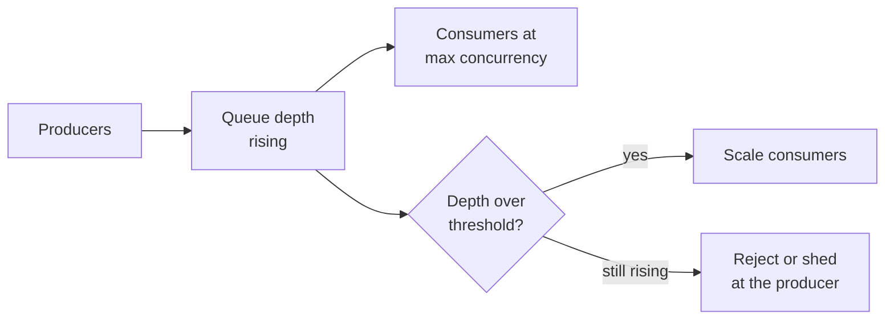
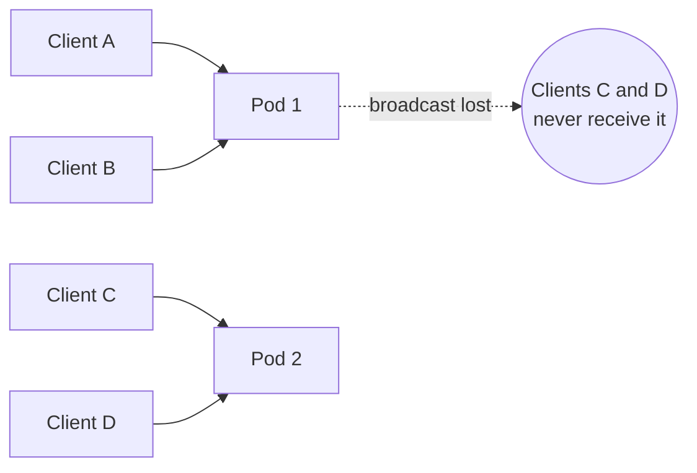

# Queue, Async কাজ ও WebSocket {#ch-message-queues}

> কাজটা request path থেকে সরিয়ে দিন, worker-কে দুবার চালালেও যেন ক্ষতি না হয় তা নিশ্চিত করুন, আর ফলাফল ফেরত পাঠান এমন connection দিয়ে, যা একাধিক server-এও টিকে থাকে।

**এই অধ্যায়ে:** queue বনাম pub/sub বনাম log · delivery guarantee আর idempotent worker · retry আর back-pressure · WebSocket, SSE নাকি polling · ধরে রাখা connection আর fan-out-কে scale করা

## 💡 মূল ধারণা

কিছু কাজ একটি request আর একটি response-এর মধ্যে আঁটে না। হয় কাজটা খুব ধীর, নয়তো কেউ তার জন্য অপেক্ষা করে না।
বেরোনোর পথ দুটি। আপনি **কাজটা request-এর পেছনে queue করতে পারেন**, আর "হয়ে গেছে"-র বদলে উত্তর দিতে পারেন "গ্রহণ করা হলো"।
অথবা কাজ শেষ হলে **ফলাফলটা ফেরত push করতে পারেন** দীর্ঘক্ষণ খোলা থাকা কোনো connection দিয়ে।

দুটিই user-এর সঙ্গে চুক্তিটা বদলে দেয়। Queue হঠাৎ চাপ সামলে নেয়, নিজেই retry করে। কিন্তু কাজটা দুবার হয়ে যেতে পারে, আর
caller আর জানে না কাজ কখন শেষ হলো। ধরে রাখা connection খবর পৌঁছে দেয় কয়েক millisecond-এ। কিন্তু connection-টা একটি
process-এর, তাই প্রতিটি নতুন server যোগ করলে broadcast আরও কঠিন হয়।

## কীভাবে কাজ করে

### তিনটি গড়ন, প্রায়ই গুলিয়ে ফেলা হয়

| গড়ন          | Delivery                                    | Message কতদিন থাকে                  | কাজে লাগে                             |
| -------------- | ------------------------------------------- | ----------------------------- | ----------------------------------- |
| **Work queue** | প্রতিটি message পায় একটি consumer              | Acknowledgement-এর পরে মুছে যায় | Task: email পাঠানো, image resize    |
| **Pub/sub**    | প্রতিটি subscriber একটি করে copy পায়                | Deliver হলেই বাদ               | আগ্রহী service-গুলোকে জানানো        |
| **Event log**  | প্রতিটি consumer group পুরো stream পড়ে | কয়েকদিন রাখা হয়, replay করা যায় | Event sourcing, analytics, নতুন করে বানানো |

RabbitMQ আর SQS হলো work queue, SNS হলো pub/sub, আর Kafka হলো log। **সিদ্ধান্তের প্রশ্নটা replay।** একদিন ধরে নষ্ট থাকা
consumer-কে যদি যা মিস করেছে তা ধরে ফেলতে হয়, তাহলে log লাগবে। নাহলে queue সহজ, আর সস্তাও।

### কী request path-এর বাইরে থাকা উচিত

পরীক্ষাটা হলো: **ফলাফলের ওপর কি response বদলায়?** Order-এর record লেখা আর card-এ charge করা synchronous থাকে, কারণ UI
সেগুলোর ওপর নির্ভর করে। Confirmation email-এর ওপর UI নির্ভর করে না, তাই সেটা queue করুন।

**আগে গ্রহণ, পরে খবর — handler দুটি সস্তা কাজ করে return করে:**

```typescript
interface JobAccepted { jobId: string; statusUrl: string }

async function requestExport(userId: string, queue: Queue, store: JobStore): Promise<JobAccepted> {
  const jobId: string = crypto.randomUUID();
  await store.create({ jobId, userId, state: "queued" }); // durable before enqueue
  await queue.send({ jobId, userId, type: "export" });
  return { jobId, statusUrl: `/jobs/${jobId}` }; // HTTP 202
}
```

Enqueue করার **আগে** job record লিখুন। Enqueue ব্যর্থ হলেও client-এর হাতে retry করার মতো একটি ID থাকে। ক্রম উল্টে দিলে
worker এমন job তুলে নিতে পারে, যার record এখনো তৈরিই হয়নি। এরপর client ফলাফল জানে `statusUrl` poll করে, অথবা push
channel-এ শুনে। সেটা নিচে আছে।

### Delivery guarantee আর idempotent worker

| Guarantee     | আসলে কী হয়                               | দাম                                                   |
| ------------- | ------------------------------------------------- | ------------------------------------------------------ |
| At most once  | পাঠিয়ে ভুলে যাওয়া; message হারাতে পারে             | শুধু telemetry-র জন্য চলে                          |
| At least once | Acknowledge না হওয়া পর্যন্ত বারবার আসে; duplicate হয় | Consumer-কে idempotent হতেই হবে                        |
| Exactly once  | শুধু একটি broker-এর নিজের transaction-এর ভেতরে          | Throughput আর জটিলতা; আপনার side effect কখনো এর আওতায় আসে না |

ধরে নিন **at least once**। Broker আর payment provider জুড়ে "exactly once" পাওয়া সম্ভব নয়। Side effect ঘটে যাওয়ার পরেও
acknowledgement হারিয়ে যেতে পারে।

**Business-এর তথ্য দিয়ে key করা একটি idempotent worker:**

```typescript
interface Processed { has(key: string): Promise<boolean>; add(key: string): Promise<void> }

async function handleCharge(msg: { orderId: string }, seen: Processed): Promise<void> {
  // A redelivery reuses the same orderId, so the key survives it; a message ID might not.
  const key = `charge:${msg.orderId}`;
  if (await seen.has(key)) return;
  await chargeCard(msg.orderId);
  await seen.add(key);
}
```

এই ক্রমে বেছে নিন: আগে এমন operation যা স্বভাবতই idempotent (চূড়ান্ত অবস্থার একটি `PUT`), তারপর downstream যে idempotency
key মেনে চলে, তারপর এখানকার মতো একটি processed-set। Processed-set-এ side effect আর record-এর মধ্যে race থাকে, তাই এর চেয়ে
ভালো কিছু না থাকলেই শুধু এটা ব্যবহার করুন।

### Retry, dead letter আর back-pressure

Retry করুন exponential backoff **আর jitter** দিয়ে। Jitter না থাকলে ব্যর্থ সব message একই মুহূর্তে retry করে, আর সেরে উঠতে থাকা
service-টাকে আবার ফেলে দেয়। Timeout, 503 আর 429-এ retry করুন (`Retry-After` মেনে চলুন)। ভুল গড়নের message আর business-এর
কারণে প্রত্যাখ্যান সোজা পাঠান **dead letter queue**-তে। তাতে কিছু জমলেই alert দিন, আর মূল message-টা তার error-সহ রেখে দিন,
যাতে replay করা যায়।



**যে queue চিরকাল বাড়তেই থাকে, সেটা ধীরে ধীরে ভেঙে পড়া একটি system; আগে consumer scale করুন, তারপর producer-এর দিকে চাপ কমান।**

Alert দিন **সবচেয়ে পুরনো message-এর বয়স** দেখে, শুধু depth দেখে নয়। দশ সেকেন্ডে খালি হয়ে যাওয়া দশ লাখ message সুস্থ লক্ষণ।
কিন্তু পঞ্চাশটি message, যার সবচেয়ে পুরনোটা এক ঘণ্টা আগের, মানে কোনো consumer আটকে গেছে।

### ফলাফল ফেরত push করা

"Real-time" একটি চাহিদা, কোনো technology নয়। Server-কে না জিজ্ঞেস করলেও client-কে কিছু জানাতে হবে। তিনটি transport এটা
পূরণ করে, তবে দাম একেবারে আলাদা।

| | **WebSocket** | **SSE** | **Polling** |
| --- | --- | --- | --- |
| দিক | দুই দিকেই | Server → client | Client জিজ্ঞেস করে |
| Protocol | `101` upgrade-এর পরে নিজস্ব protocol | সাধারণ HTTP | সাধারণ HTTP |
| Reconnect | আপনাকে বানাতে হয় | ✅ নিজে থেকেই, `Last-Event-ID` দিয়ে replay | প্রযোজ্য নয় |
| Proxy, CDN, HTTP/2 | ⚠️ প্রায়ই config লাগে; compression হারায় | ✅ স্রেফ HTTP | ✅ |
| Server-এর খরচ | প্রতি client-এ একটি ধরে রাখা connection | প্রতি client-এ একটি ধরে রাখা connection | মাঝে মাঝে লাফায়, কিন্তু stateless |

**সিদ্ধান্তের প্রশ্ন: client-ও কি ঘন ঘন message পাঠায়?** পাঠালে socket লাগবে, আর stateful infrastructure মেনে নিতে হবে। না
পাঠালে আপনি এক দিকে push করছেন, আর সাধারণ HTTP সেটা আগে থেকেই পারে। তিনটির মধ্যে SSE সবচেয়ে কম ব্যবহার হয়। Job-এর
অগ্রগতি, notification আর token stream, সবই SSE-তে মানায়।

> ⚠️ **HTTP/1.1-এর সতর্কতা:** browser HTTP/1.1-এ প্রতি origin-এ মোটামুটি ছয়টি connection-এর বেশি খোলে না, তাই SSE stream
> ধরে রাখা কয়েকটি tab একে অপরকে আটকে দেয়। HTTP/2-তে সবাই একটি connection ভাগ করে, আর সমস্যাটা চলে যায়।

### Stateful connection-এর সমস্যা

ধরে রাখা connection ঠিক একটি process-এর। Scaling-এর সব ঝামেলা এখান থেকেই আসে।



**Client A একটি room-এ message পাঠায়। Room-এর অর্ধেক আছে Pod 2-তে, আর Pod 2 খবরটা কখনো পায় না।**

সমাধান হলো এমন একটি pub/sub broker, যাতে প্রতিটি pod subscribe করে। প্রতিটি pod বাইরে যাওয়া message একটি shared channel-এ
publish করে, আর যা পায় তা নিজের socket-গুলোতে পৌঁছে দেয়। সাধারণত বেছে নেওয়া হয় Redis Pub/Sub।

| চিন্তার বিষয়                 | বড় scale-এ এর মানে                                                                                  |
| ----------------------- | ------------------------------------------------------------------------------------------------------- |
| **Fan-out-এর খরচ**        | প্রতিটি message প্রতিটি pod-এ পৌঁছায়। কয়েক ডজন pod পেরোলে channel-কে room ধরে shard করুন                        |
| **Durability নেই**       | Disconnect থাকা pod যা মিস করেছে, Redis Pub/Sub তা ফেলে দেয়, তাই source of truth হলো database               |
| **Deploy মানেই outage** | Rolling deploy একটি pod-এর সব socket একসঙ্গে ফেলে দেয়। নতুন connection নেওয়া বন্ধ করুন, client-দের reconnect করতে বলুন, তারপর ধাপে ধাপে বন্ধ করুন |
| **Capacity**            | প্রতি Node.js process-এ মোটামুটি 50k অলস socket; CPU-র আগেই memory ফুরিয়ে যায়                                   |

**কখন কিনবেন, তা জানুন।** Managed service (Ably, Pusher, AWS API Gateway WebSockets) connection-এর scaling, sharding আর
draining-এর দায় আপনার team-এর কাঁধ থেকে নামিয়ে দেয়। "আমি এটা কিনতাম" senior-এর মতো উত্তর, যদি দামটা বলতে পারেন: প্রতি
connection-এর দাম, আর আপনার সবচেয়ে latency-সংবেদনশীল path-এ একটি vendor।

### Fan-out

Notification হলো fan-out-এর ক্লাসিক সমস্যা: একটি event থেকে হাজার হাজার delivery।

| Pattern          | কীভাবে                                                         | কখন ব্যবহার করবেন                                         |
| ---------------- | ----------------------------------------------------------- | ------------------------------------------------ |
| Fan-out on write | Publish-এর সময়েই প্রাপকের তালিকা খুলে ফেলা, প্রত্যেকের জন্য একটি message | প্রাপকের তালিকা ছোট, আর read ঘন ঘন হয় |
| Fan-out on read  | Event একবার রাখা, প্রতিটি user চাইলে তখন খোলা            | প্রাপকের তালিকা বিশাল (celebrity problem) |
| Hybrid           | সাধারণ account-এর জন্য write-side, ব্যতিক্রমগুলোর জন্য read-side  | বাস্তবের system-এ, প্রায় সবসময়                      |

প্রতিটি fan-out-এ business event দিয়ে key করা **deduplication** লাগে, যাতে redelivery-তে push কখনো দুবার না যায়। লাগে
**প্রতি channel-এর rate limit**-ও, কারণ provider-রা হঠাৎ দশ লাখ email-এর ঝাপটা ফিরিয়ে দেয়।

## কখন ব্যবহার করবেন

| পরিস্থিতি                                      | বেছে নিন                     | কেন                                    |
| ---------------------------------------------- | -------------------------- | -------------------------------------- |
| Background task, প্রতি message-এ একটি worker       | Work queue (SQS, RabbitMQ) | কাজ করে এমন সবচেয়ে সহজ জিনিস              |
| Consumer-কে history replay করতে হবে                  | Event log (Kafka)          | Retention আর offset-ই এখানে আসল সুবিধা  |
| Caller-এর উত্তর এখনই চাই                | Queue নয়                   | এখানে async শুধু একটি polling-এর সমস্যা যোগ করে |
| Server push করে, client শোনে — অগ্রগতি, alert | SSE                      | এক দিক, আর proxy সেটা সামলাতে পারে   |
| Client ঘন ঘন পাঠায় — chat, cursor, editing    | WebSocket                  | সত্যিই দুই দিকের                |
| "30 সেকেন্ডের মধ্যে টাটকা" হলেই চলে              | Polling                    | Stateless, cache করা যায়, চালানো খুব সহজ   |

## সাধারণ ভুল

❌ **এমন worker, যা দুবার চালানো নিরাপদ নয়।** কোনো key ছাড়া message পেলেই card-এ charge করলে charge দুবার হবে। সাধারণত
এটা ঘটে incident-এর সময়, যখন redelivery-র সম্ভাবনা সবচেয়ে বেশি।
✅ `Idempotency-Key: order-8821` পাঠান, যাতে redelivery-তে আগের charge-টাই ফেরত আসে।

❌ **Feature-এর নাম "live" বলেই socket ধরা।** বেশিরভাগ live feature এক দিকে push করে।
✅ জিজ্ঞেস করুন, client কি কিছু পাঠায়? না পাঠালে SSE ব্যবহার করুন।

❌ **একটি instance-এর ওপর broadcast design করা।** Development-এ চলে, দ্বিতীয় pod আসতেই ভেঙে যায়।
✅ প্রথম খসড়া থেকেই ধরে নিন process একাধিক, আর event broker-এর বাইরে persist করুন।

## 🔑 মূল শিক্ষা

- Queue কাজ কখন হবে আর কখন চাওয়া হয়েছিল, এই দুটিকে আলাদা করে দেয়। User-এর সঙ্গে চুক্তি "হয়ে গেছে" থেকে বদলে হয় "গ্রহণ করা হলো"।
- ধরে নিন delivery at-least-once, আর প্রতিটি consumer-কে idempotent করুন, message দিয়ে নয়, business-এর তথ্য দিয়ে key করে।
- Alert দিন সবচেয়ে পুরনো message-এর বয়স দেখে, কারণ শুধু depth দেখলে আটকে যাওয়া consumer চোখে পড়ে না।
- WebSocket বেছে নিন শুধু তখনই, যখন client ঘন ঘন message পাঠায়। নাহলে SSE বা polling চালাতে খরচ অনেক কম।
- ধরে রাখা connection একটি process-এর, তাই server জুড়ে broadcast করতে pub/sub broker লাগে, আর durability-র জন্য তখনও database লাগে।

## Interview-এর প্রশ্ন

**Q: আপনার consumer একই message দুবার process করে। Bug-টা কার?**

কারও না। At-least-once delivery এটাই নিশ্চিত করে, কারণ কাজ সফল হওয়ার পরেও acknowledgement হারিয়ে যেতে পারে। Consumer-কে
idempotent হতে হবে: স্বভাবতই idempotent কোনো operation, downstream যে idempotency key মানে, অথবা business identifier দিয়ে key
করা একটি processed-set।

**Q: SQS-এর বদলে কখন Kafka বেছে নেবেন?**

যখন consumer-দের replay করতে হয়, যখন কয়েকটি consumer group একই stream পড়ে, অথবা যখন partition-এর ভেতরে ক্রম গুরুত্বপূর্ণ।
সাধারণ background task-এর জন্য SQS সহজ আর সস্তা। Job queue-র জন্য Kafka মানে এমন feature-এর জন্য cluster চালানো, যা আপনি
ব্যবহারই করেন না।

**Q: ধীর endpoint-এর সমাধান হিসেবে queue কখন ভুল?**

যখন caller-কে এগোতে হলে ফলাফলটা লাগে। ধীর call-কে job আর polling বানালে latency দূর হয় না, শুধু জায়গা বদলায়। সঙ্গে যোগ হয়
একটি job store, একটি status endpoint আর client-এর একটি state machine। আগে ধীর কাজটা ঠিক করুন, আর queue করুন শুধু তখন,
যখন কেউ অপেক্ষা করছে না।

**Q: Browser-এ job-এর অগ্রগতি stream করতে WebSocket নাকি SSE?**

SSE। অগ্রগতি যায় এক দিকে। SSE সাধারণ HTTP, তাই proxy আর HTTP/2 multiplexing কাজ করে, আর browser `Last-Event-ID` দিয়ে replay
করে নিজে থেকেই reconnect করে। WebSocket তার খরচের যোগ্য হয় শুধু তখন, যখন traffic সত্যিই দুই দিকের, যেমন chat বা
collaborative cursor।

**Q: অনেক server জুড়ে real-time connection কীভাবে scale করবেন?**

প্রতিটি server একটি shared pub/sub channel-এ subscribe করে, আর message পৌঁছে দেয় নিজের socket-গুলোতে। এতে broadcast ঠিক হয়,
কিন্তু দুটি ফাঁক থেকে যায়। Broker পাঠিয়ে ভুলে যায়, তাই durability আসে database থেকে। আর প্রতিটি message প্রতিটি server-এ
পৌঁছায়, ফলে কয়েক ডজন node-এর কাছাকাছি গিয়ে scaling থেমে যায়। তার পরে room ধরে shard করুন, অথবা managed service কিনুন।

## এরপর কী পড়বেন

- [Chapter ?? — Real-Time ও Streaming API](#ch-realtime-streaming) — SSE আর WebSocket-এর পেছনের server code: typed event, authentication, room
- [Chapter ?? — Resilience Pattern](#ch-resilience-patterns) — worker যে call করে, তার চারপাশে timeout, retry আর circuit breaker
- [Chapter ?? — একটি Infinite Feed Design করুন](#ch-design-infinite-feed) — fan-out on write বনাম on read, শুরু থেকে শেষ পর্যন্ত
