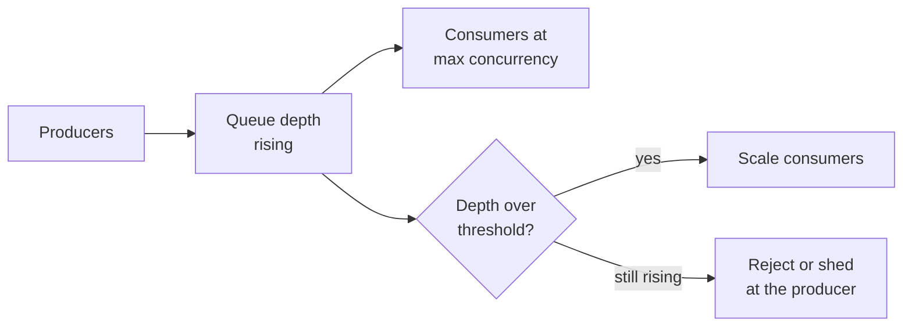
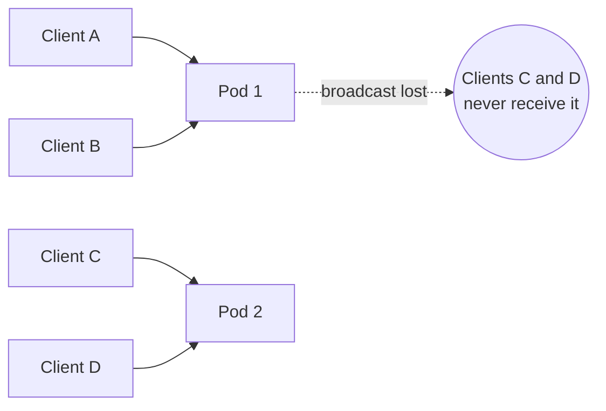

# Queue, Async কাজ ও WebSocket {#ch-message-queues}

> কাজকে request path থেকে সরিয়ে দিন, worker-কে দুবার চালানোর মতো নিরাপদ করুন, আর ফলাফল এমন একটি connection দিয়ে ফেরত পাঠান, যা একাধিক server-এ টিকে থাকে।

**এই অধ্যায়ে:** queue বনাম pub/sub বনাম log · delivery guarantee আর idempotent worker · retry আর back-pressure · WebSocket, SSE না polling · ধরে রাখা connection scale করা আর fan-out

## 💡 মূল ধারণা

কিছু কাজ একটি request আর একটি response-এর মধ্যে ধরে না। হয় খুব ধীর, নয়তো এর জন্য কেউ অপেক্ষা করে না। বের হওয়ার
দুটি পথ আছে। আপনি **request-এর পেছনে কাজটি queue করতে পারেন**, আর "হয়ে গেছে"-র বদলে "গ্রহণ করা হয়েছে" উত্তর দিতে
পারেন। অথবা ফলাফল তৈরি হলে একটি দীর্ঘস্থায়ী connection দিয়ে **ফলাফলটি push করে ফেরত পাঠাতে পারেন**।

দুটিই user-এর সঙ্গে চুক্তি বদলে দেয়। Queue নিজে থেকেই spike শুষে নেয় আর retry করে, কিন্তু কাজটি দুবার ঘটতে পারে,
আর caller আর জানে না সেটা কখন শেষ হলো। ধরে রাখা connection millisecond-এর মধ্যে খবর পৌঁছায়, কিন্তু এটা একটি
process-এর, তাই প্রতিটি নতুন server broadcast-কে আরও কঠিন করে।

## কীভাবে কাজ করে

### তিনটি আকার, প্রায়ই গুলিয়ে ফেলা হয়

| আকার          | Delivery                                    | Message-এর আয়ু                  | কীসের জন্য                             |
| -------------- | ------------------------------------------- | ----------------------------- | ----------------------------------- |
| **Work queue** | প্রতিটি message একজন consumer পায়              | Acknowledgement-এর পর delete হয় | Task: email পাঠানো, image resize করা     |
| **Pub/sub**    | প্রতিটি subscriber একটি copy পায়                | Deliver হলেই বাদ               | আগ্রহী service-গুলোকে জানানো       |
| **Event log**  | প্রতিটি consumer group পুরো stream পড়ে | কয়েক দিন রাখা হয়, replay করা যায় | Event sourcing, analytics, rebuild |

RabbitMQ আর SQS হলো work queue, SNS হলো pub/sub, আর Kafka হলো log। **নির্ণায়ক প্রশ্ন হলো replay।** এক দিন ভেঙে
থাকা একটি consumer-কে যদি যা miss করেছে তা ধরে ফেলতে হয়, আপনার একটি log দরকার। নইলে queue সহজ আর সস্তা।

### Request path-এর বাইরে কী যাবে

পরীক্ষাটি: **ফলাফলের ওপর ভিত্তি করে কি response বদলায়?** Order record লেখা আর card charge করা synchronous থাকে,
কারণ UI এদের ওপর নির্ভর করে। Confirmation email করে না, তাই সেটা queue করুন।

**গ্রহণ, তারপর জানানো — handler দুটি সস্তা কাজ করে আর return করে:**

```typescript
interface JobAccepted { jobId: string; statusUrl: string }

async function requestExport(userId: string, queue: Queue, store: JobStore): Promise<JobAccepted> {
  const jobId: string = crypto.randomUUID();
  await store.create({ jobId, userId, state: "queued" }); // durable before enqueue
  await queue.send({ jobId, userId, type: "export" });
  return { jobId, statusUrl: `/jobs/${jobId}` }; // HTTP 202
}
```

Enqueue করার **আগে** job record লিখুন। Enqueue ব্যর্থ হলেও client-এর হাতে retry করার জন্য একটি ID থাকে। ক্রম উল্টে
দিলে একটি worker এমন job তুলে নিতে পারে, যার record এখনো নেই। এরপর client ফলাফল জানে `statusUrl` poll করে, বা একটি
push channel-এ শুনে, যা নিচে আলোচনা করা হয়েছে।

### Delivery guarantee আর idempotent worker

| Guarantee     | আসলে কী ঘটে                               | খরচ                                                   |
| ------------- | ------------------------------------------------- | ------------------------------------------------------ |
| At most once  | পাঠিয়ে ভুলে যাওয়া; message হারাতে পারে             | শুধু telemetry-র জন্য গ্রহণযোগ্য                          |
| At least once | Acknowledge না হওয়া পর্যন্ত আবার deliver হয়; duplicate হয় | Consumer-কে idempotent হতে হবে                        |
| Exactly once  | শুধু একটি broker-এর নিজস্ব transaction-এর ভেতরে          | Throughput আর জটিলতা; আপনার side effect কখনো এর আওতায় পড়ে না |

**At least once** ধরে নিন। একটি broker আর একটি payment provider জুড়ে "exactly once" অর্জন করা যায় না।
Side effect ঘটে যাওয়ার পরেও acknowledgement হারিয়ে যেতে পারে।

**একটি idempotent worker, business fact-এর ওপর key করা:**

```typescript
interface Processed { has(key: string): Promise<boolean>; add(key: string): Promise<void> }

async function handleCharge(msg: { orderId: string }, seen: Processed): Promise<void> {
  // A redelivery reuses the same orderId, so the key survives it; a message ID might not.
  const key = `charge:${msg.orderId}`;
  if (await seen.has(key)) return;
  await chargeCard(msg.orderId);
  await seen.add(key);
}
```

এই ক্রমে বেছে নিন: স্বাভাবিকভাবেই idempotent একটি operation (চূড়ান্ত state-এর একটি `PUT`), তারপর downstream যে
idempotency key মেনে চলে, তারপর এটার মতো একটি processed-set। Processed-set-এ side effect আর record-এর মধ্যে
একটি race আছে, তাই এটা ব্যবহার করুন শুধু যখন এর চেয়ে ভালো কিছু নেই।

### Retry, dead letter আর back-pressure

Exponential backoff **আর jitter** দিয়ে retry করুন। Jitter ছাড়া প্রতিটি ব্যর্থ message একই মুহূর্তে retry করে, আর
সেরে ওঠা service-টিকে আবার ফেলে দেয়। Timeout, 503 আর 429 retry করুন (`Retry-After` মেনে চলুন)। ভুল গঠনের message
আর business rejection সরাসরি একটি **dead letter queue**-তে পাঠান। এতে কিছু জমলেই alert দিন, আর মূল message-টি তার
error-সহ রেখে দিন, যাতে replay করা যায়।



**যে queue চিরকাল বাড়তে থাকে, সেটা ধীরে ধীরে ব্যর্থ হতে থাকা একটি system; consumer scale করুন, তারপর producer-এ load ফেলে দিন।**

শুধু depth নয়, **সবচেয়ে পুরোনো message-এর বয়স** দেখে alert দিন। দশ সেকেন্ডে খালি হয়ে যাওয়া দশ লাখ message
সুস্থ। পঞ্চাশটি message, যার সবচেয়ে পুরোনোটি এক ঘণ্টা আগের, মানে একটি consumer আটকে গেছে।

### ফলাফল push করে ফেরত পাঠানো

"Real-time" একটি requirement, technology নয়। Server-কে না জিজ্ঞেস করা অবস্থাতেই client-কে কিছু জানাতে হবে। তিনটি
transport এটা পূরণ করে, খুবই আলাদা দামে।

| | **WebSocket** | **SSE** | **Polling** |
| --- | --- | --- | --- |
| দিক | Bidirectional | Server → client | Client জিজ্ঞেস করে |
| Protocol | `101` upgrade-এর পর নিজস্ব protocol | সাধারণ HTTP | সাধারণ HTTP |
| Reconnect | আপনাকে বানাতে হয় | ✅ স্বয়ংক্রিয়, `Last-Event-ID` replay | প্রযোজ্য নয় |
| Proxy, CDN, HTTP/2 | ⚠️ প্রায়ই config লাগে; compression হারায় | ✅ শুধু HTTP | ✅ |
| Server-এর খরচ | প্রতি client-এ একটি ধরে রাখা connection | প্রতি client-এ একটি ধরে রাখা connection | ওঠানামা করে, কিন্তু stateless |

**নির্ণায়ক প্রশ্ন: client-ও কি ঘন ঘন message পাঠায়?** হ্যাঁ হলে আপনার একটি socket দরকার, আর stateful
infrastructure মেনে নিতে হবে। না হলে আপনি একদিকে push করছেন, আর সাধারণ HTTP সেটা আগেই করে। তিনটির মধ্যে SSE সবচেয়ে
কম ব্যবহৃত। Job progress, notification আর token stream, সবকটির জায়গা এখানেই।

> ⚠️ **HTTP/1.1-এর সতর্কতা:** browser HTTP/1.1-এ প্রতি origin-এ প্রায় ছয়টি connection-এর সীমা রাখে, তাই SSE
> stream ধরে রাখা কয়েকটি tab একে অপরকে বঞ্চিত করে। HTTP/2-তে তারা একটি connection share করে, আর সমস্যাটা চলে যায়।

### Stateful connection-এর সমস্যা

একটি ধরে রাখা connection ঠিক একটি process-এর। Scaling-এর প্রতিটি অসুবিধা এখান থেকেই আসে।



**Client A একটি room-এ emit করে। Pod 2 room-এর অর্ধেক ধরে রাখে, আর এ ব্যাপারে কখনো শোনে না।**

সমাধান হলো একটি pub/sub broker, যাতে প্রতিটি pod subscribe করে। প্রতিটি pod বাইরে যাওয়া message একটি shared
channel-এ publish করে, আর যা পায় তা নিজের socket-গুলোতে deliver করে। সাধারণত Redis Pub/Sub বেছে নেওয়া হয়।

| বিষয়                 | Scale-এ এর মানে কী                                                                                  |
| ----------------------- | ------------------------------------------------------------------------------------------------------- |
| **Fan-out-এর খরচ**        | প্রতিটি message প্রতিটি pod-এ পৌঁছায়। কয়েক ডজন pod পেরোলে channel-কে room অনুযায়ী shard করুন                        |
| **Durability নেই**       | Disconnected pod যা miss করেছে, Redis Pub/Sub তা ফেলে দেয়, তাই source of truth হলো database               |
| **Deploy মানেই outage** | একটি rolling deploy একটি pod-এর সব socket একসঙ্গে ফেলে দেয়। নতুন connection নেওয়া বন্ধ করুন, client-দের reconnect করতে বলুন, তারপর ধাপে ধাপে exit করুন |
| **Capacity**            | প্রতি Node.js process-এ প্রায় 50k idle socket; CPU-র আগে memory ফুরিয়ে যায়                                   |

**কখন কিনবেন, তা জানুন।** একটি managed service (Ably, Pusher, AWS API Gateway WebSockets) connection scaling,
sharding আর draining আপনার team-এর কাঁধ থেকে নামিয়ে দেয়। "আমি এটা কিনতাম" একটি senior উত্তর, যদি আপনি খরচটা বলতে
পারেন: প্রতি connection-এর দাম, আর আপনার সবচেয়ে latency-সংবেদনশীল path-এ একটি vendor।

### Fan-out

Notification হলো fan-out-এর ক্লাসিক সমস্যা: একটি event হাজার হাজার delivery হয়ে যায়।

| Pattern          | কীভাবে                                                         | কখন ব্যবহার করবেন                                         |
| ---------------- | ----------------------------------------------------------- | ------------------------------------------------ |
| Fan-out on write | Publish-এর সময় প্রাপকের list ছড়িয়ে দিন, প্রত্যেকের জন্য একটি message | প্রাপকের list ছোট আর read ঘন ঘন হয় |
| Fan-out on read  | Event একবার store করুন, প্রতিটি user চাইলে তখন ছড়িয়ে দিন            | প্রাপকের list বিশাল (celebrity-র সমস্যা) |
| Hybrid           | সাধারণ account-এর জন্য write-side, ব্যতিক্রমগুলোর জন্য read-side  | বাস্তব system-এ, প্রায় সবসময়                      |

প্রতিটি fan-out-এ business event-এর ওপর key করা **deduplication** দরকার, যাতে একটি redelivery কখনো একটি push দুবার
না পাঠায়। এতে **প্রতি channel-এ rate limit**-ও দরকার, কারণ provider-রা দশ লাখ email-এর একটি burst reject করে।

## কখন ব্যবহার করবেন

| পরিস্থিতি                                      | বেছে নিন                     | কেন                                    |
| ---------------------------------------------- | -------------------------- | -------------------------------------- |
| Background task, প্রতি message-এ একটি worker       | Work queue (SQS, RabbitMQ) | কাজ করে এমন সবচেয়ে সহজ জিনিস              |
| Consumer-দের history replay করতে হবে                  | Event log (Kafka)          | Retention আর offset-ই এর feature  |
| Caller-এর এখনই উত্তর দরকার                | Queue নয়                   | এখানে async শুধু একটি polling-এর সমস্যা যোগ করে |
| Server push করে, client শোনে — progress, alert | SSE                      | একটি দিক, আর proxy এটা সামলায়   |
| Client ঘন ঘন পাঠায় — chat, cursor, editing    | WebSocket                  | সত্যিই bidirectional                |
| "30 সেকেন্ডের মধ্যে fresh" হলেই চলে              | Polling                    | Stateless, cacheable, চালানো খুবই সহজ   |

## সাধারণ ভুল

❌ **এমন worker, যা দুবার চালানো নিরাপদ নয়।** Message পেলেই কোনো key ছাড়া card charge করলে দুবার charge হবে। এটা
সাধারণত ঘটে একটি incident-এর সময়, যখন redelivery-র সম্ভাবনা সবচেয়ে বেশি।
✅ `Idempotency-Key: order-8821` পাঠান, যাতে একটি redelivery মূল charge-টিই ফেরত দেয়।

❌ **Feature-এর নাম "live" বলে socket-এর দিকে হাত বাড়ানো।** বেশিরভাগ live feature একদিকে push করে।
✅ জিজ্ঞেস করুন client কিছু পাঠায় কি না। না পাঠালে SSE ব্যবহার করুন।

❌ **একটি instance-এর ওপর broadcast design করা।** Development-এ চলে, দ্বিতীয় pod-এ ব্যর্থ হয়।
✅ প্রথম খসড়া থেকেই একাধিক process ধরে নিন, আর event broker-এর বাইরে persist করুন।

## 🔑 মূল শিক্ষা

- Queue কাজ কখন ঘটে তাকে কখন চাওয়া হয়েছিল তা থেকে আলাদা করে, আর user-এর সঙ্গে চুক্তি "হয়ে গেছে" থেকে "গ্রহণ করা হয়েছে"-তে বদলায়।
- At-least-once delivery ধরে নিন আর প্রতিটি consumer-কে idempotent করুন, message-এর ওপর নয়, business fact-এর ওপর key করে।
- সবচেয়ে পুরোনো message-এর বয়স দেখে alert দিন, কারণ শুধু depth একটি আটকে যাওয়া consumer-কে লুকিয়ে রাখে।
- WebSocket বেছে নিন শুধু যখন client ঘন ঘন message পাঠায়। নইলে SSE বা polling চালাতে অনেক কম খরচ।
- একটি ধরে রাখা connection একটি process-এর, তাই server জুড়ে broadcast-এর জন্য একটি pub/sub broker লাগে, আর durability-র জন্য তবুও database লাগে।

## Interview-এর প্রশ্ন

**Q: আপনার consumer একই message দুবার process করে। Bug-টা কার?**

কারোরই নয়। At-least-once delivery এটা নিশ্চিত করে, কারণ কাজ সফল হওয়ার পরেও acknowledgement হারিয়ে যেতে পারে।
Consumer-কে idempotent হতে হবে: স্বাভাবিকভাবে idempotent একটি operation, downstream যে idempotency key মেনে চলে,
বা business identifier-এর ওপর key করা একটি processed-set।

**Q: কখন SQS-এর বদলে Kafka বাছবেন?**

যখন consumer-দের replay করতে হয়, যখন কয়েকটি consumer group একই stream পড়ে, বা যখন একটি partition-এর ভেতরের ক্রম
গুরুত্বপূর্ণ। সাধারণ background task-এর জন্য SQS সহজ আর সস্তা। Job queue-র জন্য Kafka মানে এমন feature-এর জন্য
একটি cluster চালানো, যা আপনি ব্যবহারই করেন না।

**Q: একটি ধীর endpoint-এর জন্য কখন queue ভুল উত্তর?**

যখন caller-এর এগোতে ফলাফলটি দরকার। একটি ধীর call-কে job আর polling-এ পরিণত করলে latency দূর হয় না, শুধু সরে যায়।
সঙ্গে যোগ হয় একটি job store, একটি status endpoint আর একটি client state machine। আগে ধীর কাজটি ঠিক করুন, আর queue
করুন শুধু তখন, যখন কেউ অপেক্ষা করছে না।

**Q: Browser-এ job progress stream করতে WebSocket না SSE?**

SSE। Progress একদিকে যায়। SSE সাধারণ HTTP, তাই proxy আর HTTP/2 multiplexing কাজ করে, আর browser নিজে থেকেই
`Last-Event-ID` replay-সহ reconnect করে। WebSocket তার খরচ উশুল করে শুধু যখন traffic সত্যিই bidirectional, যেমন
chat বা collaborative cursor।

**Q: অনেক server জুড়ে real-time connection কীভাবে scale করেন?**

প্রতিটি server একটি shared pub/sub channel-এ subscribe করে আর message নিজের socket-গুলোতে deliver করে। এতে
broadcast ঠিক হয়, কিন্তু দুটি ফাঁক থেকে যায়। Broker পাঠিয়ে ভুলে যায়, তাই durability আসে database থেকে। আবার
প্রতিটি message প্রতিটি server-এ পৌঁছায়, যা কয়েক ডজন node-এর ঘরে scale করা থামিয়ে দেয়। এর পরে room অনুযায়ী
shard করুন, বা একটি managed service কিনুন।

## এরপর কী পড়বেন

- [Chapter ?? — Real-Time ও Streaming API](#ch-realtime-streaming) — SSE আর WebSocket-এর পেছনের server code: typed event, authentication, room
- [Chapter ?? — Resilience Pattern](#ch-resilience-patterns) — একটি worker যে call করে, তার চারপাশে timeout, retry আর circuit breaker
- [Chapter ?? — একটি Infinite Feed Design করুন](#ch-design-infinite-feed) — fan-out on write বনাম on read, শুরু থেকে শেষ পর্যন্ত করে দেখানো
