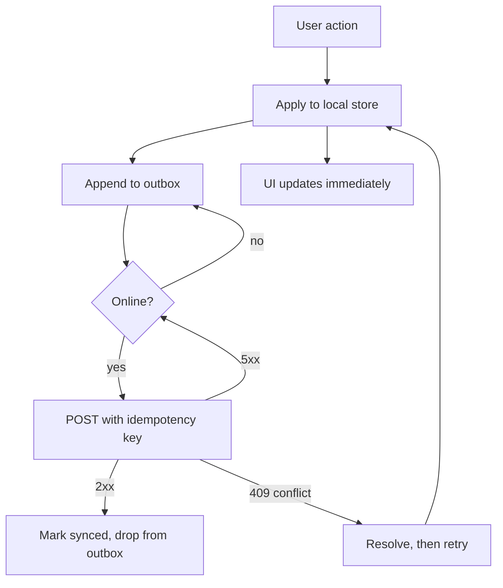

# Offline-First Architecture {#ch-offline-first-architecture}

> ট্রেনের সুড়ঙ্গের কথা মাথায় রেখে design করুন, আর সুড়ঙ্গে থাকার সময় যে write জমে গেছে, সেগুলো পরে মিলিয়ে নিন।

**এই অধ্যায়ে:** offline-first আসলে কী বদলায় · outbox pattern · idempotent sync · conflict strategy বাছাই · UI-র কাছে user-এর যা পাওনা

## 💡 মূল ধারণা

Caching মানেই offline-first নয়। Cache করা application network চলে গেলেও page দেখাতে পারে। কিন্তু user যে মুহূর্তে
কিছু *লেখেন*, তখন হয় design-এর কাছে উত্তর আছে, নয়তো data হারায়।

Offline-first মানে interface পড়ে local store থেকে, আর network হলো পেছনের একটা চ্যানেল, যা local store-কে server-এর
সঙ্গে মিলিয়ে রাখে। প্রতিটি write আগে local-এ পড়ে, একটা টেকসই queue-তে ঢোকে, আর connection ফিরলে আবার চালানো
হয়। Read হলো সহজ অর্ধেক, আর interviewer সেটা জানেন। **Round-টা আসলে queue আর merge নিয়ে।**

Service worker আর IndexedDB-র কলকব্জা browser platform-এর বিষয়। সেগুলো আছে [Chapter ?? — Service Worker, Caching ও Offline](#ch-service-workers)
আর [Chapter ?? — Web Storage ও IndexedDB](#ch-storage-apis)-এ। এই অধ্যায় সেগুলোর ওপর যে architecture
বানাবেন, তা নিয়ে।

## কীভাবে কাজ করে

তিনটি layer আছে, আর প্রতিটি আলাদাভাবে ভাঙে। বেশিরভাগ design শুধু প্রথমটার কথা ভাবে।

| Layer | কী রাখে | ভাঙলে যা হয় |
| ----- | ----- | -------- |
| Shell | HTML, JS, CSS, font | ফাঁকা page |
| Read data | User যে server state দেখছেন | পুরনো বা খালি screen |
| Write queue | এখনো গৃহীত হয়নি এমন mutation | নিঃশব্দে data হারানো |

Write queue-টাই **outbox**: যে write-গুলো করার কথা, তাদের একটা টেকসই, ক্রম-মানা তালিকা। Reload, crash আর tab বন্ধ
হওয়ার পরেও সেটা টিকে থাকে।



**Offline-first application-এ একটা write।** Interface কখনো network-এর জন্য অপেক্ষা করে না, আর server acknowledge না
করা পর্যন্ত outbox থেকে কিছুই বেরোয় না।

দুটি বৈশিষ্ট্য এটাকে নিরাপদ করে। Queue-তে থাকা প্রতিটি write-এর সঙ্গে থাকে **client-এর বানানো একটা idempotency key**।
তাই অস্পষ্ট কোনো failure-এর পর retry করলেও duplicate তৈরি হয় না। আর entry outbox ছাড়ে কেবল acknowledgement এলে,
পাঠানোর সময় কখনোই নয়।

## কখন ব্যবহার করবেন

Offline-first বিনা খরচে আসে না। এতে যোগ হয় একটা local schema, migration-এর একটা পথ আর একটা merge policy। দাম দিন
কেবল সেখানে, যেখানে দাম উঠে আসে।

| Application | Design | কেন |
| --------------- | ------ | --- |
| মাঠে data সংগ্রহ, পরিদর্শন, delivery | পুরোপুরি offline-first | User নিয়মিত coverage-এর বাইরে থাকেন, আর write-ই product |
| Note, task list, ব্যক্তিগত document | পুরোপুরি offline-first | User নিজের চোখে যে write জমা হতে দেখেছেন, সেটা হারানো ক্ষমার অযোগ্য |
| Read-বেশি dashboard বা catalogue | Cache করা shell আর stale-while-revalidate | Read ধীরে ধীরে, ভদ্রভাবে খারাপ হয়; হারানোর মতো কোনো write নেই |
| Payment, booking, stock আছে এমন যেকোনো কিছু | শুধু online, সঙ্গে offline নিয়ে সৎ একটা message | যে optimistic write রাখতে পারবেন না, সেটা আটকে দেওয়া write-এর চেয়েও খারাপ |

শেষ row-টাই সেই বিচারের জায়গা, যা জোরে বলা উচিত। Offline-এ seat reservation queue-তে রাখা মানে এমন seat-এর
প্রতিশ্রুতি দেওয়া, যা আপনার হাতে নেই।

## Outbox

যে অংশটা ঠিক হতেই হবে, সেটা queue। এটাকে ছোট আর একঘেয়ে রাখুন।

**IndexedDB-তে রাখা একটা টেকসই write queue:**

```typescript
type Op = "create" | "update" | "delete";

interface PendingWrite {
  id: string;          // client-generated, also the idempotency key
  entity: string;      // "todo", "inspection"
  op: Op;
  payload: unknown;
  baseVersion: number; // the server version this edit was made against
  queuedAt: number;
}

async function flush(queue: PendingWrite[]): Promise<void> {
  for (const write of queue) {
    const res = await fetch(`/api/${write.entity}`, {
      method: "POST",
      headers: { "Idempotency-Key": write.id, "Content-Type": "application/json" },
      body: JSON.stringify(write),
    });

    if (res.ok) await markSynced(write.id);        // only now does it leave the queue
    else if (res.status === 409) await resolve(write, await res.json());
    else break;                                    // ✅ stop, keep order, retry later
  }
}
```

ওই code তিনটি সিদ্ধান্ত নেয়। Write flush হয় **ক্রম মেনে**, কারণ create-এর আগে delete পৌঁছে গেলে সেটা fail করে।
Conflict ছাড়া অন্য কোনো error হলে সামনে এগিয়ে না গিয়ে **পুরো flush থেমে যায়**, একই কারণে। আর `baseVersion`
write-এর সঙ্গেই যায়। এটা থাকলেই কেবল server conflict ধরতে পারে।

> ⚠️ **Background Sync সব জায়গায় পাওয়া যায় না।** `sync` event দিয়ে tab বন্ধ হওয়ার পরেও retry পাওয়া যায়, কিন্তু
> সব browser এটা support করে না। এটাকে বাড়তি সুবিধা হিসেবে দেখুন। Application চালু হওয়ার সময় আর `online` event-এও
> flush করুন, নইলে বন্ধ tab-এর write কখনো device ছেড়ে বেরোবে না।

## Conflict strategy বাছাই

Conflict মানে একই `baseVersion`-এর ওপর দুটি edit। প্রতিটি offline design-এর এর একটা উত্তর লাগে। আর "last write wins"
সত্যিকারের উত্তরই, যতক্ষণ আপনি বলছেন এর দাম কী।

| Strategy | মীমাংসা | দাম | মানায় |
| -------- | ---------- | ---- | ---- |
| Last write wins | সবচেয়ে বড় timestamp টিকে যায় | অন্য edit-টা নিঃশব্দে বাদ পড়ে | এক user-এর data, ঝুঁকি কম |
| Server wins | Local edit বাদ যায় | User যে কাজ গৃহীত হতে দেখেছিলেন, সেটা হারান | প্রায় শুধু পড়ার reference data |
| Field-level merge | প্রতিটি field আলাদা, প্রতিটিতে নতুনতম value | এমন record তৈরি হতে পারে, যা কেউ লেখেনি | স্বাধীন field-ওয়ালা form |
| User-কে জিজ্ঞেস করা | দুটিই দেখান, user বেছে নিন | কাজে বাধা দেয়, আর সত্যিকারের একটা interface লাগে | বিরল, বেশি মূল্যের conflict |
| CRDT | গঠনের গুণেই merge হয় | নতুন data model আর library | Collaborative text আর list |

Clock skew (device-এর ঘড়ি একে অন্যের সঙ্গে না মেলা) "সবচেয়ে বড় timestamp"-কে যতটা মনে হয় তার চেয়ে কম নির্ভরযোগ্য
করে দেয়। ভুল ঘড়ির device হয় প্রতিটি conflict-এ জেতে, নয়তো প্রতিটিতে হারে। Client timestamp-এর চেয়ে server-এর দেওয়া
version number সমতা ভাঙার ভালো উপায়।

Collaborative editing-এর উত্তর প্রায় সবসময় CRDT, এমন একটা data type যা নিজে নিজেই merge হওয়ার জন্য বানানো।
সেই যুক্তি আছে [Chapter ?? — একটি Collaborative Document Editor Design করুন](#ch-design-collaborative-editor)-এ।

## UI-র কাছে user-এর যা পাওনা

যে offline application মিথ্যা বলে, সেটা load হতে অস্বীকার করা application-এর চেয়েও খারাপ।

- **Write-এর অবস্থা দেখান**, শুধু application-এর নয়। Pending, synced আর failed তিনটি আলাদা জিনিস, আর তৃতীয়টার বেলায় কী
  করবেন, তা কেবল user-ই ঠিক করতে পারেন।
- **যে write রাখতে পারবেন না, তার জন্য কখনো নকল সাফল্য দেখাবেন না।** Rollback সস্তা হলে optimistic চলে। টাকা বা
  stock জড়িত কিছুতে চলে না।
- **Storage-এর টান সামনে আনুন।** Disk-এ জায়গা কমে গেলে browser site-এর জমানো data মুছে দেয়। সেই মোছার সঙ্গে outbox-ও
  চলে গেলে সেটা নিঃশব্দে data হারানো। Persistent storage চেয়ে নিন, আর না পেলে user-কে জানান।
- **ব্যর্থতা থেকে ফেরার পথ রাখুন।** যে write পাঁচবার fail করেছে, তার জন্য চোখে পড়ার মতো retry বা export লাগে, অনন্ত
  ঘুরতে থাকা spinner নয়।

## সাধারণ ভুল

❌ **Cache-কে offline strategy ভাবা।** Read চলে, প্রথম write-টাই উধাও হয়ে যায়।
✅ আগে outbox design করুন; read cache সহজ অংশ।

❌ **Idempotency key ছাড়া retry।** একটা অস্পষ্ট timeout দুটি record হয়ে দাঁড়ায়।
✅ প্রথম চেষ্টার আগেই key-টা client-এ বানান, আর প্রতিটি retry-তে সেটাই আবার ব্যবহার করুন।

❌ **Queue parallel-ভাবে flush করা।** যে create-এর ওপর delete নির্ভর করে, delete তার আগেই পৌঁছে যায়।
✅ ক্রম মেনে flush করুন, আর conflict ছাড়া প্রথম failure-এই থামুন।

❌ **Cache-এর কোনো version নেই।** Deploy-এর পর user-রা অনির্দিষ্টকাল গত মাসের application চালাতে থাকেন।
✅ Cache-এ version দিন, আর নতুন worker অপেক্ষায় থাকলে reload করতে বলুন।

❌ **Eviction উপেক্ষা করা।** Browser origin-এর storage ফেরত নেয়, আর তার সঙ্গে outbox-ও যায়।
✅ Persistent storage চান। না পেলে সেটাকে আরও ঘন ঘন sync করার কারণ হিসেবে ধরুন।

## 🔑 মূল শিক্ষা

- Offline-first আসলে write-এর সমস্যা। Read cache দেখতে আসল কাজের মতো, কিন্তু আসল কাজ নয়।
- Queue-তে থাকা প্রতিটি write-এর লাগে client-এর বানানো idempotency key, যা তৈরি হয় প্রথম চেষ্টার আগেই।
- Write flush হয় ক্রম মেনে, আর outbox ছাড়ে কেবল acknowledgement পেলে, পাঠানোর সময় কখনো নয়।
- Conflict strategy স্পষ্টভাবে বেছে নিন আর তার দাম বলুন — last-write-wins চলে, নিঃশব্দে data হারানো চলে না।
- Browser storage মুছে দেওয়া হতে পারে। তাই outbox টেকসই কেবল ততক্ষণ, যতক্ষণ origin-এর ওপর চাপ পড়েনি।

## Interview-এর প্রশ্ন

**Q: একজন user offline অবস্থায় তিনটি record তৈরি করলেন, তারপর online-এ ফিরলেন। কী কী হয়, ধাপে ধাপে বলুন।**

প্রতিটি record local store-এ আর outbox-এ গেছে, সঙ্গে client-এর বানানো একটা id, যা idempotency key-ও। Reconnect
হলে আমি queue ক্রম মেনে flush করি, একবারে একটা request, প্রতিটির সঙ্গে base version পাঠিয়ে। 2xx এলে entry সরে যায়।
409 এলে সেটা যায় conflict policy-তে। 5xx বা network error হলে ক্রম ঠিক রাখতে flush থেমে যায়, আর backoff দিয়ে পুরো flush
আবার চেষ্টা হয়।

**Q: Idempotency key client-এই কেন বানাতে হবে?**

কারণ যে failure থেকে আমি বাঁচাচ্ছি, সেটা অস্পষ্ট। Request timeout হলে আমি জানি না server সেটা apply করেছে কি না, আর
key ছাড়া retry করলে duplicate তৈরি হয়। Server-এর দেওয়া key কাজে আসে না। সেটা পেতেও একটা network call লাগে, যা ঠিক
একইভাবে fail করতে পারে। প্রথম চেষ্টার আগে local-ভাবে বানালে প্রমাণসহ বলা যায় যে প্রতিটি retry একই write।

**Q: কখন offline-first বানাতে রাজি হবেন না?**

যখন write পরে রক্ষা করা যাবে না। Seat booking, payment নেওয়া বা stock কমানো এর উদাহরণ। এগুলো queue-তে রাখা মানে
user-কে বলা যে কাজটা হয়ে গেছে, অথচ সেই প্রতিশ্রুতি দেওয়ার এখতিয়ার আমার নেই। ব্যর্থতাটা তখন ধরা পড়ে কয়েক ঘণ্টা
পরে, যখন তার খরচ অনেক বেশি। এগুলোর জন্য আমি shell cache করে রাখব, যাতে application তবু load হয়, আর কাজটা সৎ
একটা message দিয়ে আটকে দেব।

**Q: Last-write-wins সহজ। এতে সমস্যা কী?**

কিছুই না, যদি data এক user-এর হয় আর আপনি এর দাম বলে দেন: দুটি edit-এর একটা বাদ পড়ে, আর কাউকে জানানো হয় না।
যে ব্যর্থতাকে মানুষ ছোট করে দেখে, সেটা clock skew। সমতা ভাঙার মাপকাঠি client timestamp হলে, ভুল ঘড়ির device যত
conflict-এ জড়ায়, তার প্রতিটিতে হয় জেতে, নয়তো হারে। আমি timestamp-এর বদলে server-এর দেওয়া version ব্যবহার করব, আর
collaborative কিছু হলে CRDT-তে চলে যাব।

## এরপর কী পড়বেন

- [Chapter ?? — Service Worker, Caching ও Offline](#ch-service-workers) — নিচের কলকব্জা: update lifecycle, আর cache-first, network-first ও stale-while-revalidate
- [Chapter ?? — একটি Collaborative Document Editor Design করুন](#ch-design-collaborative-editor) — যেখানে conflict-এর মীমাংসা আর policy থাকে না, data structure হয়ে যায়
