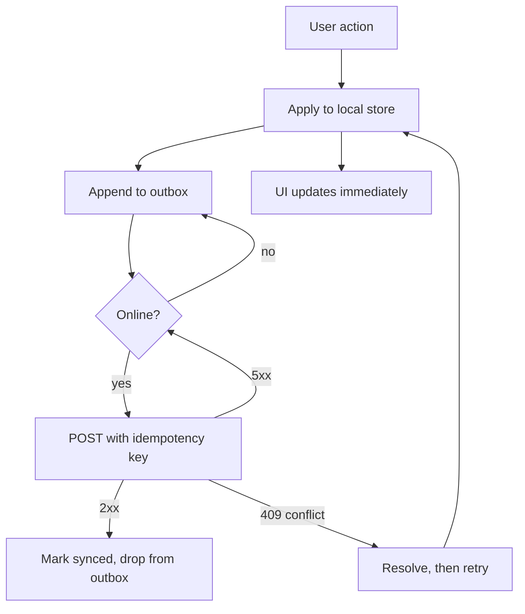

# Offline-First Architecture {#ch-offline-first-architecture}

> Train-এর tunnel-এর জন্য design করুন, আর tunnel-এ থাকার সময় যে write-গুলো জমেছে সেগুলো মিলিয়ে নিন।

**এই অধ্যায়ে:** offline-first আসলে কী বদলায় · outbox pattern · idempotent sync · conflict strategy বাছাই · user-এর জন্য UI-কে কী করতেই হবে

## 💡 মূল ধারণা

Caching মানে offline-first নয়। Cache করা একটি application network চলে গেলেও একটি page দেখাতে পারে। কিন্তু user যে মুহূর্তে কিছু *লেখেন*, design-এর হয় একটি উত্তর আছে, নয়তো data হারায়।

Offline-first মানে interface local store থেকে পড়ে, আর network হলো একটি background channel, যেটা local store-কে server-এর সাথে মিলিয়ে আনে। প্রতিটি write আগে locally বসে, একটি টেকসই queue-তে যোগ হয়, আর connection ফিরলে আবার replay হয়। Read হলো সহজ অর্ধেক, আর interviewer সেটা জানেন। **Round-টা আসলে queue আর merge নিয়ে।**

Service worker আর IndexedDB-র mechanics browser platform-এর বিষয়। সেগুলো আছে [Chapter ?? — Service Worker, Caching ও Offline](#ch-service-workers) আর [Chapter ?? — Web Storage ও IndexedDB](#ch-storage-apis)-এ। এই অধ্যায় সেগুলোর ওপর যে architecture তৈরি করেন, তা নিয়ে।

## কীভাবে কাজ করে

তিনটি layer আছে, আর প্রতিটি আলাদাভাবে fail করে। বেশিরভাগ design শুধু প্রথমটার কথা ভাবে।

| Layer | যা রাখে | যেভাবে fail করে |
| ----- | ----- | -------- |
| Shell | HTML, JS, CSS, font | একটি ফাঁকা page |
| Read data | User যে server state দেখছেন | একটি stale বা খালি screen |
| Write queue | এখনো গৃহীত না হওয়া mutation | নীরবে data হারানো |

Write queue-টিই **outbox**: যে write-গুলো করার কথা, তাদের একটি টেকসই, ক্রমানুসারী তালিকা, যেটা reload, crash আর tab বন্ধ হওয়ার পরেও টিকে থাকে।



**একটি offline-first application-এ একটি write।** Interface কখনো network-এর জন্য অপেক্ষা করে না, আর server acknowledge না করা পর্যন্ত কিছুই outbox ছাড়ে না।

দুটো বৈশিষ্ট্য এটাকে নিরাপদ করে। Queue-তে থাকা প্রতিটি write একটি **client-generated idempotency key** বহন করে, তাই অস্পষ্ট একটি failure-এর পর retry কোনো duplicate তৈরি করতে পারে না। আর entry outbox ছাড়ে শুধু acknowledgement পেলে, পাঠানোর সময় কখনো নয়।

## কখন ব্যবহার করবেন

Offline-first বিনা খরচে আসে না। এটা একটি local schema, একটি migration path আর একটি merge policy যোগ করে। শুধু সেখানেই এর দাম দিন, যেখানে এটা দাম ফেরত দেয়।

| Application | Design | কেন |
| --------------- | ------ | --- |
| Field data capture, inspection, delivery | পুরো offline-first | User প্রায়ই coverage-এর বাইরে থাকেন, আর write-ই product |
| Note, task list, ব্যক্তিগত document | পুরো offline-first | User যে write বসতে দেখেছেন, সেটা হারানো ক্ষমার অযোগ্য |
| Read-heavy একটি dashboard বা catalogue | Cache করা shell আর stale-while-revalidate | Read সুন্দরভাবে মান হারায়; হারানোর মতো কোনো write নেই |
| Payment, booking, stock-যুক্ত যেকোনো কিছু | শুধু online, একটি সৎ offline message-সহ | যে optimistic write রাখতে পারবেন না, সেটা একটি আটকানো write-এর চেয়ে খারাপ |

শেষ row-টাই সেই বিচারবুদ্ধির সিদ্ধান্ত, যেটা জোরে বলা উচিত। Offline-এ একটি seat reservation queue করা মানে এমন একটি seat-এর প্রতিশ্রুতি দেওয়া, যেটা আপনার কাছে নেই।

## Outbox

Queue-টাই সেই অংশ, যেটাকে সঠিক হতেই হবে। এটা ছোট আর একঘেয়ে রাখুন।

**IndexedDB-তে রাখা একটি টেকসই write queue:**

```typescript
type Op = "create" | "update" | "delete";

interface PendingWrite {
  id: string;          // client-generated, also the idempotency key
  entity: string;      // "todo", "inspection"
  op: Op;
  payload: unknown;
  baseVersion: number; // the server version this edit was made against
  queuedAt: number;
}

async function flush(queue: PendingWrite[]): Promise<void> {
  for (const write of queue) {
    const res = await fetch(`/api/${write.entity}`, {
      method: "POST",
      headers: { "Idempotency-Key": write.id, "Content-Type": "application/json" },
      body: JSON.stringify(write),
    });

    if (res.ok) await markSynced(write.id);        // only now does it leave the queue
    else if (res.status === 409) await resolve(write, await res.json());
    else break;                                    // ✅ stop, keep order, retry later
  }
}
```

এই code তিনটি সিদ্ধান্ত নেয়। Write flush হয় **ক্রমানুসারে**, কারণ যে delete তার create-কে টপকে যায়, সেটা fail করে। Conflict নয় এমন একটি error **পুরো flush থামিয়ে দেয়**, সামনে টপকে না গিয়ে, একই কারণে। আর `baseVersion` write-এর সাথে যায়। Server যে আদৌ একটি conflict ধরতে পারে, সেটা এর জন্যই।

> ⚠️ **Background Sync সব জায়গায় পাওয়া যায় না।** `sync` event tab বন্ধ হওয়ার পরেও একটি retry দেয়, কিন্তু সব browser এটা support করে না। এটাকে বাড়তি সুবিধা হিসেবে দেখুন। Application start-এ আর `online` event-এও flush করুন, নাহলে বন্ধ tab-এর write কখনো device ছাড়ে না।

## Conflict strategy বাছাই

একই `baseVersion`-এর বিপরীতে দুটো edit-ই একটি conflict। প্রতিটি offline design-এর একটি উত্তর লাগে, আর "last write wins" একটি আসল উত্তর, যতক্ষণ আপনি এর খরচটা বলেন।

| Strategy | Resolution | খরচ | মানানসই |
| -------- | ---------- | ---- | ---- |
| Last write wins | সবচেয়ে বড় timestamp টিকে থাকে | অন্য edit-টি নীরবে বাদ দেয় | Single-user data, ঝুঁকি কম |
| Server wins | Local edit বাদ যায় | User যে কাজ গৃহীত হতে দেখেছেন, তা হারান | বেশিরভাগ সময় শুধু পড়া reference data |
| Field-level merge | প্রতি field-এ, প্রতিটির সবচেয়ে নতুন value | এমন record তৈরি করতে পারে, যা কেউ লেখেনি | স্বাধীন field-যুক্ত form |
| User-কে জিজ্ঞেস করা | দুটোই দেখান, তাঁকে বাছতে দিন | বাধা দেয়, আর একটি আসল interface লাগে | বিরল, উচ্চমূল্যের conflict |
| CRDT | গঠনগতভাবেই merge হয় | একটি নতুন data model আর library | Collaborative text আর list |

Clock skew (device-এর clock-গুলো যখন মেলে না) "সবচেয়ে বড় timestamp"-কে শোনার চেয়ে কম নির্ভরযোগ্য করে। ভুল clock-ওয়ালা একটি device প্রতিটি conflict-এ জেতে বা হারে। Client timestamp-এর চেয়ে server-assigned version number ভালো tiebreaker।

Collaborative editing-এর উত্তর প্রায় সবসময় একটি CRDT, এমন একটি data type যা নিজে নিজেই merge হওয়ার জন্য তৈরি। সেই যুক্তি দেওয়া হয়েছে [Chapter ?? — একটি Collaborative Document Editor Design করুন](#ch-design-collaborative-editor)-এ।

## user-এর জন্য UI-কে কী করতেই হবে

যে offline application মিথ্যা বলে, সেটা load হতে অস্বীকার করা application-এর চেয়ে খারাপ।

- **Write-এর state দেখান**, শুধু application-এর নয়। Pending, synced আর failed তিনটি আলাদা জিনিস, আর তৃতীয়টা নিয়ে কী করবেন, সেটা শুধু user-ই ঠিক করতে পারেন।
- **যে write রাখতে পারবেন না, তাতে কখনো মিথ্যা success দেখাবেন না।** Rollback সস্তা হলে optimistic চলে। টাকা বা stock জড়িত যেকোনো কিছুর জন্য চলে না।
- **Storage-এর চাপ সামনে আনুন।** Disk space কমে গেলে browser একটি site-এর রাখা data মুছে দেয়। যে eviction outbox-কেও সাথে নিয়ে যায়, সেটা নীরবে data হারানো। Persistent storage চান, আর প্রত্যাখ্যাত হলে user-কে জানান।
- **Failure-কে পুনরুদ্ধারযোগ্য করুন।** যে write পাঁচবার fail করেছে, তার দরকার একটি দৃশ্যমান retry বা একটি export, অনন্ত spinner নয়।

## সাধারণ ভুল

❌ **একটি cache-কে offline strategy হিসেবে দেখা।** Read কাজ করে, প্রথম write উধাও হয়ে যায়।
✅ আগে outbox design করুন; read cache সহজ অংশ।

❌ **Idempotency key ছাড়া retry করা।** একটি অস্পষ্ট timeout দুটো record হয়ে যায়।
✅ প্রথম চেষ্টার আগে client-এ key তৈরি করুন, আর প্রতিটি retry-তে সেটাই আবার ব্যবহার করুন।

❌ **Queue parallel-এ flush করা।** একটি delete সেই create-এর আগে পৌঁছায়, যার ওপর সে নির্ভর করে।
✅ ক্রমানুসারে flush করুন, আর conflict নয় এমন প্রথম failure-এ থামুন।

❌ **কোনো cache versioning নেই।** একটি deploy-এর পর user-রা অনির্দিষ্টকাল গত মাসের application চালান।
✅ Cache-গুলো version করুন, আর একটি নতুন worker অপেক্ষায় থাকলে reload করতে বলুন।

❌ **Eviction উপেক্ষা করা।** Browser origin-এর storage ফিরিয়ে নেয়, আর outbox-ও সাথে চলে যায়।
✅ Persistent storage চান, আর প্রত্যাখ্যানকে আরও আগ্রাসীভাবে sync করার কারণ হিসেবে দেখুন।

## 🔑 মূল শিক্ষা

- Offline-first হলো write-এর সমস্যা; read cache সেই অর্ধেক, যেটা দেখতে কাজের মতো লাগে কিন্তু আসল কাজ নয়।
- Queue-তে থাকা প্রতিটি write-এর একটি client-generated idempotency key লাগে, যেটা প্রথম চেষ্টার আগে তৈরি হয়।
- Write ক্রমানুসারে flush হয়, আর outbox ছাড়ে শুধু acknowledgement পেলে, পাঠানোর সময় কখনো নয়।
- স্পষ্টভাবে একটি conflict strategy বাছুন আর এর খরচ বলুন — last-write-wins গ্রহণযোগ্য, নীরবে data হারানো নয়।
- Browser storage evict হতে পারে, তাই একটি outbox ততক্ষণই টেকসই, যতক্ষণ origin চাপে না পড়ে।

## Interview-এর প্রশ্ন

**Q: একজন user offline-এ তিনটি record তৈরি করলেন, তারপর online-এ ফিরলেন। কী ঘটে, ধাপে ধাপে বলুন।**

প্রতিটি record local store-এ গিয়েছে আর একটি outbox-এ ঢুকেছে, একটি client-generated id-সহ, যেটাই idempotency key। Reconnect-এ আমি queue ক্রমানুসারে flush করি, একবারে একটি request, প্রতিটির সাথে base version পাঠিয়ে। একটি 2xx entry-টি সরিয়ে দেয়। একটি 409 যায় conflict policy-তে। একটি 5xx বা network error ক্রম রক্ষার জন্য flush থামিয়ে দেয়, আর পুরো flush backoff-সহ retry হয়।

**Q: Idempotency key কেন client-এই তৈরি করতে হয়?**

কারণ আমি যে failure থেকে রক্ষা করছি, সেটা অস্পষ্ট। Request timeout হলে আমি জানি না server সেটা apply করেছে কিনা, আর key ছাড়া retry একটি duplicate তৈরি করে। Server-এর দেওয়া key কোনো কাজের নয়। সেটা পাওয়াটাই একটি network call, যেটা একইভাবে fail করতে পারে। প্রথম চেষ্টার আগে locally তৈরি করলে প্রতিটি retry প্রমাণযোগ্যভাবে একই write হয়।

**Q: কখন offline-first তৈরি করতে অস্বীকার করবেন?**

যখন write পরে রাখা সম্ভব নয়। একটি seat booking, একটি payment নেওয়া বা stock কমানো — এগুলো উদাহরণ। এগুলো queue করা মানে user-কে বলা যে কিছু একটা হয়ে গেছে, যখন সেই প্রতিশ্রুতি দেওয়ার কোনো অধিকার আমার নেই। Failure তখন ঘণ্টাখানেক পরে দেখা দেয়, যখন এর খরচ অনেক বেশি। এগুলোর জন্য আমি shell cache করে রাখব যাতে application তবুও load হয়, আর একটি সৎ message দিয়ে action-টি আটকে দেব।

**Q: Last-write-wins সহজ। এতে সমস্যা কী?**

কিছুই না, যদি data single-user হয় আর আপনি খরচটা বলেন: দুটো edit-এর একটি বাদ যায়, আর কাউকে জানানো হয় না। যে failure মানুষ কম করে দেখে, সেটা clock skew। Tiebreaker যদি client timestamp হয়, ভুল clock-ওয়ালা একটি device যে conflict-এই থাকুক, প্রতিটিতে জেতে বা হারে। আমি timestamp-এর বদলে server-assigned version ব্যবহার করব, আর collaborative যেকোনো কিছুর জন্য একটি CRDT-তে চলে যাব।

## এরপর কী পড়বেন

- [Chapter ?? — Service Worker, Caching ও Offline](#ch-service-workers) — নিচের mechanism: update lifecycle আর cache-first, network-first ও stale-while-revalidate
- [Chapter ?? — একটি Collaborative Document Editor Design করুন](#ch-design-collaborative-editor) — যেখানে conflict resolution আর একটি policy থাকে না, একটি data structure হয়ে যায়
