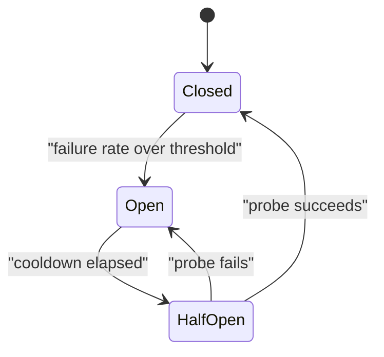

# Resilience Pattern {#ch-resilience-patterns}

> একটি ব্যর্থ dependency যেন caller-কেও সঙ্গে নিয়ে না ডোবে, তা ঠেকান, চারটি pattern দিয়ে, যারা শুধু একসঙ্গেই কাজ করে।

**এই অধ্যায়ে:** ভিত্তি হিসেবে timeout · backoff আর budget-সহ retry · circuit breaker · bulkhead · load shedding · graceful degradation

## 💡 মূল ধারণা

একটি distributed system-এ dependency ধীর হওয়া dependency বন্ধ থাকার চেয়ে খারাপ। যে service বন্ধ, সে সঙ্গে সঙ্গে
একটি error ফেরত দেয়, আর caller এগিয়ে যায়। যে service ত্রিশ সেকেন্ড নেয়, সে caller-এর একটি connection ত্রিশ
সেকেন্ড ধরে রাখে। যেকোনো বাস্তব request rate-এ caller-এর connection ফুরিয়ে যায়, আর সে-ও ব্যর্থ হয়। এমনকি সেই
request-গুলোর জন্যও ব্যর্থ হয়, যাদের সঙ্গে ধীর dependency-টির কোনো সম্পর্কই ছিল না।

Resilience হলো সেই pattern-গুলোর সমষ্টি, যারা *ধীর*-কে *দ্রুত ব্যর্থতায়* পরিণত করে, তারপর ঠিক করে, বদলে user-কে কী
দেখানো হবে।

> প্রতিটি remote call-এর জন্য একটি প্রশ্নের উত্তর দরকার: এটা যদি কখনো ফিরে না আসে, তাহলে কী হবে?

## কীভাবে কাজ করে

### Timeout সবার আগে

বাকি প্রতিটি pattern এটার ওপর নির্ভর করে। Call যদি স্রেফ ঝুলে থাকে, retry চালু হতে পারে না, circuit breaker-ও
open হতে পারে না।

```typescript
async function callWithTimeout<T>(fn: (signal: AbortSignal) => Promise<T>, ms: number): Promise<T> {
  const controller = new AbortController();
  const timer = setTimeout(() => controller.abort(), ms);
  try {
    return await fn(controller.signal);
  } finally {
    clearTimeout(timer); // release the timer even when the call throws
  }
}
```

Timeout set করুন dependency-র পর্যবেক্ষণ করা p99 (যে latency-কে 99% call হারায়) থেকে, কোনো গোল সংখ্যা থেকে নয়।
সাধারণত সেটা p99 আর সামান্য একটু বাড়তি। Budget **call chain-এ নিচের দিকে কমতে থাকবে**। Gateway যদি 3 সেকেন্ড দেয়,
যে service-কে এটা call করে তাকে কম দিতে হবে। নইলে বাইরের call হাল ছেড়ে দেওয়ার পরেও ভেতরের call চলতে থাকে, আর
কাজটা নষ্ট হয়।

| Layer                   | Timeout          |
| ----------------------- | ---------------- |
| Client থেকে gateway       | 5 s              |
| Gateway থেকে service      | 3 s              |
| Service থেকে database     | 1 s              |
| Service থেকে cache        | 100 ms           |

### Retry, একটি budget-সহ

Retry সাহায্য করে শুধু **ক্ষণস্থায়ী** ব্যর্থতায়। একটি 400 বা business rejection retry করলে শুধু load বাড়ে, এমন
একটি ফলাফলের জন্য, যা কখনো বদলাবে না।

| Response                     | Retry?                    |
| ---------------------------- | ------------------------- |
| Connection reset, timeout    | হ্যাঁ                       |
| 502, 503, 504                | হ্যাঁ                       |
| 429                          | হ্যাঁ, `Retry-After` মেনে |
| 400, 401, 403, 404, 422      | না                        |
| Idempotency key ছাড়া যেকোনো non-idempotent write | না — duplicate আরও খারাপ |

```typescript
// Full jitter: without the random factor, every client retries at the same instant.
const delayMs = (attempt: number, baseMs: number = 100, capMs: number = 10_000): number =>
  Math.random() * Math.min(capMs, baseMs * 2 ** attempt);
```

> ⚠️ ছোট একটি incident বড় হয়ে ওঠার সবচেয়ে সাধারণ কারণ retry। প্রতি client-এ তিনটি চেষ্টা মানে 3× load-এর
> গুণক, ঠিক তখনই প্রয়োগ হয় যখন system সবচেয়ে দুর্বল। চেষ্টার সংখ্যা সীমিত করুন, সবসময় jitter যোগ করুন, আর stack-এর
> একাধিক layer-এ কখনো retry করবেন না। Retry করা একটি SDK-র পেছনে retry করা একটি gateway-র পেছনে retry করা একটি
> client হলো 27× গুণক, যা কেউ design করেনি।

### Circuit breaker

Breaker আগে থেকেই ব্যর্থ হতে থাকা একটি dependency-কে call করা বন্ধ করে, ফলে caller timeout-এ নয়, microsecond-এ
ব্যর্থ হয়।



**Closed traffic যেতে দেয়, open সঙ্গে সঙ্গে reject করে, half-open একটি probe-কে সিদ্ধান্ত নিতে দেয়।**

| Setting            | যুক্তিসঙ্গত শুরু        | কেন                                             |
| ------------------ | --------------------- | ----------------------------------------------- |
| Failure threshold  | একটি rolling window-এ 50% | Count নয়, একটি rate — শান্ত service-এ count ভুল করে trip করে |
| Minimum volume     | 20 request           | দুটোর মধ্যে দুটো ব্যর্থতা কোনো প্রমাণ নয়         |
| Open duration      | 30 s                  | Restart-এর জন্য যথেষ্ট লম্বা, দ্রুত সেরে উঠতে যথেষ্ট ছোট |
| Half-open probe   | 1                     | বেশি probe এখনো ভঙ্গুর একটি service-কে আবার ভাসিয়ে দেয় |

**প্রতি dependency-তে** একটি breaker ব্যবহার করুন, পুরো service-এর জন্য একটি কখনো নয়। নইলে একটি ব্যর্থ analytics
call checkout আটকে দেবে।

### Bulkhead

Bulkhead সীমিত করে, একটি dependency একটি shared resource-এর কতটা ব্যবহার করতে পারে, যাতে তার ব্যর্থতা বাকি সবকিছুকে
বঞ্চিত করতে না পারে। নামটি এসেছে জাহাজের সেই সিল করা দেয়াল থেকে, যা একটি অংশে পানি ঢুকলে পুরো জাহাজ ডুবতে দেয় না।

```typescript
// Separate concurrency pools mean a stalled payment provider cannot consume every worker.
const pools: Record<string, { limit: number; inFlight: number }> = {
  payments: { limit: 20, inFlight: 0 },
  recommendations: { limit: 5, inFlight: 0 },
  analytics: { limit: 2, inFlight: 0 },
};

function tryAcquire(name: string): boolean {
  const pool = pools[name];
  if (pool.inFlight >= pool.limit) return false; // shed, do not queue forever
  pool.inFlight += 1;
  return true;
}
```

Limit-গুলো অগ্রাধিকার প্রকাশ করে। Analytics দুটো slot পায়, কারণ analytics হারানো গ্রহণযোগ্য, payment হারানো নয়।

### Load shedding আর degradation

System যখন সবকিছু serve করতে পারে না, কী বাদ দেবেন তা আপনি বাছেন। Queue-কে বাছতে দেবেন না।

| স্তর                       | প্রথমে বাদ দিন                                  |
| --------------------------- | ------------------------------------------- |
| থাকলে ভালো এমন enrichment     | Recommendation, সম্পর্কিত item, live count |
| অপরিহার্য নয় এমন write         | Analytics event, activity log             |
| ব্যয়বহুল read path        | Search facet, পুরো history                 |
| কখনো নয়                       | Authentication, checkout, মূল read     |

Degradation হলো বদলে user যা দেখেন। "আপনি যাদের চিনতে পারেন" অংশটি ছাড়া render হওয়া একটি feed page একটি কাজ
করা page। ওই একটি call timeout হওয়ায় 500 ফেরত দেওয়া একটি feed page হলো outage। আর কেউ একজন সেটা বেছে নিয়েছিল।

### Pattern-গুলো একসঙ্গে জোড়া লাগে

বাইরে যাওয়া একটি call-এ এগুলো এই ক্রমে প্রয়োগ করুন। **Bulkhead** ঠিক করে capacity আছে কি না। **Circuit breaker**
ঠিক করে dependency-টিকে call করা সার্থক কি না। **Timeout** অপেক্ষার সীমা টানে, **retry** একটি ক্ষণস্থায়ী ব্যর্থতা
সামলায়, আর বাকি সব ব্যর্থ হলে কী ফেরত দেওয়া হবে তা ঠিক করে **fallback**।

## কখন ব্যবহার করবেন

| পরিস্থিতি                                    | কী ব্যবহার করবেন                        |
| -------------------------------------------- | -------------------------------- |
| বাইরে যাওয়া যেকোনো network call                     | একটি timeout — কোনো ব্যতিক্রম নেই        |
| ক্ষণস্থায়ী error-ওয়ালা একটি অনির্ভরযোগ্য dependency      | Jitter আর সীমাসহ retry      |
| যে dependency একটানা কয়েক মিনিট ব্যর্থ থাকে | Circuit breaker                  |
| একটি thread pool share করা কয়েকটি dependency    | প্রতি dependency-তে bulkhead          |
| গুরুত্বপূর্ণ page-এ একটি অপরিহার্য নয় এমন feature    | Fallback আর graceful degradation |
| টানা overload                            | অগ্রাধিকার অনুযায়ী load shedding       |

## সাধারণ ভুল

**❌ বাইরে যাওয়া call-এ timeout নেই**

> Runtime-এর default-সহ `await fetch(url)`, যা কয়েক মিনিটও হতে পারে, আবার একেবারে না-ও থাকতে পারে।

তখন একটি ধীর dependency caller-এর প্রতিটি connection খেয়ে ফেলে, আর caller-এর নিজের health check ব্যর্থ হতে শুরু
করে।

**✅ Dependency-র p99 থেকে বের করা timeout**

> যে dependency-র p99 250 ms, তার জন্য `callWithTimeout(fn, 400)`, timeout-এর ক্ষেত্রে একটি fallback-সহ।

**❌ Non-idempotent write retry করা**

Timeout হওয়া একটি payment হয়তো আসলে সফল হয়েছে। Idempotency key ছাড়া retry করলে দুবার charge হয়।

**❌ পুরো service-এর জন্য একটি circuit breaker**

একটি ব্যর্থ recommendation call breaker open করে দেয়, আর checkout-কেও সঙ্গে নিয়ে যায়। Breaker-এর পরিধি রাখুন প্রতি
dependency-তে।

## 🔑 মূল শিক্ষা

- ধীর dependency মৃত dependency-র চেয়ে বেশি বিপজ্জনক, কারণ এটা কিছু তৈরি না করেই caller-এর connection খেয়ে ফেলে।
- Timeout হলো ভিত্তি: বাকি প্রতিটি pattern-এর কাজ করার জন্য একটি সীমিত অপেক্ষা দরকার।
- Retry একটি incident-এর সময় load বাড়িয়ে দেয়, তাই এদের সীমিত করুন, jitter যোগ করুন, আর ঠিক একটি layer-এ retry করুন।
- Circuit breaker-এর পরিধি প্রতি dependency-তে। পুরো service-এর জন্য একটি breaker সম্পর্কহীন feature-গুলোকে জুড়ে দেয়।
- কোন feature degrade হবে তা আগেই ঠিক করুন, যাতে overload-এ error page নয়, একটি ছোট করা page তৈরি হয়।

## Interview-এর প্রশ্ন

**Q: একটি downstream service 200 ms-এর বদলে 30 সেকেন্ড নিতে শুরু করল। আপনার service-এর কী হয়?**

Timeout না থাকলে, connection আর thread-pool slot ধরে রেখে request জমতে থাকে, যতক্ষণ না pool ফুরিয়ে যায়। তারপর
প্রতিটি request ব্যর্থ হয়, যারা ওই dependency কখনো ছোঁয় না তারাও। Timeout আর circuit breaker থাকলে, প্রথম কয়েকটি
request দ্রুত ব্যর্থ হয় আর breaker open হয়। পরের call-গুলো microsecond-এ reject হয়, আর service-এর বাকি অংশ কাজ
করতে থাকে।

**Q: Retry-এর setting কীভাবে বাছেন?**

শুধু ক্ষণস্থায়ী ব্যর্থতা আর শুধু idempotent operation retry করুন। দুই বা তিনটি চেষ্টায় সীমা টানুন, আর full jitter-সহ
exponential backoff ব্যবহার করুন। একটি global retry budget জোর দিয়ে মানান, যাতে retry মোট traffic-এর একটি ছোট অংশ
থাকে। সবচেয়ে গুরুত্বপূর্ণ, শুধু একটি layer retry করে। Client, gateway আর SDK সবাই retry করলে load তাদের গুণফল
অনুযায়ী বাড়ে।

**Q: কখন circuit breaker যোগ করবেন না?**

যখন dependency-র কোনো অর্থবহ fallback নেই, আর এটা ছাড়া request-টি মূল্যহীন। তখন breaker open করা শুধু একটি ধীর
ব্যর্থতাকে দ্রুত ব্যর্থতায় পরিণত করে, user-এর কোনো লাভ ছাড়াই। এটা এমন একটি component-ও যোগ করে, যা ভুল করে trip
করতে পারে। সেখানে একটি timeout আর একটি পরিষ্কার error-ই যথেষ্ট।

## এরপর কী পড়বেন

- [Chapter ?? — Reliability, Consistency ও CAP](#ch-consistency-and-cap) — যে cascade ভাঙার জন্যই এই pattern-গুলো আছে
- [Chapter ?? — Service Boundary ও API Gateway](#ch-service-boundaries) — যে call-গুলোর এই সুরক্ষা দরকার, আর edge-এ breaker কোথায় বসবে
