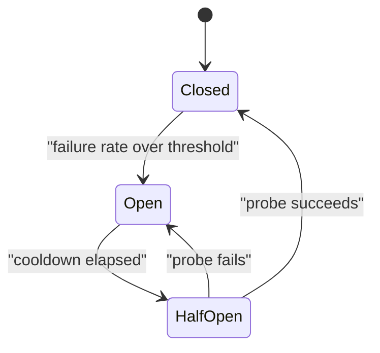

# Resilience Pattern {#ch-resilience-patterns}

> একটি dependency ব্যর্থ হলে caller-ও যেন তার সঙ্গে না ডোবে, তা ঠেকান চারটি pattern দিয়ে, যেগুলো কেবল একসঙ্গেই কাজ করে।

**এই অধ্যায়ে:** ভিত্তি হিসেবে timeout · backoff আর budget-সহ retry · circuit breaker · bulkhead · load shedding · graceful degradation

## 💡 মূল ধারণা

Distributed system-এ dependency বন্ধ থাকার চেয়ে dependency ধীর হওয়া বেশি খারাপ। বন্ধ service সঙ্গে সঙ্গে error ফেরত দেয়,
আর caller এগিয়ে যায়। যে service ত্রিশ সেকেন্ড নেয়, সেটা caller-এর একটি connection ত্রিশ সেকেন্ড ধরে আটকে রাখে। বাস্তবের যেকোনো
request rate-এ caller-এর connection ফুরিয়ে যায়, আর caller নিজেও ব্যর্থ হয়। এমনকি সেই request-গুলোর জন্যও, যাদের সঙ্গে ধীর
dependency-র কোনো সম্পর্কই ছিল না।

Resilience হলো সেই pattern-গুলো, যা *ধীর*-কে *দ্রুত ব্যর্থতায়* বদলে দেয়, তারপর ঠিক করে user-কে তার বদলে কী দেখানো হবে।

> প্রতিটি remote call-এর জন্য একটি প্রশ্নের উত্তর থাকতে হবে: এটা যদি কখনো ফিরে না আসে, তাহলে কী হবে?

## কীভাবে কাজ করে

### আগে timeout

বাকি সব pattern এর ওপর নির্ভর করে। Call যদি স্রেফ ঝুলে থাকে, তাহলে retry চলতে পারে না, circuit breaker-ও খুলতে পারে না।

```typescript
async function callWithTimeout<T>(fn: (signal: AbortSignal) => Promise<T>, ms: number): Promise<T> {
  const controller = new AbortController();
  const timer = setTimeout(() => controller.abort(), ms);
  try {
    return await fn(controller.signal);
  } finally {
    clearTimeout(timer); // release the timer even when the call throws
  }
}
```

Timeout ঠিক করুন dependency-র মাপা p99 (যে latency-র চেয়ে 99% call দ্রুত শেষ হয়) থেকে, কোনো গোল সংখ্যা থেকে নয়। সাধারণত
সেটা p99-এর সঙ্গে সামান্য বাড়তি। Budget রাখুন **call chain-এ যত নিচে, তত কম**। Gateway যদি 3 সেকেন্ড দেয়, তাহলে gateway যে service-কে
call করে, তাকে দিতে হবে তার কম। নাহলে বাইরের call হাল ছেড়ে দেওয়ার পরেও ভেতরের call চলতে থাকে, আর কাজটা বৃথা যায়।

| Layer                   | Timeout          |
| ----------------------- | ---------------- |
| Client থেকে gateway       | 5 s              |
| Gateway থেকে service      | 3 s              |
| Service থেকে database     | 1 s              |
| Service থেকে cache        | 100 ms           |

### Retry, budget-সহ

Retry কাজে লাগে শুধু **ক্ষণস্থায়ী** failure-এ। 400 বা business-এর কারণে প্রত্যাখ্যানে retry করলে শুধু load বাড়ে, অথচ ফল কখনো
বদলাবে না।

| Response                     | Retry করবেন?                    |
| ---------------------------- | ------------------------- |
| Connection reset, timeout    | হ্যাঁ                       |
| 502, 503, 504                | হ্যাঁ                       |
| 429                          | হ্যাঁ, `Retry-After` মেনে |
| 400, 401, 403, 404, 422      | না                        |
| Idempotency key ছাড়া যেকোনো non-idempotent write | না — duplicate হলে আরও খারাপ |

```typescript
// Full jitter: without the random factor, every client retries at the same instant.
const delayMs = (attempt: number, baseMs: number = 100, capMs: number = 10_000): number =>
  Math.random() * Math.min(capMs, baseMs * 2 ** attempt);
```

> ⚠️ ছোট incident বড় হয়ে ওঠার সবচেয়ে সাধারণ কারণ retry। প্রতি client-এ তিনবার চেষ্টা মানে 3× load, আর সেটা চাপে ঠিক তখনই,
> যখন system সবচেয়ে দুর্বল। চেষ্টার সংখ্যা বেঁধে দিন, সবসময় jitter দিন, আর stack-এর একাধিক layer-এ কখনো retry করবেন না।
> Retry করা SDK-র সামনে retry করা gateway, তার সামনে retry করা client মানে 27× load, যা কেউ design করেনি।

### Circuit breaker

Breaker এমন dependency-কে call করা বন্ধ করে দেয়, যা আগে থেকেই ব্যর্থ হচ্ছে। ফলে caller timeout পর্যন্ত অপেক্ষা না করে
microsecond-এর মধ্যে ব্যর্থ হয়।



**Closed অবস্থায় traffic যায়, open অবস্থায় সঙ্গে সঙ্গে ফিরিয়ে দেয়, half-open-এ একটি probe সিদ্ধান্ত নেয়।**

| Setting            | শুরুর জন্য যুক্তিসঙ্গত        | কেন                                             |
| ------------------ | --------------------- | ----------------------------------------------- |
| Failure threshold  | একটি rolling window-এ 50% | হার, সংখ্যা নয় — সংখ্যা ধরলে চুপচাপ service-এও breaker খুলে যায় |
| Minimum volume     | 20টি request           | দুটির মধ্যে দুটি ব্যর্থ হওয়া কোনো প্রমাণ নয়         |
| Open duration      | 30 s                  | Restart-এর জন্য যথেষ্ট লম্বা, দ্রুত সেরে ওঠার জন্য যথেষ্ট ছোট |
| Half-open probe   | 1                     | বেশি probe দিলে এখনো দুর্বল service আবার ডুবে যায় |

**প্রতিটি dependency-র জন্য** একটি breaker রাখুন, পুরো service-এর জন্য একটি কখনো নয়। নাহলে ব্যর্থ একটি analytics call
checkout-কেও আটকে দেবে।

### Bulkhead

Bulkhead ঠিক করে দেয়, একটি dependency shared resource-এর কতটা ব্যবহার করতে পারবে। ফলে তার failure বাকি সবাইকে না খাইয়ে
মারতে পারে না। নামটা এসেছে জাহাজের সিল করা দেয়াল থেকে, যা একটি অংশে পানি ঢুকলেও পুরো জাহাজকে ডুবতে দেয় না।

```typescript
// Separate concurrency pools mean a stalled payment provider cannot consume every worker.
const pools: Record<string, { limit: number; inFlight: number }> = {
  payments: { limit: 20, inFlight: 0 },
  recommendations: { limit: 5, inFlight: 0 },
  analytics: { limit: 2, inFlight: 0 },
};

function tryAcquire(name: string): boolean {
  const pool = pools[name];
  if (pool.inFlight >= pool.limit) return false; // shed, do not queue forever
  pool.inFlight += 1;
  return true;
}
```

Limit-গুলোতে অগ্রাধিকার লেখা থাকে। Analytics পায় দুটি slot, কারণ analytics হারানো মেনে নেওয়া যায়, payment হারানো যায় না।

### Load shedding আর degradation

System যখন সবকিছু সার্ভ করতে পারে না, তখন কী বাদ দেবেন তা আপনিই বেছে নেবেন। Queue-কে সেটা ঠিক করতে দেবেন না।

| স্তর                       | আগে বাদ দিন                                  |
| --------------------------- | ------------------------------------------- |
| থাকলে ভালো এমন বাড়তি তথ্য     | Recommendation, related item, live count |
| গুরুত্বহীন write         | Analytics event, activity log             |
| দামি read path        | Search facet, পুরো history                 |
| কখনো নয়                       | Authentication, checkout, মূল read     |

Degradation হলো তার বদলে user যা দেখেন। "আপনি যাদের চিনতে পারেন" rail ছাড়াই render হওয়া feed page একটি চালু page। কিন্তু
শুধু ওই একটি call timeout হয়েছে বলে 500 ফেরত দেওয়া feed page একটি outage। আর সেটা কেউ একজন বেছে নিয়েছে।

### Pattern-গুলো একসঙ্গে জোড়া লাগে

বাইরে যাওয়া একটি call-এ এগুলো এই ক্রমে বসান। **Bulkhead** ঠিক করে capacity আছে কি না। **Circuit breaker** ঠিক করে
dependency-কে call করা আদৌ লাভের কি না। **Timeout** অপেক্ষার সীমা টানে, **retry** ক্ষণস্থায়ী failure সামলায়, আর বাকি সব
ব্যর্থ হলে কী ফেরত যাবে, তা ঠিক করে **fallback**।

## কখন ব্যবহার করবেন

| পরিস্থিতি                                    | কী ব্যবহার করবেন                        |
| -------------------------------------------- | -------------------------------- |
| বাইরে যাওয়া যেকোনো network call                     | Timeout — কোনো ব্যতিক্রম নেই        |
| ক্ষণস্থায়ী error-সহ অনির্ভরযোগ্য dependency      | Jitter আর সীমাসহ retry      |
| এমন dependency, যা একটানা কয়েক মিনিট ব্যর্থ থাকে | Circuit breaker                  |
| কয়েকটি dependency একটি thread pool ভাগ করে    | প্রতি dependency-তে একটি bulkhead          |
| গুরুত্বপূর্ণ page-এ অপ্রয়োজনীয় একটি feature    | Fallback আর graceful degradation |
| একটানা overload                            | অগ্রাধিকার ধরে load shedding       |

## সাধারণ ভুল

**❌ বাইরে যাওয়া call-এ timeout নেই**

> Runtime-এর default দিয়ে `await fetch(url)`, যা কয়েক মিনিট হতে পারে, আবার একেবারে না-ও থাকতে পারে।

তখন একটি ধীর dependency caller-এর সব connection খেয়ে ফেলে, আর caller-এর নিজের health check-ও ব্যর্থ হতে শুরু করে।

**✅ Dependency-র p99 থেকে বের করা timeout**

> যে dependency-র p99 হলো 250 ms, তার জন্য `callWithTimeout(fn, 400)`, সঙ্গে timeout হলে কী হবে তার একটি fallback।

**❌ Non-idempotent write retry করা**

Timeout হওয়া payment আসলে সফলও হয়ে থাকতে পারে। Idempotency key ছাড়া retry করলে charge দুবার হয়।

**❌ পুরো service-এর জন্য একটি circuit breaker**

ব্যর্থ একটি recommendations call breaker খুলে দেয়, আর তার সঙ্গে checkout-ও বন্ধ হয়ে যায়। Breaker রাখুন প্রতি dependency ধরে।

## 🔑 মূল শিক্ষা

- ধীর dependency মরা dependency-র চেয়ে বেশি বিপজ্জনক, কারণ সেটা কিছু না দিয়েই caller-এর connection খেয়ে ফেলে।
- Timeout হলো ভিত্তি: বাকি প্রতিটি pattern কাজ করার জন্য সীমিত অপেক্ষার ওপর নির্ভর করে।
- Incident-এর সময় retry load বাড়িয়ে দেয়, তাই সীমা বেঁধে দিন, jitter দিন, আর retry করুন ঠিক একটি layer-এ।
- Circuit breaker থাকে প্রতি dependency ধরে। পুরো service-এর জন্য একটি breaker অসম্পর্কিত feature-গুলোকে জুড়ে ফেলে।
- কোন feature-গুলো degrade হবে, তা আগেই ঠিক করুন, যাতে overload-এ error page নয়, একটি ছোট করা page দেখা যায়।

## Interview-এর প্রশ্ন

**Q: একটি downstream service 200 ms-এর বদলে 30 সেকেন্ড নিতে শুরু করল। আপনার service-এর কী হয়?**

Timeout না থাকলে request-গুলো connection আর thread-pool-এর slot ধরে জমতে থাকে, যতক্ষণ না pool ফুরিয়ে যায়। তারপর সব request
ব্যর্থ হয়, এমনকি সেগুলোও, যারা ওই dependency ছোঁয়ই না। Timeout আর circuit breaker থাকলে প্রথম কয়েকটি request দ্রুত ব্যর্থ হয়,
আর breaker খুলে যায়। পরের call-গুলো microsecond-এর মধ্যে ফিরিয়ে দেওয়া হয়, আর service-এর বাকি অংশ চলতে থাকে।

**Q: Retry-এর setting কীভাবে বেছে নেন?**

Retry করুন শুধু ক্ষণস্থায়ী failure-এ, আর শুধু idempotent operation-এ। দুই বা তিনবারে সীমা টানুন, আর full jitter-সহ exponential
backoff দিন। একটি global retry budget চালু রাখুন, যাতে retry মোট traffic-এর ছোট একটি অংশই থাকে। সবচেয়ে জরুরি হলো, retry
করবে শুধু একটি layer। Client, gateway আর SDK, সবাই retry করলে load বাড়ে তাদের গুণফলের হারে।

**Q: কখন circuit breaker যোগ করবেন না?**

যখন dependency-র কোনো অর্থবহ fallback নেই, আর তাকে ছাড়া request-টার কোনো মূল্যই নেই। তখন breaker খোলা শুধু ধীর failure-কে
দ্রুত failure বানায়, user-এর কোনো লাভ হয় না। সঙ্গে এমন একটি component যোগ হয়, যা ভুল করে খুলে যেতে পারে। সেখানে timeout আর
একটি স্পষ্ট error-ই যথেষ্ট।

## এরপর কী পড়বেন

- [Chapter ?? — Reliability, Consistency ও CAP](#ch-consistency-and-cap) — যে cascade ভাঙতেই এই pattern-গুলোর জন্ম
- [Chapter ?? — Service Boundary ও API Gateway](#ch-service-boundaries) — যে call-গুলোর এই সুরক্ষা লাগে, আর edge-এ breaker কোথায় বসে
