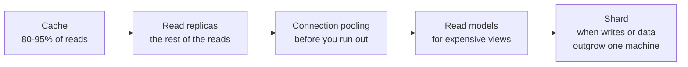

# Scalability, Latency ও Throughput {#ch-scalability}

> একটি latency distribution ঠিকভাবে পড়ুন, আসল bottleneck খুঁজে বের করুন, আর যে সবচেয়ে সস্তা lever সেটা ঠিক করে, সেটা টানুন।

**এই অধ্যায়ে:** latency বনাম throughput · গড় কেন মিথ্যা বলে · Little's Law আর queueing · scaling lever-এর সিঁড়ি · statelessness আর auto-scaling · database scale করা

## 💡 মূল ধারণা

Latency হলো একটি request কতক্ষণ নেয়। Throughput হলো প্রতি সেকেন্ডে কতগুলো request শেষ হয়। এরা প্রায়ই উল্টো দিকে
চলে। Batching throughput বাড়ায় আর latency যোগ করে। একটি queue throughput রক্ষা করে, আর তার একেবারে পেছনে যে
অপেক্ষা করছে তার ক্ষতি করে।

Load বাড়ার সাথে দুটি সংখ্যাকেই তাদের target-এর ভেতরে রাখার উপায় হলো scalability। এটা এমন কোনো গুণ নয় যেটা
যোগ করা যায়। এটা lever-এর একটি সিঁড়ি, আর প্রতিটি ধাপ আগেরটার চেয়ে টাকায় সস্তা কিন্তু জটিলতায় দামি। সিঁড়িটা এমন:
measure করুন, বড় machine কিনুন, state সরান, machine যোগ করুন, তারপর database-এর সমস্যা ছোট করুন। ক্লাসিক ভুল হলো
সরাসরি শেষ ধাপে লাফ দেওয়া, আর এমন একটি database shard করা যেটা একটি cache দিয়েই আরও দুই বছর চলত।

> User-রা latency অনুভব করেন। বিল দেওয়া হয় throughput-এর জন্য। Requirement কোনটার ভাষায় লেখা, তা জানুন।

## কীভাবে কাজ করে

### গড় কেন মিথ্যা বলে

120 ms-এর একটি mean latency প্রায় যেকোনো user experience-এর সাথে মিলে যায়, কারণ এটা tail লুকিয়ে রাখে।

| Statistic | যেভাবে পড়বেন                    | যার জন্য ব্যবহার করবেন                         |
| --------- | ------------------------------- | ------------------------------------------- |
| Mean      | মোট সময় ÷ request               | শুধু capacity-র হিসাব, user experience কখনো নয় |
| p50       | অর্ধেক request এর চেয়ে দ্রুত       | সাধারণ ক্ষেত্র                                 |
| p99       | 100-এ 1টি request এর চেয়ে ধীর      | যে SLO মানুষ আসলে ঠিক করে                     |
| p99.9     | 1,000-এ 1টি request এর চেয়ে ধীর    | আপনার সবচেয়ে ভারী user-রা সবসময় যা দেখেন        |

একটি page load 100টি request করতে পারে। তাই অন্তত একটিতে p99-এ পড়ার ভালো সম্ভাবনা একজন user-এর থাকে। এজন্যই
p99 কোনো edge case নয়: বাস্তব volume-এ **tail হলো কারও না কারও median**।

Fan-out tail-কে আরও খারাপ করে। ধরুন একটি backend call 1% সময় ধীর। যে request এমন দশটি call-এর জন্য অপেক্ষা করে,
সেটা **1 − 0.99¹⁰ ≈ 9.6%** সময় ধীর। দশটি call একটি p99 সমস্যাকে p90 সমস্যায় পরিণত করে। তিনটি সমাধান আছে। কম
call করুন (batch বা denormalise করুন)। Hedged request পাঠান: p95 অপেক্ষার পরে একটি duplicate, যেটার উত্তর আগে আসে
সেটা নিন। অথবা partial result ফেরত দিন, যেটা UI ফাঁকসহ দেখাতে পারে।

### Little's Law আর queue

**বেশিরভাগ capacity-র চমকের পেছনে থাকা একটিমাত্র formula:**

```text
concurrency = arrival rate × average latency
```

যে service প্রতি সেকেন্ডে 500টি request সামলায়, প্রতিটি 200 ms-এ, সেটা একসাথে 100টি request in flight ধরে রাখে।
50টি worker-এর একটি pool সেকেন্ডে মাত্র 250টি শেষ করতে পারে, তাই তার queue সীমাহীনভাবে বাড়ে। মূল ফলাফল: **utilisation
যত 100%-এর কাছে যায়, queueing-এর সময় তত সীমাহীনভাবে বাড়ে।** 50% utilisation-এ queue-এর অপেক্ষা প্রায় service
time-এর সমান। 90%-এ এটা service time-এর প্রায় নয় গুণ। তাই যে system 70% CPU-তে ঠিকঠাক দেখায়, সেটা 85%-এ ভেঙে পড়ে।
CPU-র সংখ্যা সামান্য সরেছে, আর অপেক্ষার সময় সরেছে অনেক।

তাই capacity-র সীমা নয়, utilisation-এর একটি সীমা ধরে পরিকল্পনা করুন। যে tier-এ latency গুরুত্বপূর্ণ, সেখানে
সাধারণ target প্রায় 70%। সেটা পার হওয়াই সিঁড়ি বেয়ে ওঠার signal।

### Lever-এর সিঁড়ি

| Lever              | যা কেনে                                     | যা খরচ হয়                                    | কখন ব্যবহার করবেন                                         |
| ------------------ | ------------------------------------------ | ------------------------------------------ | ------------------------------------------------------- |
| **Right-size**     | যে capacity-র জন্য আপনি আগে থেকেই টাকা দেন     | এক বিকেলের profiling                        | সবসময় প্রথমে। Bottleneck প্রায়ই আপনার অনুমান করাটা নয়      |
| **Scale up**       | 2–10× headroom, একটি maintenance window-এ   | টাকা, আর একটি restart                        | Database, stateful service, বদলানোর জন্য তৈরি নয় এমন যেকোনো কিছু |
| **Go stateless**   | আদৌ scale out করার সুযোগ                     | Session আর file বাইরে সরানো                  | প্রথম বাড়তি instance-এর আগে, পরে নয়                       |
| **Scale out**      | প্রায় সীমাহীন capacity, সাথে redundancy      | একটি load balancer, আর state নিয়ে প্রতিটি ধারণা  | Web আর API tier, আর যেকোনো single point of failure       |
| **Scale the data** | Read capacity, তারপর write capacity        | Replication lag, তারপর sharding যা কিছু আনে  | যখন database-ই saturate হচ্ছে                            |

### Scale up করা, আর কেন এটা ভীরুর পথ নয়

বড় machine কোনো architecture বদলায় না। এটা আজই পাওয়া যায়, এতে কোনো design-এর ঝুঁকি নেই, আর কঠিন কাজটা ঠিকভাবে
করার জন্য যে কয়েক মাস দরকার সেটা কিনে দেয়। কিন্তু আগে bottleneck নিশ্চিত করুন।

**যে resource আসলে saturated, তার নাম বলা:**

```typescript
interface InstanceMetrics {
  cpuPercent: number;
  memoryPercent: number;
  diskIoWaitPercent: number;
  networkAtLimit: boolean;
}

function bottleneck(m: InstanceMetrics): string {
  if (m.diskIoWaitPercent > 30) return "I/O — faster storage or read replicas, not more vCPU";
  if (m.memoryPercent > 85) return "memory — more RAM, or find the leak";
  if (m.cpuPercent > 80) return "CPU — more cores, or a cheaper query";
  if (m.networkAtLimit) return "network — a larger instance class raises the bandwidth cap";
  return "no clear bottleneck — profile the application before spending anything";
}
```

সীমাটা অর্থনৈতিক, technical নয়। প্রতিবার দ্বিগুণ করলে বিল মোটামুটি দ্বিগুণ হয়, কিন্তু throughput ফেরত আসে কম। কারণ
বেশিরভাগ web workload core ফুরানোর অনেক আগেই CPU-bound থাকা বন্ধ করে।

> ⚠️ Vertical scaling-এ restart লাগে। Managed database-এ এর মানে primary-তে কয়েক মিনিটের একটি maintenance window,
> যার পুরো সময় write fail করে। Engineering-এর সময়ে এটা সস্তা, availability-তে বিনামূল্যে নয়।

### Stateless হওয়া

Scale out তখনই কাজ করে, যখন যেকোনো server যেকোনো request-এর উত্তর দিতে পারে। যে server local state ধরে রাখে, যেমন
memory-তে session বা disk-এ upload, সেটা বদলযোগ্য নয়। দ্বিতীয় একটি যোগ করলে আপনি পান দুটি আধা-কার্যকর system,
একটি বড় system নয়।

**❌ এমন state, যেটা পরের request খুঁজে পায় না:**

```typescript
const sessions = new Map<string, UserSession>(); // lives in one process

function getSession(sessionId: string): UserSession | undefined {
  return sessions.get(sessionId); // only on the server that created it
}
```

**✅ এমন state, যেটায় প্রতিটি server পৌঁছাতে পারে:**

```typescript
interface SessionStore {
  get(sessionId: string): Promise<UserSession | null>;
  set(sessionId: string, session: UserSession, ttlSeconds: number): Promise<void>;
}

async function getSession(store: SessionStore, sessionId: string): Promise<UserSession | null> {
  return store.get(sessionId);
}
```

একই কথা upload (object storage) আর চলমান কাজের (একটি queue) ক্ষেত্রেও খাটে। Memory-তে যা থাকে, instance চলে গেলে
সেটা হারানো নিরাপদ হতে হবে।

### Auto-scaling আর cooldown

Instance-গুলো বদলযোগ্য হলে capacity চাহিদার পিছু নিতে পারে। মানুষ যেটা ভুল করে, সেটা হলো অসমতা।

| দিক        | Trigger         | কতক্ষণ টানা     | Cooldown  | কেন                                   |
| --------- | --------------- | ------------- | --------- | ------------------------------------ |
| Scale out | CPU 70%-এর ওপরে  | 3 মিনিট        | 1 মিনিট    | একটি বাড়তি instance-এর খরচ সামান্য      |
| Scale in  | CPU 30%-এর নিচে  | 10 মিনিট       | 5 মিনিট    | একটি কম instance-এর খরচ একটি outage   |

**দ্রুত scale out করুন, ধীরে scale in করুন।** লম্বা scale-in cooldown-ই policy-কে বারবার এদিক-ওদিক দোলা থেকে
আটকায়। Minimum দুটি instance রাখুন, ভিন্ন availability zone-এ, কখনো একটি নয়।

CPU হলো default trigger, আর প্রায়ই ভুলটা। যে service একটি database-এর জন্য অপেক্ষা করে, সেটা CPU-bound নয়। এর
processor-এর অনেক আগেই এর queue depth বা p99 latency সাড়া দেয়, আর Little's Law বলে কেন: load সবার আগে queue-তেই
দেখা যায়।

### Database scale করা

Database সবার শেষে saturate হয় আর সবচেয়ে বেশি ক্ষতি করে, কারণ সেখানে "আরেকটি যোগ করো" নিজে থেকে কাজ করে না।



**প্রতিটি ধাপ পরেরটার জন্য সময় কেনে; sharding-ই একমাত্র ধাপ যেটা সস্তায় ফেরানো যায় না।**

দুটি তথ্য হাতে রাখুন। Replica পিছিয়ে থাকে, load-এর মধ্যে কয়েক সেকেন্ড, তাই write-এর ঠিক পরের read-কে primary-তে
যেতে হবে। আর connection limit তাড়াতাড়ি কামড় দেয়। দশটি করে connection-সহ একশোটি app instance একটি default
PostgreSQL setup (100 connection) দশ বার ফুরিয়ে ফেলে।

## কখন ব্যবহার করবেন

| লক্ষণ                                            | সম্ভাব্য কারণ                            | Lever                                                |
| ---------------------------------------------- | ------------------------------------- | ---------------------------------------------------- |
| p50 ঠিক, p99 ভয়ানক                               | GC pause, ঠান্ডা cache, একটি ধীর shard   | ধীর request-গুলোকে tenant আর instance অনুযায়ী ভাগ করুন, তারপর ব্যতিক্রমটা ঠিক করুন |
| শুধু peak-এ ধীর                                    | Utilisation সীমা পার হয়েছে              | Queue depth দেখে auto-scale করুন, বা load ফেলে দিন    |
| Database primary 85% CPU-তে, redesign-এর সময় নেই | সরল saturation                        | Scale up। চাপের মধ্যে এটাই সৎ উত্তর                     |
| একটি web tier, যাকে একটি node মরে গেলেও টিকতে হবে  | একটি single point of failure          | Scale out, কমপক্ষে দুটি instance, session বাইরে রাখা  |
| Read বাড়ছে, write স্থির                           | Read load                             | Cache, তারপর replica, এই ক্রমে                       |
| দেশে দ্রুত, বিদেশে ধীর                               | ভূগোল: London থেকে Sydney fibre-এ আলোর ~250 ms | CDN, edge caching, regional read replica  |

## সাধারণ ভুল

❌ **গড়কে optimise করা।** দ্রুত request আরও দ্রুত হলে mean ভালো হয়, যেটা কোনো user টের পান না।
✅ Requirement যে percentile-এর নাম বলে, সেটা optimise করুন। "p99 1.2 s থেকে 380 ms-এ নেমেছে" — এটা একটি ফলাফল।

❌ **Profiling-এর আগে scaling।** Disk-এর জন্য অপেক্ষা করা service-এর জন্য বাড়তি vCPU কিছুই করে না। ✅ Saturated
resource-টা খুঁজুন, তারপর সেটাই কিনুন।

❌ **একটি stateful service scale out করা।** Sticky session এটা লুকিয়ে রাখে, যতক্ষণ না একটি server মরে আর তার user-দের
session সাথে নিয়ে যায়। ✅ দ্বিতীয় instance-এর আগে state বাইরে সরান, পরে নয়।

❌ **সমান cooldown।** দ্রুত scale-in capacity সরিয়ে দেয়, আবার দরকার হওয়ার ঠিক কিছুক্ষণ আগে। ✅ কয়েক মিনিটে scale
out করুন, কয়েক দশ মিনিট ধরে scale in করুন।

❌ **Database-এ প্রথম পদক্ষেপ হিসেবে sharding।** এটা প্রতিটি query, migration আর incident-এ খরচ যোগ করে।
✅ আগে cache, replicate আর pool করুন। Data সত্যিই না আঁটলে তবে shard করুন।

## 🔑 মূল শিক্ষা

- Latency আর throughput একে অপরের বিনিময়ে আসে, তাই প্রতিটি performance requirement-কে বলতে হবে সে কোনটার কথা বলছে।
- Mean tail লুকিয়ে রাখে, আর বাস্তব volume-এ p99 হলো কারও না কারও median অভিজ্ঞতা।
- Little's Law দেখায় যে utilisation 100%-এর কাছে গেলে অপেক্ষার সময় বিস্ফোরিত হয়, তাই প্রায় 70%-এর একটি সীমা ধরে পরিকল্পনা করুন।
- Scalability হলো খরচের ক্রমে সাজানো lever-এর একটি সিঁড়ি, আর মানুষ যতটা স্বীকার করে তার চেয়ে বেশিবার বড় machine-ই সঠিক ধাপ।
- Scale out-এর আগে statelessness আসে। Database-এ sharding শেষ ধাপ, আর একমাত্র ধাপ যেটা ফেরানো কঠিন।

## Interview-এর প্রশ্ন

**Q: Vertical নাকি horizontal scaling — কীভাবে বাছবেন?**

আগে vertical, কারণ এতে architecture-এ কিছুই বদলায় না, আর আজ বিকেলেই করা যায়। Horizontal তখন, যখন আপনার fault
tolerance, zero-downtime deploy, বা এক machine যা দিতে পারে তার চেয়ে বেশি দরকার। সিদ্ধান্তের মূল কারণ সাধারণত
availability, throughput নয়। একটি বড় instance যেকোনো আকারেই একটি single point of failure।

**Q: p50 40 ms আর p99 3 সেকেন্ড। কোথায় খুঁজবেন?**

এমন কিছুতে, যেটা অল্প কিছু request-কে খুব বেশি ক্ষতি করে, সব request-কে সামান্য নয়। ভাবুন ঠান্ডা cache, garbage
collection pause, একটি ধীর shard, lock contention, বা এমন একটি code path যেখানে শুধু বড় account-রা পৌঁছায়। আগে ধীর
request-গুলোকে tenant, endpoint আর instance অনুযায়ী ভাগ করুন। Tail-এর প্রায় সবসময় একটি সাধারণ বৈশিষ্ট্য থাকে।

**Q: আপনার service 70% CPU-তে ঠিক দেখায় আর 85%-এ ভেঙে পড়ে। কেন?**

Queueing। Little's Law অনুযায়ী, in-flight কাজ = arrival rate × latency। Utilisation 100%-এর কাছে গেলে queue-এর
অপেক্ষা CPU-র সংখ্যার চেয়ে অনেক দ্রুত বাড়ে। Load-এ ছোট একটি বৃদ্ধি latency-তে বড় বৃদ্ধি হয়ে যায়, আর এজন্যই
capacity plan প্রায় 70%-এর একটি সীমা target করে।

**Q: কখন আপনি ইচ্ছা করে খারাপ latency মেনে নেবেন?**

যখন throughput বা খরচ বেশি গুরুত্বপূর্ণ। Write batch করা, telemetry buffer করা আর background job queue করা — সবই
একেকটি item-কে দেরি করায়, কিন্তু system-কে সস্তা আর মজবুত করে। শর্ত হলো, কোনো user ফলাফলের জন্য অপেক্ষা করেন না।
যে মুহূর্তে কেউ করেন, trade-off উল্টে যায়।

## এরপর কী পড়বেন

- [Chapter ?? — Load Balancing](#ch-load-balancing) — যে component scale out সম্ভব করে
- [Chapter ?? — Caching](#ch-caching) — read latency আর database load-এর ওপর সবচেয়ে বড় একক lever
- [Chapter ?? — বড় পরিসরে Sharding ও Transaction](#ch-sharding) — শেষ ধাপ, আর তার খরচ
