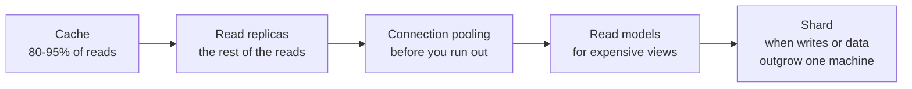

# Scalability, Latency ও Throughput {#ch-scalability}

> Latency distribution ঠিকভাবে পড়ুন, আসল bottleneck খুঁজে বের করুন, আর যে সবচেয়ে সস্তা উপায়ে সমস্যাটা মেটে, সেটাই নিন।

**এই অধ্যায়ে:** latency বনাম throughput · average কেন ভুল বোঝায় · Little's Law আর queueing · scale করার উপায়ের মই · stateless হওয়া আর auto-scaling · database scale করা

## 💡 মূল ধারণা

Latency মানে একটি request-এ কত সময় লাগে। Throughput মানে সেকেন্ডে কতটি request শেষ হয়। দুটি প্রায়ই উল্টো দিকে চলে।
Batching throughput বাড়ায়, কিন্তু latency যোগ করে। Queue throughput রক্ষা করে, কিন্তু যে তার একদম পেছনে দাঁড়িয়ে
অপেক্ষা করছে, তার ক্ষতি হয়।

Load বাড়ার সঙ্গে দুটি সংখ্যাকেই লক্ষ্যের মধ্যে রাখার উপায় হলো scalability। এটা এমন কোনো গুণ নয় যা পরে জুড়ে দেওয়া
যায়। এটা উপায়ের একটি মই। প্রতিটি ধাপ আগেরটার চেয়ে টাকায় সস্তা, কিন্তু জটিলতায় দামি। মইটা এরকম: measure করুন,
বড় machine কিনুন, state সরিয়ে দিন, machine যোগ করুন, তারপর database-এর সমস্যাটা ছোট করুন। পরিচিত ভুল হলো সোজা
সবচেয়ে নিচের ধাপে লাফ দেওয়া, আর এমন একটি database shard করা, যা একটি cache দিয়েই আরও দুই বছর চলত।

> User টের পান latency। Bill আসে throughput-এর জন্য। Requirement কোনটার ভাষায় লেখা, তা জেনে নিন।

## কীভাবে কাজ করে

### Average কেন ভুল বোঝায়

120 ms-এর একটি mean latency প্রায় যেকোনো user experience-এর সঙ্গেই মিলে যায়, কারণ এটা tail-কে লুকিয়ে রাখে।

| Statistic | মানে | কীসে কাজে লাগে |
| --------- | ---- | ------------- |
| Mean | মোট সময় ÷ request | শুধু capacity-র হিসাবে, user experience-এ কখনো নয় |
| p50 | অর্ধেক request এর চেয়ে দ্রুত | সাধারণ ক্ষেত্র |
| p99 | প্রতি 100টি-তে 1টি request এর চেয়ে ধীর | মানুষ আসলে যে SLO ঠিক করে |
| p99.9 | প্রতি 1,000টি-তে 1টি request এর চেয়ে ধীর | সবচেয়ে ভারী user-রা সারাক্ষণ যা দেখেন |

একটি page load-এ 100টি request হতে পারে। তাই অন্তত একটিতে p99-এ পড়ার সম্ভাবনা একজন user-এর বেশ ভালোই আছে। এ কারণেই
p99 কোনো ব্যতিক্রমী ঘটনা নয়: আসল volume-এ **tail হলো কারও না কারও median**।

Fan-out tail-কে আরও খারাপ করে। ধরুন একটি backend call 1% সময় ধীর। যে request এমন দশটি call-এর জন্য অপেক্ষা করে, সেটা
ধীর হয় **1 − 0.99¹⁰ ≈ 9.6%** সময়। দশটি call একটি p99 সমস্যাকে p90 সমস্যা বানিয়ে দেয়। সমাধান তিনটি। Call কমান (batch
করুন বা denormalise করুন)। Hedged request পাঠান: p95 পরিমাণ অপেক্ষার পর একটি duplicate, আর যে উত্তর আগে আসে সেটাই নিন।
অথবা আংশিক result return করুন, যা UI ফাঁকসহ দেখাতে পারে।

### Little's Law আর queue

**Capacity নিয়ে বেশিরভাগ চমকের পেছনে এই একটি formula:**

```text
concurrency = arrival rate × average latency
```

যে service সেকেন্ডে 500টি request সামলায়, প্রতিটিতে 200 ms, তার হাতে একসঙ্গে 100টি request চলমান থাকে। 50টি worker-এর
একটি pool সেকেন্ডে শেষ করতে পারে মাত্র 250টি, তাই তার queue অবিরাম বাড়তে থাকে। মূল ফলাফল হলো: **utilisation যত 100%-এর
কাছে যায়, queue-তে অপেক্ষার সময় সীমাহীনভাবে বাড়ে।** 50% utilisation-এ queue-তে অপেক্ষা মোটামুটি service time-এর সমান।
90%-এ সেটা service time-এর প্রায় নয় গুণ। তাই যে system 70% CPU-তে ঠিকঠাক দেখায়, সেটা 85%-এ ভেঙে পড়ে। CPU-র সংখ্যা
একটু নড়েছে, কিন্তু অপেক্ষার সময় নড়েছে অনেক।

তাই পরিকল্পনা করুন utilisation-এর একটি সীমা ধরে, capacity-র সীমা ধরে নয়। যে tier-এ latency গুরুত্বপূর্ণ, সেখানে সাধারণ
লক্ষ্য প্রায় 70%। সেটা পার হলেই বুঝবেন, মইয়ের পরের ধাপে ওঠার সময় হয়েছে।

### উপায়ের মই

| উপায় | যা পান | যা খরচ হয় | কখন নেবেন |
| ---- | ----- | -------- | -------- |
| **Right-size** | যে capacity-র জন্য আগে থেকেই টাকা দিচ্ছেন | এক বিকেলের profiling | সবসময় প্রথমে। Bottleneck প্রায়ই সেটা নয়, যেটা আপনি আন্দাজ করেছিলেন |
| **Scale up** | একটি maintenance window-এ 2–10× বাড়তি জায়গা | টাকা, আর একটি restart | Database, stateful service, বা যা এখনো বদলানোর জন্য তৈরি নয় |
| **Stateless হওয়া** | আদৌ scale out করার সুযোগ | Session আর file বাইরে সরানো | প্রথম বাড়তি instance-এর আগে, পরে নয় |
| **Scale out** | প্রায় সীমাহীন capacity, সঙ্গে redundancy | একটি load balancer, আর state নিয়ে প্রতিটি assumption | Web আর API tier, আর যেকোনো single point of failure |
| **Data scale করা** | আগে read capacity, তারপর write capacity | আগে replication lag, তারপর sharding-এর সব ঝামেলা | যখন database-ই সবার আগে ভরে যায় |

### Scale up, আর কেন এটা ভীরুর পথ নয়

বড় machine কোনো architecture বদলায় না। এটা আজই পাওয়া যায়, design-এর কোনো ঝুঁকি নেই, আর কঠিন কাজটা ঠিকভাবে করার
জন্য যে কয়েক মাস লাগে, সেটা কিনে দেয়। তবে আগে bottleneck নিশ্চিত করুন।

**যে resource আসলে ভরে গেছে, তার নাম বলা:**

```typescript
interface InstanceMetrics {
  cpuPercent: number;
  memoryPercent: number;
  diskIoWaitPercent: number;
  networkAtLimit: boolean;
}

function bottleneck(m: InstanceMetrics): string {
  if (m.diskIoWaitPercent > 30) return "I/O — faster storage or read replicas, not more vCPU";
  if (m.memoryPercent > 85) return "memory — more RAM, or find the leak";
  if (m.cpuPercent > 80) return "CPU — more cores, or a cheaper query";
  if (m.networkAtLimit) return "network — a larger instance class raises the bandwidth cap";
  return "no clear bottleneck — profile the application before spending anything";
}
```

সীমাটা technical নয়, অর্থনৈতিক। প্রতিবার দ্বিগুণ করলে bill মোটামুটি দ্বিগুণ হয়, কিন্তু throughput বাড়ে তার চেয়ে কম।
কারণ বেশিরভাগ web workload core ফুরানোর অনেক আগেই CPU-bound থাকা বন্ধ করে দেয়।

> ⚠️ Vertical scaling-এ restart লাগে। Managed database-এ সেটা primary-তে কয়েক মিনিটের maintenance window, আর পুরো সময়টা
> write ব্যর্থ হয়। Engineering-এর সময়ে এটা সস্তা, কিন্তু availability-তে বিনা খরচে নয়।

### Stateless হওয়া

Scale out তখনই কাজ করে, যখন যেকোনো server যেকোনো request-এর উত্তর দিতে পারে। যে server local state রাখে, যেমন memory-তে
session বা disk-এ upload, তাকে অন্যটার সঙ্গে বদলানো যায় না। দ্বিতীয় একটি যোগ করলে একটি বড় system পান না, পান দুটি
আধা-কাজ-করা system।

**❌ এমন state, যা পরের request খুঁজে পায় না:**

```typescript
const sessions = new Map<string, UserSession>(); // lives in one process

function getSession(sessionId: string): UserSession | undefined {
  return sessions.get(sessionId); // only on the server that created it
}
```

**✅ এমন state, যা প্রতিটি server-এর নাগালে:**

```typescript
interface SessionStore {
  get(sessionId: string): Promise<UserSession | null>;
  set(sessionId: string, session: UserSession, ttlSeconds: number): Promise<void>;
}

async function getSession(store: SessionStore, sessionId: string): Promise<UserSession | null> {
  return store.get(sessionId);
}
```

Upload (object storage) আর চলমান কাজের (queue) ক্ষেত্রেও একই কথা। Memory-তে যা থাকে, instance চলে গেলে তা হারালেও
যেন কোনো ক্ষতি না হয়।

### Auto-scaling আর cooldown

Instance-গুলো একটির জায়গায় আরেকটি বসানো গেলে capacity চাহিদার সঙ্গে তাল মিলিয়ে চলতে পারে। মানুষ ভুল করে এর
অসমতায়।

| দিক | Trigger | কতক্ষণ টানা | Cooldown | কেন |
| --- | ------- | ---------- | -------- | --- |
| Scale out | CPU 70%-এর ওপরে | 3 মিনিট | 1 মিনিট | একটি বাড়তি instance-এর খরচ সামান্য |
| Scale in | CPU 30%-এর নিচে | 10 মিনিট | 5 মিনিট | একটি instance কম থাকার খরচ একটি outage |

**দ্রুত scale out করুন, ধীরে scale in করুন।** Scale in-এর লম্বা cooldown-ই policy-কে বারবার এদিক-ওদিক দুলতে দেয় না।
সর্বনিম্ন রাখুন দুটি instance, আলাদা availability zone-এ। কখনো একটি নয়।

CPU হলো default trigger, আর প্রায়ই ভুলটা। যে service database-এর জন্য অপেক্ষা করে, সেটা CPU-bound নয়। Processor-এর
অনেক আগেই এর queue depth বা p99 latency সাড়া দেয়। Little's Law-ই বলে দেয় কেন: load সবার আগে দেখা দেয় queue-তে।

### Database scale করা

Database সবার শেষে ভরে, আর ক্ষতি করে সবচেয়ে বেশি। কারণ সেখানে শুধু "আরেকটি যোগ করুন" দিয়ে কাজ হয় না।



**প্রতিটি ধাপ পরের ধাপের জন্য সময় কিনে দেয়। Sharding-ই একমাত্র ধাপ, যা সস্তায় ফিরিয়ে নেওয়া যায় না।**

দুটি তথ্য হাতের কাছে রাখুন। Replica পিছিয়ে থাকে, load-এর মধ্যে কয়েক সেকেন্ড পর্যন্ত। তাই write-এর ঠিক পরের read-কে
primary-তে যেতে হবে। আর connection-এর সীমা খুব তাড়াতাড়ি সমস্যা করে। একশোটি app instance, প্রত্যেকটিতে দশটি connection,
একটি default PostgreSQL setup-এর (100 connection) দশ গুণ খরচ করে ফেলে।

## কখন ব্যবহার করবেন

| লক্ষণ | সম্ভাব্য কারণ | উপায় |
| ----- | ------------ | ---- |
| p50 ঠিক আছে, p99 ভয়াবহ | GC pause, cold cache, একটি ধীর shard | ধীর request-গুলো tenant আর instance ধরে ভাগ করুন, তারপর ব্যতিক্রমটা ঠিক করুন |
| শুধু peak-এ ধীর | Utilisation সীমা পেরিয়ে গেছে | Queue depth দেখে auto-scale করুন, বা load কমিয়ে দিন |
| Database primary 85% CPU-তে, redesign-এর সময় নেই | সাধারণ saturation | Scale up। চাপের মধ্যে এটাই সৎ উত্তর |
| Web tier-কে একটি node মারা গেলেও টিকে থাকতে হবে | একটি single point of failure | Scale out, কমপক্ষে দুটি instance, session বাইরে রাখা |
| Read বাড়ছে, write স্থির | Read load | আগে cache, তারপর replica, এই ক্রমে |
| দেশে দ্রুত, বিদেশে ধীর | ভূগোল: London থেকে Sydney পর্যন্ত fibre-এ আলোর যেতেই ~250 ms | CDN, edge caching, অঞ্চলভিত্তিক read replica |

## সাধারণ ভুল

❌ **Average optimise করা।** দ্রুত request আরও দ্রুত হলে mean ভালো হয়, যা কোনো user টেরই পান না।
✅ Requirement যে percentile-এর কথা বলে, সেটাই optimise করুন। "p99 1.2 s থেকে 380 ms-এ নেমেছে" হলো একটি ফলাফল।

❌ **Profiling-এর আগে scale করা।** যে service disk-এর জন্য অপেক্ষা করে, তাকে বাড়তি vCPU কিছুই দেয় না। ✅ কোন resource
ভরে গেছে, তা খুঁজে বের করুন, তারপর ঠিক সেটাই কিনুন।

❌ **Stateful service scale out করা।** Sticky session সমস্যাটা লুকিয়ে রাখে, যতক্ষণ না একটি server মারা যায় আর তার
user-দের session সঙ্গে নিয়ে যায়। ✅ দ্বিতীয় instance-এর আগেই state বাইরে সরান, পরে নয়।

❌ **দুই দিকেই সমান cooldown।** দ্রুত scale in করলে capacity সরে যায় ঠিক আবার দরকার পড়ার আগমুহূর্তে। ✅ Scale out
করুন কয়েক মিনিটে, scale in করুন কয়েক দশ মিনিট ধরে।

❌ **Database-এ প্রথম পদক্ষেপই sharding।** এতে প্রতিটি query, migration আর incident-এর খরচ বাড়ে।
✅ আগে cache, replicate আর pool করুন। Data সত্যিই না ধরলে তবেই shard করুন।

## 🔑 মূল শিক্ষা

- Latency আর throughput একটি আরেকটির বিনিময়ে আসে, তাই প্রতিটি performance requirement-কে বলতে হবে কোনটার কথা হচ্ছে।
- Mean tail-কে লুকায়, আর আসল volume-এ p99 হলো কারও না কারও median অভিজ্ঞতা।
- Little's Law দেখায়, utilisation 100%-এর কাছে গেলে অপেক্ষার সময় হু হু করে বাড়ে। তাই প্রায় 70%-এর একটি সীমা ধরে
  পরিকল্পনা করুন।
- Scalability হলো খরচের ক্রমে সাজানো উপায়ের মই। মানুষ যতটা স্বীকার করে, তার চেয়ে বেশিবার বড় machine-ই সঠিক ধাপ।
- Scale out-এর আগে stateless হতে হয়। Database-এ sharding শেষ ধাপ, আর একমাত্র ধাপ যা ফিরিয়ে নেওয়া কঠিন।

## Interview-এর প্রশ্ন

**Q: Vertical না horizontal scaling, কীভাবে বেছে নেবেন?**

আগে vertical, কারণ এতে architecture-এ কিছুই বদলায় না, আর আজ বিকেলেই করা যায়। Horizontal তখন, যখন fault tolerance,
zero-downtime deploy, বা এক machine যা দিতে পারে তার চেয়ে বেশি দরকার। সিদ্ধান্ত সাধারণত ঠিক করে availability,
throughput নয়। একটি বড় instance, আকার যত বড়ই হোক, একটি single point of failure।

**Q: p50 40 ms আর p99 3 সেকেন্ড। কোথায় খুঁজবেন?**

এমন কিছুতে, যা অল্প কয়েকটি request-কে খুব খারাপভাবে ভোগায়, সব request-কে একটু করে নয়। যেমন cold cache, garbage
collection pause, একটি ধীর shard, lock contention, কিংবা এমন code path যেখানে শুধু বড় account-রা পৌঁছায়। আগে ধীর
request-গুলো tenant, endpoint আর instance ধরে ভাগ করুন। Tail-এর request-গুলোর প্রায় সবসময় কোনো একটি বৈশিষ্ট্য মেলে।

**Q: আপনার service 70% CPU-তে ঠিক দেখায়, আর 85%-এ ভেঙে পড়ে। কেন?**

Queueing। Little's Law অনুযায়ী, চলমান কাজ = আসার হার × latency। Utilisation 100%-এর কাছে গেলে queue-তে অপেক্ষা CPU-র
সংখ্যার চেয়ে অনেক দ্রুত বাড়ে। Load সামান্য বাড়লে latency বাড়ে অনেক। এ কারণেই capacity plan প্রায় 70%-এর একটি সীমা
লক্ষ্য রাখে।

**Q: কখন ইচ্ছে করে খারাপ latency মেনে নেবেন?**

যখন throughput বা খরচ বেশি গুরুত্বপূর্ণ। Write batch করা, telemetry buffer করা, background job queue-তে রাখা: সবই এক
একটি item-কে দেরি করায়, কিন্তু system-কে সস্তা আর মজবুত করে। শর্ত হলো, কোনো user যেন result-এর জন্য অপেক্ষা না
করেন। যে মুহূর্তে কেউ অপেক্ষা করেন, লেনদেনটা উল্টে যায়।

## এরপর কী পড়বেন

- [Chapter ?? — Load Balancing](#ch-load-balancing) — যে component scale out সম্ভব করে
- [Chapter ?? — Caching](#ch-caching) — read latency আর database load কমানোর সবচেয়ে বড় একক উপায়
- [Chapter ?? — বড় পরিসরে Sharding ও Transaction](#ch-sharding) — শেষ ধাপ, আর তার দাম
