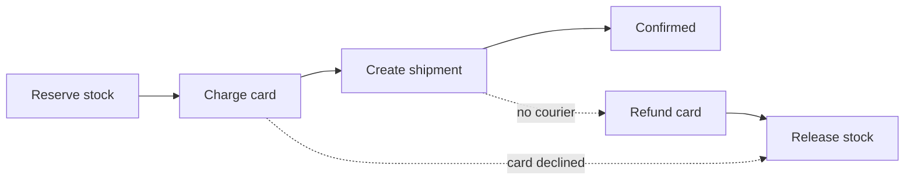

# Service Boundary ও API Gateway {#ch-service-boundaries}

> Service-গুলোর মধ্যে রেখা টানুন সেখানে, যেখানে data আর team আগে থেকেই আছে, আর তাদের সামনের edge-কে পাতলা রাখুন।

**এই অধ্যায়ে:** monolith বনাম service · seam খুঁজে বের করা · request, event আর saga · gateway কীসের মালিক · backend-for-frontend pattern

## 💡 মূল ধারণা

একটি service boundary একটি প্রতিশ্রুতি। এটা বলে, code-এর দুটি অংশ আলাদাভাবে বদলানো, deploy আর scale করা যায়।
প্রতিশ্রুতিটি ব্যয়বহুল। একটি function call হয়ে যায় network call, যা ব্যর্থ হতে পারে। একটি transaction হয়ে যায়
distributed workflow। একটি schema change হয়ে যায় team-দের মধ্যে দর-কষাকষি।

API gateway সেই সিদ্ধান্তের অন্য দিক। এটা service-গুলোর সামনে দাঁড়ায়, আর একবারেই route, authenticate আর
rate-limit করে। Business logic ভেতরে ঢোকার আগ পর্যন্ত এটা ভালো চুক্তি।

> একটি system ভাগ করা technical সিদ্ধান্ত হওয়ার আগে একটি সমন্বয়ের সিদ্ধান্ত। একটি boundary-র দুই পাশেরই মালিক
> যদি একটি team হয়, সেই boundary আপনাকে কিছুই এনে দেয় না।

## কীভাবে কাজ করে

### Monolith না service

| | Modular monolith | Service |
| --- | ---------------- | -------- |
| Deploy | একটি artefact, হয় সব নয় কিছুই না | প্রতিটি service আলাদাভাবে |
| ব্যর্থতা | একটি exception, process-এর ভেতরে | Network call, যা timeout হয় |
| Data | একটি database, সত্যিকারের transaction | প্রত্যেকের একটি store, service জুড়ে কোনো transaction নেই |
| Scaling | সবকিছু একসঙ্গে scale হয় | গরম অংশটি একা scale হয় |
| কার জন্য ঠিক | কয়েক ডজন engineer-এর কম বেশিরভাগ system | স্বাধীন team, বা খুবই আলাদা workload |

Interview-এ default উত্তর হলো **পরিষ্কার ভেতরের boundary-সহ একটি modular monolith**, তারপর যে একটি module এটা
অর্জন করেছে, সেটাকে আলাদা করা। "Microservices" দিয়ে শুরু করলে সেটা একটি résumé-র মতো শোনায়।

### Seam খুঁজে বের করা

ভালো boundary আসে domain থেকে, technical layer থেকে নয়। ভাগ করুন **যা একসঙ্গে বদলায়** তা অনুযায়ী।

| লক্ষণ | এটা কী ইঙ্গিত দেয় |
| ------ | ---------------- |
| দুটি অংশ সবসময় একসঙ্গে deploy হয় | boundary **নয়** — এরা একই জিনিস |
| আলাদা একগুচ্ছ বিশেষ্য আর নিয়ম | একটি bounded context, যেমন order, payment বা catalogue |
| আলাদা ধরনের scaling | Image processing, search indexing, report তৈরি |
| নিজস্ব roadmap-সহ আলাদা একটি team | আপনি পরিকল্পনা করুন বা না করুন, Conway's law এই রেখা টানবেই |

> ⚠️ যে boundary-তে দুই দিকেই একটি synchronous call লাগে, সেটা boundary নয়। প্রতিটি request-এ একে অপরকে call
> করা দুটি service আসলে network জুড়ে ছড়িয়ে থাকা একটি function call।

**Layer-এর আকারে ভাগ করা হলো ক্লাসিক ভুল।** একটি "database service", একটি "API service" আর একটি "logic service"
মানে প্রতিটি feature তিনটিকেই ছোঁয়। কোনোটাই আলাদাভাবে deploy হতে পারে না।

### Request না event

| | Synchronous request | Event |
| --- | ------------------- | ----- |
| Coupling | Caller callee-কে চেনে | Publisher subscriber-দের চেনে না |
| ব্যর্থতা | Caller সঙ্গে সঙ্গে দেখে | Broker retry করে; caller-এর কিছু হয় না |
| Consistency | তাৎক্ষণিক | Eventual |
| Latency | পুরো chain-এর যোগফল | Producer সঙ্গে সঙ্গে return করে |

Request ব্যবহার করুন **যখন caller-এর response দিতে উত্তরটি দরকার**। Order confirm করার আগে stock দেখা একটি
request। Receipt email করা একটি event।

**Critical path-এ সর্বোচ্চ একটি synchronous hop রাখুন।** প্রতিটি 99.9% availability-র তিনটি chain করা call মিলে
দেয় 99.7%, আর তাদের latency যোগ হয়।

**এমন একটি event, যা subscriber-দের যা দরকার তা বহন করে:**

```typescript
// Past tense, immutable, self-contained.
interface OrderPlaced {
  eventId: string; // lets consumers drop duplicates
  type: "order.placed";
  occurredAt: string;
  orderId: string;
  userId: string;
  total: number; // copied, so no subscriber has to call back
}
```

শুধু একটি ID-ওয়ালা event প্রতিটি subscriber-কে ফিরে call করতে বাধ্য করে, যা coupling ফিরিয়ে আনে।

### প্রতি service-এ একটি database, আর saga

প্রতিটি service নিজের store-এর মালিক, আর অন্য কোনো service সেটা সরাসরি পড়ে না। এটাই একটি boundary-কে বাস্তব করে।
Shared database মানে shared schema, আর shared schema মানে চিরকাল সমন্বিত deploy।

দাম হলো, service জুড়ে join আর transaction উধাও হয়ে যায়। দুটি service-এর data একটি page-এ দেখাতে, সেটা একটি
BFF-এ (backend for frontend, নিচে আলোচনা করা হয়েছে) জোড়া লাগান। Service জুড়ে query করতে, event থেকে একটি read
model বানান। দুটি service একসঙ্গে update করতে, একটি **saga** ব্যবহার করুন: local transaction-এর একটি chain,
প্রত্যেকটির সঙ্গে একটি **compensating action**, যা সেটাকে ফিরিয়ে নেয়।



**একটি checkout saga: প্রতিটি সামনের ধাপের একটি বিপরীত আছে, আর saga ঠিক ততটাই নির্ভরযোগ্য, যতটা সেই বিপরীতগুলো।**

Saga-র **কোনো isolation নেই**। অন্য request অর্ধেক শেষ হওয়া state দেখতে পারে, তাই UI-এর একটি pending status
দরকার। Compensation rollback-ও নয়: refund একটি নতুন transaction। Two-phase commit সমাধান নয়, কারণ এটা network
জুড়ে lock ধরে রাখে। ছোট flow choreograph করা যায়, যেখানে প্রতিটি service event-এ সাড়া দেয়। প্রায় চার ধাপ পেরোলে,
ধাপগুলো চালানো একটি orchestrator বেশি পরিষ্কার।

### Edge-এ gateway

Gateway না থাকলে, প্রতিটি client প্রতিটি service-এর address জানে, আর প্রতিটি service নিজের মতো করে token যাচাই করে
আর traffic সীমিত করে। Gateway এটা একবারেই করে, একটি config store-এ রাখা route table থেকে।

| বিষয় | Gateway কী করে |
| ------- | --------------------- |
| Authentication | Token একবার validate করে আর একটি যাচাই করা identity header এগিয়ে দেয় |
| Rate limiting | Edge-এই reject করে, কোনো service compute খরচ করার আগে |
| TLS | একবার terminate করে; network-এর ভেতরে সাধারণ HTTP |
| Routing | `/api/orders/*`-কে order service-এ map করে; client শুধু একটি URL জানে |

| | Load balancer | API gateway | Service mesh |
| --- | ------------- | ----------- | ------------ |
| কাদের মধ্যে route করে | **একটি** service-এর replica-গুলো | **আলাদা আলাদা** service, path অনুযায়ী | Service, hop-এর পর hop |
| Traffic | যেকোনো | North–south: client থেকে cluster | East–west: service থেকে service |
| কীসের মালিক | Load ছড়ানো, health check | Auth, quota, TLS, routing | mTLS, retry, প্রতি hop-এর tracing |

Interviewer-রা ইচ্ছে করেই এদের গুলিয়ে ফেলেন। এরা একসঙ্গে কাজ করে। সাধারণত একটি L4 load balancer একটি stateless
gateway cluster-এর সামনে থাকে, আর বড় একটি estate mesh যোগ করে।

> ⚠️ Gateway হলো কর্তৃত্বপূর্ণ limit, একমাত্র নয়। ভেতরের caller-রা একে পুরোপুরি এড়িয়ে যায়, তাই যে service-কে
> কিছুতেই চাপে ডুবতে দেওয়া যাবে না, defence in depth হিসেবে তার নিজস্ব limit-ও দরকার।

### Backend for frontend

Web, mobile আর partner-দের serve করা একটি gateway একটি shared bottleneck হয়ে যায়। প্রতিটি client আলাদা আকার চায়।
**BFF হলো প্রতি client type-এ একটি gateway**, যার মালিক সেই team, যারা ওই client-এর মালিক।

**একই order service-এর ওপর দুটি BFF:**

```typescript
// Mobile BFF — only the fields the app renders
async function getMobileOrder(orderId: string): Promise<MobileOrderSummary> {
  const order = await orderService.getOrder(orderId);
  return { id: order.id, status: order.status, totalAmount: order.totalAmount };
}

// Web BFF — aggregates what the desktop detail page shows
async function getWebOrder(orderId: string): Promise<FullOrderDetail> {
  const order = await orderService.getOrder(orderId);
  const [user, stock] = await Promise.all([
    userService.getUser(order.userId),
    inventoryService.getStock(order.lineItems),
  ]);
  return assembleOrderDetail(order, user, stock);
}
```

খরচটা বাস্তব। তিনটি BFF মানে তিনটি deploy, আর একটি shared change তিন জায়গায় গিয়ে পড়ে। BFF এর দাম উশুল করে যখন
client-দের চাহিদা সত্যিই আলাদা হয়ে যায়, যখন একটি client দুটি field কম চায় তখন নয়।

## কখন ব্যবহার করবেন

| পরিস্থিতি | কী করবেন | কেন |
| --------- | -- | --- |
| ~20 জনের কম engineer, একটি product | Modular monolith | ভাগ করার খরচ লাভের চেয়ে বেশি |
| আলাদা ধরনের scaling-এর একটি workload | শুধু সেই service-টি আলাদা করুন | সবচেয়ে পরিষ্কার কারণ |
| Deploy নিয়ে team-রা একে অপরকে আটকে রাখছে | Team-এর রেখা ধরে ভাগ করুন | স্বাধীনতাই আসল product |
| এমন flow, যা কয়েকটি service update করবে | স্পষ্ট compensation-সহ saga | কোনো distributed transaction নেই |
| বাইরের client-ওয়ালা কয়েকটি service | API gateway | বারবার লেখা auth আর limit-এর দাম আপনি আগেই দিচ্ছেন |
| খুবই আলাদা আকার চাওয়া client | প্রতি client type-এ একটি BFF | একটি আকার একটি client-এর সক্রিয় ক্ষতি করে |

## সাধারণ ভুল

**❌ Distributed monolith।** আটটি service, যাদের একসঙ্গে deploy করতেই হয়, কারণ তাদের contract একই তালে বদলায়।
Distribution-এর সব খরচ, স্বাধীনতার কিছুই নেই।

**✅ একটি বলা কারণের জন্য আলাদা করা একটি service।** "Image processing CPU-bound আর হঠাৎ হঠাৎ চাপ আসে, তাই এটা
আলাদাভাবে scale হয়, আর এর ব্যর্থতা checkout-কে ছোঁয় না।"

**❌ Service-গুলোর মধ্যে shared database।** একটি schema migration হয়ে যায় একাধিক team-এর ঘটনা। প্রতিটি service
নিজের store-এর মালিক হওয়া উচিত, আর অন্যরা সেটা পড়বে তার API বা event দিয়ে।

**❌ Gateway-তে business logic**, যেমন discount-এর নিয়ম বা entitlement check। এখন প্রতিটি team মিলে সবচেয়ে
গুরুত্বপূর্ণ shared component-টি বদলায়।

**✅ Gateway route করে আর রক্ষা করে।** Aggregation থাকে এর পেছনের একটি service বা একটি GraphQL layer-এ।

> ⚠️ Timeout বা circuit breaker ছাড়া একটি upstream gateway-র connection জমিয়ে তোলে। তখন একটি ধীর service পুরো
> edge-কে সাড়াহীন করে দিতে পারে। প্রতিটি upstream-কে তার নিজস্ব timeout আর breaker দিন।

## 🔑 মূল শিক্ষা

- একটি service boundary স্বাধীন deploy আর scaling এনে দেয়, আর বিনিময়ে network failure, eventual consistency আর schema নিয়ে দর-কষাকষির দাম নেয়।
- Domain আর team অনুযায়ী ভাগ করুন, কখনো technical layer অনুযায়ী নয়, আর যে দুটি service সারাক্ষণ একে অপরকে call করে, তাদের এক করুন।
- প্রতি service-এ একটি database একটি boundary-কে বাস্তব করে, আর compensating step-সহ saga সেই service-জোড়া transaction-এর জায়গা নেয়, যা এটা সরিয়ে দেয়।
- Gateway তার hop-এর দাম উশুল করে auth, limit, TLS আর routing একবারে নিজের হাতে নিয়ে, আর business logic ঢুকলেই উশুল করা থামে।
- Client-দের চাহিদা সত্যিই আলাদা হলে উত্তর BFF, আর এর খরচ প্রতি client type-এ আরও একটি deployable।

## Interview-এর প্রশ্ন

**Q: একটি monolith কোথায় ভাগ করবেন, তা কীভাবে ঠিক করেন?**

এমন একটি অংশ খুঁজুন, যা আলাদা গতিতে বদলায়, আলাদাভাবে scale করে, বা এমন একটি team-এর, যারা বাকি সবার release-এ
আটকে থাকে। তারপর data দেখুন। আলাদা করা অংশটিকে যদি প্রতিটি request-এ মূল database-এ ফিরে যেতে হয়, seam ভুল জায়গায়।
একটি service আলাদা করুন, আর পরেরটির কথা ভাবার আগে প্রমাণ করুন boundary টিকে আছে।

**Q: দুটি service-কে atomically update হতে হবে। আপনি কী করবেন?**

মেনে নিন যে distributed transaction পাওয়া যাবে না, আর একটি saga ব্যবহার করুন। প্রতিটি service locally commit করে
আর একটি event publish করে, আর প্রতিটি ধাপের একটি compensating action থাকে। ফলটা শুরুতেই বলে দিন। একটি দৃশ্যমান
সময় থাকে, যখন system অর্ধেক update হয়ে আছে, তাই user-এর সামনের model-এ একটি pending state দরকার।

**Q: কখন microservices ভুল উত্তর?**

যখন team একটি। যে স্বাধীনতা কেনা হচ্ছে তা সাংগঠনিক, তাই একটি team network failure, distributed debugging আর
deployment matrix-এর বিনিময়ে কিছুই পায় না। জোর দিয়ে মানানো ভেতরের boundary-সহ একটি modular monolith design-এর
বেশিরভাগ সুবিধা পায়, আর পরে, যখন কারণ থাকে, ভাগ করা যায়।

**Q: API gateway আর load balancer-এর পার্থক্য কী?**

Load balancer একটি service-এর replica-গুলোর মধ্যে traffic ছড়ায়, L4 বা L7-এ। Gateway L7-এ কাজ করে আর path অনুযায়ী
আলাদা আলাদা service-এর মধ্যে route করে। এটা auth, rate limit আর request shaping-এরও মালিক। এরা একসঙ্গে কাজ করে:
সাধারণত একটি L4 load balancer একটি stateless gateway cluster-এর সামনে বসে।

**Q: Gateway এখন একটি single point of failure। এ নিয়ে আপনি কী করবেন?**

একে stateless রাখুন, যাতে scale out করা যায়, আর অন্তত দুটি availability zone জুড়ে active-active চালান। Route
table memory-তে cache করুন, যাতে config store-এর outage edge-কে নামিয়ে না দেয়। তারপর প্রতি upstream-এ circuit
breaker যোগ করুন, যাতে gateway শুধু তার সবচেয়ে দুর্বল service-এর সমান নির্ভরযোগ্য না হয়।

## এরপর কী পড়বেন

- [Chapter ?? — Queue, Async কাজ ও WebSocket](#ch-message-queues) — যে transport service-গুলোর মধ্যে event বহন করে
- [Chapter ?? — Resilience Pattern](#ch-resilience-patterns) — boundary পেরোনো প্রতিটি call-এর জন্য timeout আর circuit breaker
- [Chapter ?? — Rate Limiting](#ch-rate-limiting) — gateway-র quota check-এর পেছনের algorithm আর atomic counter
