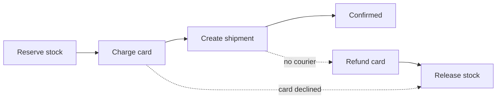

# Service Boundary ও API Gateway {#ch-service-boundaries}

> Service-এর মাঝের রেখাটা টানুন সেখানে, যেখানে data আর team আগে থেকেই ভাগ হয়ে আছে, আর তাদের সামনের edge-টা পাতলা রাখুন।

**এই অধ্যায়ে:** monolith বনাম service · জোড়ের জায়গা খোঁজা · request, event আর saga · gateway কোন দায় নেয় · backend-for-frontend pattern

## 💡 মূল ধারণা

Service boundary একটি প্রতিশ্রুতি। এর মানে, দুই টুকরো code আলাদাভাবে বদলানো, deploy করা আর scale করা যাবে। কিন্তু
প্রতিশ্রুতিটার দাম অনেক। Function call হয়ে যায় network call, যা ব্যর্থ হতে পারে। একটি transaction হয়ে যায় distributed
workflow। Schema-র একটি পরিবর্তন হয়ে যায় team-দের মধ্যে দর কষাকষি।

API gateway এই সিদ্ধান্তের অন্য দিক। Gateway service-গুলোর সামনে দাঁড়িয়ে routing, authentication আর rate limiting একবারেই
সেরে দেয়। Business logic ভেতরে ঢোকার আগ পর্যন্ত এটা ভালো চুক্তি।

> System ভাগ করা আগে coordination-এর সিদ্ধান্ত, তারপর technical সিদ্ধান্ত। Boundary-র দুই দিকই যদি একই team-এর হয়, তাহলে
> সেই boundary আপনাকে কিছুই দেয় না।

## কীভাবে কাজ করে

### Monolith নাকি service

| | Modular monolith | Service |
| --- | ---------------- | -------- |
| Deploy | একটি artefact, হয় সব নয়তো কিছুই না | প্রতিটি service আলাদাভাবে |
| Failure | একটি exception, process-এর ভেতরেই | Network call, যার timeout হয় |
| Data | একটি database, আসল transaction | প্রত্যেকের নিজের store, service জুড়ে কোনো transaction নেই |
| Scaling | সবকিছু একসঙ্গে scale হয় | শুধু hot অংশটা আলাদা করে scale হয় |
| কার জন্য ঠিক | কয়েক ডজনের কম engineer-এর বেশিরভাগ system | স্বাধীন team, অথবা একেবারে ভিন্ন ধরনের workload |

Interview-এ default উত্তর হলো **স্পষ্ট ভেতরের boundary-সহ একটি modular monolith**, তারপর শুধু সেই module-টা আলাদা করা, যেটা
এর যোগ্য হয়েছে। শুরুতেই "microservices" বললে মনে হয় résumé পড়ছেন।

### জোড়ের জায়গা খোঁজা

ভালো boundary আসে domain থেকে, technical layer থেকে নয়। ভাগ করুন **যা একসঙ্গে বদলায়** তা দেখে।

| লক্ষণ | এর ইঙ্গিত |
| ------ | ---------------- |
| দুটি অংশ সবসময় একসঙ্গে deploy হয় | Boundary **নয়** — আসলে এরা একটিই জিনিস |
| নিজস্ব noun আর নিয়মের একটি আলাদা সেট | একটি bounded context, যেমন order, payment বা catalogue |
| Scale হওয়ার আলাদা ধরন | Image processing, search indexing, report তৈরি |
| নিজস্ব roadmap-সহ আলাদা একটি team | Conway's law এই রেখা টানবেই, আপনি পরিকল্পনা করুন বা না করুন |

> ⚠️ যে boundary-তে দুই দিক থেকেই synchronous call লাগে, সেটা boundary নয়। প্রতিটি request-এ একে অপরকে call করা দুটি
> service আসলে network জুড়ে ছড়িয়ে দেওয়া একটি function call।

**Layer ধরে ভাগ করা ক্লাসিক ভুল।** "Database service", "API service" আর "logic service" থাকলে প্রতিটি feature-কে তিনটিই
ছুঁতে হয়। কোনোটাই আলাদা করে deploy হতে পারে না।

### Request নাকি event

| | Synchronous request | Event |
| --- | ------------------- | ----- |
| Coupling | Caller callee-কে চেনে | Publisher subscriber-দের চেনে না |
| Failure | Caller সঙ্গে সঙ্গে টের পায় | Broker retry করে; caller-এর কিছু হয় না |
| Consistency | তাৎক্ষণিক | Eventual |
| Latency | পুরো chain-এর যোগফল | Producer সঙ্গে সঙ্গেই return করে |

Request ব্যবহার করুন **যখন উত্তর দিতে caller-এর ওই answer-টা লাগে**। Order confirm করার আগে stock দেখা একটি request।
Receipt email করা একটি event।

**Critical path-এ synchronous hop রাখুন বড়জোর একটি।** প্রত্যেকটি 99.9% availability-র তিনটি call পরপর জুড়লে মোট হয় 99.7%,
আর তাদের latency যোগ হতে থাকে।

**এমন event, যাতে subscriber-দের যা দরকার তা থাকে:**

```typescript
// Past tense, immutable, self-contained.
interface OrderPlaced {
  eventId: string; // lets consumers drop duplicates
  type: "order.placed";
  occurredAt: string;
  orderId: string;
  userId: string;
  total: number; // copied, so no subscriber has to call back
}
```

শুধু ID থাকা event প্রতিটি subscriber-কে ফিরে call করতে বাধ্য করে, আর তাতে coupling আবার ফিরে আসে।

### প্রতি service-এ database, আর saga

প্রতিটি service নিজের store-এর মালিক, আর অন্য কোনো service সেটা সরাসরি পড়ে না। এটাই boundary-কে সত্যিকারের করে তোলে।
Shared database মানে shared schema, আর shared schema মানে চিরকাল মিলিয়ে deploy করা।

দামটা হলো, service জুড়ে join আর transaction আর থাকে না। দুটি service-এর data এক page-এ দেখাতে হলে BFF-এ (backend for
frontend, নিচে আছে) জুড়ে নিন। Service জুড়ে query করতে event থেকে একটি read model বানান। দুটি service একসঙ্গে update করতে
**saga** ব্যবহার করুন: local transaction-এর একটি chain, যার প্রতিটি ধাপের একটি **compensating action** থাকে, যা ধাপটাকে
উল্টে দেয়।



**একটি checkout saga: প্রতিটি সামনের ধাপের একটি উল্টো ধাপ আছে, আর saga ঠিক ততটাই নির্ভরযোগ্য, যতটা ওই উল্টো ধাপগুলো।**

Saga-র **কোনো isolation নেই**। অন্য request অর্ধেক-শেষ অবস্থাটা দেখতে পারে, তাই UI-তে একটি pending status লাগে।
Compensation rollback-ও নয়: refund একটি নতুন transaction। Two-phase commit সমাধান নয়, কারণ সেটা network জুড়ে lock ধরে রাখে।
ছোট flow choreograph করা যায়, যেখানে প্রতিটি service event-এ সাড়া দেয়। মোটামুটি চারটি ধাপের বেশি হলে একটি orchestrator
দিয়ে ধাপগুলো চালানো বেশি পরিষ্কার।

### Edge-এ gateway

Gateway না থাকলে প্রতিটি client প্রতিটি service-এর address জানে, আর প্রতিটি service নিজের মতো করে token যাচাই করে আর traffic
সীমিত করে। Gateway কাজটা একবারেই করে, একটি config store-এ রাখা route table থেকে।

| চিন্তার বিষয় | Gateway কী করে |
| ------- | --------------------- |
| Authentication | Token একবার যাচাই করে, আর যাচাই করা identity header সামনে পাঠায় |
| Rate limiting | Edge-এই ফিরিয়ে দেয়, কোনো service compute খরচ করার আগে |
| TLS | একবারই terminate করে; network-এর ভেতরে সাধারণ HTTP |
| Routing | `/api/orders/*`-কে order service-এ পাঠায়; client-রা চেনে একটি URL |

| | Load balancer | API gateway | Service mesh |
| --- | ------------- | ----------- | ------------ |
| কাদের মধ্যে route করে | **একটি** service-এর replica-দের মধ্যে | path ধরে **আলাদা আলাদা** service-এ | Service-দের মধ্যে, প্রতিটি hop-এ |
| Traffic | যেকোনো | North–south: client থেকে cluster | East–west: service থেকে service |
| দায়িত্ব | Load ছড়িয়ে দেওয়া, health check | Auth, quota, TLS, routing | mTLS, retry, প্রতি hop-এর tracing |

Interviewer-রা ইচ্ছে করেই এগুলো গুলিয়ে দেন। এরা একসঙ্গে কাজ করে। সাধারণত একটি L4 load balancer থাকে একটি stateless gateway
cluster-এর সামনে, আর বড় estate-এ এর সঙ্গে mesh যোগ হয়।

> ⚠️ Gateway-র limit-টাই প্রধান, কিন্তু একমাত্র নয়। ভেতরের caller-রা gateway পুরোপুরি এড়িয়ে যায়। তাই যে service-কে
> কোনোভাবেই চাপে ভেঙে পড়তে দেওয়া যাবে না, defence in depth হিসেবে তার নিজেরও limit লাগে।

### Backend for frontend

Web, mobile আর partner, সবাইকে একটি gateway সার্ভ করলে সেটা সবার জন্য একটি bottleneck হয়ে যায়। প্রতিটি client চায় আলাদা গড়ন।
**BFF হলো প্রতি ধরনের client-এর জন্য একটি করে gateway**, আর তার মালিক সেই team, যে ওই client-এর মালিক।

**একই order service-এর ওপর দুটি BFF:**

```typescript
// Mobile BFF — only the fields the app renders
async function getMobileOrder(orderId: string): Promise<MobileOrderSummary> {
  const order = await orderService.getOrder(orderId);
  return { id: order.id, status: order.status, totalAmount: order.totalAmount };
}

// Web BFF — aggregates what the desktop detail page shows
async function getWebOrder(orderId: string): Promise<FullOrderDetail> {
  const order = await orderService.getOrder(orderId);
  const [user, stock] = await Promise.all([
    userService.getUser(order.userId),
    inventoryService.getStock(order.lineItems),
  ]);
  return assembleOrderDetail(order, user, stock);
}
```

খরচটা সত্যি। তিনটি BFF মানে তিনটি deploy, আর একটি shared পরিবর্তন তিন জায়গায় গিয়ে পড়ে। BFF সেই খরচের যোগ্য হয় যখন client-দের
চাহিদা সত্যিই আলাদা দিকে যায়, কোনো client দুটি field কম চাইলে নয়।

## কখন ব্যবহার করবেন

| পরিস্থিতি | কী করবেন | কেন |
| --------- | -- | --- |
| মোটামুটি 20-এর কম engineer, একটি product | Modular monolith | ভাগ করার খরচ তার লাভের চেয়ে বেশি |
| Scale হওয়ার আলাদা ধরনের একটি workload | শুধু ওই service-টা আলাদা করুন | এর চেয়ে স্পষ্ট কারণ আর হয় না |
| Deploy নিয়ে team-রা একে অপরকে আটকে দিচ্ছে | Team-এর সীমানা ধরে ভাগ করুন | স্বাধীনতাই আসল product |
| এমন flow, যাকে কয়েকটি service update করতে হয় | স্পষ্ট compensation-সহ saga | Distributed transaction বলে কিছু নেই |
| বাইরের client-সহ কয়েকটি service | API gateway | Auth আর limit-এর পুনরাবৃত্তি এর মধ্যেই আপনার খরচ বাড়াচ্ছে |
| এমন client, যাদের একেবারে ভিন্ন গড়ন লাগে | প্রতি ধরনের client-এর জন্য একটি BFF | একটি গড়ন কোনো একটি client-এর সরাসরি ক্ষতি করছে |

## সাধারণ ভুল

**❌ Distributed monolith।** আটটি service, যাদের একসঙ্গে deploy করতেই হয়, কারণ তাদের contract একসঙ্গে বদলায়। Distribution-এর
সব খরচ আছে, স্বাধীনতার কিছুই নেই।

**✅ ঘোষিত একটি কারণে একটি service আলাদা করা।** "Image processing CPU-bound আর হঠাৎ হঠাৎ চাপ বাড়ে, তাই এটা আলাদা করে scale হয়,
আর এর failure checkout-কে ছোঁয় না।"

**❌ Service-দের মধ্যে shared database।** একটি schema migration হয়ে যায় একাধিক team-এর অনুষ্ঠান। প্রতিটি service নিজের store-এর
মালিক হবে, আর অন্যরা সেটা পড়বে তার API বা event দিয়ে।

**❌ Gateway-তে business logic**, যেমন discount-এর নিয়ম বা entitlement check। তখন সবচেয়ে গুরুত্বপূর্ণ shared component-টা
সব team মিলে একসঙ্গে বদলায়।

**✅ Gateway route করে আর সুরক্ষা দেয়।** Aggregation থাকে তার পেছনের কোনো service বা GraphQL layer-এ।

> ⚠️ Timeout বা circuit breaker ছাড়া upstream থাকলে gateway-তে connection জমতে থাকে। তখন একটি ধীর service পুরো edge-কে
> অচল করে দিতে পারে। প্রতিটি upstream-কে নিজস্ব timeout আর breaker দিন।

## 🔑 মূল শিক্ষা

- Service boundary আলাদা deploy আর scaling এনে দেয়, আর বিনিময়ে নেয় network failure, eventual consistency আর schema নিয়ে দর কষাকষি।
- ভাগ করুন domain আর team ধরে, technical layer ধরে কখনো নয়। যে দুটি service সারাক্ষণ একে অপরকে call করে, তাদের এক করে ফেলুন।
- প্রতি service-এ database boundary-কে সত্যিকারের করে, আর service জুড়ে যে transaction হারায়, তার জায়গা নেয় compensating ধাপসহ saga।
- Gateway তার hop-এর দাম তোলে auth, limit, TLS আর routing একবারে সামলে। Business logic ঢুকলেই সেই দাম আর ওঠে না।
- Client-দের চাহিদা সত্যিই আলাদা হলে উত্তর BFF, আর তার খরচ প্রতি ধরনের client-এ আরেকটি deployable।

## Interview-এর প্রশ্ন

**Q: Monolith কোথায় ভাগ করবেন, তা কীভাবে ঠিক করেন?**

এমন অংশ খুঁজুন, যা আলাদা গতিতে বদলায়, আলাদাভাবে scale হয়, অথবা এমন team-এর, যে বাকি সবার release-এ আটকে থাকে। তারপর data
দেখুন। আলাদা করা অংশটাকে যদি প্রতিটি request-এ মূল database-এ ফিরে হাত দিতে হয়, তাহলে জোড়ের জায়গাটা ভুল। একটি service
আলাদা করুন, আর পরেরটার কথা ভাবার আগে প্রমাণ করুন boundary-টা টিকছে।

**Q: দুটি service-কে atomic-ভাবে update করতে হবে। কী করবেন?**

মেনে নিন distributed transaction পাওয়া যাবে না, আর saga ব্যবহার করুন। প্রতিটি service locally commit করে event publish করে,
আর প্রতিটি ধাপের একটি compensating action থাকে। ফলাফলটা শুরুতেই বলে দিন। এমন একটি সময় থাকে, যখন system-টা অর্ধেক update
হয়ে আছে আর সেটা দেখা যায়। তাই user যে model দেখেন, তাতে একটি pending অবস্থা লাগে।

**Q: Microservices কখন ভুল সমাধান?**

যখন team একটিই। যে স্বাধীনতা কেনা হচ্ছে, সেটা organisational। তাই network failure, distributed debugging আর deployment matrix-এর
বিনিময়ে একটি team কিছুই পায় না। ভেতরের boundary কড়াভাবে মানা একটি modular monolith design-এর বেশিরভাগ সুবিধা দেয়, আর পরে
কারণ এলে ভাগ করা যায়।

**Q: API gateway আর load balancer-এর পার্থক্য কী?**

Load balancer একটি service-এর replica-দের মধ্যে traffic ছড়িয়ে দেয়, L4 বা L7-এ। Gateway কাজ করে L7-এ, আর path ধরে আলাদা আলাদা
service-এ route করে। Auth, rate limit আর request shaping-ও তার দায়িত্ব। এরা একসঙ্গে কাজ করে: সাধারণত একটি L4 load balancer
বসে থাকে একটি stateless gateway cluster-এর সামনে।

**Q: Gateway এখন single point of failure। এ নিয়ে কী করবেন?**

এটাকে stateless রাখুন, যাতে scale out করা যায়, আর অন্তত দুটি availability zone জুড়ে active-active চালান। Route table memory-তে
cache করুন, যাতে config store বন্ধ হলেও edge না পড়ে। তারপর প্রতি upstream-এ circuit breaker যোগ করুন, যাতে gateway-র
নির্ভরযোগ্যতা তার সবচেয়ে দুর্বল service-এর সমান না হয়ে যায়।

## এরপর কী পড়বেন

- [Chapter ?? — Queue, Async কাজ ও WebSocket](#ch-message-queues) — service-দের মধ্যে event বয়ে নেওয়া transport
- [Chapter ?? — Resilience Pattern](#ch-resilience-patterns) — boundary পার হওয়া প্রতিটি call-এর জন্য timeout আর circuit breaker
- [Chapter ?? — Rate Limiting](#ch-rate-limiting) — gateway-র quota check-এর পেছনের algorithm আর atomic counter
