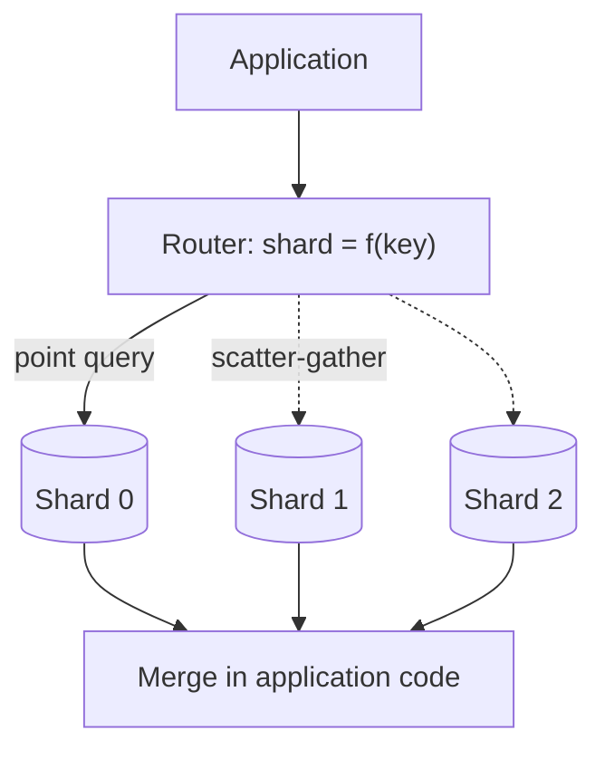

# বড় পরিসরে Sharding ও Transaction {#ch-sharding}

> Data কয়েকটি machine-এ ভাগ করুন, এমন একটি shard key বাছুন যার জন্য পরে আফসোস করবেন না, আর একটি transaction যখন আর সব write ঢাকতে পারে না, তখনো write-গুলো সঠিক রাখুন।

**এই অধ্যায়ে:** তিনটি strategy · consistent hashing · shard key বাছাই · hot shard আর hot row · একটি shard-এর ভেতরে transaction · saga, outbox আর idempotency

## 💡 মূল ধারণা

Sharding একটি database-কে কয়েকটিতে ভাগ করে। প্রতিটি shard data-র একটি অংশ রাখে, আর কোনোটাই এত বেশি রাখে না যে
bottleneck হয়ে যায়। Write scale করার একমাত্র উপায় এটাই, আর এ কারণেই এটা আছে। এটা সবচেয়ে শেষে ব্যবহার করার উপায়ও।

খরচ হলো, প্রতিটি query-র আকার বদলে যায়। জিজ্ঞেস করার আগেই system-কে জানতে হয় কোন shard-কে জিজ্ঞেস করবে। যে প্রশ্ন
একাধিক shard জুড়ে, সেটা application code-এ একটি fan-out আর একটি merge হয়ে যায়।

Transaction-এর আকারও বদলায়। একটি database-এ একগুচ্ছ write বিনা খরচে একসাথে commit হয়, কিন্তু data ভাগ হয়ে
গেলে শুধু একটি shard-এর ভেতরে। Senior উত্তর হলো এমনভাবে সাজানো, যাতে distributed transaction-এর দরকারই না পড়ে:
সম্পর্কিত data একসাথে রাখুন, আর বাকিটার জন্য saga, outbox আর idempotency ব্যবহার করুন।

> ⚠️ Caching, read replica আর connection pooling শেষ হয়ে গেলে তবেই shard করুন। ওগুলো read সামলায়, আর বেশিরভাগ
> system-এ আগে read-ই ফুরিয়ে যায়। Sharding ঠিক করে write throughput আর data volume, আর এটা ফিরিয়ে আনা ব্যয়বহুল।

## কীভাবে কাজ করে

Application আর shard-গুলোর মাঝে একটি router বসে। এটা shard key থেকে shard হিসাব করে, আর query-টি একটি machine-এ
পাঠায়। Query-তে shard key না থাকলে সবগুলোকেই জিজ্ঞেস করতে হয়।



**Query-তে shard key থাকলে একটি shard; না থাকলে সবগুলো।**

### তিনটি strategy

| | Range | Hash | Directory |
| --- | --- | --- | --- |
| **Shard যেভাবে বাছা হয়** | Key কোন interval-এ পড়ে | Key-এর একটি hash | একটি lookup table |
| **Range query** | একটি shard-এই থাকে | প্রতিটি shard-এ যায় | Placement-এর ওপর নির্ভর করে |
| **বণ্টন** | অসম; নতুন data এক জায়গায় জমে | সমান | আপনি যা ঠিক করেন |
| **কখন ব্যবহার করবেন** | তারিখ দিয়ে query হওয়া time-series data | High-cardinality key-এ point lookup | প্রতিটি entity-র placement আপনাকে নিয়ন্ত্রণ করতেই হবে |

**Hash-based routing, user data-র default:**

```typescript
import { createHash } from "node:crypto";

// The same user always lands on the same shard — that is the whole contract.
function shardIndex(key: string, shardCount: number): number {
  return parseInt(createHash("md5").update(key).digest("hex").slice(0, 8), 16) % shardCount;
}
```

ওই modulo-টাই আবার দুর্বলতা। `hash % 4` আর `hash % 5` প্রায় প্রতিটি key নিয়ে দ্বিমত করে। একটি shard যোগ করলে
প্রায় সব data সরে যায়।

### Consistent hashing

Consistent hashing modulo সরিয়ে দেয়। Key আর shard দুটিই একটি ring-এ বসে, আর একটি key তার থেকে clockwise প্রথম
shard-এর। নতুন shard শুধু তার প্রতিবেশীর কাছ থেকে key নেয়, তাই মোটামুটি `1/N` data সরে। প্রতিটি shard ring-এর অনেক
বিন্দুতেও বসে। এই **virtual node**-গুলো ভাগগুলো সমান রাখে।

### Shard key বাছাই

Shard key-ই পরের সবকিছু ঠিক করে, আর এটাই ফিরিয়ে নেওয়া সবচেয়ে কঠিন সিদ্ধান্ত।

| বৈশিষ্ট্য | কেন গুরুত্বপূর্ণ |
| --- | --- |
| **High cardinality** | আলাদা value কম মানে সম্ভাব্য shard কম, আর load সেগুলোর ওপরই জমে |
| **সাধারণ query-র সাথে মেলে** | তখন সাধারণ query সবগুলো নয়, একটি shard ছোঁয় |
| **Atomic write-গুলো একসাথে রাখে** | যে write-গুলোকে একসাথে commit হতে হবে, সেগুলো তা পারে শুধু একই shard-এ থাকলে |
| **অপরিবর্তনীয়, আর সময়-ক্রমিক নয়** | Key বদলালে row সরে যায়; ক্রমিক key প্রতিটি নতুন write একটি shard-এ পাঠায় |

User data-র জন্য `user_id` hash করুন। Message-এর key করুন `conversation_id` দিয়ে, যাতে একটি conversation মানে একটি
query। Order-এর key করুন `tenant_id` দিয়ে, যাতে একটি account-এর order আর তার line item একটি local transaction-এ
commit হয়।

### Hot shard আর hot row

Key সমানভাবে ছড়ায়, কিন্তু request ছড়ায় না। একটি celebrity account তার সব কাজ একটি shard-এ ফেলে। Read-heavy hot
key cache করুন, অথবা কয়েকটি bucket-এ ভাগ করুন। Write-heavy একটিকে তার নিজের shard দিন।

Hot **row** আরও খারাপ: একটি global counter, শেষ seat, একটি product-এর stock। কোনো isolation level এটা ঠিক করে না,
কারণ প্রতিটি writer একই lock-এর জন্য queue-তে দাঁড়ায়। এটাকে N-টি counter row-তে ভাগ করুন, আর read-এর সময় যোগ করুন।
অথবা **reserve-then-confirm** ব্যবহার করুন: seat-টি দশ মিনিটের জন্য ধরে রাখুন, transaction-এর বাইরে payment নিন, আর
একটি expiry job-কে confirm না হওয়া hold ছেড়ে দিতে দিন।

### Cross-shard query আর re-sharding

Shard key ছাড়া query হলো **scatter-gather**। এটা সবচেয়ে ধীর shard-এর মতোই ধীর, আর shard যত বাড়ে, এর tail latency
তত খারাপ হয়। এড়ান key-কে মূল access pattern-এর সাথে মিলিয়ে, denormalise করে, আর reporting-এর মতো global প্রশ্ন
একটি warehouse-এ পাঠিয়ে।

**একটি ভরা shard ভাগ করা — সস্তা কোনো উপায় নেই, আছে শুধু সাবধানী উপায়:**

```text
1. Stand up the new shard, empty.
2. Double-write: every write goes to both old and new placement.
3. Backfill the historical rows, verifying as you go.
4. Shift reads across gradually, and keep the old copy readable.
5. Stop double-writing, then delete the old data — last, and only once reads are clean.
```

### একটি shard-এর ভেতরে transaction

একটি shard-এর ভেতরে সাধারণ transaction এখনো কাজ করে। **Read committed** সঠিক default, আর PostgreSQL-এরও এটাই।
এর ফাঁক হলো **lost update**। দুটি request প্রত্যেকে একটি value পড়ে, বদলায় আর আবার লেখে: দুটিই 100 পড়ে, দুটিই 50
লেখে, আর একটি পরিবর্তন হারিয়ে যায়। Balance আর stock-এর ক্ষেত্রে এটা গুরুত্বপূর্ণ।

**হিসাবটা database-কেই করতে দিন, একটি conditional statement-এ:**

```sql
UPDATE inventory SET quantity = quantity - 1
WHERE sku = 'A1' AND quantity > 0; -- zero rows affected means sold out
```

মাঝখানে logic চালাতে হলে lock করুন। **Optimistic** locking একটি version column যোগ করে, আর conflict হলে retry করে।
Conflict কদাচিৎ হলে এটা মানানসই। **Pessimistic** locking `SELECT ... FOR UPDATE` ব্যবহার করে, আর conflict ঘন ঘন হলে
মানানসই। Serializable প্রতিটি anomaly ঠেকায়, কিন্তু contention-কে এমন error-এ পরিণত করে, যেটা code-কে retry করতে হয়।

> ⚠️ Network call চলাকালীন কখনো database lock ধরে রাখবেন না। Payment provider-এর জন্য অপেক্ষা করার সময় lock করা
> row provider-এর p99 পর্যন্ত lock হয়ে থাকে।

### যখন একটি write একাধিক shard বা service জুড়ে

| প্রয়োজন | উত্তর |
| --- | --- |
| একটি shard-এ দুটি write | একটি সাধারণ transaction — key এমনভাবে বাছুন, যাতে দুটি একসাথে পড়ে |
| দুটি shard-এ দুটি write | কিছু store এটা support করে, latency-র খরচে; বেশিরভাগ করে না |
| দুটি service-এ দুটি write | একটি **saga**: local transaction-এর একটি শিকল, প্রতিটির একটি compensation |
| একটি write-এর সাথে পাঠানো message | **Outbox**: event-টি একই local transaction-এ লিখুন |

**Two-phase commit** network জুড়ে lock ধরে রাখে, আর coordinator মারা গেলে সবাইকে আটকে দেয়। **Saga** এর বদলে
প্রতিটি ধাপ locally commit করে। তিন নম্বর ধাপ fail করলে এটা দুই আর এক নম্বর ধাপের compensation চালায়, যেমন একটি
refund। একটি row লেখা আর একটি message publish করার মাঝে crash হলে দুটির একটি হারায়। **Outbox** এটা ঠিক করে: event-টি
একই transaction-এ একটি table-এ লিখুন, আর একটি relay সেটা publish করে।

**Outbox আর idempotent consumer একসাথে:**

```typescript
// Same transaction: either the order and its event both exist, or neither does.
async function placeOrder(db: Db, order: Order): Promise<void> {
  await db.transaction(async (tx: Tx) => {
    await tx.insert("orders", order);
    await tx.insert("outbox", { id: order.id, type: "order.placed", payload: order });
  });
}

// The relay retries, so delivery is at-least-once. The consumer makes it effectively-once.
async function onOrderPlaced(db: Db, event: OutboxEvent): Promise<void> {
  await db.transaction(async (tx: Tx) => {
    const fresh: boolean = await tx.insertIfAbsent("processed_events", { id: event.id });
    if (!fresh) return; // already handled — a duplicate delivery
    await tx.update("inventory", { sku: event.payload.sku, delta: -1 });
  });
}
```

**Idempotency** এই সবকিছুকে নিরাপদ করে। Retry-নির্ভর প্রতিটি pattern কখনো কখনো একটি operation দুবার apply করবে।
একটি unique event id, effect-এর সাথে একই transaction-এ যাচাই করা হলে, দ্বিতীয়বারের চেষ্টা কিছুই করে না।

## কখন ব্যবহার করবেন

| পরিস্থিতি | বাছাই |
| --- | --- |
| Read-ই bottleneck | Replica আর caching — sharding নয় |
| Data বা write throughput একটি primary-র সীমা ছাড়ায় | Shard করুন, প্রথম দিন থেকেই consistent hashing দিয়ে |
| প্রচণ্ড contention-এ stock বা seat | একটি conditional update, অথবা reserve-then-confirm |
| একাধিক service জুড়ে একটি workflow | Compensation-সহ একটি saga, কখনো two-phase commit নয় |
| এমন write, যেটাকে একটি event-ও পাঠাতে হবে | Outbox, idempotent consumer-সহ |

## সাধারণ ভুল

❌ **আগেভাগে shard করা, "তৈরি থাকার জন্য"।** সেদিন থেকে প্রতিটি query, migration আর incident কঠিন হয়ে যায়।
✅ আগে vertical scaling, replica আর caching শেষ করুন, আর মাপা একটি সীমার বিপরীতে shard করুন।

❌ **সাধারণ modulo hashing।** প্রথমবার shard যোগ করলেই এটা ভাঙে, ঠিক যখন এটা সবচেয়ে বেশি দরকার।
✅ শুরু থেকেই virtual node-সহ consistent hashing।

❌ **ধরে নেওয়া যে transaction এখনো কাজ করে।** দুটি shard জুড়ে একটি write আর atomic নয়। ✅ Key এমনভাবে বাছুন, যাতে
atomic যা কিছু, সব একটি shard-এ থাকে, আর বাকিটার জন্য saga ব্যবহার করুন।

❌ **আগে write, তারপর publish।** দুটির মাঝে crash হলে event হারায়, অথবা একটি ভুতুড়ে event চলে যায়। ✅ একই
transaction-এ একটি outbox-এ লিখুন।

## 🔑 মূল শিক্ষা

- Write scale করার একমাত্র উপায় sharding, আর একমাত্র উপায় যার খরচ স্থায়ী।
- Shard key query-র খরচ আর transaction-এর পরিধি ঠিক করে, তাই প্রধান query আর atomic write-এর তালিকা দেখে সেটা বাছুন।
- Virtual node-সহ consistent hashing একটি shard যোগ হলে মোটামুটি `1/N` key সরায়, যেখানে সাধারণ modulo প্রায় সবগুলো সরায়।
- Read committed এখনো lost update হতে দেয়, তাই counter আর stock-এর জন্য conditional update বা explicit locking লাগে।
- Shard আর service জুড়ে কোনো বিনা খরচের transaction নেই, আছে শুধু saga, outbox আর idempotent consumer।

## Interview-এর প্রশ্ন

**Q: কখন shard করবেন, আর তার বদলে কী করবেন?**

যখন write বা data volume একটি machine-এর সীমা ছাড়ায়, তার আগে নয়। Read সামলায় caching আর replica, যেগুলো অনেক
সস্তা, তাই read bottleneck sharding-এর পক্ষে যুক্তি নয়। Shard করার আগে instance-টি বড় করুন, replica যোগ করুন,
connection pool করুন, আর ব্যয়বহুল view-গুলো একটি read model-এ সরিয়ে নিন।

**Q: একটি ভালো shard key কীসে হয়?**

High cardinality, যাতে load ছড়ায়। সাধারণ query-তে থাকে, যাতে বেশিরভাগ read একটি shard-এ যায়। যে write-গুলোকে একসাথে
commit হতে হবে, সেগুলোর মধ্যে এক, যাতে সেগুলো একটি local transaction-এ থাকে। অপরিবর্তনীয়, আর সময়-ক্রমিক নয়, যাতে
row কখনো না সরে আর write সবচেয়ে নতুন shard-এ গিয়ে না জমে।

**Q: দুজন user একই সময়ে শেষ item-টি কিনছেন। Oversell কীভাবে ঠেকাবেন?**

Decrement-টি একটি statement-এ conditional আর atomic করুন, আর affected row শূন্য হলে sold out ধরুন। Payment শেষ হওয়া
পর্যন্ত stock ধরে রাখতে হলে expiry-সহ reserve-then-confirm-এ যান। Payment call চলাকালীন database lock ধরে রাখা চলে না।

**Q: একটি order service আর একটি payment service দুটিকেই সফল হতে হবে। আপনি কি two-phase commit ব্যবহার করবেন?**

না। Two-phase commit network জুড়ে lock ধরে রাখে, আর coordinator fail করলে সবাইকে আটকে দেয়। একটি saga ব্যবহার করুন:
প্রতিটি service locally commit করে, আর একটি failure refund-এর মতো compensation চালায়। প্রতিটি ধাপ একটি outbox দিয়ে
publish করুন, আর প্রতিটি consumer idempotent করুন, কারণ retry দুবার deliver করবেই।

## এরপর কী পড়বেন

- [Chapter ?? — Datastore বাছাই ও তার Replication](#ch-choosing-a-datastore) — replica, read-এর দিকের উত্তর যেটা আগে চেষ্টা করবেন
- [Chapter ?? — Service Boundary ও API Gateway](#ch-service-boundaries) — saga আর outbox, যে প্রেক্ষাপটে এদের দরকার
- [Chapter ?? — Reliability, Consistency ও CAP](#ch-consistency-and-cap) — consistency-র অন্য অর্থ, যেটা নিয়ে CAP
