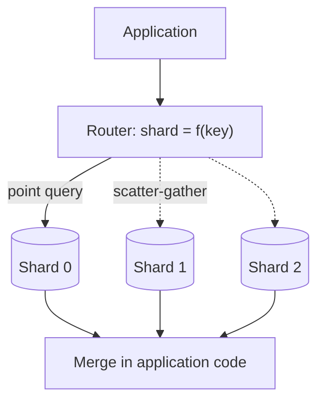

# বড় পরিসরে Sharding ও Transaction {#ch-sharding}

> Data কয়েকটি machine-এ ভাগ করুন, এমন shard key বাছুন যার জন্য পরে পস্তাতে হবে না, আর একটি transaction যখন সব write আর ঢাকতে পারে না, তখনও write-গুলো ঠিক রাখুন।

**এই অধ্যায়ে:** তিনটি strategy · consistent hashing · shard key বাছাই · hot shard আর hot row · এক shard-এর ভেতরে transaction · saga, outbox আর idempotency

## 💡 মূল ধারণা

Sharding একটা database-কে কয়েকটিতে ভাগ করে। প্রতিটি shard data-র একটা অংশ রাখে, আর কোনোটাতেই এত data থাকে
না যে সেটা bottleneck হয়ে যায়। Write scale করার উপায় এই একটিই, আর এ কারণেই sharding-এর অস্তিত্ব। তবে এটা
হাতে নেওয়ার কথা সবার শেষে।

দাম হলো, প্রতিটি query-র চেহারা বদলে যায়। কোন shard-কে জিজ্ঞেস করতে হবে, সেটা system-কে আগে জানতে হয়।
যে প্রশ্ন কয়েকটি shard জুড়ে ছড়ানো, সেটা application code-এ fan-out আর merge হয়ে দাঁড়ায়।

Transaction-এর চেহারাও বদলায়। এক database-এ কয়েকটি write একসঙ্গে commit হয় বিনা খরচে। কিন্তু data ভাগ হয়ে
গেলে সেটা চলে শুধু এক shard-এর ভেতরে। Senior উত্তর হলো, distributed transaction যাতে লাগেই না, সেভাবে
সাজানো: সম্পর্কিত data একসঙ্গে রাখুন, আর বাকিটার জন্য saga, outbox আর idempotency ব্যবহার করুন।

> ⚠️ Caching, read replica আর connection pooling শেষ হওয়ার পরেই কেবল shard করুন। ওগুলো read সামলায়, আর
> বেশিরভাগ system-এ আগে read-এরই টান পড়ে। Sharding সমাধান করে write throughput আর data-র পরিমাণের সমস্যা, আর
> একবার করলে ফেরানো খুব খরচের।

## কীভাবে কাজ করে

Application আর shard-গুলোর মাঝখানে একটা router বসে থাকে। Router shard key থেকে shard হিসাব করে, তারপর query
পাঠায় একটি machine-এ। Query-তে shard key না থাকলে সবগুলোকেই জিজ্ঞেস করতে হয়।



**Query-তে shard key থাকলে একটি shard, না থাকলে সবগুলো।**

### তিনটি strategy

| | Range | Hash | Directory |
| --- | --- | --- | --- |
| **Shard ঠিক হয়** | Key কোন interval-এ পড়ে তা দেখে | Key-র hash দিয়ে | একটা lookup table থেকে |
| **Range query** | এক shard-এই থাকে | সব shard-এ যায় | Data কোথায় রাখা, তার ওপর নির্ভর করে |
| **বণ্টন** | অসমান; নতুন data এক জায়গায় জমে | সমান | আপনি যেমন ঠিক করেন |
| **কখন বেছে নেবেন** | Time-series data, যা তারিখ ধরে query হয় | High-cardinality key-তে point lookup | প্রতিটি entity কোথায় থাকবে, তা নিজে ঠিক করতে হলে |

**Hash-ভিত্তিক routing, user data-র জন্য default:**

```typescript
import { createHash } from "node:crypto";

// The same user always lands on the same shard — that is the whole contract.
function shardIndex(key: string, shardCount: number): number {
  return parseInt(createHash("md5").update(key).digest("hex").slice(0, 8), 16) % shardCount;
}
```

ওই modulo-টাই আবার দুর্বলতা। `hash % 4` আর `hash % 5` প্রায় কোনো key-তেই একমত হয় না। একটা shard যোগ করলেই
প্রায় সব data সরাতে হয়।

### Consistent hashing

Consistent hashing modulo-টা বাদ দেয়। Key আর shard দুটিই একটা ring-এর ওপর বসে, আর key-টা যায় তার থেকে
ঘড়ির কাঁটার দিকে প্রথম যে shard পড়ে, তার কাছে। নতুন shard key নেয় শুধু পাশের shard থেকে, তাই data-র মোটামুটি `1/N`
অংশ সরে। প্রতিটি shard আবার ring-এর অনেকগুলো বিন্দুতে বসে। এই **virtual node**-গুলোর কারণে ভাগগুলো সমান থাকে।

### Shard key বাছাই

পরের সবকিছু ঠিক হয় shard key দিয়ে, আর এই সিদ্ধান্তটাই ফেরানো সবচেয়ে কঠিন।

| বৈশিষ্ট্য | কেন জরুরি |
| --- | --- |
| **High cardinality** | আলাদা value কম থাকলে shard-ও কম হতে পারে, আর load সেগুলোর ওপরেই জমে |
| **সাধারণ query-র সঙ্গে মেলে** | তাহলে চেনা query সব shard-এ না গিয়ে একটিতেই যায় |
| **Atomic write-গুলো একসঙ্গে রাখে** | যে write-গুলো একসঙ্গে commit হতে হবে, সেগুলো একই shard-এ থাকলেই কেবল তা সম্ভব |
| **বদলায় না, আর সময়ের ক্রমে বাড়ে না** | Key বদলালে row সরে যায়; ক্রমিক key হলে প্রতিটি নতুন write একটি shard-এই যায় |

User data-র জন্য `user_id` hash করুন। Message-এর key দিন `conversation_id`, তাহলে একটা conversation মানে একটা
query। Order-এর key দিন `tenant_id`, তাহলে একটা account-এর order আর তার line item এক local transaction-এ
commit হয়।

### Hot shard আর hot row

Key সমানভাবে ছড়ায়, কিন্তু request ছড়ায় না। একজন celebrity-র account-এর সব কাজ গিয়ে পড়ে একটি shard-এ। Read-বেশি
hot key হলে cache করুন, বা কয়েকটি bucket-এ ভাগ করুন। Write-বেশি হলে তাকে আলাদা একটা shard দিন।

Hot **row** আরও খারাপ: একটা global counter, শেষ seat, একটা product-এর stock। কোনো isolation level এটা ঠিক করতে
পারে না, কারণ প্রতিটি writer একই lock-এর জন্য লাইনে দাঁড়ায়। Counter-কে N-টি row-তে ভাগ করুন, আর পড়ার সময়
যোগ করে নিন। নয়তো **reserve-then-confirm** ব্যবহার করুন: seat দশ মিনিটের জন্য ধরে রাখুন, payment নিন
transaction-এর বাইরে, আর confirm না হওয়া hold একটা expiry job ছেড়ে দিক।

### Cross-shard query আর re-sharding

Shard key ছাড়া query মানে **scatter-gather**। এর গতি সবচেয়ে ধীর shard-এর সমান, আর shard যত বাড়ে, tail
latency তত খারাপ হয়। এড়ানোর উপায়: key-টা প্রধান access pattern-এর সঙ্গে মেলান, denormalise করুন, আর
reporting-এর মতো global প্রশ্ন warehouse-এ পাঠান।

**ভরা shard ভাগ করা — সস্তা কোনো উপায় নেই, আছে শুধু সাবধানী উপায়:**

```text
1. Stand up the new shard, empty.
2. Double-write: every write goes to both old and new placement.
3. Backfill the historical rows, verifying as you go.
4. Shift reads across gradually, and keep the old copy readable.
5. Stop double-writing, then delete the old data — last, and only once reads are clean.
```

### এক shard-এর ভেতরে transaction

Shard-এর ভেতরে সাধারণ transaction এখনো চলে। **Read committed** সঠিক default, আর PostgreSQL-এরও default এটাই।
এর ফাঁক হলো **lost update**। দুটি request একটা value পড়ে, বদলায়, তারপর লিখে দেয়: দুটিই 100 পড়ে, দুটিই 50
লেখে, আর একটা বদল হারিয়ে যায়। Balance আর stock-এর বেলায় এটা গুরুতর।

**হিসাবটা database-কেই করতে দিন, একটা conditional statement-এ:**

```sql
UPDATE inventory SET quantity = quantity - 1
WHERE sku = 'A1' AND quantity > 0; -- zero rows affected means sold out
```

মাঝখানে logic চালাতে হলে lock নিন। **Optimistic** locking একটা version column যোগ করে, আর conflict হলে আবার চেষ্টা
করে। Conflict কম হলে এটা মানায়। **Pessimistic** locking ব্যবহার করে `SELECT ... FOR UPDATE`, আর conflict ঘন ঘন হলে এটা
মানায়। Serializable সব anomaly আটকায়, কিন্তু contention-কে error বানিয়ে দেয়, যা code-কে retry করতে হয়।

> ⚠️ Network call চলার সময় কখনো database lock ধরে রাখবেন না। Payment provider-এর জন্য অপেক্ষা করার সময় যে row
> lock করা থাকে, সেটা lock থাকে provider-এর p99 পর্যন্ত।

### Write যখন কয়েকটি shard বা service জুড়ে

| প্রয়োজন | উত্তর |
| --- | --- |
| এক shard-এ দুটি write | সাধারণ transaction — key এমনভাবে বাছুন যাতে দুটি একই জায়গায় পড়ে |
| দুটি shard-এ দুটি write | কিছু store এটা পারে, latency-র দাম দিয়ে; বেশিরভাগই পারে না |
| দুটি service-এ দুটি write | **Saga**: local transaction-এর একটা শিকল, প্রতিটির সঙ্গে একটা compensation |
| Write-এর সঙ্গে একটা message পাঠানো | **Outbox**: event-টা একই local transaction-এ লিখুন |

**Two-phase commit** network জুড়ে lock ধরে রাখে, আর coordinator মারা গেলে সবাইকে আটকে দেয়। **Saga** এর বদলে
প্রতিটি ধাপ local-ভাবে commit করে। তিন নম্বর ধাপ fail করলে দুই আর এক নম্বর ধাপের compensation চলে, যেমন refund।
Row লেখা আর message publish করার মাঝখানে crash হলে দুটির একটা হারিয়ে যায়। **Outbox** এটা ঠিক করে: event-টা
একই transaction-এ একটা table-এ লিখুন, আর একটা relay সেটা publish করুক।

**Outbox আর idempotent consumer একসঙ্গে:**

```typescript
// Same transaction: either the order and its event both exist, or neither does.
async function placeOrder(db: Db, order: Order): Promise<void> {
  await db.transaction(async (tx: Tx) => {
    await tx.insert("orders", order);
    await tx.insert("outbox", { id: order.id, type: "order.placed", payload: order });
  });
}

// The relay retries, so delivery is at-least-once. The consumer makes it effectively-once.
async function onOrderPlaced(db: Db, event: OutboxEvent): Promise<void> {
  await db.transaction(async (tx: Tx) => {
    const fresh: boolean = await tx.insertIfAbsent("processed_events", { id: event.id });
    if (!fresh) return; // already handled — a duplicate delivery
    await tx.update("inventory", { sku: event.payload.sku, delta: -1 });
  });
}
```

এই সবকিছু নিরাপদ হয় **idempotency**-র জোরে। Retry-নির্ভর প্রতিটি pattern কখনো না কখনো একটা operation দুবার
চালাবে। প্রতিটি event-এর একটা unique id রাখুন, আর effect-এর সঙ্গে একই transaction-এ সেটা যাচাই করুন। তাহলে
দ্বিতীয়বার চললে কিছুই হয় না।

## কখন ব্যবহার করবেন

| পরিস্থিতি | যা বেছে নেবেন |
| --- | --- |
| Bottleneck হলো read | Replica আর caching — sharding নয় |
| Data বা write throughput এক primary-র সাধ্যের বাইরে | Shard করুন, প্রথম দিন থেকেই consistent hashing দিয়ে |
| প্রচণ্ড contention-এ stock বা seat | Conditional update, নয়তো reserve-then-confirm |
| কয়েকটি service জুড়ে workflow | Compensation-সহ saga, two-phase commit কখনোই নয় |
| এমন write, যাকে একটা event-ও পাঠাতে হবে | Outbox, সঙ্গে idempotent consumer |

## সাধারণ ভুল

❌ **"তৈরি থাকার জন্য" আগেভাগে sharding।** সেদিন থেকে প্রতিটি query, migration আর incident কঠিন হয়ে যায়।
✅ আগে vertical scaling, replica আর caching শেষ করুন। তারপর মেপে দেখা একটা সীমার বিরুদ্ধে shard করুন।

❌ **সাধারণ modulo hashing।** প্রথম যেদিন shard যোগ করবেন, সেদিনই এটা ভেঙে পড়ে, আর ঠিক তখনই এটা সবচেয়ে বেশি
দরকার। ✅ শুরু থেকেই virtual node-সহ consistent hashing।

❌ **ধরে নেওয়া যে transaction আগের মতোই চলে।** দুটি shard জুড়ে write আর atomic থাকে না। ✅ Key এমনভাবে বাছুন
যাতে atomic যা কিছু, তা এক shard-এই থাকে। বাকিটার জন্য saga।

❌ **আগে write, তারপর publish।** দুটির মাঝখানে crash হলে event হারায়, নয়তো ভূতুড়ে একটা event চলে যায়। ✅ একই
transaction-এ outbox-এ লিখুন।

## 🔑 মূল শিক্ষা

- Write scale করার উপায় শুধু sharding, আর এটাই একমাত্র উপায় যার দাম চিরস্থায়ী।
- Query-র খরচ আর transaction-এর পরিধি ঠিক হয় shard key দিয়ে। তাই key বাছুন প্রধান query আর atomic write-এর তালিকা দেখে।
- Virtual node-সহ consistent hashing-এ shard যোগ করলে key-র মোটামুটি `1/N` অংশ সরে। সাধারণ modulo-তে সরে প্রায় সবগুলো।
- Read committed-এও lost update হয়। তাই counter আর stock-এর জন্য লাগে conditional update বা স্পষ্ট locking।
- Shard আর service জুড়ে বিনা খরচের transaction নেই। আছে শুধু saga, outbox আর idempotent consumer।

## Interview-এর প্রশ্ন

**Q: কখন shard করবেন, আর তার বদলে কী করবেন?**

Write বা data-র পরিমাণ যখন এক machine-এর সাধ্য ছাড়িয়ে যায়, তখন, তার আগে নয়। Read সামলায় caching আর replica,
যা অনেক সস্তা। তাই read-এর bottleneck sharding-এর পক্ষে কোনো যুক্তি নয়। Shard করার আগে instance বড় করুন,
replica যোগ করুন, connection pool করুন, আর খরচের view-গুলো একটা read model-এ সরিয়ে নিন।

**Q: ভালো shard key কেমন হয়?**

High cardinality, যাতে load ছড়িয়ে পড়ে। সাধারণ query-তে থাকে, যাতে বেশিরভাগ read একটি shard-এ যায়। যে
write-গুলো একসঙ্গে commit হতে হবে, সেগুলোর মধ্যে একই, যাতে সেগুলো এক local transaction-এ থাকে। বদলায় না আর
সময়ের ক্রমে বাড়ে না, যাতে row কখনো সরে না, আর write-গুলো সবচেয়ে নতুন shard-এ গিয়ে জমে না।

**Q: দুজন user একই সময়ে শেষ item-টা কিনছেন। Oversell কীভাবে ঠেকাবেন?**

Decrement-টা এক statement-এ conditional আর atomic করুন। কোনো row affected না হলে ধরুন stock শেষ। Payment শেষ
হওয়া পর্যন্ত stock ধরে রাখতে হলে expiry-সহ reserve-then-confirm-এ যান। Payment call চলার সময় database lock
ধরে রাখা চলে না।

**Q: Order service আর payment service দুটিকেই সফল হতে হবে। Two-phase commit ব্যবহার করবেন?**

না। Two-phase commit network জুড়ে lock ধরে রাখে, আর coordinator fail করলে সবাইকে আটকে দেয়। Saga ব্যবহার
করুন: প্রতিটি service local-ভাবে commit করে, আর কোথাও fail হলে refund-এর মতো compensation চলে। প্রতিটি ধাপ
outbox দিয়ে publish করুন, আর প্রতিটি consumer idempotent রাখুন, কারণ retry হলে message দুবার পৌঁছাবেই।

## এরপর কী পড়বেন

- [Chapter ?? — Datastore বাছাই ও তার Replication](#ch-choosing-a-datastore) — replica, read-এর দিকের সমাধান, যা আগে চেষ্টা করবেন
- [Chapter ?? — Service Boundary ও API Gateway](#ch-service-boundaries) — saga আর outbox, যে প্রেক্ষাপটে এদের দরকার
- [Chapter ?? — Reliability, Consistency ও CAP](#ch-consistency-and-cap) — consistency-র অন্য অর্থটা, যেটা নিয়ে CAP
