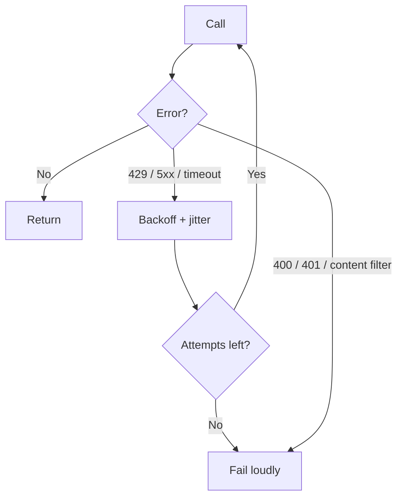

# TypeScript থেকে LLM Call করা {#ch-calling-an-llm-from-typescript}

> এমন একটি model call করুন, যা একটি ধীর, দামি, মাঝে মাঝে ভুল third-party service-এ অন্য যেকোনো call-এর মতোই আচরণ করে।

**এই অধ্যায়ে:** HTTP dependency হিসেবে call · provider SDK বনাম unified SDK · timeout আর retry · যে error-গুলো গুরুত্বপূর্ণ · key কোথায় থাকে

## 💡 মূল ধারণা

একটি model call হলো একটি ধীর service-এ HTTP request। এটা **আপনার database-এর চেয়ে দশ থেকে একশো গুণ ধীর, দুই দিকেই
token হিসেবে দাম ধরা হয়, আর HTTP 200 ফেরত দিতে দিতেই fail করতে পারে।** এর বাইরে এতে অস্বাভাবিক কিছু নেই।
Payment gateway বা search API-এর বেলায় আপনি যত অভ্যাস মেনে চলেন, সবই এখানে খাটে। যে team-গুলো ধাক্কা খায়, তারা
call-টাকে network dependency না ভেবে library function ভাবে।

একটি failure নতুন, তাই সেটা নিজের একটি paragraph পায়। Request সফল হতে পারে, status `200` হতে পারে, body ঠিকঠাক
গঠিত হতে পারে, আর তবুও content ভুল হতে পারে। HTTP বলে দেয় transport কাজ করেছে। উত্তর নিয়ে সে কিছুই বলে না।

> Response-টাকে একটি ধীর remote service থেকে আসা untrusted input হিসেবে দেখুন। এই একটি দৃষ্টিভঙ্গিই বেশিরভাগ
> engineering ঠিক করে দেয়।

## কীভাবে কাজ করে

### একটি call-এর shape

তিনটি জিনিস যায়: instruction, message আর setting। তিনটি ফেরত আসে: content, থামার কারণ আর usage।

```typescript
import { generateText } from 'ai';

const result = await generateText({
  model: 'anthropic/claude-sonnet-4.6',
  instructions: 'Answer only from the provided documentation. Say when you cannot.',
  messages: [{ role: 'user', content: question }],
  maxOutputTokens: 800,           // a cost ceiling, not a style hint
  abortSignal: AbortSignal.timeout(20_000),
});

result.text;         // the content
result.finishReason; // 'stop' | 'length' | 'tool-calls' | 'content-filter' | 'error'
result.usage;        // inputTokens, outputTokens — the bill
```

**`finishReason` হলো সেই field, যা বেশিরভাগ codebase কখনো পড়ে না।** অথচ এটাই বলে দেয় উত্তরটা কেটে গেছে। একটি
`length` finish মানে model বাক্যের মাঝপথে তার output-এর বরাদ্দ শেষ করে ফেলেছে। সেটাকে পূর্ণ উত্তর হিসেবে দেখানো এমন
একটি bug, যা কখনো throw করে না।

> ⚠️ **যা বদলাতে থাকে:** এই বই **AI SDK 7**-এর ভিত্তিতে লেখা, যেখানে system prompt হলো
> `instructions` property, আর `messages`-এর ভেতরে একটি `system` message default-ভাবে reject হয়। টেকসই
> নীতি হলো, instruction আর conversation দুটি আলাদা input, যাদের caching-এর আচরণ আলাদা। Call লেখার আগে বর্তমান
> shape দেখে নিন।

### Provider SDK নাকি unified SDK

| পদ্ধতি | আপনি পান | আপনি দেন |
| --- | --- | --- |
| **Provider SDK** (`@anthropic-ai/sdk`, `openai`) | প্রতিটি feature যেদিন আসে সেদিনই, provider-এর হুবহু semantics | দ্বিতীয় provider যোগ করতে পুরো rewrite |
| **Unified SDK** (AI SDK, LangChain) | সব provider-এ একই call shape, একই streaming format | নতুন feature পেতে দেরি; যেখানে provider-রা সত্যিই আলাদা, সেখানে ফাঁক বেরিয়ে পড়ে |
| **নিজের wrapper** | ঠিক আপনার যা দরকার | এখন আপনি নিজেই একটি unified SDK maintain করছেন |

Unified SDK দিয়ে শুরু করুন, যদি না প্রথম দিনেই একটি provider-এর সবচেয়ে নতুন feature আপনার দরকার হয়। Migration-এর
খরচ উল্টো দিকে চলে। পরে একটি unified call-এর জায়গায় provider call বসাতে এক বিকেল লাগে। পরে চল্লিশটি call site
জুড়ে একটি abstraction যোগ করতে তার চেয়ে অনেক বেশি লাগে। কোনো abstraction সবকিছু লুকায় না: tool-call shape,
streaming event আর caching এখনো provider-ভেদে আলাদা।

### Timeout, কারণ default-টা কোনো timeout-ই নয়

বেশিরভাগ HTTP client-এর default হলো কোনো timeout নেই, বা দুই মিনিট। User-এর সামনের model call-এর জন্য দুটোই ভুল।
একটি reasoning model সত্যিই নব্বই সেকেন্ড ভাবতে পারে, আর একজন user দশ সেকেন্ডও অপেক্ষা করবে না।

```typescript
async function ask(question: string, budgetMs: number): Promise<string> {
  const result = await generateText({
    model: 'anthropic/claude-sonnet-4.6',
    messages: [{ role: 'user', content: question }],
    abortSignal: AbortSignal.timeout(budgetMs),
  });
  if (result.finishReason === 'length') throw new TruncatedAnswer(result.text);
  return result.text;
}
```

Budget ঠিক করুন surface দেখে, model দেখে নয়। User-এর কাছে stream করা একটি chat box উদার budget পায়, কারণ প্রথম token
তাড়াতাড়ি আসে। Page render আটকে রাখা একটি synchronous API endpoint কড়া budget পায়।

### Retry, আর যে দুটি failure retry করা চলবে না



**কোন model error দ্বিতীয়বার চেষ্টার যোগ্য, আর কোনটা টাকার অপচয়।**

`429` আর `503` সাময়িক (নিজে থেকেই কেটে যায়)। Exponential backoff আর jitter দিয়ে এগুলো retry করুন। `400`
(ভুলভাবে গঠিত request, context অতিরিক্ত লম্বা) আর `401` নির্ধারিত — প্রতিবার একই ফল দেয়। এগুলো retry করলে শুধু সময়
পুড়িয়ে একই failure-এ পৌঁছানো হয়। Content filter একটি সিদ্ধান্ত, outage নয়। হুবহু একই কথায় retry করলে সাধারণত একই
প্রত্যাখ্যান ফেরত আসে।

প্রতিটি retry একটি পূর্ণ request। একটি বড় prompt-এ তিনটি retry মানে input-এর চার গুণ খরচ, আর input-ই সাধারণত দামি
অর্ধেক।

### যে error-গুলোর আলাদা নাম দেওয়া দরকার

| শ্রেণি | সাধারণ কারণ | ঠিক প্রতিক্রিয়া |
| --- | --- | --- |
| **Rate limit** (429) | হঠাৎ ভিড়, বা একটি shared org quota | Backoff, queue, বা load কমানো |
| **Context too long** (400) | Assembler বেশি ভরে ফেলেছে | পাঠানোর আগে ছাঁটুন — যেমন আছে তেমন কখনো retry নয় |
| **Overloaded** (529 / 503) | Provider-এর capacity | Backoff, তারপর fail over |
| **Content filter** | Input বা output একটি policy-তে আটকেছে | সৎভাবে দেখান; loop করবেন না |
| **Truncated** (`finishReason: 'length'`) | Output-এর বরাদ্দ খুব ছোট | সীমা বাড়ান, বা কম চান |

### Key কোথায় থাকে

API key একটি server-side secret, যার সঙ্গে প্রতি token-এর খরচ জুড়ে আছে। এটা কখনো browser-এ পৌঁছায় না। যে public
endpoint user-এর text সরাসরি provider-এর কাছে পাঠিয়ে দেয়, সেটা আপনার billing account-এ সবার জন্য খোলা একটি খাতা।
Route-টার দরকার যেকোনো দামি endpoint-এর মতো একই নিয়ন্ত্রণ: authentication, প্রতি user-এর rate limit আর input
size-এর একটি সীমা।

## কখন ব্যবহার করবেন

| পরিস্থিতি | Call shape | কেন |
| --- | --- | --- |
| উত্তর একজন মানুষকে দেখানো হয় | Streaming, উদার timeout | অনুভূত latency প্রায় শূন্যে নেমে আসে |
| Pipeline-এ classify বা extract | `generateText`, কড়া timeout, ছোট model | কেউ spinner-এর দিকে তাকিয়ে নেই |
| উত্তর অন্য code-এ যায় | Validation-সহ structured output | একটি string-কে parse করতে হয়, যাতে ভরসা করা যায় না |
| হাজার হাজার item-এর batch | Concurrency limit-সহ queue | Rate limit প্রতি মিনিটের হিসাবে, প্রতি request-এর নয় |

## সাধারণ ভুল

**❌ Browser থেকে provider-কে call করা**

> Key উন্মুক্ত হয়ে যায়, আর খরচের কোনো সীমা থাকে না। সবসময় নিজের server-এর মধ্য দিয়ে route করুন।

**❌ `finishReason` উপেক্ষা করা**

> Response body-তে একটি কাটা-পড়া উত্তর দেখতে হুবহু একটি পূর্ণ উত্তরের মতো। Field-টা check করুন, নইলে user-দের কাছে
> আধা-বাক্য পাঠাবেন।

**❌ প্রতিটি error একইভাবে retry করা**

> একটি context-length error তিনবার retry করলে একই failure-এ পৌঁছাতে চারবার পুরো input-এর দাম দিতে হয়। Loop লেখার
> আগে retry-যোগ্য আর নির্ধারিত error আলাদা করুন।

**✅ প্রতিটি call-কে একটি স্পষ্ট token সীমা আর একটি স্পষ্ট deadline দিন**

> `maxOutputTokens` bill-এর সীমা টানে। `abortSignal` অপেক্ষার সীমা টানে। কোনোটারই নিরাপদ default নেই, আর একটি
> বাদ পড়লে সেটা দেখা দেয় হঠাৎ খরচ বেড়ে যাওয়া বা ঝুলে থাকা request হিসেবে।

## 🔑 মূল শিক্ষা

- একটি model call একটি ধীর, দামি network dependency, যা HTTP 200 ফেরত দিতে দিতেই fail করতে পারে।
- সবসময় একটি output token সীমা আর একটি স্পষ্ট deadline দিন। কোনোটারই কাজে লাগার মতো default নেই।
- `finishReason` পড়ুন। এটা ছাড়া একটি কাটা-পড়া উত্তর দেখতে হুবহু পূর্ণ উত্তরের মতো।
- Rate limit আর overload error backoff দিয়ে retry করুন। ভুলভাবে গঠিত request বা content filter কখনো retry করবেন না।
- Unified SDK দিয়ে শুরু করুন। পরে অনেক call site জুড়ে একটি abstraction যোগ করা, একটিকে বদলানোর চেয়ে অনেক বেশি দামি।

## Interview-এর প্রশ্ন

**Q: একটি সাদামাটা `await callModel(prompt)` ship করার আগে প্রথমে কী যোগ করবেন?**

একটি deadline আর একটি output সীমা। বেশিরভাগ HTTP client-এর default timeout যেকোনো user-এর অপেক্ষার চেয়ে লম্বা।
`maxOutputTokens` ছাড়া একটি request ততক্ষণ generate করতে পারে, যতক্ষণ না model নিজে থামার সিদ্ধান্ত নেয়। মানে প্রতি
request-এ সীমাহীন খরচ। এই দুটির পরে error-এর শ্রেণিবিভাগ: কোন failure retry হবে আর কোনটা হবে না।

**Q: Provider 200 ফেরত দিয়েছে, আর user একটি অসমাপ্ত বাক্য দেখছেন। কী হয়েছে?**

Output-এর বরাদ্দ শেষ হয়ে গেছে, আর `finishReason` এসেছে `length` হিসেবে। Transport সফল হয়েছে, তাই কিছুই throw
করেনি। সমাধান হলো finish reason পড়া, আর truncation-কে একটি সত্যিকারের error state হিসেবে দেখা। তারপর সীমা বাড়ান,
model-এর কাছে ছোট উত্তর চান, বা user-কে জানান যে response কেটে গেছে। চুপচাপ render করাটাই failure।

**Q: আপনি provider SDK ব্যবহার করবেন, নাকি unified SDK?**

Default হিসেবে unified SDK। এটা ছাড়া পরে দ্বিতীয় provider যোগ করা মানে প্রতিটি call site নতুন করে লেখা। আর খরচ বা
একটি outage বাধ্য করলে দ্বিতীয় provider আসবেই — প্রশ্নটা কখন, আসবে কি না তা নয়। Feature যদি এমন কিছুর ওপর নির্ভর
করে যা সেই provider এই quarter-এ ছেড়েছে, তাহলে আমি সরাসরি provider SDK ব্যবহার করব। Unified layer নকশাগতভাবেই নতুন
feature-এ পিছিয়ে থাকে।

**Q: একটি AI endpoint-এ rate limit একটি সাধারণ endpoint থেকে কীভাবে আলাদাভাবে করবেন?**

খরচ দিয়ে, request-এর সংখ্যা দিয়ে নয়। 100k-token context আর লম্বা উত্তরের একটি request এক হাজার সাধারণ request-এর
চেয়ে বেশি দামি হতে পারে। তাই প্রতি মিনিটে request-এর একটি সীমা খরচকে সীমিত করে না। Input size-এর সীমা দিন, output
token-এর সীমা দিন, আর request limit-এর পাশাপাশি প্রতি user-এর একটি token budget track করুন। আসলে bill রক্ষা করে এই
নিয়ন্ত্রণটাই।

**Q: API key কোথায় রাখবেন, আর সেই endpoint-এর আর কী দরকার?**

শুধু server-side-এ, কখনো browser বা client bundle-এ নয়। যে endpoint এটা ধরে রাখে, তার দরকার authentication, প্রতি
user-এর token budget, input size-এর সীমা আর একটি timeout। এগুলো ছাড়া যে কেউ এর মধ্য দিয়ে আপনার টাকা খরচ করতে পারে।
এটা একটি সাধারণ খোলা endpoint-এর চেয়ে আলাদা, আর আরও খারাপ সমস্যা।

## এরপর কী পড়বেন

- [Chapter ?? — Streaming Response](#ch-streaming-responses) — একই call, token ধরে ধরে পৌঁছে দেওয়া
- [Chapter ?? — Structured Output](#ch-structured-output) — যখন উত্তরকে এমন JSON হতে হবে, যাতে আপনার code ভরসা করতে পারে
- [Chapter ?? — Observability ও Cost Engineering](#ch-observability) — ওই usage-এর সংখ্যাগুলো মিলে কী দাঁড়ায়
