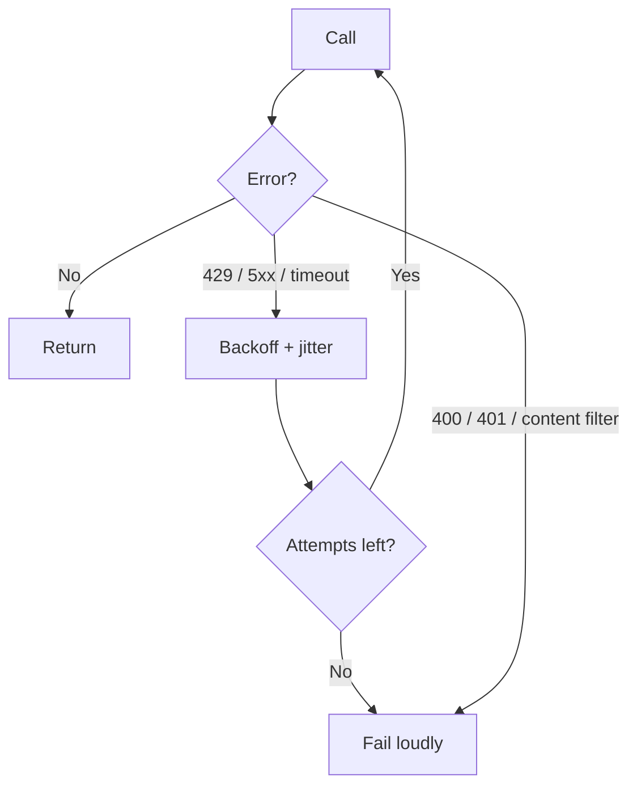

# TypeScript থেকে LLM Call করা {#ch-calling-an-llm-from-typescript}

> Model call এমনভাবে করুন, যাতে সেটা ধীর, দামি আর মাঝে মাঝে ভুল বলা যেকোনো third-party service-এর call-এর মতোই আচরণ করে।

**এই অধ্যায়ে:** HTTP dependency হিসেবে call · provider SDK বনাম unified SDK · timeout আর retry · যে error-গুলো জরুরি · key কোথায় থাকে

## 💡 মূল ধারণা

Model call হলো একটি ধীর service-এ HTTP request। এটা **আপনার database-এর চেয়ে দশ থেকে একশোগুণ ধীর, দাম ধরা হয় দুই
দিকেই token গুনে, আর HTTP 200 ফেরত দিয়েও fail করতে পারে।** এর বাইরে এতে অস্বাভাবিক কিছু নেই। Payment gateway বা search
API-র বেলায় যত অভ্যাস মানেন, এখানেও সবই খাটে। যে team-গুলো ঠকে, তারা call-টাকে network dependency না ভেবে library
function ভাবে।

একটি failure নতুন, তাই ওটার জন্য আলাদা paragraph। Request সফল হতে পারে, status `200` হতে পারে, body ঠিকঠাক গড়নের হতে
পারে, তবু content ভুল হতে পারে। HTTP শুধু বলে transport কাজ করেছে। উত্তর নিয়ে কিছুই বলে না।

> Response-কে একটি ধীর remote service থেকে আসা অবিশ্বস্ত input হিসেবে দেখুন। শুধু এই একটি দৃষ্টিভঙ্গিতেই engineering-এর
> বেশিরভাগটা ঠিক হয়ে যায়।

## কীভাবে কাজ করে

### একটি call-এর গড়ন

তিনটি জিনিস যায়: instruction, message আর setting। তিনটি ফেরত আসে: content, থামার কারণ আর usage।

```typescript
import { generateText } from 'ai';

const result = await generateText({
  model: 'anthropic/claude-sonnet-4.6',
  instructions: 'Answer only from the provided documentation. Say when you cannot.',
  messages: [{ role: 'user', content: question }],
  maxOutputTokens: 800,           // a cost ceiling, not a style hint
  abortSignal: AbortSignal.timeout(20_000),
});

result.text;         // the content
result.finishReason; // 'stop' | 'length' | 'tool-calls' | 'content-filter' | 'error'
result.usage;        // inputTokens, outputTokens — the bill
```

**বেশিরভাগ codebase যে field কখনো পড়েই না, সেটা `finishReason`।** অথচ উত্তর কাটা পড়েছে কি না, বলে এটাই। `length`
finish মানে বাক্যের মাঝখানে model-এর output-এর বরাদ্দ ফুরিয়ে গেছে। সেটাকে সম্পূর্ণ উত্তর হিসেবে দেখানো এমন একটি bug,
যা কখনো throw করে না।

> ⚠️ **যা বদলাতে থাকে:** এই বই লেখা হয়েছে **AI SDK 7** ধরে। সেখানে system prompt হলো `instructions` property, আর
> `messages`-এর ভেতরের `system` message default-এ বাতিল হয়। টেকসই নীতি হলো, instruction আর conversation দুটি আলাদা
> input, আর cache-এ দুটির আচরণও আলাদা। Call লেখার আগে এখনকার গড়নটা মিলিয়ে নিন।

### Provider SDK নাকি unified SDK

| পদ্ধতি | কী পান | কী দিতে হয় |
| --- | --- | --- |
| **Provider SDK** (`@anthropic-ai/sdk`, `openai`) | প্রতিটি feature ship হওয়ার দিনই, provider-এর হুবহু আচরণ | দ্বিতীয় provider যোগ করতে পুরো rewrite |
| **Unified SDK** (AI SDK, LangChain) | সব provider-এ একই call-এর গড়ন, একই streaming format | নতুন feature আসতে দেরি; যেখানে provider-রা সত্যিই আলাদা, সেখানে ফাঁক বেরিয়ে পড়ে |
| **নিজের wrapper** | ঠিক আপনার যা দরকার | এখন একটি unified SDK আপনাকেই চালাতে হয় |

প্রথম দিনেই কোনো এক provider-এর সবচেয়ে নতুন feature না লাগলে unified SDK দিয়ে শুরু করুন। Migration-এর খরচ উল্টো দিকে
বেশি। পরে একটি unified call-এর জায়গায় provider call বসাতে এক বিকেল লাগে। কিন্তু পরে চল্লিশটি call site জুড়ে abstraction
বসাতে অনেক বেশি লাগে। কোনো abstraction সবকিছু ঢাকতে পারে না: tool call-এর গড়ন, streaming event আর caching এখনো provider
থেকে provider-এ আলাদা।

### Timeout, কারণ default-টা কোনো timeout নয়

বেশিরভাগ HTTP client-এর default হয় কোনো timeout-ই নেই, নয়তো দুই মিনিট। User-এর সামনের model call-এর জন্য দুটিই ভুল।
একটি reasoning model সত্যিই নব্বই সেকেন্ড ভাবতে পারে, আর user দশ সেকেন্ডও অপেক্ষা করবেন না।

```typescript
async function ask(question: string, budgetMs: number): Promise<string> {
  const result = await generateText({
    model: 'anthropic/claude-sonnet-4.6',
    messages: [{ role: 'user', content: question }],
    abortSignal: AbortSignal.timeout(budgetMs),
  });
  if (result.finishReason === 'length') throw new TruncatedAnswer(result.text);
  return result.text;
}
```

Budget ঠিক করুন surface দেখে, model দেখে নয়। User-এর কাছে stream করা chat box উদার budget পায়, কারণ প্রথম token তাড়াতাড়ি
আসে। যে synchronous API endpoint একটি page render আটকে রাখে, সেটা পায় কড়া budget।

### Retry, আর যে দুটি failure কখনো retry করা চলবে না



**কোন model error দ্বিতীয়বার চেষ্টার যোগ্য, আর কোনটায় শুধু টাকা নষ্ট।**

`429` আর `503` ক্ষণস্থায়ী, মানে নিজে থেকেই কেটে যায়। Exponential backoff আর jitter দিয়ে এগুলো retry করুন। `400` (ভুল
গড়নের request, context খুব লম্বা) আর `401` deterministic। এগুলো retry করলে সময় পুড়িয়ে একই failure-এ পৌঁছান। Content
filter একটি সিদ্ধান্ত, outage নয়। হুবহু একই কথায় আবার চেষ্টা করলে সাধারণত একই refusal ফেরত আসে।

প্রতিটি retry একটি পুরো request। বড় prompt-এ তিনবার retry মানে চারগুণ input-এর খরচ, আর সাধারণত দামি অর্ধেকটা input-ই।

### যে error-গুলোর আলাদা নাম দেওয়া দরকার

| ধরন | সাধারণ কারণ | সঠিক প্রতিক্রিয়া |
| --- | --- | --- |
| **Rate limit** (429) | হঠাৎ চাপ, বা পুরো org-এর ভাগাভাগির quota | Backoff, queue, বা load ছেঁটে ফেলা |
| **Context খুব লম্বা** (400) | Assembler বেশি ভরে ফেলেছে | পাঠানোর আগে ছাঁটুন, হুবহু retry কখনো নয় |
| **Overloaded** (529 / 503) | Provider-এর ক্ষমতা ফুরিয়েছে | Backoff, তারপর fail over |
| **Content filter** | Input বা output কোনো policy-তে আটকেছে | সৎভাবে দেখান, loop করবেন না |
| **কাটা পড়া** (`finishReason: 'length'`) | Output-এর বরাদ্দ খুব কম | সীমা বাড়ান, বা কম চান |

### Key কোথায় থাকে

API key হলো server-side secret, যার সঙ্গে প্রতি token-এর খরচ জোড়া। এটা কখনো browser-এ পৌঁছায় না। যে public endpoint
user-এর text সরাসরি provider-এর কাছে পাঠায়, সেটা আপনার billing account-এ খোলা খাতা। এই route-এরও সেই একই নিয়ন্ত্রণ
লাগে, যা যেকোনো দামি endpoint-এর লাগে: authentication, প্রতি user-এর rate limit, আর input-এর মাপে সীমা।

## কখন ব্যবহার করবেন

| পরিস্থিতি | Call-এর গড়ন | কেন |
| --- | --- | --- |
| উত্তর একজন মানুষকে দেখানো হয় | Streaming, উদার timeout | যতটা ধীর মনে হয়, সেটা অনেক কমে যায় |
| Pipeline-এ classify বা extract করা | `generateText`, কড়া timeout, ছোট model | কেউ spinner-এর দিকে তাকিয়ে নেই |
| উত্তর অন্য code-এ যায় | Validation সহ structured output | String হলে parse করতে হয়, আর সেই parse-এ ভরসা করা যায় না |
| হাজার হাজার request-এর batch | Concurrency limit সহ queue | Rate limit request প্রতি নয়, মিনিট প্রতি |

## সাধারণ ভুল

**❌ Browser থেকে provider-কে call করা**

> Key বেরিয়ে পড়ে, আর খরচের কোনো সীমা থাকে না। সবসময় নিজের server-এর মধ্য দিয়ে route করুন।

**❌ `finishReason` উপেক্ষা করা**

> Response body-তে কাটা পড়া উত্তর দেখতে হুবহু সম্পূর্ণ উত্তরের মতো। Field-টা check করুন, নইলে user-দের কাছে আধখানা বাক্য
> ship করবেন।

**❌ সব error একইভাবে retry করা**

> Context-length error তিনবার retry করলে চারবার পুরো input-এর দাম দিয়ে একই failure-এ পৌঁছান। Loop লেখার আগে retry করা
> যায় এমন error আর deterministic error আলাদা করুন।

**✅ প্রতিটি call-কে স্পষ্ট token-এর সীমা আর স্পষ্ট deadline দিন**

> `maxOutputTokens` বিলের সীমা টানে। `abortSignal` অপেক্ষার সীমা টানে। কোনোটারই নিরাপদ default নেই, আর একটি না থাকলে
> সেটা ধরা পড়ে হঠাৎ খরচ লাফিয়ে ওঠায়, বা আটকে থাকা request-এ।

## 🔑 মূল শিক্ষা

- Model call একটি ধীর, দামি network dependency, যা HTTP 200 ফেরত দিয়েও fail করতে পারে।
- সবসময় output token-এর সীমা আর স্পষ্ট deadline দিন। কোনোটারই কাজের মতো default নেই।
- `finishReason` পড়ুন। নইলে কাটা পড়া উত্তর দেখতে হুবহু সম্পূর্ণ উত্তরের মতো।
- Rate limit আর overload error backoff দিয়ে retry করুন। ভুল গড়নের request বা content filter কখনো retry করবেন না।
- Unified SDK দিয়ে শুরু করুন। পরে অনেক call site জুড়ে abstraction বসানোর খরচ একটি বদলানোর চেয়ে অনেক বেশি।

## Interview-এর প্রশ্ন

**Q: সাদামাটা একটি `await callModel(prompt)` ship করার আগে প্রথমে কী যোগ করবেন?**

একটি deadline আর output-এর সীমা। বেশিরভাগ HTTP client-এর default timeout যেকোনো user-এর ধৈর্যের চেয়ে লম্বা।
`maxOutputTokens` না থাকলে একটি request ততক্ষণ generate করতে পারে, যতক্ষণ না model নিজে থামে। মানে প্রতি request-এ
সীমাহীন খরচ। এ দুটির পরে error-এর শ্রেণিবিভাগ: কোন failure retry হবে, কোনটা হবে না।

**Q: Provider 200 ফেরত দিল, আর user দেখলেন একটি আধখানা বাক্য। কী হয়েছিল?**

Output-এর বরাদ্দ ফুরিয়ে গিয়েছিল, আর `finishReason` এসেছিল `length` হয়ে। Transport সফল, তাই কিছুই throw করেনি। সমাধান
হলো finish reason পড়া, আর কাটা পড়াকে সত্যিকারের error অবস্থা হিসেবে ধরা। তারপর হয় সীমা বাড়ান, নয় model-এর কাছে ছোট
উত্তর চান, নয়তো user-কে বলে দিন যে উত্তরটা কাটা পড়েছে। চুপচাপ ওটা render করাটাই failure।

**Q: Provider SDK ব্যবহার করবেন, নাকি unified SDK?**

Default হিসেবে unified SDK। ওটা না থাকলে পরে দ্বিতীয় provider যোগ করা মানে প্রতিটি call site নতুন করে লেখা। আর খরচ বা
একটি outage চাপ দিলে দ্বিতীয় provider আসবেই, প্রশ্ন শুধু কবে। Feature যদি এমন কিছুর ওপর নির্ভর করে, যা ওই provider এই
quarter-এ ship করেছে, তাহলে সরাসরি provider SDK ব্যবহার করব। Unified স্তর নকশাগতভাবেই নতুন feature-এ পিছিয়ে থাকে।

**Q: সাধারণ endpoint-এর তুলনায় AI endpoint-এ rate limit কীভাবে আলাদাভাবে করবেন?**

Request-এর সংখ্যা দিয়ে নয়, খরচ দিয়ে। 100k-token context আর লম্বা উত্তরসহ একটি request-এর খরচ হাজারটি সাধারণ request-এর
চেয়েও বেশি হতে পারে। তাই মিনিট প্রতি request-এর সীমা খরচ আটকায় না। Input-এর মাপে সীমা দিন, output token-এ সীমা দিন, আর
request limit-এর পাশাপাশি প্রতি user-এর token budget-এর হিসাব রাখুন। বিলকে আসলে রক্ষা করে এই নিয়ন্ত্রণটাই।

**Q: API key কোথায় রাখবেন, আর ওই endpoint-এর আর কী লাগে?**

শুধু server-side-এ। Browser-এ বা client bundle-এ কখনো নয়। যে endpoint key ধরে রাখে, তার লাগে authentication, প্রতি
user-এর token budget, input-এর মাপে সীমা আর একটি timeout। এগুলো না থাকলে যে কেউ ওটা দিয়ে আপনার টাকা খরচ করতে পারে। এটা
সাধারণ খোলা endpoint-এর চেয়ে আলাদা, আর আরও খারাপ সমস্যা।

## এরপর কী পড়বেন

- [Chapter ?? — Streaming Response](#ch-streaming-responses) — একই call, token ধরে ধরে পৌঁছে দেওয়া
- [Chapter ?? — Structured Output](#ch-structured-output) — যখন উত্তরকে এমন JSON হতে হয়, যাতে আপনার code ভরসা করতে পারে
- [Chapter ?? — Observability ও Cost Engineering](#ch-observability) — ওই usage-এর সংখ্যাগুলো যোগ হয়ে কী দাঁড়ায়
