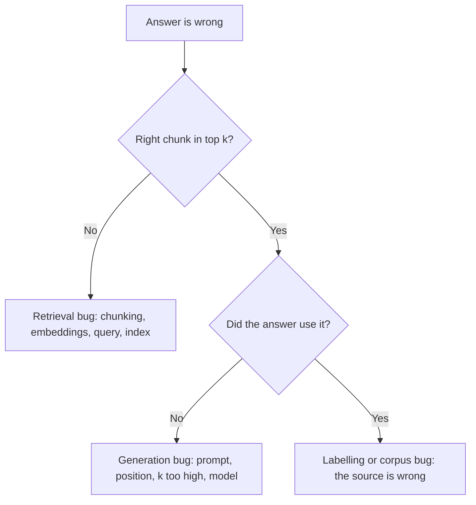

# Eval, Retrieval Metric ও Error Analysis {#ch-evals}

> "ভালো লাগছে"-র জায়গায় একটি golden set-এ pass rate বসান, system-এর কোন অর্ধেক ব্যর্থ হলো তা খুঁজে বের করুন, আর একটি prompt-এর পরিবর্তনকে ঠিক সেভাবে build fail করান, যেভাবে একটি code-এর পরিবর্তন করে।

**এই অধ্যায়ে:** golden set · recall@k আর retrieval-বনাম-generation ভাগ · grader আর LLM-as-judge · error-analysis loop · CI-তে eval

## 💡 মূল ধারণা

এই বইয়ের বেশিরভাগ code নিয়ে যুক্তি দিয়ে ভেবেই সেটাকে ভালো করা যায়। একটি AI feature-কে যায় না। Output
non-deterministic, failure diff-এ দেখা যায় না, আর **একটি prompt-এর পরিবর্তন একটি case ঠিক করতে গিয়ে প্রায়ই এমন
চারটি ভেঙে ফেলে, যেগুলোর দিকে আপনি তাকাচ্ছিলেন না।**

Eval হলো সেই হারিয়ে যাওয়া feedback loop: input-এর একটি নির্দিষ্ট set, ভালো output-এর একটি সংজ্ঞা, আর একটি score।
এটা একটি test suite, শুধু একটি পার্থক্যসহ। Assertion equality হতে পারে না, কারণ সঠিক output একটি string নয়, বরং
গ্রহণযোগ্য উত্তরের একটি পরিসর।

Documentation assistant-এর দুটো অর্ধেক। Retrieval passage-গুলো window-এ রাখে, অর্থাৎ যে text model পড়ে।
Generation সেগুলো থেকে উত্তর লেখে। দুটোই একই অভিযোগ নিয়ে ব্যর্থ হয়: "উত্তরটা ভুল ছিল"। কিন্তু দুটোর সমাধান আলাদা,
তাই একটি eval suite প্রতিটি অর্ধেক আলাদা করে মাপে। তারপর error analysis failure-গুলোকে কাজের একটি ক্রমানুসারে
সাজানো তালিকায় পরিণত করে।

Senior AI hiring-এ এটাই সবচেয়ে বেশি জিজ্ঞেস করা আর সবচেয়ে কম শেখানো skill। কারণটা সোজা: একটি eval suite বানানো
মানে labelling-এর কাজ, আর labelling-এর কাজ একঘেয়ে।

> একটি suite আর একটি সংখ্যা ছাড়া, একটি AI feature-এর ওপর কাজ হলো এলোমেলো হাঁটা, যেটাকে অগ্রগতি বলে মনে হয়।

## কীভাবে কাজ করে

### Golden set

| বৈশিষ্ট্য | লক্ষ্য | কেন |
| --- | --- | --- |
| Size | প্রথম signal-এর জন্য 30, পরিণত অবস্থায় 100–200 | 30-এর নিচে একটি case-ই সংখ্যাটা খুব বেশি নাড়িয়ে দেয় |
| উৎস | Log আর ticket থেকে আসল user query | Synthetic case আপনার অনুমানগুলোই উত্তরাধিকার সূত্রে পায় |
| Failure | প্রতিটি report হওয়া bug, একটি case হিসেবে যোগ করা | Suite incident থেকে বড় হয় |
| Edge case | 10–20% adversarial, অস্পষ্ট বা উত্তরহীন | নইলে system সবসময় উত্তর দিতে শেখে |
| Versioning | Repository-তে, code-এর সাথে | যে set সরে যায়, সেটা history-কে অর্থহীন করে দেয় |

শুরু করুন **আজ বিকেলে হাতে লেখা বিশটি case দিয়ে।** একটি ছোট suite যেটা চলে, সেটা এমন বড় suite-কে হারায় যেটার
এখনো পরিকল্পনা চলছে। প্রথম run সাধারণত এমন একটি failure খুঁজে পায়, যেটার কথা কেউ জানত না।

আপনার document থেকে একটি model যে প্রশ্ন generate করে, সেগুলো নিয়ে সাবধান থাকুন। এরা document-এর শব্দই আবার
ব্যবহার করে, তাই retrieval সহজেই এদের খুঁজে পায়, আর score system-কে তোষামোদ করে। আসল user নিজের ভাষায় প্রশ্ন
করে, আর ঠিক এই অমিলটাই retrieval-কে পার হতে হয়। Generate করা প্রশ্ন coverage-এর ফাঁক ভরাতে ব্যবহার করুন, কখনোই
set-এর মূল অংশ হিসেবে নয়।

প্রতিটি case সেই passage-গুলোর id বহন করে, যেগুলো retrieve হওয়া উচিত। Corpus পড়েছেন এমন একজন মানুষ সেগুলো
label করেন। ওই একটি field-ই একই set দিয়ে দুটো অর্ধেক মাপা সম্ভব করে।

**একটি golden case, যেটা retrieval আর উত্তর দুটোই কভার করে**

```typescript
interface EvalCase {
  readonly id: string;
  readonly input: string;
  readonly category: 'factual' | 'procedural' | 'comparison' | 'unanswerable';
  readonly relevantChunkIds: string[];  // labelled by a human who read the corpus
  readonly expect: {
    readonly mustContain?: string[];
    readonly mustNotContain?: string[];
    readonly mustCiteFrom?: string[];   // deterministic groundedness check
    readonly shouldRefuse?: boolean;    // true for the unanswerable cases
    readonly rubric?: string;           // only when nothing above will do
  };
}
```

### আগে retrieval মাপুন

সঠিক passage window-এ না থাকলে পরের কোনো কিছুই সেটা ফেরত আনতে পারে না। Generator যা কখনো দেখেনি, তা cite করতে
পারে না। তাই আগে retrieval মাপুন। এটা সস্তা: কোনো model call নেই, শুধু label করা id-এর সাথে একটি মিলিয়ে দেখা।

| Metric | যে প্রশ্নের উত্তর দেয় | কখন ব্যবহার করবেন |
| --- | --- | --- |
| **recall@k** | ওপরের *k*-টিতে আদৌ কোনো সঠিক passage ছিল কি? | প্রধান metric — এটাই মানের ঊর্ধ্বসীমা |
| **precision@k** | ওপরের *k*-টির কতটা প্রাসঙ্গিক ছিল? | যখন খরচ আর noise জরুরি |
| **MRR** | প্রথম সঠিক result কত ওপরে ছিল? | যখন একটিই সঠিক উত্তর আছে |
| **nDCG@k** | মাত্রাভিত্তিক প্রাসঙ্গিকতা, অবস্থান অনুযায়ী ওজন দেওয়া | যখন কয়েকটি passage আংশিক প্রাসঙ্গিক |

**recall@k দিয়ে শুরু করুন, আর বেশিরভাগ সময় সেখানেই থাকুন।** Recall ঠিকঠাক হলেই কেবল ranking metric-এর গুরুত্ব
আসে। যে result-গুলোতে উত্তরই নেই, সেগুলোর ক্রম বদলালে কিছুই বদলায় না।

**Golden set-এর ওপর recall@k**

```typescript
function recallAtK(cases: EvalCase[], retrieve: (q: string, k: number) => Promise<string[]>, k: number) {
  return Promise.all(cases.map(async (c) => {
    const ids = await retrieve(c.input, k);
    return c.relevantChunkIds.some((id) => ids.includes(id)) ? 1 : 0;
  })).then((hits) => hits.reduce<number>((a, b) => a + b, 0) / cases.length);
}
```

এটা *k*-এর দুটো value-তে report করুন। `recall@20` retriever-কে মাপে। `recall@5` retriever আর reranker দুটোকে মাপে।
দুটো সংখ্যা একটি অস্পষ্ট অভিযোগকে তিনটি workstream-এর একটিতে নামিয়ে আনে।

| recall@20 | recall@5 | রোগনির্ণয় | সমাধান |
| --- | --- | --- | --- |
| কম | কম | Passage খুঁজে পাওয়া যায় না | Chunking, তারপর embedding, তারপর query rewriting |
| বেশি | কম | পাওয়া যায়, কিন্তু rank খারাপ | Reranking যোগ বা tune করুন |
| বেশি | বেশি, তবু উত্তর ভুল | Generation, retrieval নয় | Prompt, অবস্থান, কম chunk, model |

একটি খারাপ উত্তরের ক্ষেত্রে, কোনো সমাধানের আগে একটি প্রশ্ন করুন।



**একটি প্রশ্নই কাজকে সঠিক অর্ধেকে পাঠিয়ে দেয়। C আর E-র মধ্যে কোনো সমাধান মিলে না।**

### উত্তর মাপুন

| Grader | যা যাচাই করে | খরচ | যে কাজে |
| --- | --- | --- | --- |
| **Deterministic** | Schema valid, একটি প্রয়োজনীয় id cite করে, latency budget-এর মধ্যে, যখন উচিত তখন refuse করেছে | বিনামূল্যে | যা কিছু এটা কভার করতে পারে |
| **Model-graded** | একটি rubric অনুযায়ী faithfulness, tone, সম্পূর্ণতা | প্রতি case-এ একটি model call | যে গুণের কোনো programmatic রূপ নেই |
| **Human** | আসল বিচার; বাকি দুটোকে calibrate করা | ব্যয়বহুল | মাঝে মাঝে, একটি sample |

**যা কিছু পারেন, প্রথম row-তে ঠেলে দিন।** মানের একটি বড় অংশ code দিয়ে যাচাই করা যায়। উত্তর কি retrieve করা কোনো
source cite করেছে? JSON কি valid? Injection-এর চেষ্টায় কি refuse করেছে? এই check-গুলো কয়েক millisecond-এ চলে, আর
কখনো নিজের সাথে দ্বিমত করে না।

একটি model আরেকটি model-এর output grade করছে — এটা কাজের, আবার অপব্যবহার করাও সহজ। চারটি শর্ত এটাকে সমর্থনযোগ্য
করে।

1. **Rubric নির্দিষ্ট।** "এটা কি ভালো?" noise তৈরি করে। "প্রতিটি তথ্যগত দাবি কি দেওয়া context-এ আছে? হ্যাঁ বা না
   উত্তর দিন, আর সমর্থনহীন দাবিটি উদ্ধৃত করুন।" একটি signal তৈরি করে।
2. **Judge-কে মানুষের সাথে মিলিয়ে দেখা হয়েছে।** হাতে 50টি case label করুন, judge চালান, আর মিল কতটা তা মাপুন।
   মোটামুটি 80%-এর নিচে হলে judge অন্য কিছু মাপছে।
3. **Judge ground truth দেখে**, যেখানে সেটা আছে। যে model-কে এমন একটি তথ্য যাচাই করতে বলা হয় যেটা সে খুঁজে দেখতে
   পারে না, সে আত্মবিশ্বাসের সাথে আন্দাজ করবে।
4. **এটা একমাত্র signal নয়।** Judge-রা লম্বা উত্তর পছন্দ করে, আর একই রকম model-এর লেখা text-এর দিকে ঝোঁকে।

> ⚠️ কখনো একটি judge-কে একই model আর একই context দিয়ে তার নিজের generation grade করতে দেবেন না। এটা generator-এর
> অন্ধ জায়গাগুলোই ভাগ করে, আর একমত হওয়ার দিকে ঝোঁকে। সেটা দেখায় উঁচু score হিসেবে, কিন্তু কিছুই মাপে না।

### Error-analysis loop

Suite বলে pass rate 71%। এটা বলে না সোমবার কী করতে হবে। **Error analysis হলো একটি সংখ্যা আর একটি পরিবর্তনের
মাঝের ধাপ।** এর বেশিরভাগই কেরানির কাজ। Failure-গুলো জড়ো করুন আর তাদের trace পড়ুন। কী ভুল হয়েছে তার নাম দিন,
নামগুলো গুনুন, সবচেয়ে বড় স্তূপটা ঠিক করুন, আর আবার চালান। প্রতি সপ্তাহে চালান। Team-রা যে ধাপটা বাদ দেয়, সেটা
গোনা।

শুধু output নয়, trace পড়ুন। ভুল উত্তর সাধারণত আসল ভুলের কয়েক ধাপ পরে আসে।

| স্তর | কী দেখবেন | যে failure প্রকাশ করে |
| --- | --- | --- |
| Input | User-এর আসল শব্দ | অস্পষ্টতা, অসমর্থিত ভাষা, scope-এর বাইরের প্রশ্ন |
| Retrieval | ফেরত আসা chunk id, score-সহ | Passage ছিল না, বা cutoff-এর নিচে rank হয়েছে |
| জোড়া লাগানো request | Window-এ আসলে কী পৌঁছেছে | Truncation, হারানো system prompt, পুরোনো history |
| Tool call | কোনটা, কোন argument আর result-সহ | ভুল tool, ভুল argument, খালি result |
| Output | Text, সাথে `finishReason` আর usage | Truncation, refusal, format লঙ্ঘন |

তৃতীয় row-টি আগে থেকে পরিকল্পনা না করলে যাচাই করা যায় না। "Model context উপেক্ষা করেছে" ধরনের অনেক report শেষে
দেখা যায়, context আসলে কখনো পৌঁছায়নি। জোড়া লাগানো request log করুন, নইলে এই স্তর অদৃশ্যই থাকে।

Category-গুলো বানান **আপনার** পঞ্চাশটি failure থেকে, কোনো blog post থেকে নয়। প্রতিটি failure-এর জন্য একটি ছোট
phrase লিখুন, তারপর phrase-গুলোকে দলে ভাগ করুন। সাধারণত পাঁচ থেকে আটটি category বেরিয়ে আসে। তারপর কিছু ঠিক
করার আগে সেগুলো গুনুন।

| Category | সংখ্যা | অংশ | ✅ সমাধান | ❌ সমাধান নয় |
| --- | --- | --- | --- | --- |
| Retrieval miss | 34 | 45% | Chunking, hybrid search, reranking | একটি ভালো model |
| Grounding failure | 18 | 24% | কম কিন্তু ভালো chunk; cite করার নির্দেশ | আরও chunk |
| অস্পষ্টতা | 12 | 16% | User-কে একটি স্পষ্ট করার প্রশ্ন করুন | আরও ভালো আন্দাজ |
| Format লঙ্ঘন | 7 | 9% | Schema-constrained output | আরও কড়া নির্দেশ |
| Over-refusal | 5 | 7% | Guardrail ঢিলা করুন, অনুমোদিত উদাহরণ যোগ করুন | অন্য একটি model |

এই table বানাতে এক বিকেল লাগে, আর পুরো deliverable এটুকুই। এটা "assistant নির্ভরযোগ্য নয়"-কে একটি ক্রমানুসারে
সাজানো পরিকল্পনায় পরিণত করে। এটা "আমাদের কি model বদলানো উচিত?"-এরও উত্তর দেয়। Model বদলালে grounding আর
format-এ লাভ হয়, এই failure-গুলোর প্রায় এক-তৃতীয়াংশ, আর এতে আসল টাকা খরচ হয়। **একটি retrieval miss generator
কখনোই ঠিক করতে পারে না।**

অস্পষ্টতাকে প্রায়ই ভুল করে model failure হিসেবে ধরা হয়। কিছু প্রশ্নের দুটো অর্থ হয়, আর সমাধানের জায়গা interface-এ,
pipeline-এ নয়।

থামুন যখন বাকি থাকা সবচেয়ে বড় category suite-এর noise-এর চেয়ে ছোট, অথবা যখন সেটা ঠিক করার খরচ failure-এর চেয়ে
বেশি। কিছু failure rate থাকাই সঠিক। যে system-কে এমনভাবে tune করা হয়েছে যে সে কখনো না বলে না, সেটাকে
আত্মবিশ্বাসী ভুলে পরিণত করা হয়েছে।

### CI-তে eval

**Gate হলো আগের run-এর তুলনায় regression, কোনো absolute threshold নয়।** Threshold ততক্ষণ নামানো হয়, যতক্ষণ না
সেটা অভিযোগ করা বন্ধ করে। একটি regression gate আসল প্রশ্নের উত্তর দেয়: এই পরিবর্তন কি জিনিসটাকে খারাপ করেছে?

- **যে file-গুলো আচরণ বদলায়, সেগুলোতে trigger করুন** — prompt, model configuration, tool definition, chunking,
  embedding config, retrieval parameter আর corpus। এদের কোনোটাই diff-এ ঝুঁকিপূর্ণ দেখায় না।
- **প্রতিটি commit-এ deterministic grader আর recall@k চালান; pull request-এ model-graded case।** প্রথম স্তরে কোনো
  খরচ নেই। দ্বিতীয়টায় প্রতি case-এ একটি model call।
- **প্রতি category অনুযায়ী report করুন।** গড়ে 3% পতন, যেটার পুরোটাই procedural প্রশ্নে — সেটা একটি finding। গড়ের
  মধ্যে মিলিয়ে গেলে সেটা noise।
- **Model version pin করুন।** নইলে suite আপনার নয়, provider-এর পরিবর্তন মাপে।
- **Build output-এ failing case-গুলোর নাম দিন**, যাতে error-analysis loop সেখান থেকেই শুরু হয়।

> ⚠️ **যা বদলাতে থাকে:** eval tooling আর hosted evaluation product অনবরত বদলায়। টেকসই অংশ হলো একটি versioned
> golden set, একটি metric যেটায় team একমত, আর একটি run যেটা merge আটকায়। এটা সেটা চালানো প্রতিটি tool-এর চেয়ে
> বেশি দিন টেকে।

### যে সংখ্যা মিথ্যা বলে

- **একটি মাত্র গড়।** এটা লুকিয়ে রাখে কোন category ধসে পড়েছে, অথচ শুধু সেই অংশ নিয়েই আপনি কিছু করতে পারেন।
- **যে set-এর ওপর prompt tune করা হয়েছে, তার pass rate।** সেটা test set-এ training করা। একটি holdout রাখুন।
- **মানুষ দিয়ে calibrate না করা judge score।** যাচাই না করা একটি যন্ত্রের আত্মবিশ্বাসী সংখ্যা।
- **গড় similarity score।** এটা retriever-এর আত্মবিশ্বাস মাপে, তার সঠিকতা নয়।
- **বড় *k*-তে recall।** `recall@50` চমৎকার করা সহজ, আর অপ্রাসঙ্গিকও, যদি window-এ মাত্র 5টি chunk পৌঁছায়।
- **100%।** Set-টি খুব সহজ, system শেষ হয়ে গেছে এমন নয়। কাজের অবস্থা হলো কঠিন input-এ কয়েকটি টিকে থাকা
  failure, কারণ পরের উন্নতি সেখানেই দেখা যায়।

## কখন ব্যবহার করবেন

| পরিস্থিতি | যা করবেন |
| --- | --- |
| যে প্রথম prompt পরিবর্তন নিয়ে কেউ তর্ক করে, তার আগে | বিশটি case বানান; তর্কটা একটি মাপজোখে পরিণত হয় |
| Chunk size বা *k* tune করার আগে | আগে প্রাসঙ্গিক chunk id label করুন, নইলে বুঝতে পারবেন না কাজে লাগল কি না |
| একজন user ভুল উত্তরের কথা জানায় | Log করা chunk id দেখুন, তারপর ঠিক করার আগে এটাকে একটি case হিসেবে যোগ করুন |
| Model, provider বা embedding model বদলানো | একই set-এ দুটোই চালান — switch করার একমাত্র নিরাপদ উপায় |
| Pass rate কমেছে আর কেউ জানে না কেন | নতুন করে fail করা trace পড়ুন; category নিজেই নিজের নাম বলে দেয় |
| User-রা অভিযোগ করছে কিন্তু metric ঠিক দেখাচ্ছে | আসল traffic থেকে sample নিন — suite-এ একটি category নেই |

## সাধারণ ভুল

**❌ একটি ঠিকঠাক eval framework-এর জন্য অপেক্ষা করা**

> একটি JSON file-এ বিশটি case আর একটি script সেই framework-কে হারায়, যেটা পরের quarter-এ ship হবে।

**❌ শুধু end-to-end উত্তরের মান মাপা**

> এটা বলে কিছু একটা ভুল, কিন্তু কোন অর্ধেকে তা কিছুই বলে না। সাধারণ ফল হলো ভুল অর্ধেকে দুই সপ্তাহ।

**❌ এইমাত্র কেউ যে failure report করল, সেটা ঠিক করা**

> এটা একটিমাত্র sample, আর সাধারণত সবচেয়ে বড় category নয়। আগে গুনুন।

**❌ এক run-এ কয়েকটি জিনিস বদলানো**

> দুটো prompt edit আর একটি retrieval পরিবর্তন একসাথে করলে মোট প্রভাব পাওয়া যায়, কিন্তু কোনটা কাজে লাগল তা জানা যায় না।

**✅ প্রতিটি production request-এ retrieve করা chunk id আর জোড়া লাগানো request log করুন**

> একটি অভিযোগ এক query-তে রোগনির্ণয়ে পরিণত হয়, আর পরের quarter-এর golden set আসে সেই log থেকেই।

**✅ ঠিক করার আগে প্রতিটি report হওয়া failure suite-এ যোগ করুন**

> Suite আসল incident থেকে বড় হয়, আর সমাধান ধরে না নিয়ে যাচাই করা হয়।

## 🔑 মূল শিক্ষা

- একটি non-deterministic system equality দিয়ে test করা যায় না; এর লাগে একটি golden set, একটি grader আর একটি score।
- আগে recall@k দিয়ে retrieval মাপুন, কারণ যে passage কখনো window-এ পৌঁছায়নি, তা ফেরত আনা যায় না।
- যত check পারেন deterministic grader-এ ঠেলে দিন, আর LLM-as-judge-কে বিশ্বাস করুন কেবল মানুষের সাথে মিলিয়ে দেখার পরে।
- Error analysis মানে গোনা: পঞ্চাশটি trace পড়ুন, category-গুলোর নাম দিন, আর সবচেয়ে বড়টা আগে ঠিক করুন।
- CI-তে gate রাখুন আগের run-এর তুলনায় regression দিয়ে, প্রতি category অনুযায়ী report করে, model version pin করে।

## Interview-এর প্রশ্ন

**Q: একটি prompt-এর পরিবর্তন জিনিসটাকে ভালো করেছে, তা কীভাবে জানবেন?**

আমি এটা একটি golden set-এ চালাই আর আগের run-এর সাথে pass rate তুলনা করি। সেটা ছাড়া একমাত্র প্রমাণ হলো ঘটনাচক্রে
চেষ্টা করা কয়েকটি উদাহরণ। আর prompt-এর পরিবর্তন প্রায়ই সামনের case-টি ঠিক করে, অন্যগুলো ভেঙে দিয়ে। Suite এটাও
দেখায় *কোন* category regress করেছে, যা result-টিকে কাজে লাগানোর মতো করে তোলে।

**Q: recall@k কী, আর কেন এটা দিয়ে শুরু করেন?**

এটা সেই প্রশ্নগুলোর অনুপাত, যেখানে অন্তত একটি প্রাসঙ্গিক passage ওপরের *k*-টি result-এ আসে। এটা আগে আসে কারণ
এটা একটি ঊর্ধ্বসীমা। সঠিক passage window-এ না থাকলে কোনো prompt, model বা reranker একটি সঠিক grounded উত্তর
তৈরি করতে পারে না। Recall ঠিকঠাক হলেই কেবল ranking metric-এর গুরুত্ব আসে।

**Q: একজন user বলছেন assistant ভুল উত্তর দিয়েছে। রোগনির্ণয়টা ধাপে ধাপে বলুন।**

আমি log থেকে ওই request-এর retrieve করা chunk id বের করি। সঠিক passage না থাকলে এটা retrieval-এর bug: chunking,
query, অথবা এমন একটি document যেটা কখনো index হয়নি। থাকলে generation সেটা উপেক্ষা করেছে, যেটা prompt, chunk-এর
অবস্থান বা অতিরিক্ত chunk-এর দিকে ইঙ্গিত করে। তারপর ঠিক করার আগে case-টি suite-এ যোগ করি।

**Q: LLM-as-judge কখন গ্রহণযোগ্য?**

যখন rubric এতটা নির্দিষ্ট যে দুজন মানুষ একইভাবে grade করবেন, আর একটি sample-এ judge মানুষের label-এর সাথে একমত।
তথ্যগত যেকোনো কিছুর জন্য এটাকে ground truth দেখতে হবে, আর এটা একমাত্র signal হতে পারবে না। আমি কখনো একটি judge-কে
একই model আর একই context-এর output grade করতে দেব না। এটা অন্ধ জায়গাগুলোই পায়, তাই score ভালো দেখায় কিন্তু কোনো
মানে থাকে না।

**Q: আপনার assistant "নির্ভরযোগ্য নয়"। এটাকে কাজে পরিণত করবেন কীভাবে?**

আমি পঞ্চাশটি failure জড়ো করি, তাদের trace পড়ি, প্রতিটিতে কী ভুল হয়েছে লিখি, আর category-গুলো গুনি। এতে অংশ আর
আনুমানিক পরিশ্রমসহ একটি ক্রমানুসারে সাজানো table পাওয়া যায়, যেটাই একটি পরিকল্পনা। সবশেষে যে failure report
হয়েছে সেটা ঠিক করা মানে একটিমাত্র sample-এর জন্য optimise করা। আর team-রা এমন একটি category-তে কয়েক সপ্তাহ
হারায়, যেটা সমস্যার মাত্র চার শতাংশ ছিল।

**Q: Pipeline ঠিক করা আর model upgrade করার মধ্যে কীভাবে সিদ্ধান্ত নেবেন?**

Category-র সংখ্যা দেখে। বেশিরভাগ failure যদি retrieval miss হয়, ভালো model কিছুই বদলায় না, কারণ passage কখনো
window-এ ছিলই না। বেশিরভাগ যদি grounding বা format failure হয়, upgrade কাজে লাগতে পারে। কিন্তু সস্তা সমাধানও কাজে
লাগে, যেমন কম কিন্তু ভালো chunk, বা একটি constrained output schema। Table একটি পছন্দকে অঙ্কে পরিণত করে।

## এরপর কী পড়বেন

- [Chapter ?? — Embedding, Vector Store ও Retrieval](#ch-retrieval) — যে parameter-গুলো recall@k দিয়ে আপনি আত্মবিশ্বাসের সাথে tune করতে পারেন
- [Chapter ?? — Observability ও Cost Engineering](#ch-observability) — এই অধ্যায় যে trace আর log-এর ওপর নির্ভর করে
