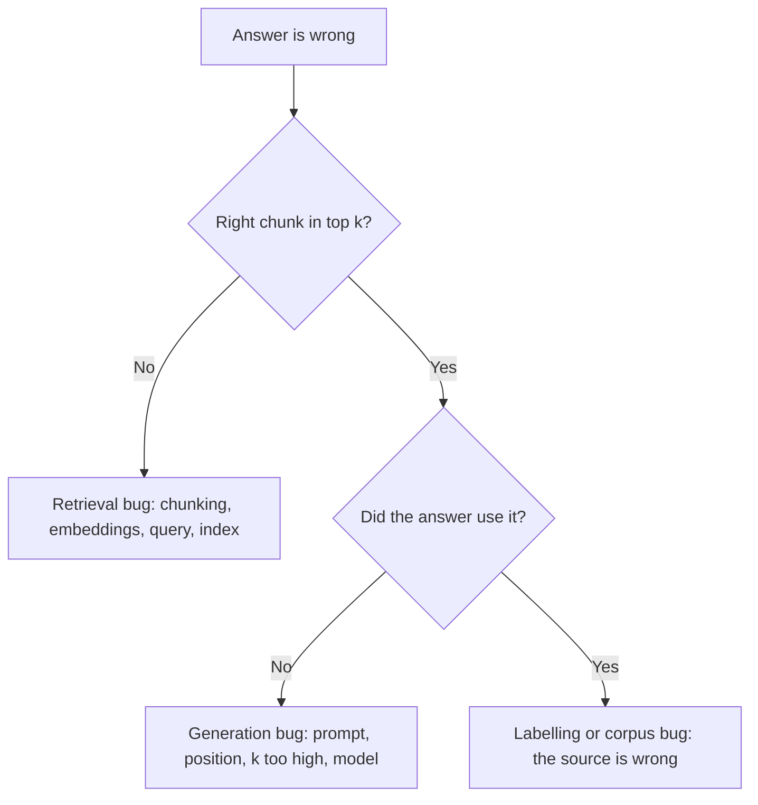

# Eval, Retrieval Metric ও Error Analysis {#ch-evals}

> "এখন একটু ভালো লাগছে" বলা বাদ দিয়ে golden set-এ pass rate দেখুন। System-এর কোন অর্ধেক ব্যর্থ হলো, সেটা খুঁজে বের করুন। আর prompt বদলালেও যেন build ভাঙে, ঠিক যেমন code বদলালে ভাঙে।

**এই অধ্যায়ে:** golden set · recall@k আর retrieval-নাকি-generation ভাগ · grader আর LLM-as-judge · error analysis-এর loop · CI-তে eval

## 💡 মূল ধারণা

এই বইয়ের বেশিরভাগ code নিয়ে ভেবে-চিন্তেই ভালো করা যায়। AI feature-এর বেলায় সেটা চলে না। Output
non-deterministic, ব্যর্থতা diff-এ ধরা পড়ে না, আর **একটি case ঠিক করতে prompt বদলালে প্রায়ই এমন চারটি case
ভেঙে যায়, যেগুলোর দিকে আপনি তাকাচ্ছিলেনই না।**

Eval হলো সেই হারিয়ে যাওয়া feedback loop: নির্দিষ্ট কিছু input, ভালো output বলতে কী বোঝায় তার সংজ্ঞা, আর একটি
score। এটা আসলে test suite-ই, শুধু একটি পার্থক্য আছে। Assertion-টা equality হতে পারে না। কারণ সঠিক output একটি
নির্দিষ্ট string নয়, গ্রহণযোগ্য উত্তরের একটি পরিসর।

Documentation assistant-এর দুটি অংশ। Retrieval passage এনে window-এ বসায়, মানে model যে text পড়বে সেটা।
Generation সেই passage থেকে উত্তর লেখে। দুটি অংশ ব্যর্থ হলে অভিযোগ একই আসে: "উত্তরটা ভুল ছিল"। কিন্তু সমাধান
আলাদা, তাই eval suite প্রতিটি অংশ আলাদা করে মাপে। তারপর error analysis ব্যর্থতাগুলোকে কাজের একটি ক্রমিক
তালিকায় সাজায়।

Senior AI hiring-এ এটাই সবচেয়ে বেশি জিজ্ঞেস করা হয়, অথচ সবচেয়ে কম শেখানো হয়। কারণটা সোজা: eval suite বানানো
মানে labelling-এর কাজ, আর labelling-এর কাজ একঘেয়ে।

> Suite আর একটি সংখ্যা ছাড়া AI feature-এর কাজ এলোমেলো হাঁটা। মনে হয় এগোচ্ছেন, আসলে ঘুরছেন।

## কীভাবে কাজ করে

### Golden set

| বৈশিষ্ট্য | লক্ষ্য | কেন |
| --- | --- | --- |
| আকার | প্রথম ইঙ্গিতের জন্য 30, পোক্ত হলে 100–200 | 30-এর নিচে একটি case-ই সংখ্যাটা অনেক নাড়িয়ে দেয় |
| উৎস | Log আর ticket থেকে আসল user query | বানানো case আপনার নিজের ধারণাই বয়ে আনে |
| ব্যর্থতা | Report হওয়া প্রতিটি bug, একটি করে case হিসেবে | Suite বাড়ে incident থেকে |
| Edge case | 10–20% adversarial, দ্ব্যর্থক বা উত্তরহীন | নইলে system শিখে ফেলে সবসময় উত্তর দিতে হবে |
| Versioning | Repository-তে, code-এর সঙ্গে | Set বদলে গেলে আগের ইতিহাসের কোনো মানে থাকে না |

শুরু করুন **আজ বিকেলেই নিজের হাতে লেখা বিশটি case দিয়ে।** ছোট suite যেটা চলে, সেটা পরিকল্পনায় আটকে থাকা বড়
suite-এর চেয়ে ভালো। প্রথম run-এ সাধারণত এমন একটি ব্যর্থতা ধরা পড়ে, যার কথা কেউ জানত না।

আপনার document থেকে model-কে দিয়ে প্রশ্ন বানালে সাবধান। সেই প্রশ্নে document-এর শব্দই ফিরে আসে, তাই
retrieval সহজেই খুঁজে পায় আর score system-কে আসলের চেয়ে ভালো দেখায়। আসল user নিজের ভাষায় প্রশ্ন করেন, আর এই
অমিলটা পার করাই retrieval-এর আসল কাজ। বানানো প্রশ্ন দিয়ে coverage-এর ফাঁক ভরান, কিন্তু set-এর মূল অংশ কখনো
সেগুলো দিয়ে নয়।

প্রতিটি case-এ থাকে যে passage-গুলো retrieve হওয়া উচিত, তাদের id। Corpus পড়েছেন এমন কেউ সেগুলো label
করেন। এই একটি field থাকলেই একই set দিয়ে দুটি অংশ মাপা যায়।

**একটি golden case, retrieval আর উত্তর দুটিই ধরে**

```typescript
interface EvalCase {
  readonly id: string;
  readonly input: string;
  readonly category: 'factual' | 'procedural' | 'comparison' | 'unanswerable';
  readonly relevantChunkIds: string[];  // labelled by a human who read the corpus
  readonly expect: {
    readonly mustContain?: string[];
    readonly mustNotContain?: string[];
    readonly mustCiteFrom?: string[];   // deterministic groundedness check
    readonly shouldRefuse?: boolean;    // true for the unanswerable cases
    readonly rubric?: string;           // only when nothing above will do
  };
}
```

### আগে retrieval মাপুন

ঠিক passage window-এ না থাকলে পরের কোনো ধাপ আর সেটা ফেরাতে পারে না। Generator যা দেখেইনি, সেটা cite করতে
পারে না। তাই আগে retrieval মাপুন। খরচও কম: কোনো model call নেই, শুধু label করা id-র সঙ্গে মিলিয়ে দেখা।

| Metric | কী জানায় | কখন ব্যবহার করবেন |
| --- | --- | --- |
| **recall@k** | ঠিক passage আদৌ প্রথম *k*-এর মধ্যে ছিল কি? | মূল metric — quality-র সর্বোচ্চ সীমা এটাই |
| **precision@k** | প্রথম *k*-এর কতটা প্রাসঙ্গিক ছিল? | যখন খরচ আর noise গুরুত্বপূর্ণ |
| **MRR** | প্রথম সঠিক result কত ওপরে ছিল? | যখন সঠিক উত্তর একটিই |
| **nDCG@k** | ধাপে ধাপে প্রাসঙ্গিকতা, অবস্থান অনুযায়ী ওজন দেওয়া | যখন কয়েকটি passage আংশিক প্রাসঙ্গিক |

**recall@k দিয়ে শুরু করুন, আর বেশিরভাগ সময় সেখানেই থাকুন।** Ranking metric-এর দাম আছে শুধু recall ঠিকঠাক
হলে। যে result-গুলোতে উত্তরই নেই, সেগুলো উল্টেপাল্টে সাজালে কিছুই বদলায় না।

**Golden set জুড়ে recall@k**

```typescript
function recallAtK(cases: EvalCase[], retrieve: (q: string, k: number) => Promise<string[]>, k: number) {
  return Promise.all(cases.map(async (c) => {
    const ids = await retrieve(c.input, k);
    return c.relevantChunkIds.some((id) => ids.includes(id)) ? 1 : 0;
  })).then((hits) => hits.reduce<number>((a, b) => a + b, 0) / cases.length);
}
```

এটা দুটি *k*-তে report করুন। `recall@20` মাপে retriever-কে। `recall@5` মাপে retriever আর reranker একসঙ্গে।
দুটি সংখ্যা মিলে একটি ঝাপসা অভিযোগকে তিনটি workstream-এর একটিতে নামিয়ে আনে।

| recall@20 | recall@5 | রোগ নির্ণয় | সমাধান |
| --- | --- | --- | --- |
| কম | কম | Passage খুঁজেই পাওয়া যাচ্ছে না | আগে chunking, তারপর embedding, তারপর query rewriting |
| বেশি | কম | পাওয়া যাচ্ছে, কিন্তু rank খারাপ | Reranking যোগ করুন বা tune করুন |
| বেশি | বেশি, তবু উত্তর ভুল | সমস্যা generation-এ, retrieval-এ নয় | Prompt, অবস্থান, কম chunk, model |

একটি ভুল উত্তর পেলে, কিছু ঠিক করার আগে একটি প্রশ্ন করুন।



**একটি প্রশ্নই কাজটাকে ঠিক অংশে পাঠিয়ে দেয়। C আর E-র সমাধানে কোনো মিল নেই।**

### উত্তর মাপুন

| Grader | কী যাচাই করে | খরচ | কোথায় ব্যবহার করবেন |
| --- | --- | --- | --- |
| **Deterministic** | Schema ঠিক আছে, দরকারি id cite করেছে, latency budget-এর মধ্যে, যেখানে refuse করার কথা সেখানে করেছে | বিনা খরচে | যতটা পারে, সবকিছুতে |
| **Model-graded** | Rubric ধরে faithfulness, tone, সম্পূর্ণতা | প্রতি case-এ একটি model call | যে গুণ code দিয়ে মাপা যায় না |
| **মানুষ** | আসল বিচার; বাকি দুটিকে calibrate করা | দামি | মাঝে মাঝে, একটি sample-এ |

**যতটা পারেন, সব প্রথম row-তে ঠেলে দিন।** Quality-র বড় একটি অংশ code দিয়েই যাচাই করা যায়। উত্তর কি
retrieve করা কোনো source cite করেছে? JSON কি ঠিক আছে? Injection-এর চেষ্টা কি refuse করেছে? এসব check
millisecond-এ চলে, আর কখনো নিজের সঙ্গে দ্বিমত করে না।

এক model অন্য model-এর output grade করলে কাজে লাগে, কিন্তু ভুলভাবে ব্যবহার করাও সহজ। চারটি শর্ত পূরণ হলে
তবেই এটা টেকে।

1. **Rubric নির্দিষ্ট।** "এটা কি ভালো?" জিজ্ঞেস করলে noise আসে। "প্রতিটি তথ্যগত দাবি কি দেওয়া context-এ আছে?
   হ্যাঁ বা না বলুন, আর যে দাবির সমর্থন নেই সেটা quote করুন।" জিজ্ঞেস করলে আসে signal।
2. **Judge-কে মানুষের সঙ্গে মিলিয়ে দেখা হয়েছে।** 50টি case হাতে label করুন, judge চালান, আর কতটা মেলে মাপুন।
   মোটামুটি 80%-এর নিচে হলে judge অন্য কিছু মাপছে।
3. **Judge ground truth দেখতে পায়,** যেখানে সেটা আছে। যে তথ্য model খুঁজে দেখতে পারে না, সেটা যাচাই করতে বললে
   model আন্দাজ করে, আর আত্মবিশ্বাসের সঙ্গেই করে।
4. **এটা একমাত্র signal নয়।** Judge লম্বা উত্তর বেশি পছন্দ করে, আর কাছাকাছি ধরনের model-এর লেখা text-এর দিকে ঝোঁকে।

> ⚠️ Judge-কে কখনো একই model আর একই context দিয়ে নিজের generation grade করতে দেবেন না। Generator-এর অন্ধ
> জায়গাগুলো judge-এরও থাকে, তাই সাধারণত একমত হয়ে যায়। Score দেখায় অনেক বেশি, অথচ কিছুই মাপে না।

### Error analysis-এর loop

Suite বলছে pass rate 71%। কিন্তু সোমবার কী করবেন, সেটা বলছে না। **সংখ্যা থেকে পরিবর্তনে যাওয়ার মাঝের ধাপটাই
error analysis।** কাজটা মূলত কেরানির কাজ। ব্যর্থতাগুলো জড়ো করুন, তাদের trace পড়ুন। কী ভুল হলো তার নাম দিন,
নামগুলো গুনুন, সবচেয়ে বড় স্তূপটা ঠিক করুন, আবার চালান। প্রতি সপ্তাহে চালান। Team-রা যে ধাপটা বাদ দেয়, সেটা
হলো গোনা।

শুধু output নয়, trace পড়ুন। ভুল উত্তরটা সাধারণত আসল ভুলের কয়েক ধাপ পরে আসে।

| স্তর | কী দেখবেন | কোন ব্যর্থতা ধরা পড়ে |
| --- | --- | --- |
| Input | User আসলে কী লিখেছেন | দ্ব্যর্থতা, support নেই এমন ভাষা, scope-এর বাইরের প্রশ্ন |
| Retrieval | ফেরত আসা chunk id, score-সহ | Passage ছিলই না, বা cutoff-এর নিচে rank পেয়েছে |
| জোড়া লাগানো request | Window-এ আসলে কী পৌঁছেছে | কেটে যাওয়া, হারিয়ে যাওয়া system prompt, পুরনো history |
| Tool call | কোন tool, কোন argument আর result | ভুল tool, ভুল argument, খালি result |
| Output | Text, সঙ্গে `finishReason` আর usage | কেটে যাওয়া, refusal, format ভাঙা |

তৃতীয় row আগে থেকে পরিকল্পনা না করলে যাচাই করা যায় না। "Model context উপেক্ষা করেছে" ধরনের অনেক report-এ
দেখা যায়, context-টা আসলে পৌঁছায়ইনি। জোড়া লাগানো request log করুন, নইলে এই স্তরটা চোখের আড়ালেই থাকবে।

Category বানান **আপনার নিজের** পঞ্চাশটি ব্যর্থতা থেকে, কোনো blog post থেকে নয়। প্রতিটি ব্যর্থতার জন্য ছোট একটি
বাক্যাংশ লিখুন, তারপর বাক্যাংশগুলো দল বাঁধুন। সাধারণত পাঁচ থেকে আটটি category বেরিয়ে আসে। তারপর কিছু ঠিক করার
আগে সেগুলো গুনুন।

| Category | সংখ্যা | ভাগ | ✅ সমাধান | ❌ সমাধান নয় |
| --- | --- | --- | --- | --- |
| Retrieval miss | 34 | 45% | Chunking, hybrid search, reranking | আরও ভালো model |
| Grounding failure | 18 | 24% | কম কিন্তু ভালো chunk; cite করার নির্দেশ | আরও chunk |
| দ্ব্যর্থতা | 12 | 16% | User-কে স্পষ্ট করার প্রশ্ন করুন | আরও ভালো আন্দাজ |
| Format ভাঙা | 7 | 9% | Schema-বাঁধা output | আরও কড়া নির্দেশ |
| Over-refusal | 5 | 7% | Guardrail একটু ঢিলে করুন, অনুমোদিত উদাহরণ দিন | অন্য model |

এই table বানাতে এক বিকেল লাগে, আর পুরো কাজের ফল এটাই। "Assistant-টা ভরসাযোগ্য নয়" কথাটা এখান থেকে ক্রমিক
একটি পরিকল্পনা হয়ে যায়। "Model বদলাব কি?" প্রশ্নেরও উত্তর মেলে। Model বদলালে grounding আর format-এ লাভ হয়, মানে
এই ব্যর্থতার মোটামুটি এক-তৃতীয়াংশে, আর খরচ হয় সত্যিকারের টাকা। **Retrieval miss generator কখনো ঠিক করতে পারে না।**

দ্ব্যর্থতাকে প্রায়ই ভুল করে model-এর ব্যর্থতা ধরা হয়। কিছু প্রশ্নের দুটি মানে হয়, আর তার সমাধান pipeline-এ নয়,
interface-এ।

থামবেন তখন, যখন বাকি থাকা সবচেয়ে বড় category-টা suite-এর noise-এর চেয়ে ছোট, অথবা ঠিক করার খরচ ব্যর্থতার
খরচের চেয়ে বেশি। কিছুটা ব্যর্থতা থাকাই ঠিক। যে system-কে tune করতে করতে এমন জায়গায় আনা হয়েছে যে কখনো না বলে না, সেটা
আসলে আত্মবিশ্বাসী ভুলের দিকে tune হয়েছে।

### CI-তে eval

**Gate হবে আগের run-এর তুলনায় regression, কোনো নির্দিষ্ট threshold নয়।** Threshold নামাতে নামাতে একসময় সেটা আর
আপত্তি করে না। Regression gate আসল প্রশ্নের উত্তর দেয়: এই পরিবর্তনে কি অবস্থা খারাপ হলো?

- **যে file-গুলো আচরণ বদলায়, সেগুলোতে trigger করুন** — prompt, model configuration, tool definition,
  chunking, embedding config, retrieval parameter আর corpus। Diff-এ এগুলোর কোনোটাকেই ঝুঁকিপূর্ণ মনে হয় না।
- **প্রতিটি commit-এ deterministic grader আর recall@k চালান; model-graded case চালান pull request-এ।** প্রথম
  ধাপে কোনো খরচ নেই। দ্বিতীয় ধাপে প্রতি case-এ একটি model call লাগে।
- **Category ধরে report করুন।** গড়ে 3% কমেছে, আর পুরোটাই procedural প্রশ্নে, এটা একটি আবিষ্কার। গড় করে
  ফেললে সেটা শুধুই noise।
- **Model version pin করুন।** নইলে suite আপনার পরিবর্তন নয়, provider-এর পরিবর্তন মাপবে।
- **ব্যর্থ case-গুলোর নাম দিন** build output-এ, যাতে error analysis-এর loop সেখান থেকেই শুরু হয়।

> ⚠️ **যা বদলাতে থাকে:** eval tooling আর hosted evaluation product সারাক্ষণ বদলায়। যেটা টেকে, সেটা হলো
> version করা golden set, team যে metric-এ একমত, আর এমন একটি run যেটা merge আটকাতে পারে। যে tool-ই সেটা চালাক,
> এগুলো তার চেয়ে বেশিদিন বাঁচে।

### যে সংখ্যা মিথ্যা বলে

- **একটি মাত্র গড়।** কোন category ধসে পড়েছে, সেটা লুকিয়ে ফেলে, অথচ শুধু সেটা নিয়েই কাজ করা যায়।
- **যে set-এর ওপর prompt tune করা হয়েছে, তার pass rate।** এটা test set-এ training করা। একটি holdout রাখুন।
- **মানুষের সঙ্গে calibrate না করা judge score।** যাচাই না করা যন্ত্রের আত্মবিশ্বাসী সংখ্যা।
- **গড় similarity score।** এটা retriever-এর আত্মবিশ্বাস মাপে, সঠিকতা নয়।
- **বড় *k*-তে recall।** Window-এ যদি মাত্র 5টি chunk পৌঁছায়, তাহলে `recall@50` চমৎকার করে ফেলা সহজ, কিন্তু
  তার কোনো মানে নেই।
- **100%।** এর মানে set-টা বেশি সহজ, system শেষ হয়ে গেছে তা নয়। কাজের অবস্থা হলো কঠিন input-এ কয়েকটি ব্যর্থতা
  টিকে থাকা, কারণ পরের উন্নতি সেখানেই দেখা যায়।

## কখন ব্যবহার করবেন

| পরিস্থিতি | কী করবেন |
| --- | --- |
| প্রথম prompt পরিবর্তন নিয়ে কেউ তর্ক করার আগেই | বিশটি case বানান; তর্কটা মাপজোখ হয়ে যায় |
| Chunk size বা *k* tune করার আগে | আগে প্রাসঙ্গিক chunk id label করুন, নইলে বুঝবেন না উপকার হলো কি না |
| User ভুল উত্তরের কথা জানালেন | Log করা chunk id দেখুন, তারপর ঠিক করার আগে সেটা case হিসেবে যোগ করুন |
| Model, provider বা embedding model বদলাচ্ছেন | একই set-এ দুটিই চালান — নিরাপদে বদলানোর একমাত্র উপায় |
| Pass rate কমেছে, কেউ জানে না কেন | নতুন করে ব্যর্থ trace-গুলো পড়ুন; category নিজেই নিজের নাম বলে দেবে |
| User অভিযোগ করছেন, কিন্তু metric ঠিক দেখাচ্ছে | আসল traffic থেকে sample নিন — suite-এ একটি category নেই |

## সাধারণ ভুল

**❌ ঠিকঠাক একটি eval framework-এর অপেক্ষায় থাকা**

> একটি JSON file-এ বিশটি case আর একটি script, পরের quarter-এ আসা framework-এর চেয়ে ভালো।

**❌ শুধু end-to-end উত্তরের quality মাপা**

> এটা বলে কোথাও সমস্যা আছে, কিন্তু কোন অংশে, তা বলে না। ফলে সাধারণত ভুল অংশে দুই সপ্তাহ চলে যায়।

**❌ এইমাত্র কেউ যে ব্যর্থতার কথা বললেন, সেটা ঠিক করতে বসা**

> সেটা একটি মাত্র sample, আর সাধারণত সবচেয়ে বড় category-ও নয়। আগে গুনুন।

**❌ এক run-এ কয়েকটি জিনিস একসঙ্গে বদলানো**

> দুটি prompt edit আর একটি retrieval পরিবর্তন একসঙ্গে করলে মোট ফলটা জানবেন, কিন্তু কোনটা কাজে লাগল তা জানবেন না।

**✅ Production-এর প্রতিটি request-এ retrieve করা chunk id আর জোড়া লাগানো request log করুন**

> তাহলে একটি query-তেই অভিযোগ থেকে রোগ নির্ণয় হয়ে যায়, আর পরের quarter-এর golden set আসে সেই log থেকেই।

**✅ ঠিক করার আগে report হওয়া প্রতিটি ব্যর্থতা suite-এ যোগ করুন**

> Suite বাড়ে আসল incident থেকে, আর fix-টা ধরে নেওয়া নয়, যাচাই করা হয়।

## 🔑 মূল শিক্ষা

- Non-deterministic system equality দিয়ে test করা যায় না; লাগে golden set, grader আর score।
- আগে recall@k দিয়ে retrieval মাপুন, কারণ যে passage window-এ পৌঁছায়নি, তাকে আর ফেরানো যায় না।
- যত check পারেন deterministic grader-এ ঠেলে দিন, আর LLM-as-judge-কে বিশ্বাস করুন মানুষের সঙ্গে মিলিয়ে দেখার পরেই।
- Error analysis মানে গোনা: পঞ্চাশটি trace পড়ুন, category-র নাম দিন, আর সবচেয়ে বড়টা আগে ঠিক করুন।
- CI-র gate হবে আগের run-এর তুলনায় regression, category ধরে report করা, model version pin করা।

## Interview-এর প্রশ্ন

**Q: Prompt বদলানোর পর অবস্থা ভালো হলো কি না, কীভাবে বোঝেন?**

একটি golden set-এ চালাই, আর আগের run-এর pass rate-এর সঙ্গে তুলনা করি। সেটা না থাকলে প্রমাণ বলতে শুধু হাতে
চেষ্টা করা কয়েকটি উদাহরণ। অথচ prompt বদলালে প্রায়ই সামনের case-টা ঠিক হয়, আর অন্যগুলো ভেঙে যায়। Suite *কোন*
category-তে regression হলো সেটাও দেখায়, তাই ফলটা নিয়ে কাজ করা যায়।

**Q: recall@k কী, আর এটা দিয়েই কেন শুরু করেন?**

যত প্রশ্নে প্রথম *k*টি result-এর মধ্যে অন্তত একটি প্রাসঙ্গিক passage আছে, তার ভগ্নাংশ। এটা আগে আসে কারণ এটাই
সর্বোচ্চ সীমা। ঠিক passage window-এ না থাকলে কোনো prompt, model বা reranker সঠিক grounded উত্তর দিতে পারবে না।
Ranking metric-এর দাম আছে শুধু recall ঠিকঠাক হলে।

**Q: একজন user বলছেন assistant ভুল উত্তর দিয়েছে। রোগ নির্ণয়টা ধাপে ধাপে বলুন।**

Log থেকে ওই request-এর retrieve করা chunk id বের করি। ঠিক passage না থাকলে এটা retrieval-এর bug: chunking,
query, বা এমন document যেটা কখনো index-ই হয়নি। থাকলে generation সেটা উপেক্ষা করেছে, তাহলে সন্দেহ prompt, chunk-এর
অবস্থান, বা অতিরিক্ত chunk-এর দিকে। তারপর ঠিক করার আগে case-টা suite-এ যোগ করি।

**Q: LLM-as-judge কখন চলে?**

যখন rubric এতটাই নির্দিষ্ট যে দুজন মানুষ একইভাবে grade করবেন, আর একটি sample-এ judge মানুষের label-এর সঙ্গে
মেলে। তথ্যগত কিছুর জন্য judge-কে ground truth দেখাতে হবে, আর এটা একমাত্র signal হতে পারবে না। একই model আর একই
context-এর output judge-কে দিয়ে কখনো grade করাব না। Judge-এরও একই অন্ধ জায়গা থাকে, তাই score ভালো দেখায় অথচ
কোনো মানে থাকে না।

**Q: আপনার assistant "ভরসাযোগ্য নয়"। কথাটাকে কাজে কীভাবে বদলাবেন?**

পঞ্চাশটি ব্যর্থতা জড়ো করি, তাদের trace পড়ি, প্রতিটিতে কী ভুল হয়েছে লিখি, আর category গুনি। তাতে ভাগ আর আনুমানিক
খাটুনিসহ একটি ক্রমিক table পাওয়া যায়, আর সেটাই পরিকল্পনা। সবশেষে যে ব্যর্থতার কথা শোনা গেল সেটা ঠিক করতে বসা
মানে একটি মাত্র sample-এর জন্য optimise করা। এভাবে team-রা এমন category-তে সপ্তাহের পর সপ্তাহ নষ্ট করে, যেটা
পুরো সমস্যার চার শতাংশ।

**Q: Pipeline ঠিক করবেন নাকি model upgrade করবেন, কীভাবে ঠিক করেন?**

Category-র সংখ্যা দেখে। বেশিরভাগ ব্যর্থতা retrieval miss হলে ভালো model কিছুই বদলাবে না, কারণ passage-টা
window-এ কখনো ছিলই না। বেশিরভাগ grounding বা format-এর ব্যর্থতা হলে upgrade কাজে লাগতে পারে। কিন্তু সস্তা সমাধানেও
কাজ হয়, যেমন কম কিন্তু ভালো chunk, বা বাঁধা output schema। Table-টা পছন্দ-অপছন্দকে হিসাবের অঙ্কে নামিয়ে আনে।

## এরপর কী পড়বেন

- [Chapter ?? — Embedding, Vector Store ও Retrieval](#ch-retrieval) — যে parameter-গুলো recall@k থাকলে ভরসা নিয়ে tune করা যায়
- [Chapter ?? — Observability ও Cost Engineering](#ch-observability) — যে trace আর log-এর ওপর এই অধ্যায় নির্ভর করে
