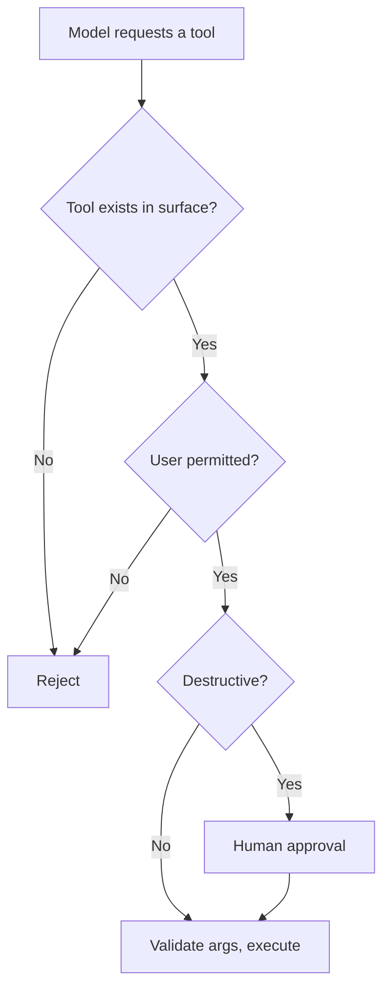

# Guardrail ও Safety {#ch-guardrails-and-safety}

> Control বসান সেখানে, যেখানে সেগুলো সত্যিই টিকে থাকতে পারে — input-এ, output-এ, আর model কী করার অনুমতি পায় তার ওপর — আর prompt কিছু enforce করবে, এই আশা ছেড়ে দিন।

**এই অধ্যায়ে:** তিনটি boundary · কী আপনার নিয়ন্ত্রণের বাইরে চলে যায় · input filtering আর তার সীমা · output filtering আর PII · tool permissioning · refusal সামলানো · over-refusal, একটি আসল failure

## 💡 মূল ধারণা

System prompt-এ লেখা একটি guardrail একটি অনুরোধ, control নয়। Model এমন text-এর মধ্য দিয়ে আন্দাজ করে পথ চলে, যেটা
আপনি পুরোপুরি বিশ্বাস করেন না। **শুধু instruction দিয়ে enforce করা যেকোনো নিয়ম অন্য instruction দিয়ে যুক্তি দেখিয়ে
সরিয়ে দেওয়া যায়।** এর মধ্যে সেই instruction-ও পড়ে, যেগুলো এমন একটি document-এর ভেতরে আসে, যেটা model-কে পড়তে বলা
হয়েছিল।

আসল control থাকে model-এর বাইরে, তিনটি boundary-তে।

| Boundary | প্রশ্ন | কী দিয়ে enforce হয় |
| --- | --- | --- |
| **Input** | আমরা একটি third party-কে কী পাঠাচ্ছি? | Redaction, size limit, classification |
| **Output** | আমরা কী দেখাচ্ছি বা store করছি? | Validation, filtering, escaping |
| **Capability** | এই system কী করতে পারে? | Tool surface, credential, approval gate |

তৃতীয়টিই সবচেয়ে শক্তিশালী, আর বাকি সব control ব্যর্থ হলেও এটাই টিকে থাকে। Model যদি data মুছতেই না পারে, কোনো
prompt-ই তাকে দিয়ে data মোছাতে পারবে না।

> Defence in depth, যেখানে tool surface হলো সেই layer, যেটা টিকে থাকে। এর আগের সবকিছু শুধু সম্ভাবনা কমায়। শুধু
> capability-ই ক্ষতির মাত্রা কমায়।

## কীভাবে কাজ করে

### কী আপনার নিয়ন্ত্রণের বাইরে চলে যায়

প্রতিটি model call একটি third party-কে content পাঠায়। এটা একটি data-protection-এর সিদ্ধান্ত, আর এটা নেওয়া হয়
architecture-এ একবার, প্রতি request-এ একবার নয়।

| ❌ পাঠাবেন না | কেন |
| --- | --- |
| Credential, token, connection string | পাঠানোর মুহূর্ত থেকেই leak হয়ে গেছে ধরে নিন |
| আইনি ভিত্তি ছাড়া personal data | এটা processing-এর একটি সিদ্ধান্ত, যেটা কাউকে না কাউকে defend করতে পারতে হবে |
| একসাথে অনেক customer record | চুক্তিগত আর regulatory ঝুঁকি |
| সমাধান না হওয়া security finding | Exploit করার মতো একটি দুর্বলতা ফাঁস করে দেয় |

যেকোনো filter-এর চেয়ে দুটি কাঠামোগত প্রতিকার বেশি গুরুত্বপূর্ণ। **আপনি আসলে কোন tier-এ আছেন, যাচাই করুন।** একই
product-এর consumer আর business tier প্রায়ই training আর retention নিয়ে আলাদা প্রতিশ্রুতি দেয়। Regulated কাজের
জন্য কিছু deployment inference রাখে আপনার নিজের cloud account আর audit trail-এর ভেতরে। এগুলো boundary নিয়ে শুধু
প্রতিশ্রুতি দেয় না, boundary-টাকেই সরিয়ে আনে।

**পাঠানোর আগে, boundary-তেই redact করুন:**

```typescript
const SENSITIVE = [
  { name: 'email', re: /[\w.+-]+@[\w-]+\.[\w.]+/g },
  { name: 'card',  re: /\b(?:\d[ -]*?){13,16}\b/g },
  { name: 'token', re: /\b(sk|pk|ghp|xox[baprs])[-_][A-Za-z0-9]{16,}\b/g },
];

function redact(text: string): { text: string; found: string[] } {
  const found: string[] = [];
  const out = SENSITIVE.reduce((acc, p) => {
    if (p.re.test(acc)) found.push(p.name);
    return acc.replace(p.re, `[${p.name.toUpperCase()}]`);
  }, text);
  return { text: out, found };   // `found` is a metric, not just a side effect
}
```

Redactor কী ধরছে সেটা গোনাই আসল উদ্দেশ্য। Email redaction-এর হার বাড়তে থাকলে বুঝবেন একটি workflow বদলেছে, আর
user-রা record paste করতে শুরু করেছেন।

> ⚠️ Pattern redaction format ধরে, অর্থ নয়। নাম ধরে একজন রোগীর free-text বর্ণনায় মেলানোর মতো কোনো pattern নেই।
> Filter দুর্ঘটনাবশত leak কমায়। একটি অনুপযুক্ত data flow-কে উপযুক্ত বানায় না।

### Input filtering, আর তার সীমা

| যাচাই | যা ধরে | যা ধরতে পারে না |
| --- | --- | --- |
| Size আর rate limit | খরচ বাড়ানোর attack, নিয়ন্ত্রণহীন loop | বাকি সবকিছু — তবু সবসময় রাখার মতো |
| Pattern redaction | নির্দিষ্ট format-এর secret আর identifier | Free-text personal data |
| Input-এর ওপর একটি classifier | স্পষ্ট অপব্যবহার আর বিষয়ের বাইরের ব্যবহার | অন্যভাবে বলা যেকোনো কিছু |
| Phrase-এর blocklist | গতকালের attack | আজকের নতুন করে বলা রূপ |

শেষ সারিটাই মনে রাখার মতো। **Input filtering সম্ভাবনা কমায়, কখনোই boundary নয়।** এটাকে একটি layer হিসেবে ধরুন, এটা
ব্যর্থ হবে ধরে নিয়ে পরিকল্পনা করুন, আর ভার রাখুন capability limit-এর ওপর।

### Output filtering, আর এর জায়গা কোথায়

Model-এর output যে-ই ব্যবহার করুক, তার কাছে এটা অবিশ্বস্ত input। কোন যাচাই খাটবে, সেটা ঠিক করে ব্যবহারকারী।

| ব্যবহারকারী | যাচাই |
| --- | --- |
| HTML হিসেবে render হয় | Escape করুন, অথবা কঠোর একটি allow-list দিয়ে Markdown render করুন। Model-এর output-এ script থাকতে পারে |
| SQL, shell বা code হিসেবে চালানো হয় | করবেন না। নির্দিষ্ট operation-সহ parameterised tool ব্যবহার করুন |
| একটি database-এ লেখা হয় | আগে schema-র সাথে validate করুন |
| একজন user-কে দেখানো হয় | ফাঁস হওয়া context খুঁজুন — system prompt-এর text, অন্য user-দের data |
| তথ্য হিসেবে উদ্ধৃত হয় | যাচাই করুন citation-টি একটি retrieve করা chunk-এ গিয়ে মেলে |

শেষ সারিটাই পুরো part-এ সবচেয়ে সস্তা quality guardrail। উত্তর যদি একটি source উদ্ধৃত করে, code-এ যাচাই করুন যে
source-টি আসলেই retrieve করা হয়েছিল। এটা কোনো model call ছাড়াই একটি বানানো citation ধরে ফেলে। একটি grounded
assistant-এর সবচেয়ে ক্ষতিকর failure-গুলোর একটি এটাই।

### Tool permissioning



**প্রতিটি tool call যে control path-এর মধ্য দিয়ে যায়। এর কিছুই prompt-এ থাকে না।**

নীতিগুলো সেগুলোই, যা আপনি যেকোনো privileged process-এ ইতিমধ্যে প্রয়োগ করেন। Credential-কে least privilege দিন।
Tool-গুলো default-ভাবে read-only রাখুন, আর write-গুলো আলাদা gated tool হিসেবে। যা কিছু ফেরানো যায় না, তার জন্য
approval চান, আর প্রতিটি call-এর একটি audit log রাখুন। আসল permission-সহ একটি agent একজন operator, তাই তাকে
সেভাবেই review করুন। [Chapter ?? — Tool Calling ও Tool Surface](#ch-tool-calling) হলো এর design-এর দিক।

### Refusal, দুই দিকেই

একটি refusal একটি স্বাভাবিক response, আর এর জন্য পরিকল্পিত একটি পথ দরকার। এটা throw করা error বা retry loop নয়।

| Refusal-এর ধরন | Response |
| --- | --- |
| সত্যিই scope-এর বাইরে | সোজাসুজি বলুন, system কী করতে পারে সেটা প্রস্তাব করুন |
| Provider-এর policy | হুবহু আবার retry করবেন না; সৎভাবে সেটা দেখান |
| আপনার নিজের guardrail চালু হয়েছে | কোন boundary, আর বৈধভাবে কীভাবে এগোনো যায়, তা বলুন |
| **Over-refusal** | একটি bug। Log করুন, গুনুন, instruction ঠিক করুন |

Over-refusal সেই failure, যেটা team-রা মাপে না, কারণ এটা দেখতে সতর্কতার মতো। যে support assistant বৈধ account-এর
প্রশ্ন ফিরিয়ে দেয়, সেটা ভাঙা, অথচ এটা কোনো error বা alert তোলে না। **Refusal rate-কে একটি quality metric হিসেবে
track করুন।** অনুমোদিত কিন্তু সংবেদনশীল case-গুলো eval suite-এ রাখুন, যাতে একটি guardrail কড়া করলে সেগুলো নীরবে
ভেঙে না যায়।

## কখন ব্যবহার করবেন

| পরিস্থিতি | Control |
| --- | --- |
| User-এর সামনে থাকা যেকোনো model call | Size limit, rate limit, output escaping |
| Personal data সামলানো | Boundary-তে redaction, সাথে একটি data-flow সিদ্ধান্ত |
| Model কাজ করতে পারে | Least privilege, approval gate, audit log |
| Citation-সহ grounded উত্তর | Code দিয়ে citation যাচাই |
| একটি regulated deployment | এমন একটি deployment, যার data boundary আপনি প্রমাণ দিয়ে দেখাতে পারেন |
| প্রতিটি deployment | দুই দিকেই refusal rate track করা |

## সাধারণ ভুল

**❌ নিয়মটা শুধু system prompt-এ রাখা**

> এটা অন্য instruction-গুলোর সাথে প্রতিযোগিতা করা একটি instruction, যেগুলোর কিছু এসেছে model-এর পড়া একটি
> document থেকে।

**❌ Model-এর output escape না করে HTML হিসেবে render করা**

> Model-এর output অবিশ্বস্ত input। এটা cross-site scripting, শুধু উৎসটা অস্বাভাবিক।

**❌ Over-refusal না মেপে guardrail tune করা**

> প্রতিটি কড়াকড়ি metric-এ অদৃশ্য, কিন্তু user-দের কাছে দৃশ্যমান। অনুমোদিত case-গুলো eval suite-এ রাখুন।

**✅ Code দিয়ে citation যাচাই করুন**

> উত্তর যদি একটি chunk উদ্ধৃত করে, যাচাই করুন chunk-টি retrieve করা হয়েছিল। কোনো model call নেই, আর এটা একটি
> grounded system-এর সবচেয়ে ক্ষতিকর failure ধরে।

## 🔑 মূল শিক্ষা

- Prompt-এ একটি guardrail একটি অনুরোধ। আসল control থাকে input, output আর capability-তে।
- Capability হলো সেই layer, যেটা টিকে থাকে: tool-টি না থাকলে কোনো instruction সেটা invoke করতে পারে না।
- Pattern redaction format ধরে, অর্থ নয়, আর একটি অনুপযুক্ত data flow-কে উপযুক্ত বানায় না।
- Model-এর output অবিশ্বস্ত input: escape করুন, validate করুন, আর citation-গুলো মেলে কিনা যাচাই করুন।
- Over-refusal একটি আসল failure, যেটা কোনো error তৈরি করে না। তাই দুই দিকেই refusal rate মাপুন।

## Interview-এর প্রশ্ন

**Q: Guardrail কোথায় রাখেন, আর prompt-এ কেন নয়?**

Model-এর বাইরে তিনটি boundary-তে: কী ভেতরে যায়, কী বেরিয়ে আসে, আর system কী করার অনুমতি পায়। Prompt এদের একটিও
নয়। System prompt-এর একটি instruction window-এর অন্য সব instruction-এর সাথে প্রতিযোগিতা করে, এমনকি model-কে পড়তে
বলা একটি document-এর ভেতরের text-এর সাথেও। Prompt-এর একটি নিয়ম সম্ভাবনা কমায়। যে tool নেই, সেটা ক্ষতি শূন্যে নামিয়ে
আনে।

**Q: Personal data যাতে provider-এর কাছে না পৌঁছায়, তা কীভাবে ঠেকান?**

Format করা case-গুলোর জন্য pattern দিয়ে boundary-তে redact করি, যেমন email, card number আর token-এর গড়ন। Redactor কী
ধরছে তা গুনি, কারণ হার বাড়লে বুঝি একটি workflow বদলেছে। কিন্তু এটা format ধরে, অর্থ নয়: নাম ধরে একজন মানুষের বিষয়ে
free text-এ মেলানোর মতো কোনো pattern নেই। আসল সিদ্ধান্তটা architecture-এর। Data কোন deployment আর কোন চুক্তিগত
tier-এর মধ্য দিয়ে যায়, আর এই ধরনের data-র জন্য সেটা কি defend করা যায়?

**Q: একটি web page-এ model-এর output render করার ঝুঁকি কী?**

এটা অবিশ্বস্ত input। Model script বা markup বের করতে পারে, আর সে এই output আংশিকভাবে তৈরি করে এমন document থেকে,
যেগুলো একজন attacker নিয়ন্ত্রণ করতে পারে। তাই এটা cross-site scripting, যেটা একটি অস্বাভাবিক পথে আসছে। সমাধান সাধারণটাই:
escape করুন, অথবা tag আর attribute-এর একটি কঠোর allow-list দিয়ে Markdown render করুন। আর output-কে কখনোই চালানোর মতো
command হিসেবে ধরবেন না, সেটা SQL, shell বা code যা-ই হোক।

**Q: একটি agent যাতে ক্ষতি না করে, তা কীভাবে নিশ্চিত করেন?**

Instruction নয়, capability সীমিত করে। Tool surface শুধু ততটুকুই দেখায়, যতটুকু feature-এর দরকার, আর credential-ও
সেটুকুতেই সীমিত। Write-গুলো আলাদা gated tool, একটি read tool-এর parameter নয়। যা কিছু ফেরানো যায় না, তাতে মানুষের
approval লাগে, আর প্রতিটি call log হয়। তখন সফলভাবে manipulate করা একটি model-ও আমার মেনে নেওয়া permission-এর বাইরে যেতে
পারে না। এটা least privilege, অন্য যেকোনো privileged process-এর মতোই।

**Q: Over-refusal কী, আর এটা কেন গুরুত্বপূর্ণ?**

এটা হলো model-এর বৈধ কিছু ফিরিয়ে দেওয়া। এটা গুরুত্বপূর্ণ, কারণ এটা কোনো error, alert বা exception তোলে না। এটা শুধু
চুপচাপ product-টাকে খারাপ করে দেয়। প্রতিটি guardrail কড়া করায় এই ঝুঁকি থাকে, আর user-রা feature-টির ওপর বিশ্বাস
হারানোর আগে কেউ টের পায় না। তাই আমি refusal rate-কে একটি quality metric হিসেবে track করি, আর অনুমোদিত কিন্তু সংবেদনশীল
case-গুলো eval suite-এ রাখি। তাতে একটি filter কড়া করলে একজন user নয়, একটি test fail করে।

## এরপর কী পড়বেন

- [Chapter ?? — Prompt Injection](#ch-prompt-injection) — যে attack থেকে এই boundary-গুলো রক্ষা করছে
- [Chapter ?? — Tool Calling ও Tool Surface](#ch-tool-calling) — design হিসেবে capability limit
- [Chapter ?? — বিশ্বাস, নির্ভুলতা ও Failure State](#ch-trust-and-correctness-ux) — screen-এ একটি refusal দেখতে কেমন
