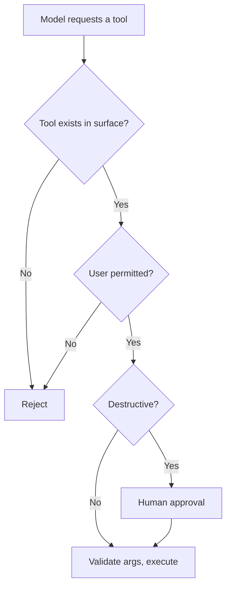

# Guardrail ও Safety {#ch-guardrails-and-safety}

> Control বসান সেখানে, যেখানে সেটা সত্যিই টিকে থাকে: input-এ, output-এ, আর model কী করার অনুমতি পাবে তার ওপর। Prompt কিছু enforce করবে, এই আশা ছেড়ে দিন।

**এই অধ্যায়ে:** তিনটি boundary · কী আপনার নিয়ন্ত্রণের বাইরে চলে যায় · input filtering আর তার সীমা · output filtering আর PII · tool-এর permission · refusal সামলানো · over-refusal, যেটা সত্যিকারের ব্যর্থতা

## 💡 মূল ধারণা

System prompt-এ লেখা guardrail একটি অনুরোধ, control নয়। Model এমন text-এর ভেতর দিয়ে আন্দাজে পথ খোঁজে, যেটাকে
আপনি পুরোপুরি বিশ্বাস করেন না। **যে নিয়ম শুধু নির্দেশ দিয়ে চাপানো, অন্য নির্দেশ দিয়ে সেটা যুক্তি দেখিয়ে বাতিল
করা যায়।** Model-কে পড়তে দেওয়া কোনো document-এর ভেতরে লুকিয়ে আসা নির্দেশও এর মধ্যে পড়ে।

সত্যিকারের control থাকে model-এর বাইরে, তিনটি boundary-তে।

| Boundary | প্রশ্ন | কী দিয়ে enforce হয় |
| --- | --- | --- |
| **Input** | তৃতীয় পক্ষের কাছে আমরা কী পাঠাচ্ছি? | Redaction, আকারের সীমা, classification |
| **Output** | আমরা কী দেখাচ্ছি বা জমা রাখছি? | Validation, filtering, escaping |
| **Capability** | এই system কী কী করতে পারে? | Tool surface, credential, approval gate |

তৃতীয়টাই সবচেয়ে শক্ত। বাকি সব control ব্যর্থ হলেও এটা টিকে থাকে। Model যদি data মুছতেই না পারে, কোনো prompt
model-কে দিয়ে data মোছাতে পারবে না।

> কয়েক স্তরের প্রতিরক্ষা, যার মধ্যে আসল ভার বহন করে tool surface। এর আগের সব স্তর শুধু সম্ভাবনা কমায়। ক্ষতির
> মাত্রা কমায় একমাত্র capability।

## কীভাবে কাজ করে

### কী আপনার নিয়ন্ত্রণের বাইরে চলে যায়

প্রতিটি model call content পাঠায় তৃতীয় পক্ষের কাছে। এটা data protection-এর সিদ্ধান্ত, আর সেটা নেওয়া হয়
architecture-এ একবার, প্রতি request-এ আলাদা করে নয়।

| ❌ পাঠাবেন না | কেন |
| --- | --- |
| Credential, token, connection string | পাঠানোর মুহূর্ত থেকেই ধরে নিন ফাঁস হয়ে গেছে |
| আইনি ভিত্তি ছাড়া ব্যক্তিগত তথ্য | এটা processing-এর সিদ্ধান্ত, যেটার পক্ষে কাউকে যুক্তি দিতে পারতে হবে |
| গ্রাহকের record, একসঙ্গে অনেক | চুক্তি আর নিয়ন্ত্রক সংস্থার দিক থেকে ঝুঁকি |
| ঠিক না করা security finding | কাজে লাগানোর মতো একটি দুর্বলতা ফাঁস করে দেয় |

যেকোনো filter-এর চেয়ে দুটি কাঠামোগত সুরক্ষা বেশি জরুরি। **আপনি আসলে কোন tier-এ আছেন, যাচাই করুন।** একই
product-এর consumer আর business tier প্রায়ই training আর retention নিয়ে আলাদা প্রতিশ্রুতি দেয়। Regulated কাজের
জন্য কিছু deployment inference রাখে আপনার নিজের cloud account আর audit trail-এর ভেতরেই। এগুলো boundary নিয়ে শুধু
প্রতিশ্রুতি দেয় না, boundary-টাকেই সরিয়ে আনে।

**পাঠানোর আগে redact করুন, boundary-তেই:**

```typescript
const SENSITIVE = [
  { name: 'email', re: /[\w.+-]+@[\w-]+\.[\w.]+/g },
  { name: 'card',  re: /\b(?:\d[ -]*?){13,16}\b/g },
  { name: 'token', re: /\b(sk|pk|ghp|xox[baprs])[-_][A-Za-z0-9]{16,}\b/g },
];

function redact(text: string): { text: string; found: string[] } {
  const found: string[] = [];
  const out = SENSITIVE.reduce((acc, p) => {
    if (p.re.test(acc)) found.push(p.name);
    return acc.replace(p.re, `[${p.name.toUpperCase()}]`);
  }, text);
  return { text: out, found };   // `found` is a metric, not just a side effect
}
```

Redactor কী কী ধরছে, সেটা গোনাই আসল কথা। Email redaction-এর হার বাড়তে থাকলে বুঝবেন কোনো workflow বদলেছে, আর
user-রা record paste করা শুরু করেছেন।

> ⚠️ Pattern দিয়ে redaction format ধরে, অর্থ নয়। নাম ধরে কোনো রোগীর বর্ণনা free text-এ লেখা থাকলে তাতে মেলানোর মতো
> কোনো pattern নেই। Filter অসাবধানে ফাঁস হওয়া কমায়। কিন্তু যে data flow অনুপযুক্ত, filter থাকলেও সেটা উপযুক্ত
> হয়ে যায় না।

### Input filtering, আর তার সীমা

| Check | কী ধরে | কী ধরে না |
| --- | --- | --- |
| আকার আর rate-এর সীমা | খরচ বাড়ানোর attack, থামতে না পারা loop | বাকি সব — তবু সবসময় রাখা উচিত |
| Pattern redaction | নির্দিষ্ট format-এর secret আর identifier | Free text-এ লেখা ব্যক্তিগত তথ্য |
| Input-এর ওপর classifier | স্পষ্ট অপব্যবহার আর বিষয়ের বাইরের ব্যবহার | অন্যভাবে বলা যেকোনো কিছু |
| বাক্যাংশের blocklist | গতকালের attack | আজকের নতুন করে বলা |

মনে রাখার মতো row হলো শেষেরটা। **Input filtering সম্ভাবনা কমায়, কখনো boundary হয় না।** এটাকে একটি স্তর হিসেবে
ধরুন, ব্যর্থ হবে ধরে নিয়েই পরিকল্পনা করুন, আর আসল ভার দিন capability-র সীমার ওপর।

### Output filtering, আর সেটা কোথায় বসবে

Model-এর output যে-ই ব্যবহার করুক, তার কাছে সেটা অবিশ্বস্ত input। কোন check লাগবে, সেটা ঠিক করে ব্যবহারকারী
অংশটাই।

| কে ব্যবহার করে | Check |
| --- | --- |
| HTML হিসেবে render হয় | Escape করুন, বা কড়া allow-list দিয়ে Markdown render করুন। Model-এর output-এ script থাকতে পারে |
| SQL, shell বা code হিসেবে চালানো হয় | চালাবেন না। নির্দিষ্ট operation-সহ parameterised tool ব্যবহার করুন |
| Database-এ লেখা হয় | আগে schema দিয়ে validate করুন |
| User-কে দেখানো হয় | ফাঁস হওয়া context খুঁজুন — system prompt-এর text, অন্য user-এর data |
| তথ্য হিসেবে cite করা হয় | যাচাই করুন citation-টা সত্যিই retrieve করা কোনো chunk-এ গিয়ে মেলে |

শেষ row-টা পুরো অংশের সবচেয়ে সস্তা quality guardrail। উত্তর কোনো source cite করলে code দিয়ে যাচাই করুন যে
source-টা সত্যিই retrieve করা হয়েছিল। কোনো model call ছাড়াই এতে বানানো citation ধরা পড়ে। Grounded assistant-এর
যত ব্যর্থতা হতে পারে, তার মধ্যে এটা সবচেয়ে ক্ষতিকরগুলোর একটি।

### Tool-এর permission



**প্রতিটি tool call যে control-এর পথ দিয়ে যায়। এর কিছুই prompt-এ থাকে না।**

নীতিগুলো সেই একই, যেগুলো আপনি যেকোনো privileged process-এ আগে থেকেই মানেন। Credential-কে সবচেয়ে কম privilege
দিন। Tool default-ভাবে read-only রাখুন, আর লেখার কাজ আলাদা, gate করা tool-এ দিন। যা ফেরানো যায় না, তার জন্য
approval চাই, আর প্রতিটি call-এর audit log রাখুন। সত্যিকারের permission পাওয়া agent আসলে একজন operator, তাই
সেভাবেই agent-এর review করুন। এর design-এর দিকটা আছে [Chapter ?? — Tool Calling ও Tool Surface](#ch-tool-calling)-এ।

### Refusal, দুই দিক থেকেই

Refusal একটি স্বাভাবিক response, আর তার জন্য ভেবেচিন্তে বানানো পথ লাগে। এটা throw করা error বা retry loop নয়।

| Refusal-এর ধরন | Response |
| --- | --- |
| সত্যিই scope-এর বাইরে | সোজাসুজি বলুন, আর system কী করতে পারে সেটা জানান |
| Provider-এর policy | হুবহু আবার retry করবেন না; সৎভাবে সামনে আনুন |
| আপনার নিজের guardrail আটকেছে | কোন boundary আটকেছে, আর বৈধভাবে কীভাবে এগোনো যায়, বলুন |
| **Over-refusal** | এটা bug। Log করুন, গুনুন, নির্দেশ ঠিক করুন |

Over-refusal এমন ব্যর্থতা, যেটা team-রা মাপে না, কারণ দেখতে সাবধানতার মতো লাগে। যে support assistant account নিয়ে
বৈধ প্রশ্নের উত্তর দিতে রাজি হয় না, সেটা ভাঙা। অথচ কোনো error ওঠে না, কোনো alert বাজে না। **Refusal rate-কে quality
metric হিসেবে নজরে রাখুন।** অনুমোদিত কিন্তু স্পর্শকাতর case-গুলো eval suite-এ রাখুন, যাতে guardrail কড়া করলে সেগুলো
চুপচাপ ভেঙে যেতে না পারে।

## কখন ব্যবহার করবেন

| পরিস্থিতি | Control |
| --- | --- |
| User-এর সামনে যেকোনো model call | আকারের সীমা, rate limit, output escaping |
| ব্যক্তিগত তথ্য নিয়ে কাজ | Boundary-তে redaction, সঙ্গে data flow নিয়ে একটি সিদ্ধান্ত |
| Model কাজ করতে পারে | সবচেয়ে কম privilege, approval gate, audit log |
| Citation-সহ grounded উত্তর | Code দিয়ে citation যাচাই |
| Regulated deployment | এমন deployment, যার data boundary প্রমাণ করে দেখাতে পারেন |
| প্রতিটি deployment | দুই দিক থেকেই refusal rate-এর হিসাব |

## সাধারণ ভুল

**❌ নিয়মটা শুধু system prompt-এ রাখা**

> এটা একটি নির্দেশ, যেটা অন্য নির্দেশের সঙ্গে প্রতিযোগিতা করে। তার কিছু এসেছে model-এর পড়া কোনো document থেকে।

**❌ Model-এর output escape না করেই HTML হিসেবে render করা**

> Model-এর output অবিশ্বস্ত input। এটা cross-site scripting, শুধু উৎসটা অস্বাভাবিক।

**❌ Over-refusal না মেপেই guardrail tune করা**

> প্রতিবার কড়া করলে metric-এ কিছু দেখা যায় না, কিন্তু user-রা ঠিকই টের পান। অনুমোদিত case-গুলো eval suite-এ রাখুন।

**✅ Code দিয়ে citation যাচাই করুন**

> উত্তর কোনো chunk cite করলে দেখুন chunk-টা retrieve করা হয়েছিল কি না। কোনো model call লাগে না, আর grounded
> system-এর সবচেয়ে ক্ষতিকর ব্যর্থতাটাই এতে ধরা পড়ে।

## 🔑 মূল শিক্ষা

- Prompt-এ রাখা guardrail একটি অনুরোধ। সত্যিকারের control বসে input, output আর capability-তে।
- ভার বহন করে capability: tool-টাই না থাকলে কোনো নির্দেশ সেটা চালাতে পারে না।
- Pattern redaction format ধরে, অর্থ নয়, আর অনুপযুক্ত data flow-কে উপযুক্ত করে দেয় না।
- Model-এর output অবিশ্বস্ত input: escape করুন, validate করুন, আর citation সত্যিই মেলে কি না যাচাই করুন।
- Over-refusal সত্যিকারের ব্যর্থতা, অথচ কোনো error দেয় না, তাই refusal rate দুই দিক থেকেই মাপুন।

## Interview-এর প্রশ্ন

**Q: Guardrail কোথায় বসান, আর prompt-এ কেন নয়?**

Model-এর বাইরে তিনটি boundary-তে: কী ভেতরে যাচ্ছে, কী বাইরে আসছে, আর system কী করার অনুমতি পাচ্ছে। Prompt এর
কোনোটা নয়। System prompt-এর নির্দেশ window-এর বাকি সব নির্দেশের সঙ্গে প্রতিযোগিতা করে, model-কে পড়তে দেওয়া
document-এর ভেতরের text-ও তার মধ্যে আছে। Prompt-এর নিয়ম সম্ভাবনা কমায়। যে tool নেই, সেটা ক্ষতির মাত্রা শূন্যে
নামিয়ে আনে।

**Q: Provider-এর কাছে ব্যক্তিগত তথ্য পৌঁছানো কীভাবে আটকান?**

Boundary-তে pattern দিয়ে redact করি, নির্দিষ্ট format-এর জিনিসের জন্য, যেমন email, card number আর token-এর গড়ন।
Redactor কী কী ধরছে গুনি, কারণ হার বাড়লে বুঝি কোনো workflow বদলেছে। কিন্তু এটা format ধরে, অর্থ নয়: নাম ধরে
কোনো মানুষকে নিয়ে free text-এ মেলানোর মতো কোনো pattern নেই। আসল সিদ্ধান্তটা architecture-এর। Data কোন deployment আর
কোন চুক্তির tier দিয়ে যাচ্ছে, আর এই ধরনের data-র জন্য সেটার পক্ষে কি যুক্তি দেওয়া যায়?

**Q: Web page-এ model-এর output render করার ঝুঁকি কী?**

এটা অবিশ্বস্ত input। Model script বা markup বের করতে পারে, আর সেই output-এর একটি অংশ আসে এমন document থেকে, যেটা
attacker-এর নিয়ন্ত্রণে থাকতে পারে। তাই এটা cross-site scripting, শুধু একটি অস্বাভাবিক পথ দিয়ে আসছে। সমাধানও সাধারণ:
escape করুন, বা tag আর attribute-এর কড়া allow-list দিয়ে Markdown render করুন। আর output-কে কখনো চালানোর মতো
command হিসেবে নেবেন না, সেটা SQL, shell বা code যা-ই হোক।

**Q: Agent যাতে ক্ষতি করতে না পারে, কীভাবে নিশ্চিত করেন?**

নির্দেশ দিয়ে নয়, capability সীমিত করে। Tool surface শুধু ততটুকুই খোলে যতটা feature-এর দরকার, আর credential-এর
scope-ও সেটুকুই। লেখার কাজ আলাদা gate করা tool-এ, read tool-এর parameter হিসেবে নয়। যা ফেরানো যায় না, তার জন্য
মানুষের approval লাগে, আর প্রতিটি call log হয়। তাহলে model সফলভাবে প্রভাবিত হলেও আমি যতটুকু permission মেনে
নিয়েছি, তার বাইরে যেতে পারে না। অন্য যেকোনো privileged process-এর মতোই, সবচেয়ে কম privilege।

**Q: Over-refusal কী, আর এটা কেন গুরুত্বপূর্ণ?**

Model যখন বৈধ কোনো কিছু করতে রাজি হয় না। গুরুত্বপূর্ণ, কারণ এতে কোনো error, alert বা exception হয় না। Product
শুধু চুপচাপ খারাপ হতে থাকে। প্রতিবার guardrail কড়া করলেই এই ঝুঁকি আসে, আর user-রা feature-এর ওপর ভরসা হারানো
পর্যন্ত কেউ টের পায় না। তাই refusal rate-কে quality metric হিসেবে দেখি, আর অনুমোদিত কিন্তু স্পর্শকাতর case-গুলো eval
suite-এ রাখি। ফলে filter কড়া করলে ব্যর্থ হয় একটি test, কোনো user নন।

## এরপর কী পড়বেন

- [Chapter ?? — Prompt Injection](#ch-prompt-injection) — যে attack থেকে এই boundary-গুলো রক্ষা করছে
- [Chapter ?? — Tool Calling ও Tool Surface](#ch-tool-calling) — design হিসেবে capability-র সীমা
- [Chapter ?? — বিশ্বাস, নির্ভুলতা ও Failure State](#ch-trust-and-correctness-ux) — screen-এ refusal দেখতে কেমন
