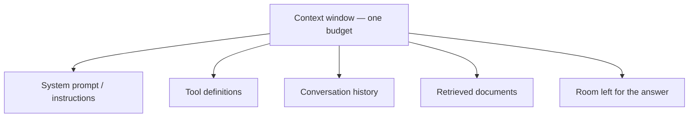

# LLM কীভাবে আচরণ করে, আর কোনটা বাছবেন {#ch-how-llms-behave}

> প্রথম AI feature ship করতে গিয়ে প্রতিটি team যে আচরণগুলো দেখে অবাক হয়, সেগুলো আগে থেকেই আন্দাজ করুন। তারপর প্রমাণ দেখে প্রতিটি route-এর জন্য আলাদা model বাছুন।

**এই অধ্যায়ে:** token আর context budget · stateless হওয়া আর তার দাম · sampling আর non-determinism · model বাছাইয়ের তিনটি অক্ষ · সংখ্যা দেখে সিদ্ধান্ত

## 💡 মূল ধারণা

Language model হলো একটি **stateless function**। এটা token-এর একটি sequence নেয়, আর পরের token কোনটা হতে পারে তার
একটি probability distribution ফেরত দেয়। Sampler সেখান থেকে একটি token বেছে নেয়, সেটা শেষে জুড়ে দেওয়া হয়, আর model
আবার চলে। Production-এ model কেমন আচরণ করবে তা বুঝতে এর চেয়ে বেশি ভেতরের কলকবজা জানার দরকার নেই।

*Stateless* মানে model কিছুই মনে রাখে না। আপনার application প্রতিটি turn-এ পুরো conversation আবার পাঠায়, তাই দশম
message-এর খরচ প্রথমটার চেয়ে বেশি। *Probability distribution* মানে একটিমাত্র সঠিক output নেই, তাই এর বিরুদ্ধে
equality assertion লেখা যায় না।

Model বাছাইও এই একই দৃষ্টিভঙ্গি থেকে আসে। Model-কে ধীর, দামি আর non-deterministic একটি function হিসেবে ধরুন, আর
model বাছুন **প্রতিটি route-এর জন্য**, পুরো application-এর জন্য একটা নয়। এই অংশে যে documentation assistant তৈরি হয়,
তাতে query classifier আর answer writer-এর সঠিক উত্তর আলাদা।

## কীভাবে কাজ করে

### Character নয়, token

Token হলো text-এর একটি টুকরো: প্রায়ই একটি গোটা শব্দ, প্রায়ই শব্দের একাংশ। English-এ গড়ে প্রতি token-এ মোটামুটি চারটি
character। Code, JSON, UUID আর non-Latin লিপিতে হিসাব অনেক খারাপ। তাই দেখতে ছোট একটি document আপনার আন্দাজের তিনগুণ
হতে পারে।

| Text | আনুমানিক token | কেন |
| --- | --- | --- |
| `The cat sat on the mat` | ~6 | চেনা শব্দ এক token-এই হয় |
| `f47ac10b-58cc-4372-a567-0e02b2c3d479` | ~25 | এলোমেলো hex-এ চেনা কোনো টুকরো নেই |
| 500 line-এর একটি TypeScript file | ~5,000 | Punctuation আর identifier ভেঙে টুকরো হয় |

**খরচ**, **context limit** আর **কাটা পড়া**, তিনটিরই একক token। `str.length` দেখে কখনো token আন্দাজ করবেন না।
Provider-এর নিজের counting endpoint-কে জিজ্ঞেস করুন। ওটা নির্ভুল, আর বিনা পয়সায়।

### Context window একটিই ভাগাভাগির budget

একটি request-এ সর্বোচ্চ যত token থাকতে পারে, সেটাই context window। Input আর output একই বরাদ্দ ভাগ করে নেয়। আর আপনি
যা পাঠাচ্ছেন বলে ভুলে গেছেন, সেটাও ওই বরাদ্দ থেকেই খায়।



**একটি সংখ্যার ওপর পাঁচজন দাবিদার। উত্তরের ভাগে পড়ে সবচেয়ে কম, কারণ ওটা বরাদ্দ হয় সবার শেষে।**

কয়েকটি tool আর একটি retrieval ধাপসহ লম্বা conversation-এ output-এর জন্য জায়গা খুব কম থাকে। উত্তর ছোট হতে থাকে,
তারপর বাক্যের মাঝখানে থেমে যায়। Model কোনো সতর্কবার্তা দেয় না। Response-এ একটি finish reason থাকে, যেটা বলে length
limit-এ ঠেকেছে। এজন্যই প্রথমে log করার জিনিস ওই field-টা।

### Stateless হওয়া, আর তার দাম

API কোনো session ধরে রাখে না। দশম turn-এ এক থেকে নয় নম্বর turn আবার যায়। প্রতিটি turn আগেরটার চেয়ে লম্বা, আর
পুরোটার জন্য আপনি আবার টাকা দেন। ফলে মোট খরচ বাড়ে conversation-এর দৈর্ঘ্যের **বর্গ** হারে।

| Turn | যত history পাঠানো হয় | মোট input token |
| --- | --- | --- |
| 1 | 0 | 500 |
| 5 | 4টি turn | ~7,500 |
| 20 | 19টি turn | ~105,000 |

Prompt caching আছে কারণ বারবার পাঠানো অংশের স্থির prefix প্রতিবার একই থাকে। পুরনো turn summarise বা মুছে ফেলার
ব্যবস্থা আছে কারণ একসময় পুরোটা আর আঁটে না।
[Chapter ?? — Context Engineering](#ch-context-engineering) দেখুন।

### Sampling: একই input কেন আলাদা উত্তর দেয়

Model একটি distribution ফেরত দেয়, আর sampler সেখান থেকে বাছে। সবসময় সবচেয়ে সম্ভাব্য token-টা নেওয়াকে বলে *greedy*
decoding। তাতে text হয় নিরস আর একঘেয়ে। তাই provider-রা sample করে। `temperature` ঠিক করে distribution কতটা সমান করে
দেওয়া হবে, আর `top_p` ঠিক করে কম সম্ভাব্য লেজের কতটা হিসাবে ধরা হবে।

**কম temperature-এর একটি call:**

```typescript
// Lower temperature narrows the distribution; it does not make the call deterministic.
const result = await generateText({
  model: MODEL,
  temperature: 0.2, // check result.warnings — not every model still accepts this
  maxOutputTokens: 512,
  prompt: userQuestion,
});
```

> ⚠️ **যা বদলাতে থাকে:** 2026-এর বেশ কয়েকটি frontier model sampling parameter **তুলে দিয়েছে**। ওগুলো পাঠালে request
> বাতিল হয়, বদলে আছে *reasoning effort*-এর একটি control। টেকসই নীতি হলো: output sample করা হয়, আর সেটা কতটা সাহসী হবে
> তার জন্য আপনি একটি knob পান। নিজের ধারণার ওপর ভরসা না করে SDK-র warning দেখুন।

**Temperature 0 দিলেই determinism আসে না।** Floating-point যোগ associative নয়, তাই ফল নির্ভর করে server request-গুলো কীভাবে
batch করেছে তার ওপর। তার ওপর provider-রা একই নামের আড়ালে model update করে।

### Model বাছাইয়ের তিনটি অক্ষ

| অক্ষ | কী বোঝায় | কোন সংকেত দেখবেন |
| --- | --- | --- |
| **Capability** | কয়েক ধাপের reasoning, লম্বা tool use, instruction মেনে চলা | Leaderboard নয়, আপনার eval-এর pass rate |
| **Latency** | Stream করলে প্রথম token আসতে কত সময়, নইলে মোট সময় | p95, আসল মাপের prompt-এ |
| **Cost** | Input আর output token-এর দাম, যা প্রায় 5× আলাদা | Request প্রতি নয়, প্রতিটি *শেষ হওয়া কাজ* ধরে খরচ |

এর মধ্যে দুটিকে optimise করতে পারবেন। Output stream হলে user টের পান **প্রথম** token-এর সময়টা। তাই যে ধীর model আগে
শুরু করে, সেটা বেশি দ্রুত মনে হতে পারে। যে সস্তা model-কে দুবার retry করতে হয়, সেটা আসলে সস্তা নয়।

### Frontier বনাম ছোট model

কাজটা **বদ্ধ** হলে ছোট model ভালো করে। মানে, উত্তরের পরিসর সীমিত, আর যা লাগবে সব input-এই আছে। কাজটা **খোলা**
হলে ছোট model দুর্বল।

| কাজের ধরন | ছোট model | Frontier model |
| --- | --- | --- |
| জানা label-এ classification | ✅ সাধারণত তফাত বোঝা যায় না | অপচয় |
| Schema ধরে extraction | ✅ সাধারণত ঠিক আছে | অপচয় |
| অস্পষ্টতার ওপর খোলামেলা reasoning | ❌ স্পষ্টতই খারাপ | ✅ দামের যোগ্য |
| অনেক ধাপের লম্বা tool use | ❌ পথ হারায়, loop-এ পড়ে | ✅ দামের যোগ্য |

বেশিরভাগ AI feature কয়েকটি বদ্ধ ধাপ আর একটি খোলা ধাপ জোড়া দিয়ে তৈরি। তাই ধাপ ধরে model বাছুন। Model-এর নাম আর দাম
কয়েক মাসেই বদলে যায়। বদ্ধ বনাম খোলার নিয়মটা বদলায় না।

### সংখ্যা দেখে সিদ্ধান্ত

Eval ছাড়া model বাছাই (মানে নির্দিষ্ট কিছু input-এর ওপর নম্বর দেওয়া একটি run ছাড়া) হলো engineering-এর পোশাক পরা
পছন্দ। পদ্ধতিটা এই:

1. Route থেকে **পঞ্চাশটি আসল input** নিন, ঝামেলার input-গুলোসহ।
2. আগে নম্বর দেওয়ার নিয়মটা লিখুন: exact match, schema ঠিক আছে কি না, একটি rubric, বা যাচাই করা একটি judge model।
3. প্রতিটি প্রার্থী model পঞ্চাশটির ওপরই চালান। Pass rate, p95 latency আর token লিখে রাখুন।
4. যে model মান ছোঁয়, তাদের মধ্যে **সবচেয়ে সস্তাটা** নিন। সবচেয়ে ভালোটা নয়।

আসল শৃঙ্খলা হলো চার নম্বর ধাপ। একটি মানদণ্ড না থাকলে সব জায়গায় সবচেয়ে শক্তিশালী model-টাই এমনিতে জিতে যায়।

**প্রতিটি route-এ একটি model id, সব এক জায়গায় রাখা:**

```typescript
// Swapping a candidate is a one-line change; shipping it is a deploy.
export const MODELS = {
  classifyIntent: "small-fast",       // closed task, hot path
  draftReply: "frontier",             // open task, human reviews it
  migrateCode: "frontier-high-effort" // open task, long horizon
} as const;
```

**Routing** প্রতিটি request-কে সেই সবচেয়ে সস্তা model-এ পাঠায়, যেটা কাজটা সামলাতে পারে। এর তিনটি লুকোনো খরচ আছে।
Router নিজেই একটি বাড়তি request, যার নিজস্ব error rate আছে। Cache model ধরে আলাদা থাকে, তাই cascade-এ cache-এর
পুনর্ব্যবহার হারায়। আর দুটি model মানে প্রতিটি provider release-এ দুটি eval suite আবার চালানো। তাই আগে সবচেয়ে
শক্তিশালী model-টাকে **কম reasoning effort**-এ মেপে দেখুন। একটি model, একটি cache আর একটি suite দিয়েই প্রায়ই একই
সাশ্রয় হয়।

## কখন ব্যবহার করবেন

Output-এর ভিন্নতা নিয়ে কী করবেন, তা নির্ভর করে output-টা কোথায় যাচ্ছে তার ওপর। কোন model, তা নির্ভর করে route-এর ওপর।

| পরিস্থিতি | এটা করুন | কেন |
| --- | --- | --- |
| Output যায় মানুষের কাছে, গদ্য হিসেবে পড়ার জন্য | ভিন্ন হতে দিন | ভিন্নতা চোখে পড়ে না, প্রায়ই ভালোও হয় |
| Output JSON হয়ে আপনার code-এ যায় | API-তেই schema বেঁধে দিন | আশা করার চেয়ে validation ভালো |
| Output একটি test-এ যায় | Property assert করুন, equality কখনো নয় | `toBe(...)` flaky হবে |
| Cache key দরকার | **Input**-কে hash করুন, output-কে কখনো নয় | Output স্থির identifier নয় |
| Route classify বা extract করে | Pass করে এমন সবচেয়ে ছোট model | এখানে capability-র টান নেই |
| Route অস্পষ্টতার ওপর reasoning করে | Frontier, বেশি effort | এই ব্যবধান এখনো ঘোচেনি |
| Route নিয়ন্ত্রিত কাজ সামলায় | নির্দিষ্ট version pin করুন | "Latest" একটি অনিয়ন্ত্রিত dependency |

## সাধারণ ভুল

**❌ String-এর দৈর্ঘ্য দেখে token আন্দাজ করা**

Log line-এর জন্য `text.length / 4` চলে, limit-এর জন্য ভুল। JSON payload বা UUID-এর column-এ হিসাব তিন-চারগুণ ছাড়িয়ে
যায়, আর request-টা provider-এর কাছে গিয়ে fail করে।

**❌ কাটা পড়া উত্তরকে quality-র সমস্যা ভাবা**

Response থেমেছে কারণ জায়গা ফুরিয়ে গেছে। "length" আর "stop" দুটি আলাদা bug।

**✅ প্রথম দিন থেকেই প্রতিটি request-এ token আর finish reason log করুন**

`usage.inputTokens`, `usage.outputTokens` আর finish reason রেখে দিতে কোনো খরচ নেই। "এটা ধীর, দামি বা কাটা কেন"
ধরনের বেশিরভাগ প্রশ্নের উত্তর এগুলো দিয়ে দেয়, কিছু reproduce করার আগেই।

**✅ Version pin করুন, আর প্রতিটি বদলে suite আবার চালান**

যে id "সবচেয়ে নতুন যেটা" তাতে গিয়ে দাঁড়ায়, সেটা আপনার critical path-এ একটি unpinned dependency। বদলটা একটি flag-এর
পেছনে ship করুন, যাতে upgrade খারাপ হলে শুধু toggle করলেই চলে। [Chapter ?? — Deployment Strategy, Rollback ও Feature Flag](#ch-deployment-strategies) দেখুন।

## 🔑 মূল শিক্ষা

- Model হলো একটি stateless function, যা token নিয়ে sample করা পরের token দেয়। Production-এর বেশিরভাগ চমক এখান থেকেই আসে।
- খরচ, limit আর কাটা পড়ার একক token। ভাগাভাগির context budget-এ উত্তরের পালা আসে সবার শেষে।
- Conversation-এর খরচ বাড়ে তার দৈর্ঘ্যের বর্গ হারে, কারণ প্রতিটি turn-এ পুরো history আবার যায়।
- Temperature শূন্য করলে distribution সরু হয়। কিন্তু call-টা তাতে reproducible হয় না।
- Route ধরে বাছুন: নিজের পঞ্চাশটি input-এ মাপা মান যে ছোঁয়, তাদের মধ্যে সবচেয়ে সস্তা model।

## Interview-এর প্রশ্ন

**Q: একই prompt প্রতিবার আলাদা উত্তর দেয় কেন, আর এটা test করবেন কীভাবে?**

Output একটি distribution থেকে sample করা। সবচেয়ে কম setting-এও batching আর floating-point-এর প্রভাবে ফল বদলায়। String
নয়, property test করুন: JSON parse হয়, উত্তরে একটি source-এর উল্লেখ আছে, label পাঁচটির একটি। গুণগত output-এর জন্য
নির্দিষ্ট একসেট input-এ নম্বর দিন, আর সময়ের সঙ্গে pass rate কোন দিকে যাচ্ছে দেখুন।

**Q: Conversation যত লম্বা হয়, তত ধীর আর দামি হয়। কেন?**

API stateless, তাই প্রতিটি turn-এ পুরো history আবার যায়। মোট খরচ বাড়ে quadratic হারে, আর latency বাড়ে input-এর মাপ
অনুযায়ী। সমাধান হলো স্থির prefix cache করা, আর পুরনো turn ছোট করে আনা।

**Q: আপনার summariser আধখানা বাক্য ফেরত দিচ্ছে। কোথায় খুঁজবেন?**

Prompt-এর আগে finish reason আর token-এর হিসাবে। সাধারণত হয় output-এর সীমা খুব কম ছিল, নয়তো input বাড়তে বাড়তে
জায়গা প্রায় ফুরিয়ে গিয়েছিল। Prompt নতুন করে লিখলে কিছুই ঠিক হয় না, কারণ model নিজে থামতে চায়নি।

**Q: একটি feature-এর জন্য frontier model আর সস্তা model-এর মধ্যে কীভাবে সিদ্ধান্ত নেবেন?**

দুটিকেই একই পঞ্চাশটি আসল input-এর ওপর চালাব, ফল দেখার আগেই নম্বর দেওয়ার নিয়ম লিখে রেখে। Pass rate, p95 latency
আর শেষ হওয়া প্রতিটি কাজের খরচ মিলিয়ে দেখব। তারপর মান ছোঁয় এমন সবচেয়ে সস্তাটা নেব। মানদণ্ড না থাকলে team-গুলো
classification-এর জন্যও frontier-এর দাম দেয়।

**Q: কোথায় ছোট model ব্যবহার করবেন না?**

যেখানেই কাজটা খোলা: requirement অস্পষ্ট, tool-এর লম্বা শিকল, অচেনা codebase জুড়ে বদল। ওখানে ছোট model সবচেয়ে
দামি উপায়ে fail করে: সাবলীল আর বিশ্বাসযোগ্য, দেখে ভাঙা মনে হয় না। ফলে ভুলটা ধরা পড়ে review-এ বা production-এ,
try-catch-এ নয়।

## এরপর কী পড়বেন

- [Chapter ?? — Context Engineering](#ch-context-engineering) — এই অধ্যায়ের budget-টা কীভাবে খরচ করবেন
- [Chapter ?? — Eval, Retrieval Metric ও Error Analysis](#ch-evals) — যে মানদণ্ড থাকলে model বাছাই প্রমাণের ওপর দাঁড়ায়, সেটা কীভাবে বানাবেন
- [Chapter ?? — Observability ও Cost Engineering](#ch-observability) — model বদলানোর আগে কোন lever-গুলো টানবেন
