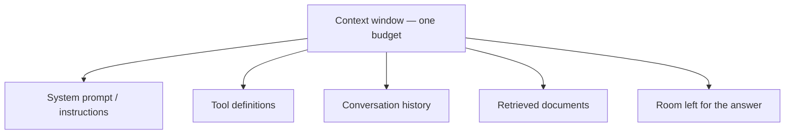

# LLM কীভাবে আচরণ করে, আর কোনটা বাছবেন {#ch-how-llms-behave}

> প্রথম AI feature ship করা প্রতিটি team যে আচরণগুলো দেখে অবাক হয়, সেগুলো আগে থেকে আন্দাজ করুন, তারপর প্রমাণের ভিত্তিতে প্রতিটি route-এর জন্য একটি model বাছুন।

**এই অধ্যায়ে:** token আর context budget · statelessness আর তার খরচ · sampling আর non-determinism · model বাছাইয়ের তিনটি অক্ষ · একটি সংখ্যা দিয়ে সিদ্ধান্ত নেওয়া

## 💡 মূল ধারণা

একটি language model হলো একটি **stateless function**। এটা token-এর একটি sequence নেয়, আর পরের token-এর ওপর একটি
probability distribution ফেরত দেয়। একটি sampler একটি token বাছে, আর সেটা যোগ করে model আবার চলে। Production-এর
আচরণ নিয়ে যুক্তি দিতে mechanism-এর এর বেশি কিছু জানার দরকার নেই।

*Stateless* মানে model কিছুই মনে রাখে না। আপনার application প্রতিটি turn-এ পুরো কথোপকথন আবার পাঠায়, তাই দশম
message প্রথমটার চেয়ে বেশি খরচ করে। *Probability distribution* মানে কোনো একক সঠিক output নেই, তাই এর বিরুদ্ধে
equality assertion লেখা যায় না।

Model বাছাইও একই দৃষ্টিভঙ্গি থেকে আসে। একে একটি ধীর, দামি, non-deterministic function হিসেবে দেখুন, আর application
প্রতি নয়, **route প্রতি** একটি বাছুন। এই অংশে যে documentation assistant বানানো হয়, তাতে query classifier আর answer
writer-এর সঠিক উত্তর আলাদা।

## কীভাবে কাজ করে

### অক্ষর নয়, token

একটি token হলো লেখার একটি টুকরো: প্রায়ই একটি শব্দ, প্রায়ই একটি শব্দের অংশ। English-এ গড়ে প্রতি token-এ প্রায়
চারটি অক্ষর। Code, JSON, UUID আর non-Latin script অনেক খারাপ করে, তাই ছোট দেখতে একটি document আপনার আন্দাজের তিন
গুণ হতে পারে।

| লেখা | আনুমানিক token | কেন |
| --- | --- | --- |
| `The cat sat on the mat` | ~6 | সাধারণ শব্দ একটি করে token |
| `f47ac10b-58cc-4372-a567-0e02b2c3d479` | ~25 | Random hex-এ কোনো সাধারণ টুকরো নেই |
| 500 line-এর একটি TypeScript file | ~5,000 | Punctuation আর identifier টুকরো টুকরো হয়ে যায় |

Token হলো **খরচের**, **context limit-এর** আর **truncation-এর** একক। কখনো `str.length` থেকে আন্দাজ করবেন না।
Provider-এর নিজস্ব counting endpoint-কে জিজ্ঞেস করুন, যেটা নির্ভুল আর বিনামূল্যে।

### Context window একটিই shared budget

Context window হলো একটি request-এ সর্বোচ্চ যতগুলো token থাকতে পারে। Input আর output এই বরাদ্দ ভাগ করে নেয়, আর
ভাগ নেয় সেই সবকিছুও, যা আপনি পাঠাচ্ছেন বলে ভুলে গেছেন।



**একটি সংখ্যার ওপর পাঁচজন দাবিদার। উত্তর চাপা পড়ে, কারণ তাকে বরাদ্দ দেওয়া হয় সবার শেষে।**

কয়েকটি tool আর একটি retrieval ধাপসহ একটি লম্বা কথোপকথন output-এর জন্য সামান্য জায়গা রাখে। উত্তর ছোট হতে থাকে,
তারপর বাক্যের মাঝখানে থেমে যায়। Model কোনো সতর্কবার্তা দেয় না। Response-এ একটি finish reason থাকে, যা বলে এটা
length limit-এ পৌঁছেছে। এই কারণেই ওই field-টাই প্রথমে log করার জিনিস।

### Statelessness, আর তার খরচ

API কোনো session ধরে রাখে না। দশম turn এক থেকে নয় নম্বর turn আবার পাঠায়। প্রতিটি turn আগেরটার চেয়ে লম্বা, আর
আপনি পুরোটার দাম আবার দেন, তাই মোট খরচ কথোপকথনের দৈর্ঘ্যের **বর্গ** হারে বাড়ে।

| Turn | পাঠানো history | মোট input token |
| --- | --- | --- |
| 1 | 0 | 500 |
| 5 | 4 turn | ~7,500 |
| 20 | 19 turn | ~105,000 |

Prompt caching আছে, কারণ এই আবার-পাঠানোর stable prefix প্রতিবার একই। পুরোনো turn summarise বা clear করার পদ্ধতি
আছে, কারণ শেষ পর্যন্ত আবার-পাঠানোটা আর জায়গায় আঁটে না।
[Chapter ?? — Context Engineering](#ch-context-engineering) দেখুন।

### Sampling: একই input কেন আলাদা উত্তর দেয়

Model একটি distribution ফেরত দেয়, আর একটি sampler তা থেকে বাছে। সবসময় সবচেয়ে সম্ভাব্য token নেওয়াকে বলে *greedy*
decoding, আর তা নিষ্প্রাণ, একঘেয়ে লেখা দেয়। তাই provider-রা sample করে। `temperature` ঠিক করে distribution-কে কতটা
সমান করা হবে, আর `top_p` ঠিক করে কম সম্ভাব্য tail-এর কতটা বিবেচনা করা হবে।

**একটি low-temperature call:**

```typescript
// Lower temperature narrows the distribution; it does not make the call deterministic.
const result = await generateText({
  model: MODEL,
  temperature: 0.2, // check result.warnings — not every model still accepts this
  maxOutputTokens: 512,
  prompt: userQuestion,
});
```

> ⚠️ **যা বদলাতে থাকে:** 2026-এর বেশ কয়েকটি frontier model sampling parameter **সরিয়ে দিয়েছে**। এগুলো পাঠানো
> request তারা reject করে, আর তার বদলে একটি *reasoning effort* control দেয়। টেকসই নীতি: output sample করা হয়, আর সেটা
> কতটা দুঃসাহসী হবে তার জন্য আপনি একটি knob পান। আপনার ধারণা নয়, আপনার SDK-র warning দেখুন।

**Temperature 0 কোনো determinism switch নয়।** Floating-point যোগ associative নয়, তাই ফলাফল নির্ভর করে server
request-গুলো কীভাবে batch করেছে তার ওপর। Provider-রা একটি স্থির নামের পেছনে model update-ও করে।

### Model বাছাইয়ের তিনটি অক্ষ

| অক্ষ | মানে কী | কোন সংকেত দেখবেন |
| --- | --- | --- |
| **Capability** | বহু ধাপের reasoning, লম্বা tool use, instruction মেনে চলা | আপনার eval pass rate, কোনো leaderboard নয় |
| **Latency** | Stream করলে প্রথম token পর্যন্ত সময়; নইলে মোট সময় | আসল prompt আকারে p95 |
| **খরচ** | প্রতি input আর output token-এর দাম, যা প্রায় 5× আলাদা | *সম্পূর্ণ হওয়া কাজ* প্রতি খরচ, request প্রতি নয় |

আপনি দুটো optimise করতে পারবেন। Output stream হলে user যা অনুভব করেন, তা হলো **প্রথম** token পর্যন্ত সময়। তাই
একটি ধীর model যা আগে শুরু করে, সেটা দ্রুত মনে হতে পারে। যে সস্তা model-এর দুবার retry লাগে, সেটা সস্তা নয়।

### Frontier বনাম ছোট

কাজ যখন **closed**, তখন ছোট model শক্তিশালী: উত্তরের পরিসর সীমিত, আর input-এ দরকারি সবকিছু আছে। কাজ যখন
**open**, তখন এটা দুর্বল।

| কাজের ধরন | ছোট model | Frontier model |
| --- | --- | --- |
| জানা label-এ classification | ✅ সাধারণত পার্থক্য করা যায় না | অপচয় |
| একটি schema অনুযায়ী extraction | ✅ সাধারণত ঠিকঠাক | অপচয় |
| অস্পষ্টতার ওপর খোলা ধরনের reasoning | ❌ স্পষ্টতই খারাপ | ✅ দামের যোগ্য |
| দীর্ঘমেয়াদি tool use, অনেক ধাপ | ❌ পথ হারায় আর loop-এ পড়ে | ✅ দামের যোগ্য |

বেশিরভাগ AI feature কয়েকটি closed ধাপ আর একটি open ধাপ জোড়া দেয়, তাই ধাপ অনুযায়ী model বাছুন। Model-এর নাম আর
দাম কয়েক মাসের মধ্যে বদলায়। Closed বনাম open নিয়মটা বদলায় না।

### একটি সংখ্যা দিয়ে সিদ্ধান্ত নেওয়া

Eval (নির্দিষ্ট input-এর ওপর একটি score করা run) ছাড়া model বাছাই হলো engineering-এর পোশাক পরা পছন্দ। পদ্ধতি:

1. Route থেকে **পঞ্চাশটি আসল input** নিন, ঝামেলার গুলোসহ।
2. আগে grading rule লিখুন: exact match, schema validity, একটি rubric, বা যাচাই করা একটি judge model।
3. প্রতিটি candidate-কে পঞ্চাশটির ওপরেই চালান। Pass rate, p95 latency আর token লিখে রাখুন।
4. **যে সবচেয়ে সস্তা model মানদণ্ড পার হয়**, সেটা নিন — সবচেয়ে ভালোটা নয়।

ধাপ 4-ই হলো শৃঙ্খলা। কোনো মানদণ্ড না থাকলে সবচেয়ে শক্তিশালী model সব জায়গায় default হিসেবে জিতে যায়।

**Route প্রতি একটি model id, এক জায়গায় রাখা:**

```typescript
// Swapping a candidate is a one-line change; shipping it is a deploy.
export const MODELS = {
  classifyIntent: "small-fast",       // closed task, hot path
  draftReply: "frontier",             // open task, human reviews it
  migrateCode: "frontier-high-effort" // open task, long horizon
} as const;
```

**Routing** প্রতিটি request-কে সেই সবচেয়ে সস্তা model-এ পাঠায়, যা এটা সামলাতে পারে। এর তিনটি লুকানো খরচ আছে। Router
একটি বাড়তি request, যার নিজস্ব error rate আছে। Cache model-ভিত্তিক, তাই একটি cascade cache-এর পুনর্ব্যবহার হারায়।
আর দুটো model মানে প্রতিটি provider release-এ আবার চালানোর জন্য দুটো eval suite। তাই আগে সবচেয়ে শক্তিশালী model-টা
**কম reasoning effort-এ** মাপুন। একটি model, একটি cache আর একটি suite প্রায়ই একই সাশ্রয় দেয়।

## কখন ব্যবহার করবেন

Variance নিয়ে কী করবেন, তা নির্ভর করে output কোথায় যায় তার ওপর। কোন model ব্যবহার করবেন, তা নির্ভর করে route-এর
ওপর।

| পরিস্থিতি | এটা করুন | কেন |
| --- | --- | --- |
| Output যায় একজন মানুষের কাছে, যিনি গদ্য পড়েন | বদলাতে দিন | পার্থক্যটা চোখে পড়ে না, আর প্রায়ই ভালো হয় |
| Output JSON হিসেবে আপনার code-এ যায় | API-তেই schema বেঁধে দিন | আশা করার চেয়ে validation ভালো |
| Output একটি test-এ যায় | Property assert করুন, কখনো equality নয় | `toBe(...)` flaky হবে |
| আপনার একটি cache key দরকার | **Input** hash করুন, কখনো output নয় | Output stable identifier নয় |
| Route classify বা extract করে | সবচেয়ে ছোট model যা pass করে | Capability এখানে সীমাবদ্ধতা নয় |
| Route অস্পষ্টতার ওপর reasoning করে | Frontier, বেশি effort | এই ফাঁক এখনো বন্ধ হয়নি |
| Route নিয়ন্ত্রিত (regulated) কাজ সামলায় | একটি নির্দিষ্ট version pin করুন | "Latest" একটি অনিয়ন্ত্রিত dependency |

## সাধারণ ভুল

**❌ String-এর দৈর্ঘ্য থেকে token আন্দাজ করা**

`text.length / 4` একটি log line-এর জন্য ঠিক আছে, কিন্তু একটি limit-এর জন্য ভুল। একটি JSON payload বা একটি UUID
column একে তিন-চার গুণ ছাড়িয়ে যায়, আর request provider-এ fail করে।

**❌ কেটে যাওয়া উত্তরকে মানের সমস্যা মনে করা**

Response থেমেছে, কারণ জায়গা ফুরিয়ে গেছে। "length" আর "stop" আলাদা bug।

**✅ প্রথম দিন থেকেই প্রতিটি request-এ token আর finish reason log করুন**

`usage.inputTokens`, `usage.outputTokens` আর finish reason লিখে রাখতে কোনো খরচ নেই। কিছু reproduce করার আগেই এরা
"এটা কেন ধীর, দামি বা কাটা" ধরনের বেশিরভাগ প্রশ্নের উত্তর দেয়।

**✅ Version pin করুন, আর প্রতিটি পরিবর্তনে suite আবার চালান**

যে id "যেটা সবচেয়ে নতুন" তাতে resolve হয়, সেটা আপনার critical path-এ একটি unpinned dependency। পরিবর্তনটা একটি
flag-এর পেছনে ship করুন, যাতে একটি খারাপ upgrade শুধু একটি toggle হয়।
[Chapter ?? — Deployment Strategy, Rollback ও Feature Flag](#ch-deployment-strategies) দেখুন।

## 🔑 মূল শিক্ষা

- একটি model হলো token থেকে একটি sample করা পরের token-এ যাওয়া stateless function, আর production-এর বেশিরভাগ চমক এখান থেকেই আসে।
- Token হলো খরচ, limit আর truncation-এর একক, আর একটি shared context budget-এ উত্তর হলো শেষ দাবিদার।
- কথোপকথনের খরচ তার দৈর্ঘ্যের বর্গ হারে বাড়ে, কারণ প্রতিটি turn-এ পুরো history আবার পাঠানো হয়।
- Temperature শূন্য distribution-কে সরু করে; এটা একটি call-কে reproducible বানায় না।
- Route প্রতি বাছুন: আপনার নিজের পঞ্চাশটি input-এ মাপা মানদণ্ড পার হওয়া সবচেয়ে সস্তা model।

## Interview-এর প্রশ্ন

**Q: একই prompt প্রতিবার আলাদা উত্তর দেয় কেন, আর আপনি এটা কীভাবে test করবেন?**

Output একটি distribution থেকে sample করা হয়। সবচেয়ে নিচের setting-এও batching আর floating-point-এর প্রভাব ফলাফল
বদলায়। String নয়, property test করুন: JSON parse হয়, উত্তর একটি source উল্লেখ করে, label পাঁচটির একটি। গুণগত
output-এর জন্য একটি নির্দিষ্ট input set-এ score দিন, আর সময়ের সাথে pass rate লক্ষ করুন।

**Q: একটি কথোপকথন যত লম্বা চলে, তত ধীর আর দামি হয়। কেন?**

API stateless, তাই প্রতিটি turn পুরো history আবার পাঠায়। মোট খরচ quadratic হারে বাড়ে, আর latency input-এর আকার
অনুসরণ করে। সমাধান হলো stable prefix cache করা আর পুরোনো turn compact করা।

**Q: আপনার summariser আধখানা বাক্য ফেরত দেয়। কোথায় খুঁজবেন?**

Prompt-এর আগে finish reason আর token-এর সংখ্যায়। সাধারণত output cap খুব কম ছিল, বা input এত বড় হয়েছিল যে সামান্য
জায়গা বাকি ছিল। Prompt নতুন করে লিখলে কিছুই ঠিক হয় না: model থামার সিদ্ধান্ত নেয়নি।

**Q: একটি feature-এর জন্য frontier model আর একটি সস্তা model-এর মধ্যে কীভাবে সিদ্ধান্ত নেবেন?**

দুটোকেই একই পঞ্চাশটি আসল input-এ চালান, ফলাফল দেখার আগেই grading rule লিখে। Pass rate, p95 latency আর সম্পূর্ণ
হওয়া কাজ প্রতি খরচ তুলনা করুন, তারপর মানদণ্ড পার হওয়া সবচেয়ে সস্তাটা নিন। মানদণ্ড না থাকলে team-গুলো classification-এর
জন্য frontier-এর দাম দেয়।

**Q: কোথায় আপনি ছোট model ব্যবহার করবেন না?**

যেখানে কাজ open: অস্পষ্ট requirement, লম্বা tool chain, অপরিচিত codebase জুড়ে পরিবর্তন। ছোট model সেখানে দামি
উপায়ে fail করে: সাবলীল আর বিশ্বাসযোগ্য, স্পষ্টভাবে ভাঙা নয়। তাই ভুলটা ধরা পড়ে review বা production-এ, try-catch-এ নয়।

## এরপর কী পড়বেন

- [Chapter ?? — Context Engineering](#ch-context-engineering) — এই অধ্যায় যে budget বর্ণনা করে, সেটা কীভাবে খরচ করবেন
- [Chapter ?? — Eval, Retrieval Metric ও Error Analysis](#ch-evals) — যে মানদণ্ড model বাছাইকে প্রমাণে পরিণত করে, সেটা কীভাবে বানাবেন
- [Chapter ?? — Observability ও Cost Engineering](#ch-observability) — model বদলানোর আগে যে lever-গুলো টানবেন
