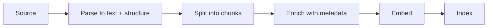

# Ingestion ও Chunking {#ch-ingestion-and-chunking}

> Document এমনভাবে ভাগ করুন যাতে ঠিক passage-টা পুরোটা একসঙ্গে খুঁজে পাওয়া যায়, আর এতটা metadata রাখুন যাতে নতুন করে শুরু না করেই filter, cite আর re-index করা যায়।

**এই অধ্যায়ে:** pipeline-এর পাঁচটি ধাপ · নির্দিষ্ট মাপে কাটা কেন ব্যর্থ হয় · গঠন বুঝে chunking · overlap আর context header · metadata-কে প্রথম শ্রেণির field হিসেবে ধরা · index তাজা রাখা

## 💡 মূল ধারণা

Chunk হলো ভাগ করা document-এর একটি টুকরো, আর আপনার system যা retrieve করতে পারে তার মধ্যে এটাই সবচেয়ে ছোট একক।
তাই **আপনি সবসময় পুরো একটি chunk-ই খুঁজে পান। কোনো chunk যদি একটি ধারণাকে মাঝখান দিয়ে কেটে ফেলে, সেই ধারণা আর
খুঁজে পাওয়া যায় না।** কোনো reranker সেটা ফেরাতে পারে না, ভালো model সেটা জোড়া লাগাতে পারে না, আর prompt বদলেও
এর পাশ কাটানো যায় না।

এ কারণেই retrieval system-এ chunking সবার আগে আসে। সস্তা একটি embedding model (যা text-কে সংখ্যার একটি vector
বানায়) ভালো chunk পেলে সেই frontier model-কেও হারিয়ে দেয়, যার chunk প্রতি 512 character-এ কাটা। দ্বিতীয় team
সাধারণত splitter-এর দিকে তাকানোর আগে কয়েক সপ্তাহ ধরে retriever tune করে।

> Document-এর লেখক যেভাবে সাজিয়েছেন, সেভাবেই chunk করুন। ধারণা কোথায় শেষ হচ্ছে, তা তিনি আগেই ঠিক করে রেখেছেন।

## কীভাবে কাজ করে

### Pipeline



**পাঁচটি ধাপ। প্রথম তিনটিতে যা সিদ্ধান্ত হয়, পরের সব ধাপ সেটাই বয়ে নিয়ে চলে।**

Parsing এমন ধাপ, যার গুরুত্ব লোকে কম বোঝে। যে PDF তার table-এর গঠন হারায়, কিংবা যে HTML page তার navigation menu
রেখে দেয়, সেখান থেকে ভাগ করার আগেই ময়লা chunk আসে। Heading, list, table, code block-এর মতো গঠন বের করে আনুন, কারণ
পরের ধাপে সেটা লাগবে।

### নির্দিষ্ট মাপে কাটা কেন ব্যর্থ হয়

প্রতি 500 character-এ কাটা হলো tutorial-এর default। এটা document ঠিক সেই জায়গাগুলোতেই ভাঙে, যেগুলো গুরুত্বপূর্ণ।

```text
Chunk 41: "...To rotate the signing key, first disable"
Chunk 42: "the old key, then run the rotation job. If you skip..."
```

এখন "how do I rotate the signing key" query মেলে chunk 41-এর সঙ্গে, যেখানে উত্তর নেই, আর chunk 42-এর সঙ্গে, যেখানে
প্রশ্নের শব্দগুলো নেই। দুটিই মাঝারি score পায়। কোনোটাই আত্মবিশ্বাসের সঙ্গে retrieve হয় না।

| পদ্ধতি | কীসের ভিত্তিতে কাটে | কোথায় মানায় |
| --- | --- | --- |
| **Fixed size** | Character বা token-এর সংখ্যা | কোথাও ভালো নয়; শুধু baseline হিসেবে |
| **Recursive** | আগে অনুচ্ছেদ, তারপর বাক্য, তারপর শব্দ | নির্ভরযোগ্য গঠন নেই এমন লেখা |
| **Structure-aware** | Heading, section, list আর code-এর সীমানা | Markdown, HTML, docs — বেশিরভাগ corpus |
| **Semantic** | Embedding distance দিয়ে ধরা বিষয়ের বদল | গঠনহীন লম্বা transcript |
| **Whole document** | কিছুই না | ছোট page, FAQ entry, ticket |

Structure-aware splitting-ই ঠিক default। Documentation, wiki আর knowledge base-এর নিজেদের সীমানা আগে থেকেই থাকে,
আর সেগুলো মানতে প্রায় কোনো খরচই নেই।

```typescript
interface Chunk {
  readonly text: string;
  readonly sourcePath: string;      // for the citation
  readonly headingPath: string[];   // ['Security', 'Key rotation'] — context and filter
  readonly updatedAt: string;       // for freshness ranking and staleness checks
  readonly tokens: number;
}

function chunkMarkdown(doc: ParsedDoc, maxTokens = 500): Chunk[] {
  return doc.sections.flatMap((section) =>
    section.tokens <= maxTokens
      ? [toChunk(section)]                    // a whole section is the ideal chunk
      : splitByParagraph(section, maxTokens), // only split what genuinely does not fit
  );
}
```

Function-টার গড়নটাই আসল কথা: **যা এঁটে যায় না, শুধু সেটাই ভাগ করুন।** 200 token-এর একটি section তার 100 token-এর
দুটি অর্ধেকের চেয়ে ভালো chunk। যে splitter সবসময় কাটে, সেটা বিনামূল্যে পাওয়া গঠন ফেলে দেয়।

### মাপ, overlap আর header-এর কৌশল

| Chunk-এর মাপ | Retrieval precision | উত্তরে context | কোথায় মানায় |
| --- | --- | --- | --- |
| ছোট (100–250 token) | বেশি — match-গুলো নির্দিষ্ট | কম; model আশপাশের detail নাও পেতে পারে | FAQ, reference, API entry |
| মাঝারি (400–800) | ভারসাম্যপূর্ণ | সাধারণত যথেষ্ট | Documentation, article |
| বড় (1,000+) | কম — একটি match অনেক বাজে জিনিস টেনে আনে | সমৃদ্ধ | বর্ণনামূলক লেখা, আইনি লেখা, contract |

কোনো ঠিক সংখ্যা নেই। যে অধ্যায় আপনাকে একটি সংখ্যা দেয়, সেটা আপনার corpus নিয়ে আন্দাজ করছে। ঠিক যা, তা হলো পদ্ধতি।
Document-এর ধরন দেখে একটি শুরুর মাপ নিন, তারপর golden set-এর (জানা উত্তরসহ আসল প্রশ্নের একটি স্থির তালিকা) ওপর recall
মাপুন, আর সেই অনুযায়ী বদলান। Recall মানে ঠিক chunk কত বার ফিরে আসে। কীভাবে, তা দেখানো আছে
[Chapter ?? — Eval, Retrieval Metric ও Error Analysis](#ch-evals)-এ।

**Overlap** আগের chunk-এর শেষ এক-দুটি বাক্য আবার রাখে। সীমানায় text হারানোর বিরুদ্ধে এটা সস্তা বিমা, আর সাধারণত
দশ থেকে পনেরো শতাংশ রাখা হয়। এতে storage লাগে, কিছু retrieval-ও দুবার আসে। বদলে বেঁচে যায় সেই বাক্যটা, যা নইলে
কাটা পড়ত।

**Context header** এর চেয়ে ভালো কৌশল, খরচও কম। Embed করার আগে প্রতিটি chunk-এর শুরুতে তার document-এর title আর
heading path জুড়ে দিন:

```text
[Platform Handbook › Security › Key rotation]
To rotate the signing key, first disable the old key...
```

এখন document-এর অনেক গভীরের chunk-ও বলে দেয় সেটা কী নিয়ে। ছোট chunk-এর ক্ষেত্রে এতে retrieval মাপার মতো ভালো হয়।
কারণ context ছাড়া একটি টুকরো embed হয় সবকিছুর কাছাকাছি, আবার কোনোকিছুরই কাছে নয়।

### Metadata তার জায়গা আদায় করে নেয়

Metadata কোনো documentation নয়। এটা একাধারে filter, citation আর তাজা থাকার signal। পরে যোগ করতে গেলে পুরো corpus
আবার ingest করতে হয়।

| Field | কাজে লাগে |
| --- | --- |
| `sourcePath`, `url`, line বা page | এমন citation, যাতে user click করতে পারেন |
| `headingPath` | Filtering আর context header |
| `updatedAt`, `version` | Archive করা docs-এর বদলে বর্তমান docs-কে আগে রাখা |
| `visibility`, `tenantId` | Query-র সময় permission filtering |
| `docType` | Routing — changelog আর tutorial আলাদা প্রশ্নের উত্তর দেয় |

বিশেষ করে permission-এর field। এগুলো ছাড়া retrieval system হয় এক tenant-এর document আরেক tenant-এর কাছে ফাঁস করে,
নয়তো দ্বিতীয় customer আসামাত্র নতুন করে বানাতে হয়।

### তাজা রাখা

Index হলো আপনার document-এর একটি cache, আর cache যেভাবে বাসি হয়, এটাও সেভাবেই হয়।

- **সময় ধরে নয়, বদল হলে re-embed করুন।** Chunk-এর text hash করুন। Hash না বদলালে embedding call বাদ দিন। বড় corpus-এ
  এটাই কয়েক মিনিট আর কয়েক ঘণ্টার পার্থক্য।
- **Delete-কেও ছড়িয়ে পড়তে হবে।** মুছে ফেলা document-এর chunk যদি index-এ থেকে যায়, system আত্মবিশ্বাসের সঙ্গে
  সেগুলো cite করে। এ ধরনের bug চোখে পড়া বেশ কঠিন।
- **Embedding model বদলানো মানে সবকিছু আবার embed করা।** দুটি model-এর vector তুলনা করা যায় না। তাই ধাপে ধাপে
  migration নয়, পুরো rebuild আর একবারে switch করার পরিকল্পনা করুন।

> ⚠️ একই index-এ দুটি embedding model-এর vector মেশালে চুপচাপ অর্থহীন ফল আসে। কিছুই error throw করে না।
> Similarity score-গুলো শুধু আর কিছু বোঝায় না।

## কখন ব্যবহার করবেন

| Corpus | কীসের ভিত্তিতে chunk | মাপ |
| --- | --- | --- |
| Markdown documentation | Heading section | 400–800 token |
| API reference | প্রতি chunk-এ একটি entry | পুরো entry |
| Support ticket | পুরো ticket | পুরো document |
| লম্বা PDF, contract | আগে section, তারপর অনুচ্ছেদ | 800–1,200, overlap সহ |
| Meeting transcript | Semantic বা time window | 500, অনেকটা overlap সহ |
| Source code | Function বা class | পুরো unit |

## সাধারণ ভুল

**❌ Character গুনে কেটে দিয়ে ভুলে যাওয়া**

> এতে বাক্য, table আর code block মাঝখান দিয়ে কাটা পড়ে। আর তা থেকে আসা retrieval-এর ব্যর্থতা কয়েক সপ্তাহ ধরে
> model-এর ব্যর্থতা বলে মনে হয়।

**❌ Context ছাড়া খালি একটি টুকরো embed করা**

> "Then run the rotation job." এমন কিছুর কাছে embed হয়, যা কোনো কাজের নয়। শুরুতে heading path জুড়ে দিন।

**❌ Blog post পড়ে chunk-এর মাপ ঠিক করা**

> ঠিক মাপ নির্ভর করে আপনার document আর আপনার প্রশ্নের ওপর। Golden set থাকলে সেটা খুঁজে বের করা এক ঘণ্টার পরীক্ষা।

**✅ Ingestion-এর সময়েই metadata রাখুন, এখনো কাজে লাগছে না এমন field-ও**

> পরে `tenantId` যোগ করা মানে পুরো corpus আবার ingest করা। এখন যোগ করলে খরচ মাত্র একটি column।

## 🔑 মূল শিক্ষা

- Chunk হলো retrieve করা যায় এমন সবচেয়ে ছোট একক, তাই যে chunk একটি ধারণাকে কেটে ফেলে, সেই ধারণা আর খুঁজে পাওয়া যায় না।
- Document-এর নিজের গঠন ধরে ভাগ করুন, আর শুধু সেই section ভাগ করুন, যা সত্যিই এঁটে যায় না।
- প্রতিটি chunk-এর শুরুতে তার document আর heading path দিন। Context ছাড়া টুকরো কোনোকিছুর কাছেই embed হয় না।
- Metadata একাধারে filter, citation আর permission boundary। পরে যোগ করা মানে সবকিছু আবার ingest করা।
- দুটি embedding model-এর vector তুলনা করা যায় না, তাই model বদলানো মানে পুরো rebuild।

## Interview-এর প্রশ্ন

**Q: একটি chunk কত বড় হওয়া উচিত?**

এটা document-এর ওপর নির্ভর করে, তাই আমি সংখ্যা দিয়ে নয়, পদ্ধতি দিয়ে উত্তর দেব। Reference entry-র জন্য ছোট chunk
ভালো, কারণ সেখানে precision জরুরি আর প্রতিটি entry নিজেই সম্পূর্ণ। বর্ণনামূলক বা আইনি লেখার জন্য বড় chunk ভালো, কারণ
অর্থ কয়েক অনুচ্ছেদ জুড়ে ছড়িয়ে থাকে। আমি document-এর ধরন দিয়ে শুরু করব, আসল প্রশ্ন দিয়ে একটি golden set বানাব, আর
কয়েকটি মাপে recall মাপব। কেউ যদি নির্দিষ্ট একটি সংখ্যা বলে দেন, তিনি সামনের corpus-এ সেটা মেপে দেখেননি।

**Q: Embedding model-এর চেয়ে chunking বেশি গুরুত্বপূর্ণ কেন?**

কারণ retrieval সবসময় পুরো chunk-ই ফেরত দেয়। উত্তর যদি কোনো সীমানা পেরিয়ে যায়, কোনো chunk-এই সেটা পুরোটা থাকে না।
ভালো embedding model শুধু অসম্পূর্ণ chunk-গুলোকে আরও নিখুঁতভাবে সাজায়। কী খুঁজে পাওয়া সম্ভব, তার সর্বোচ্চ সীমা ঠিক
করে chunking। আর embedding model ঠিক করে আপনি সেই সীমার কত কাছে পৌঁছাবেন। Team-গুলো সাধারণত দ্বিতীয়টা tune করে,
প্রথমটার দিকে তাকায়ই না।

**Q: কোন metadata রাখবেন, আর ingestion-এর সময়েই কেন?**

Citation-এর জন্য source path আর অবস্থান, context আর filtering-এর জন্য heading path, তাজা থাকার জন্য update হওয়ার
timestamp, আর permission-এর জন্য visibility বা tenant field। Ingestion-এর সময়েই রাখি, কারণ metadata থাকে index করা
record-এর ওপর। পরে একটি field যোগ করা মানে পুরো corpus আবার ঘুরে আসা। Field-টা যদি embed করা text বদলায়, তাহলে প্রতিটি
embedding-এর দামও দ্বিতীয়বার দিতে হয়। পরে যোগ করতে সবচেয়ে বেশি কষ্ট permission-এর field-এ।

**Q: আপনি embedding model বদলালেন। চালু index-এর কী হবে?**

সেটা আবার বানাতে হবে। আলাদা model-এর vector থাকে আলাদা space-এ, তাই তাদের মধ্যে similarity-র কোনো অর্থ নেই। ব্যর্থতাটা
চুপচাপ হয়, কারণ অঙ্ক তবু সংখ্যা দিয়ে যায়। আমি পুরনো index-এর পাশে নতুনটা বানাব, একই golden set-এ দুটিকেই যাচাই
করব, আর নতুনটা জিতলে switch করব। জায়গায় দাঁড়িয়ে migrate করব না।

**Q: Source document-এর সঙ্গে index-কে তাল মিলিয়ে রাখবেন কীভাবে?**

প্রতিটি chunk-এর content hash করুন, আর শুধু hash বদলালেই re-embed করুন। এতে incremental run এত সস্তা হয় যে প্রতিটি
publish-এ চালানো যায়। Deletion যতটা মনে হয়, তার চেয়ে বেশি গুরুত্বপূর্ণ। কোনো document সরিয়ে ফেলা হলো, অথচ তার chunk
index-এ থেকে গেল, তাহলে system পুরো আত্মবিশ্বাস নিয়ে সেগুলো retrieve আর cite করবে। কোনো user ধরিয়ে না দেওয়া পর্যন্ত
কেউ টেরই পায় না। তাই pipeline-কে শুধু upsert (insert-or-update write) নয়, মুছে ফেলাটাও আলাদা করে সামলাতে হবে।

## এরপর কী পড়বেন

- [Chapter ?? — Embedding, Vector Store ও Retrieval](#ch-retrieval) — এই chunk-গুলো কোথায় থাকে, আর query-র সময় তাদের কী হয়
- [Chapter ?? — Eval, Retrieval Metric ও Error Analysis](#ch-evals) — মাপের প্রশ্নটা একটি সংখ্যা দিয়ে কীভাবে মেটাবেন
