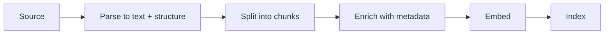

# Ingestion ও Chunking {#ch-ingestion-and-chunking}

> Document এমনভাবে ভাগ করুন যাতে সঠিক অংশটি পুরোটা খুঁজে পাওয়া যায়। আর এতটুকু metadata রাখুন, যাতে filter, citation আর re-index শূন্য থেকে শুরু না করেই করা যায়।

**এই অধ্যায়ে:** pipeline-এর পাঁচটি ধাপ · fixed-size splitting কেন ব্যর্থ হয় · structure-aware chunking · overlap আর context header · metadata প্রথম শ্রেণির field হিসেবে · index-কে হালনাগাদ রাখা

## 💡 মূল ধারণা

Chunk হলো ভাগ করা document-এর একটি টুকরো, আর এটাই আপনার system-এর retrieve করার সবচেয়ে ছোট একক। তাই
**আপনি সবসময় একটি পুরো chunk-ই খুঁজে পাবেন। যে chunk একটি ধারণাকে মাঝখান থেকে কেটে ফেলে, সেই ধারণা আর খুঁজে
পাওয়া যায় না।** কোনো reranker সেটা ফেরত আনে না, কোনো ভালো model সেটা সারায় না, আর কোনো prompt বদলে এর
পাশ কাটানো যায় না।

এই কারণেই একটি retrieval system-এ chunking সবকিছুর আগে আসে। ভালো chunk-সহ একটি সস্তা embedding model
(এটা text-কে সংখ্যার একটি vector-এ পরিণত করে) প্রতি 512 character-এ কাটা chunk-সহ একটি frontier model-কে
হারিয়ে দেয়। দ্বিতীয় team সাধারণত splitter-এর দিকে তাকানোর আগে কয়েক সপ্তাহ retriever tune করে কাটায়।

> Document-এর লেখক যেভাবে সাজিয়েছেন, সেভাবেই chunk করুন। ধারণা কোথায় শেষ হয়, তা তিনি আগেই ঠিক করে রেখেছেন।

## কীভাবে কাজ করে

### Pipeline



**পাঁচটি ধাপ। পরের সবকিছু প্রথম তিনটি ধাপের সিদ্ধান্ত উত্তরাধিকার সূত্রে পায়।**

Parsing-কে মানুষ সবচেয়ে কম গুরুত্ব দেয়। যে PDF তার table-এর structure হারায়, বা যে HTML page তার navigation
menu রেখে দেয়, সেগুলো splitting শুরুর আগেই noisy chunk দেয়। Structure বের করে আনুন, যেমন heading, list, table
আর code block, কারণ পরের ধাপের এগুলো দরকার।

### Fixed-size splitting কেন ব্যর্থ হয়

প্রতি 500 character-এ ভাগ করা tutorial-এর default। এটা document-কে ঠিক সেই জায়গাগুলোতেই ভাঙে, যেগুলো জরুরি।

```text
Chunk 41: "...To rotate the signing key, first disable"
Chunk 42: "the old key, then run the rotation job. If you skip..."
```

"how do I rotate the signing key" query এখন chunk 41-এর সাথে মেলে, যেটায় উত্তর নেই। আবার chunk 42-এর সাথেও মেলে,
যেটায় প্রশ্নের শব্দগুলো নেই। দুটোরই score মাঝারি। কোনোটাই আত্মবিশ্বাসের সাথে retrieve হয় না।

| পদ্ধতি | কীসের ভিত্তিতে ভাগ করে | কোথায় মানায় |
| --- | --- | --- |
| **Fixed size** | Character বা token-এর সংখ্যা | কোথাও ভালো নয়; শুধু একটি baseline |
| **Recursive** | Paragraph, তারপর sentence, তারপর word | নির্ভরযোগ্য structure নেই এমন লেখা |
| **Structure-aware** | Heading, section, list আর code-এর সীমানা | Markdown, HTML, docs — বেশিরভাগ corpus |
| **Semantic** | Embedding distance দিয়ে ধরা topic-এর পরিবর্তন | লম্বা, structure-হীন transcript |
| **পুরো document** | কিছুই না | ছোট page, FAQ entry, ticket |

Structure-aware splitting-ই সঠিক default। Documentation, wiki আর knowledge base-এর নিজেদের সীমানা আগে থেকেই
আছে, আর সেগুলো মেনে চলতে প্রায় কোনো খরচ নেই।

```typescript
interface Chunk {
  readonly text: string;
  readonly sourcePath: string;      // for the citation
  readonly headingPath: string[];   // ['Security', 'Key rotation'] — context and filter
  readonly updatedAt: string;       // for freshness ranking and staleness checks
  readonly tokens: number;
}

function chunkMarkdown(doc: ParsedDoc, maxTokens = 500): Chunk[] {
  return doc.sections.flatMap((section) =>
    section.tokens <= maxTokens
      ? [toChunk(section)]                    // a whole section is the ideal chunk
      : splitByParagraph(section, maxTokens), // only split what genuinely does not fit
  );
}
```

ওই function-এর গঠনটাই আসল কথা: **শুধু যেটা আঁটে না, সেটাই ভাগ করুন।** একটি 200-token section তার দুটো
100-token অর্ধেকের চেয়ে ভালো chunk। যে splitter সবসময় ভাগ করে, সে বিনা খরচে পাওয়া structure ফেলে দেয়।

### Size, overlap আর header-এর কৌশল

| Chunk size | Retrieval precision | উত্তরে context | কোথায় মানায় |
| --- | --- | --- | --- |
| ছোট (100–250 token) | বেশি — match-গুলো নির্দিষ্ট | কম; model আশপাশের detail না-ও পেতে পারে | FAQ, reference, API entry |
| মাঝারি (400–800) | ভারসাম্যপূর্ণ | সাধারণত যথেষ্ট | Documentation, article |
| বড় (1,000+) | কম — একটি match অনেক noise টেনে আনে | সমৃদ্ধ | বর্ণনামূলক লেখা, legal, contract |

কোনো সঠিক সংখ্যা নেই। যে অধ্যায় আপনাকে একটি সংখ্যা দেয়, সে আপনার corpus নিয়ে আন্দাজ করছে। সঠিক হলো পদ্ধতিটা।
Document-এর ধরন দেখে একটি শুরুর size বাছুন। তারপর একটি golden set-এ (আগে থেকে জানা উত্তরসহ আসল প্রশ্নের
একটি নির্দিষ্ট তালিকা) recall মাপুন, আর size ঠিক করুন। Recall মানে সঠিক chunk কত ঘন ঘন ফিরে আসে।
[Chapter ?? — Eval, Retrieval Metric ও Error Analysis](#ch-evals) দেখায় কীভাবে।

**Overlap** আগের chunk-এর শেষ এক-দুটো sentence আবার রাখে। সীমানায় text হারানোর বিরুদ্ধে এটা সস্তা বীমা, আর
সাধারণত দশ থেকে পনেরো শতাংশ রাখা হয়। এতে storage খরচ হয়, কিছু duplicate retrieval-ও হয়। বদলে এটা সেই
sentence-টি বাঁচায়, যেটা নইলে কাটা পড়ত।

**Context header** এর চেয়ে ভালো কৌশল, আর খরচও কম। Embed করার আগে প্রতিটি chunk-এর শুরুতে তার document-এর
title আর heading path জুড়ে দিন:

```text
[Platform Handbook › Security › Key rotation]
To rotate the signing key, first disable the old key...
```

এখন document-এর গভীরে থাকা একটি chunk-ও জানে সে কী নিয়ে। ছোট chunk-এর ক্ষেত্রে এতে retrieval মাপার মতো ভালো
হয়। কারণ context-হীন একটি টুকরো সবকিছুর কাছেও embed হয়, আবার কোনো কিছুর কাছেই নয়।

### Metadata তার জায়গা অর্জন করে

Metadata documentation নয়। এটা একটি filter, একটি citation আর হালনাগাদ থাকার একটি signal। পরে যোগ করা মানে পুরো
corpus আবার ingest করা।

| Field | যে কাজে লাগে |
| --- | --- |
| `sourcePath`, `url`, line বা page | এমন citation, যেটায় user click করতে পারে |
| `headingPath` | Filtering আর context header |
| `updatedAt`, `version` | Archive-এর docs-এর বদলে চলতি docs-কে প্রাধান্য দেওয়া |
| `visibility`, `tenantId` | Query-র সময় permission filtering |
| `docType` | Routing — একটি changelog আর একটি tutorial আলাদা প্রশ্নের উত্তর দেয় |

বিশেষ করে permission field। এগুলো ছাড়া একটি retrieval system হয় tenant-দের মধ্যে document leak করে, নয়তো
দ্বিতীয় customer আসার সাথে সাথে নতুন করে বানাতে হয়।

### হালনাগাদ রাখা

Index আপনার document-গুলোর একটি cache, আর এটা একইভাবে stale হয়ে যায়।

- **Schedule ধরে নয়, পরিবর্তন হলে re-embed করুন।** Chunk-এর text hash করুন। Hash না বদলালে embedding call বাদ
  দিন। বড় corpus-এ এটাই কয়েক মিনিট আর কয়েক ঘণ্টার পার্থক্য।
- **Delete-কে পুরো পথে পৌঁছাতে হবে।** মুছে ফেলা document-এর chunk index-এ থেকে গেলে system আত্মবিশ্বাসের সাথে
  সেগুলো cite করে। এটা চোখে পড়া সবচেয়ে কঠিন bug-গুলোর একটি।
- **Embedding model বদলানো মানে সবকিছু re-embed করা।** দুটো model-এর vector তুলনা করা যায় না। তাই ধাপে ধাপে
  migration নয়, পুরো rebuild আর একটি switchover-এর পরিকল্পনা করুন।

> ⚠️ এক index-এ দুটো embedding model-এর vector মেশালে নিঃশব্দে অর্থহীন ফল আসে। কিছুই error throw করে না।
> Similarity score-এর আর কোনো মানে থাকে না, ব্যস।

## কখন ব্যবহার করবেন

| Corpus | কীসের ভিত্তিতে chunk | Size |
| --- | --- | --- |
| Markdown documentation | Heading section | 400–800 token |
| API reference | প্রতি chunk-এ একটি entry | পুরো entry |
| Support ticket | পুরো ticket | পুরো document |
| লম্বা PDF, contract | Section, তারপর paragraph | Overlap-সহ 800–1,200 |
| Meeting transcript | Semantic বা time window | বেশি overlap-সহ 500 |
| Source code | Function বা class | পুরো unit |

## সাধারণ ভুল

**❌ Character-এর সংখ্যা দিয়ে ভাগ করে এগিয়ে যাওয়া**

> এটা sentence, table আর code block-এর মাঝখান দিয়ে কাটে। তার ফলে আসা retrieval failure কয়েক সপ্তাহ ধরে model-এর
> failure বলে মনে হয়।

**❌ Context ছাড়া একটি খালি টুকরো embed করা**

> "Then run the rotation job." কোনো কাজের জিনিসের কাছে embed হয় না। শুরুতে heading path জুড়ে দিন।

**❌ একটি blog post পড়ে chunk size ঠিক করা**

> সঠিক size আপনার document আর আপনার প্রশ্নের বৈশিষ্ট্য। একটি golden set থাকলে সেটা খুঁজে বের করা এক ঘণ্টার
> experiment।

**✅ Ingestion-এর সময়েই metadata রাখুন, এমনকি যে field এখনো ব্যবহার করছেন না সেটাও**

> পরে `tenantId` যোগ করা মানে পুরো corpus আবার ingest করা। এখন যোগ করলে খরচ একটি column।

## 🔑 মূল শিক্ষা

- Chunk retrieve করার সবচেয়ে ছোট একক। তাই যে chunk একটি ধারণাকে ভাগ করে, সেই ধারণা আর খুঁজে পাওয়া যায় না।
- Document-এর নিজের structure ধরে ভাগ করুন, আর শুধু সেই section-ই ভাগ করুন যেটা সত্যিই আঁটে না।
- Chunk-এর শুরুতে তার document আর heading path জুড়ে দিন। Context-হীন টুকরো কোনো কিছুর কাছেই embed হয় না।
- Metadata একটি filter, একটি citation আর একটি permission boundary। পরে যোগ করা মানে সবকিছু আবার ingest করা।
- দুটো embedding model-এর vector তুলনা করা যায় না, তাই model বদলানো মানে পুরো rebuild।

## Interview-এর প্রশ্ন

**Q: একটি chunk কত বড় হওয়া উচিত?**

এটা document-এর ওপর নির্ভর করে, তাই আমি একটি সংখ্যা নয়, একটি পদ্ধতি দিয়ে উত্তর দেব। Reference entry-তে ছোট
chunk দরকার, কারণ precision জরুরি আর প্রতিটি entry নিজেই সম্পূর্ণ। বর্ণনামূলক বা legal text-এ বড় chunk দরকার,
কারণ অর্থ কয়েকটি paragraph জুড়ে থাকে। আমি document-এর ধরন থেকে শুরু করব, আসল প্রশ্ন দিয়ে একটি golden set
বানাব, আর কয়েকটি size-এ recall মাপব। যে একটি নির্দিষ্ট সংখ্যা বলে, সে সামনের corpus-এ সেটা মেপে দেখেনি।

**Q: Embedding model-এর চেয়ে chunking কেন বেশি জরুরি?**

কারণ retrieval সবসময় শুধু পুরো chunk-ই ফেরত দিতে পারে। উত্তর যদি একটি সীমানা পার হয়, কোনো chunk-এ সেটা পুরো
থাকে না। ভালো embedding model শুধু অসম্পূর্ণ chunk-গুলোকে আরও নিখুঁতভাবে rank করে। Chunking ঠিক করে কতটুকু
খুঁজে পাওয়া সম্ভব তার ঊর্ধ্বসীমা, আর embedding model ঠিক করে আপনি সেটার কতটা কাছে যান। Team-রা সাধারণত দ্বিতীয়টা
tune করে, প্রথমটার দিকে কখনো তাকায় না।

**Q: আপনি কোন metadata রাখবেন, আর কেন ingestion-এর সময়েই?**

Citation-এর জন্য source path আর অবস্থান, context আর filtering-এর জন্য heading path, হালনাগাদ থাকার জন্য একটি
updated timestamp, আর permission-এর জন্য visibility বা tenant field। আমি ingestion-এর সময়েই রাখি, কারণ metadata
index করা record-এর ওপর থাকে। পরে একটি field যোগ করা মানে পুরো corpus আবার ঘুরে আসা। Field-টি যদি embed করা
text বদলায়, তাহলে প্রতিটি embedding-এর খরচ দ্বিতীয়বার দিতে হয়। Permission field পরে যোগ করতেই সবচেয়ে বেশি
কষ্ট।

**Q: আপনি embedding model বদলালেন। আগের index-এর কী হবে?**

এটা নতুন করে বানাতে হবে। আলাদা model-এর vector আলাদা space-এ থাকে, তাই তাদের মধ্যে similarity-র কোনো মানে
নেই। Failure-টা নিঃশব্দ, কারণ অঙ্ক তখনও সংখ্যা দেয়। আমি পুরোনোটার পাশে নতুন index বানাব, একই golden set-এ
দুটোকে evaluate করব, আর নতুনটা জিতলে switch করব। জায়গায় দাঁড়িয়ে migrate করব না।

**Q: Index-কে source document-এর সাথে কীভাবে তাল মিলিয়ে রাখবেন?**

প্রতিটি chunk-এর content hash করুন, আর শুধু hash বদলালেই re-embed করুন। এতে একটি incremental run এতটা সস্তা হয়
যে প্রতিটি publish-এ চালানো যায়। Deletion যতটা মনে হয় তার চেয়ে বেশি জরুরি। একটি document মুছে ফেলা হলো কিন্তু তার
chunk index-এ রয়ে গেল, তাহলে system পুরো আত্মবিশ্বাসের সাথে সেগুলো retrieve আর cite করে। কোনো user ধরার আগে কেউ
টের পায় না। তাই pipeline-কে শুধু upsert (insert-or-update write) নয়, removal-ও স্পষ্টভাবে সামলাতে হবে।

## এরপর কী পড়বেন

- [Chapter ?? — Embedding, Vector Store ও Retrieval](#ch-retrieval) — এই chunk-গুলো কোথায় থাকে, আর query-র সময় এদের কী হয়
- [Chapter ?? — Eval, Retrieval Metric ও Error Analysis](#ch-evals) — size-এর প্রশ্নটা একটি সংখ্যা দিয়ে কীভাবে মীমাংসা করবেন
