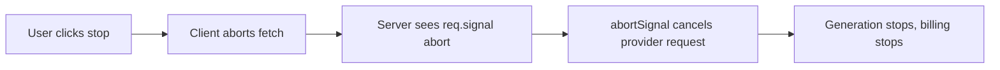

# Streaming Response {#ch-streaming-responses}

> আট সেকেন্ডে পুরো উত্তরের বদলে 400 ms-এ প্রথম token browser-এ পৌঁছে দিন। আর user চলে গেলে পরিষ্কারভাবে cancel করুন।

**এই অধ্যায়ে:** streaming কেন optimisation নয় · SSE আর transport বাছাই · server route · একদম নিচ পর্যন্ত cancellation · আংশিক ফলও ফল

## 💡 মূল ধারণা

Model একবারে একটি করে token তৈরি করে। প্রথমটা দেখানোর আগে শেষটার জন্য অপেক্ষা করা একটি সিদ্ধান্ত, আর প্রায় সবসময়ই ভুল
সিদ্ধান্ত। **Streaming উত্তরকে দ্রুত করে না। এটা আট সেকেন্ডের একটি অপেক্ষাকে বানিয়ে দেয় 400 ms-এর অপেক্ষা, তারপর এমন
text, যা মানুষ যত দ্রুত পড়ে তার চেয়েও দ্রুত আসে।**

তাতে মাপকাঠিটাই বদলে যায়। User-এর সামনের feature-এ যে সংখ্যা জরুরি, সেটা মোট সময় নয়, **প্রথম token আসার সময়**। ধরুন
একটি model ছয় সেকেন্ডে শেষ করে, প্রথম token আসে 300 ms-এ। চার সেকেন্ড অপেক্ষার পর চার সেকেন্ডে শেষ করা model-এর
চেয়ে এটা ভালো মনে হয়। Model যত tune-ই করুন, এই ব্যবধান ঘোচে না।

> Streaming হলো user experience-এর একটি সিদ্ধান্ত, যা implement হয় transport স্তরে। একে performance-এর ছোটখাটো
> optimisation না ভেবে product-এর requirement হিসেবে দেখুন।

> ⚠️ **যা বদলাতে থাকে:** যে helper model-এর stream-কে HTTP response বানায়, AI SDK-র প্রতিটি major version-এ তার নাম
> বদলেছে। এই বই লেখা AI SDK 7 ধরে, যেখানে নামটা `toUIMessageStreamResponse`। ধরে নিন, আপনি পড়তে পড়তে নামটা আবার বদলে
> গেছে। টেকসই নীতি দশ বছরেও নড়েনি। Route এমন একটি response ফেরত দেয়, যার body তখনো তৈরি হচ্ছে। Route আর browser-এর মাঝের
> প্রতিটি স্তরকে buffer না করতে রাজি হতে হয়, মানে body সম্পূর্ণ না হওয়া পর্যন্ত আটকে রাখা চলবে না।

## কীভাবে কাজ করে

### Transport

বিকল্প তিনটি, আর প্রায় সব ক্ষেত্রে জেতে একটিই।

| Transport | কোথায় মানায় | বিপক্ষে কী |
| --- | --- | --- |
| **Server-Sent Events** | এক দিকের server → client text | শুধু text, শুধু এক দিকে |
| **WebSocket** | দুই দিকে, voice, live collaboration | Connection state, scaling, reconnection-এর logic |
| **Chunked HTTP / `ReadableStream`** | সহজ token pipe, framework-এর built-in | Event-এর framing নতুন করে বানাতে হয় |

**Default হলো Server-Sent Events।** Model-এর response হলো HTTP-র ওপর এক দিকের text, আর SSE ঠিক এই কাজের জন্যই
বানানো। এটা নিজে থেকেই reconnect করে, সাধারণ HTTP infrastructure-এর মধ্য দিয়েই চলে, আর কোনো protocol upgrade লাগে না।
Client-ও যখন stream করে, যেমন audio পাঠানো বা একসঙ্গে editing-এর session, তখন WebSocket নিন। Server-এ ওই response খোলা
রাখলে proxy buffering, keep-alive ping আর HTTP/1.1-এ ছয়টি connection-এর সীমার ঝামেলা আসে। সেগুলো আছে
[Chapter ?? — Real-Time ও Streaming API](#ch-realtime-streaming)-এ।

### Server route

```typescript
import { streamText, convertToModelMessages, type UIMessage } from 'ai';

export async function POST(req: Request): Promise<Response> {
  const { messages }: { messages: UIMessage[] } = await req.json();

  const result = streamText({
    model: 'anthropic/claude-sonnet-4.6',
    instructions: DOCS_ASSISTANT_INSTRUCTIONS,
    messages: convertToModelMessages(messages),
    abortSignal: req.signal,        // the whole point — see cancellation below
    onAbort: ({ steps }) => persistPartial(steps),
    onFinish: ({ usage, text }) => recordUsage(usage, text),
  });

  return result.toUIMessageStreamResponse();
}
```

খেয়াল করুন, এখানে কী **নেই**: model call-এ কোনো `await` নেই। `streamText` সঙ্গে সঙ্গে একটি stream handle নিয়ে ফেরে, আর
token আসতে থাকা অবস্থাতেই response client-এর কাছে চলে যায়। পুরো ফলের জন্য await করে তারপর stream করা একটি সাধারণ ভুল।
তাতে পুরো অপেক্ষাটাই ফিরে আসে।

### Cancellation-কে provider পর্যন্ত পৌঁছাতে হয়

যে user tab বন্ধ করেছেন বা stop চেপেছেন, তাঁর আর আগ্রহ নেই। কিন্তু provider-এর কাছে যাওয়া request সত্যিই abort না হওয়া
পর্যন্ত token-এর খরচ চলতেই থাকে। আর সেটা হয় কেবল তখনই, যখন signal প্রতিটি ধাপ পেরিয়ে যায়।



**Cancellation-এ আদৌ টাকা বাঁচাতে হলে abort-কে যে পথ পাড়ি দিতে হয়।**

শিকলটা যেকোনো জায়গায় ভাঙলে model এমন একটি socket-এ generate করতেই থাকে, যেটা কেউ পড়ছে না। Call-এর ভেতরে `req.signal`
পাঠিয়ে দেওয়া এক line-এর কাজ। কিন্তু এই line-টাই cancellation-কে সত্যি করে, শুধু দেখানোর জিনিস থাকতে দেয় না।

> ⚠️ Buffer করা proxy stream গিলে ফেলে। CDN, API gateway বা compression middleware সম্পূর্ণ body-র জন্য অপেক্ষা করতে পারে।
> তাতে streaming route আবার blocking হয়ে যায়। দেখে মনে হয় model ধীর, ভুল config করা proxy নয়। শুধু `localhost` নয়,
> deploy করা URL-টা test করুন।

### Backpressure, আর কেন এটা সাধারণত আপনার মাথাব্যথা নয়

`ReadableStream` নিজে থেকেই backpressure দেয়, মানে পাঠক ধীর হলে লেখকও ধীর হয়। Client ধীরে পড়লে queue ভরে যায়, আর producer
থেমে থাকে। সেকেন্ডে কয়েকশো token-এর text-এ কোনো browser-ই bottleneck নয়।

তবে fan-out-এ এটা জরুরি। ধরুন একটি model response অনেক subscriber-এর কাছে stream হচ্ছে, যেমন shared session বা live
demo-তে। ওখানে একজন ধীর consumer আলাদা না করলে সবাইকে আটকে দেয়। প্রতিটি subscriber-এর জন্য আলাদা buffer রাখুন, আর যে
পিছিয়ে পড়ে সেই subscriber-কে বাদ দিন। ধীর subscriber-কে source-এর ওপর backpressure চাপাতে দেবেন না।

### আংশিক উত্তরেরও দাম আছে

Stream 60%-এ মারা গেলে আপনার হাতে উত্তরের 60% আছে। সেটা ফেলে দিয়ে error দেখানো মানে user-এর হাতে থাকা একমাত্র জিনিসটাই
ফেলে দেওয়া।

| ঘটনা | ❌ সাধারণত যা হয় | ✅ যা ভালো |
| --- | --- | --- |
| Stream-এর মাঝখানে network চলে যায় | Pane খালি করে error দেখানো | Text রেখে দিন, অসম্পূর্ণ বলে চিহ্নিত করুন, retry-এর সুযোগ দিন |
| User stop চাপেন | ফেলে দেওয়া | রেখে দিন, প্রায়ই ওটাই তাঁর দরকার ছিল |
| 400 নম্বর token-এ rate limit | পুরো failure | 400টি token রাখুন, কারণ বলুন, বাকিটা retry করুন |

Abort হলে আংশিক output save করুন। Agent loop-এ আংশিক state আবার হিসাব করা দামি, আর সেই save-এর জায়গা `onAbort`।

## কখন ব্যবহার করবেন

| পরিস্থিতি | Stream করবেন? | কেন |
| --- | --- | --- |
| Chat বা assistant UI | হ্যাঁ | প্রথম token আসার সময়টাই পুরো অভিজ্ঞতা |
| লম্বা generate করা document | হ্যাঁ | অগ্রগতি দেখা যায়, user আগেই থামাতে পারেন |
| একটি label ফেরত দেওয়া classification | না | Output 5টি token; streaming শুধু শুধু জটিলতা বাড়ায় |
| অন্য service যে JSON নেয় | সাধারণত না | Consumer-এর সম্পূর্ণ, valid object লাগে |
| Background batch job | না | কেউ তাকিয়ে নেই |

## সাধারণ ভুল

**❌ পুরো response-এর জন্য await করে তারপর stream-এ লেখা**

```typescript
const { text } = await generateText({ /* ... */ }); // the eight-second wait, restored
return new Response(toStream(text));
```

> Route এখন এমন ফল stream করছে, যার জন্য user আগেই অপেক্ষা করে ফেলেছেন। Streaming call-টা ব্যবহার করুন।

**❌ Abort signal পাঠিয়ে না দেওয়া**

> Client disconnect করে, provider generate করতেই থাকে, আর আপনি টাকা দিতেই থাকেন। কেউ পড়ুক বা না পড়ুক, token-এর bill হয়।

**❌ শুধু localhost-এ streaming test করা**

> কোনো proxy নেই, CDN নেই, gateway নেই। Buffering দেখা দেয় staging-এ, আর মনে হয় model ধীর।

**✅ Text যেমন আসে তেমন render করুন, আর failure হলেও রেখে দিন**

> User দেখেন পড়ার গতিতেই উত্তর তৈরি হচ্ছে। আর stream ভাঙলে খালি box-এর বদলে তাঁর হাতে থাকে উত্তরের বেশিরভাগটা।

## 🔑 মূল শিক্ষা

- Streaming একটি লম্বা অপেক্ষার বদলে একটি ছোট অপেক্ষা দেয়। জরুরি মাপকাঠি হলো প্রথম token আসার সময়।
- Default হিসেবে Server-Sent Events-ই ঠিক, কারণ model-এর response সাধারণ HTTP-র ওপর এক দিকের text।
- Abort signal provider-এর request পর্যন্ত পৌঁছালে তবেই cancellation-এ টাকা বাঁচে।
- Buffer করা proxy চুপচাপ streaming route-কে আবার blocking বানিয়ে দেয়। Deploy করা URL test করুন।
- Stream fail করলে আংশিক output রেখে দিন। ওটা উত্তরের বেশিরভাগ, ফেলে দিলে কারও লাভ হয় না।

## Interview-এর প্রশ্ন

**Q: মোট সময় একই থাকলে stream করবেন কেন?**

কারণ user যতটা দেরি টের পান, সেটা মোট সময় নয়। যে user 400 ms-এ text দেখেন, তাঁর কাছে system দ্রুত সাড়া দেয়, শেষ হতে
আট সেকেন্ড লাগলেও। যে user চার সেকেন্ড spinner-এর দিকে তাকিয়ে থাকেন, তিনি ভাবেন কিছু ভেঙে গেছে। এই ব্যবধান যেকোনো model
upgrade-এর চেয়ে বড়। আর এর খরচ transport-এ একটি বদল, model-এ কোনো বদল নয়।

**Q: Chat feature-এর জন্য SSE নাকি WebSocket?**

SSE, যদি না client-কেও stream করতে হয়। Data যায় এক দিকে, HTTP-র ওপর text হিসেবে। SSE নিজে থেকেই reconnect করে, আর
protocol upgrade ছাড়াই সাধারণ HTTP infrastructure-এর মধ্য দিয়ে চলে। WebSocket যোগ করে connection state, reconnection
সামলানো আর scaling-এর প্রশ্ন। বদলে দেয় দুই দিকের traffic, যা feature-টা ব্যবহারই করে না। Voice input বা live
collaboration থাকলে উত্তর বদলায়।

**Q: User উত্তরের মাঝখানে tab বন্ধ করলেন। কী হয়, আর কী হওয়া উচিত?**

Default-এ server provider থেকে পড়তেই থাকে, আর যে token কেউ দেখে না তার প্রতিটির দাম আপনি দেন। উচিত হলো, client
disconnect করলে server-এর request abort হবে। তারপর server তার abort signal model call-এ পাঠিয়ে দেবে, যাতে generation
সত্যিই থামে। এটা একটি parameter-এর ব্যাপার। এটা না থাকলে cancellation শুধু UI-এর একটি বিভ্রম।

**Q: Streaming local-এ চলে, production-এ আটকে যায়। কোথায় খুঁজবেন?**

Route আর browser-এর মাঝের সবকিছুতে। CDN, gateway বা compression middleware body সম্পূর্ণ না হওয়া পর্যন্ত response buffer
করে রাখতে পারে। তাতে stream হয়ে যায় একটিমাত্র blocking write। দেখে মনে হয় model ধীর, আর লোকজন পুরোপুরি ভুল স্তরে খুঁজতে
যান। আগে response header আর proxy-র buffering config দেখুন।

**Q: কখন stream করবেন না?**

যখন কেউ তাকিয়ে নেই, বা consumer-এর এমনিতেও পুরোটা লাগে। যেমন একটি label ফেরত দেওয়া classifier, একটি background job,
কিংবা অন্য service-এ যাওয়া JSON output। ওখানে streaming আংশিক parse-এর জটিলতা বাড়ায়, বদলে কিছুই দেয় না। Streaming-এর
দাম ওঠে শুধু তখন, যখন একজন মানুষ অপেক্ষা করছেন।

## এরপর কী পড়বেন

- [Chapter ?? — Latency ও Generative UI](#ch-generative-ui) — ওই token-গুলো নিয়ে interface কী করে
- [Chapter ?? — বিশ্বাস, নির্ভুলতা ও Failure State](#ch-trust-and-correctness-ux) — ভাঙা stream-কে ঠিকভাবে design করা
- [Chapter ?? — Structured Output](#ch-structured-output) — গদ্যের বদলে একটি object stream করা
