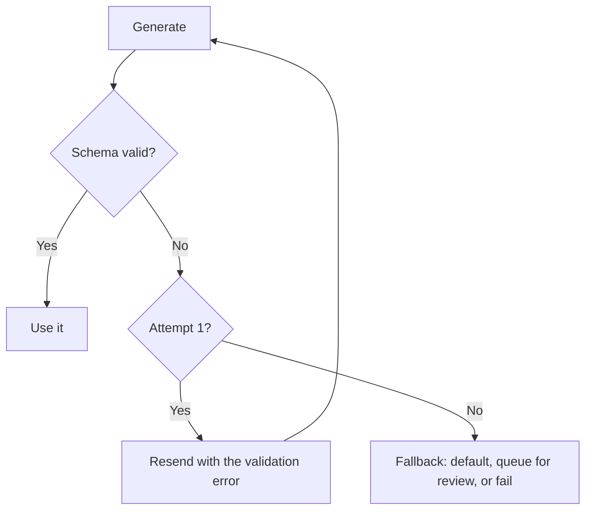

# Structured Output {#ch-structured-output}

> এমন JSON পান, যার ওপর আপনার code ভরসা করতে পারে। আর যেদিন তবু সেটা ভুল হবে, সেদিন কী হবে তা আগেই ঠিক করে রাখুন।

**এই অধ্যায়ে:** JSON পাওয়ার তিনটি উপায় · schema দিয়ে বাঁধা generation · boundary-তে validation · repair loop আর তার খরচ · এমন schema design, যা উত্তর বদলে দেয়

## 💡 মূল ধারণা

Model-এর output যখন মানুষের বদলে code-এ যায়, তখন গদ্য ভুল মাধ্যম। লাগে একটি গড়ন: নাম দেওয়া field, জানা type, একটি চুক্তি।
**Schema দিয়ে বাঁধা generation নির্ভরযোগ্যভাবে সেই গড়ন দেয়। কিন্তু এটা বাঁধে syntax-কে, সত্যকে নয়।** পুরোপুরি valid একটি
object-এও hallucinate করা, মানে বানানো, invoice number থাকতে পারে।

তাই কাজটা দুই ভাগে ভাগ হয়, আর এই দুটি গুলিয়ে ফেলাই এখানে সবচেয়ে সাধারণ ভুল। Constrained decoding guarantee দেয় যে JSON
parse হবে আর schema-র সঙ্গে মিলবে। আপনার boundary-র validation guarantee দেয় যে value-গুলো এমন, যার ওপর আপনার system
কাজ করতে পারে। দুটিই লাগে, আর দুটি আলাদা জিনিস ধরে।

> Schema একটি type system, fact checker নয়। এটা বলে field-টা আছে। Value-টা যে আসল, তা বলে না।

## কীভাবে কাজ করে

### চাওয়ার তিনটি উপায়, নির্ভরযোগ্যতার ক্রমে

| পদ্ধতি | কীভাবে কাজ করে | Failure rate | কখন ব্যবহার করবেন |
| --- | --- | --- | --- |
| **Prompt দিয়ে চেয়ে parse করা** | "JSON-এ উত্তর দাও", তারপর `JSON.parse` | বেশি: শুরুতে গদ্য, শেষে বাড়তি comma, code fence | Production-এ কখনো না |
| **JSON mode** | Provider valid JSON-এর guarantee দেয় | Syntax-এ কম, schema-র কোনো guarantee নেই | গড়ন একদম সাধারণ হলে |
| **Schema দিয়ে বাঁধা** | Provider decoding-কে আপনার schema-য় বেঁধে দেয় | সবচেয়ে কম | Type আছে এমন যেকোনো কিছুর default |

Schema দিয়ে বাঁধা generation কাজ করে decoding-এর ধাপে। Provider প্রতিটি জায়গায় কোন token বৈধ তা সীমিত করে দেয়, তাই output
grammar-এর বাইরে যেতে পারে না। এজন্যই এটা prompting-এর চেয়ে ভালো। Model-কে কেউ অনুরোধ করে না। Provider এমন ব্যবস্থা করে
যে ভুল গড়নের object তৈরি করাই অসম্ভব।

### Call-টা

```typescript
import { generateText, Output } from 'ai';
import { z } from 'zod';

const Extraction = z.object({
  summary: z.string().max(300),
  severity: z.enum(['low', 'medium', 'high']),
  affectedVersions: z.array(z.string()),
  confident: z.boolean().describe('false if the document did not clearly state this'),
});

const { output } = await generateText({
  model: 'anthropic/claude-sonnet-4.6',
  output: Output.object({ schema: Extraction }),
  prompt: `Extract the fields from this changelog entry:\n\n${entry}`,
});

output.severity; // typed as 'low' | 'medium' | 'high'
```

ওই schema-র দুটি খুঁটিনাটি আসল কাজ করে। SDK `.describe()`-কে schema-র অংশ হিসেবে model-এর কাছে পাঠায়। এটা একটি field-এর
সঙ্গে জোড়া prompt text, আর কোনো value-কে ঠিক দিকে চালানোর সবচেয়ে সস্তা উপায়। `confident` boolean-টা model-কে সন্দেহ
জানানোর একটি বৈধ পথ দেয়। এটা না থাকলে অনিশ্চিত model-কে একটি বিশ্বাসযোগ্য value বানাতেই হয়, কারণ schema ওই জায়গায় কিছু
একটা চায়।

> ⚠️ **যা বদলাতে থাকে:** এখানে AI SDK 7-এর surface হলো `generateText` আর `streamText`-এ `Output.object({ schema })`।
> কড়াভাবে schema মেনে চলার support model থেকে model-এ আলাদা। টেকসই নীতি হলো, schema যায় provider-এর কাছে, আর ফলটা আপনার
> দিকেও validate হয়। API-র নাম বদলায়। এই ভাগটা বদলায় না।

### তবু validate করুন

Constrained decoding একটি provider feature, আর প্রতিটি provider এর আলাদা আলাদা অংশ সামলায়। কিছু model JSON Schema-র শুধু
একটি অংশ support করে। কিছু model যে constraint চাপাতে পারে না, যেমন string-এর দৈর্ঘ্য বা regular expression, সেগুলো
চুপচাপ বাদ দেয়। যা-ই হোক, নিজের boundary-তে parse করুন।

```typescript
const parsed = Extraction.safeParse(output);
if (!parsed.success) {
  metrics.increment('llm.schema_violation', { field: parsed.error.issues[0]?.path.join('.') });
  return fallback(entry);
}
```

Field ধরে violation গুনলে এটা আর শুধু একটি `try`/`catch` থাকে না, একটি সংকেত হয়ে ওঠে। যে field 5% সময় fail করে, সেটা
আসলে বলছে তার description অস্পষ্ট। এর সমাধান prompt-এ, retry-এ নয়।

### Repair loop, আর তার খরচ

Validation fail করলে error-টা ফেরত পাঠিয়ে দ্বিতীয়বার চেষ্টা করালে প্রায়ই কাজ হয়। কিন্তু তাতে ওই request-এর খরচ আর latency
দ্বিগুণ হয়।



**একবার repair-এর চেষ্টা, তারপর একটি সিদ্ধান্ত। কাজ না হওয়া পর্যন্ত চলতে থাকা loop নয়।**

একবারের বেশি retry করবেন না। একই input-এ দ্বিতীয়বার fail প্রায় কখনোই sampling-এর দুর্ঘটনা নয়। এর মানে schema আর input
মিলছে না, আর তৃতীয় call হলো একই দেয়ালে পৌঁছাতে খরচ করা টাকা। সীমার পরে আসে product-এর একটি সিদ্ধান্ত: একটি নিরাপদ
default, মানুষের review-এর queue, নয়তো সৎ একটি failure।

### Schema design উত্তর বদলে দেয়

Schema prompt-এরই অংশ। Field-এর নাম, ক্রম আর গড়ন, সবই output-কে সরায়।

| ❌ দুর্বল | ✅ জোরালো | কেন |
| --- | --- | --- |
| `status: z.string()` | `status: z.enum([...])` | খোলা string বানিয়ে বলতে ডাকে |
| `data: z.record(z.unknown())` | নাম দেওয়া স্পষ্ট field | কোনো বাঁধন নেই এমন থলে কিছুই বাঁধে না |
| আগে উত্তরের field | আগে reasoning-এর field | আগে তৈরি হওয়া token পরের token-কে প্রভাবিত করে |
| অনিশ্চয়তার কোনো field নেই | `confident: z.boolean()` | "আমি জানি না"-কে যাওয়ার একটি জায়গা দেয় |
| গভীরভাবে nested, 40টি field | Flat, 8টি field | Schema যত জটিল, মেনে চলা তত কম |

Field-এর ক্রমটাই সূক্ষ্ম ব্যাপার। Generation চলে বাঁ থেকে ডানে। তাই রায়ের **আগে** বসানো একটি `reasoning` field রায়কে মাপার
মতো ভালো করে। পরে বসালে সেটা হয়ে যায় আগেই নেওয়া সিদ্ধান্তের সঙ্গে মিলিয়ে লেখা একটি কৈফিয়ত।

### Object stream করা

ধাপে ধাপে render করতে আংশিক object stream করা যায়। কিন্তু আংশিক object সংজ্ঞা অনুযায়ীই এখনো valid নয়। আংশিক field
আশাবাদী হয়ে render করুন, আর validate করুন শুধু সম্পূর্ণ হলে। আধা-তৈরি object-এর ভিত্তিতে কখনো কোনো কাজ করবেন না।

## কখন ব্যবহার করবেন

| প্রয়োজন | পদ্ধতি |
| --- | --- |
| Output দিয়ে code চলে, database-এ লেখা হয়, বা UI component তৈরি হয় | Schema দিয়ে বাঁধা, সঙ্গে validation |
| Output একজন মানুষ পড়েন | সাধারণ text। Schema শুধু শুধু খরচ আর অনমনীয়তা বাড়ায় |
| নির্দিষ্ট কয়েকটি category-তে classification | এক field-এর enum schema, eval pass করে এমন সবচেয়ে ছোট model |
| Document থেকে extraction | অনিশ্চয়তার স্পষ্ট field-সহ schema |
| Value শুধু ঠিক type-এর হলেই চলবে না, আসল হতে হবে | Schema, সঙ্গে নিজের data-য় মিলিয়ে দেখা |

## সাধারণ ভুল

**❌ Schema-কে নির্ভুলতার guarantee ভেবে ভরসা করা**

> `invoiceId: z.string()` যেকোনো string পেলেই সন্তুষ্ট। Id-টা সত্যিই থাকতে হলে খুঁজে দেখুন।

**❌ সীমাহীন repair loop**

> Fail করতে থাকা schema-য় তিনবার retry মানে একই failure-এ পৌঁছাতে চারবার দাম দেওয়া। একবারে থামুন, তারপর সিদ্ধান্ত নিন।

**❌ এমন schema, যাতে "আমি জানি না" বলার উপায় নেই**

> প্রতিটি required field ভরতেই হবে। অনিশ্চয়তার flag বা nullable field না থাকলে model-এর একমাত্র বৈধ চাল হলো একটি value
> বানানো।

**✅ Schema-য় রায়ের আগে reasoning রাখুন**

> Model ক্রম ধরে generate করে, তাই reasoning তখন সত্যিই উত্তরকে প্রভাবিত করে, শুধু সাজসজ্জা হয়ে থাকে না।

## 🔑 মূল শিক্ষা

- Schema দিয়ে বাঁধা generation ভুল গড়নের JSON প্রায় অসম্ভব করে দেয়। কিন্তু ভুল value-এর সম্ভাবনা একটুও কমায় না।
- যা-ই হোক, নিজের দিকে validate করুন, কারণ provider-এর schema support আংশিক আর model থেকে model-এ আলাদা।
- Repair loop-কে একবারের retry-তে আটকে রাখুন, তারপর ভেবেচিন্তে fallback করুন। দ্বিতীয়বার fail মানে schema-র সমস্যা।
- Schema design মানেই prompt design: খোলা string-এর চেয়ে enum ভালো, আর reasoning-এর field-এর জায়গা রায়ের আগে।
- Model-কে অনিশ্চয়তা জানানোর একটি বৈধ পথ দিন, নইলে required field তাকে একটা কিছু বানাতে বাধ্য করে।

## Interview-এর প্রশ্ন

**Q: Model থেকে নির্ভরযোগ্য JSON কীভাবে পাবেন?**

Schema দিয়ে বাঁধা generation দিয়ে। Schema যায় provider-এর কাছে, আর provider decoding-কে এমন token-এ সীমিত রাখে, যাতে output
grammar-এর ভেতরে থাকে। তাতে syntax-এর সমস্যা প্রায় পুরোপুরি চলে যায়, যা prompt দিয়ে চেয়ে parse করে কখনো হয় না। তারপর
parse করা object-টা নিজের boundary-তে validate করি। পুরো schema-র support provider-দের মধ্যে অসমান, আর যে guarantee-র
ওপর আমি আসলে নির্ভর করি, সেটা আমার নিজের code-এরই চাপানো উচিত।

**Q: Schema validate হচ্ছে, কিন্তু data ভুল। এ থেকে কী বোঝা যায়?**

Schema যে কাজ পারে সেটা করেছে, আমার যেটা দরকার ছিল সেটা নয়। গড়ন আর সত্য দুটি আলাদা বিষয়। Constrained decoding গড়নের
guarantee দেয়। কোনো identifier সত্যিই আছে কি না, বা কোনো সংখ্যা ঠিক column থেকে এসেছে কি না, call-এর কোনো অংশ তা যাচাই করে
না। Value-কে আসল হতেই হলে সত্যের কোনো উৎসের সঙ্গে মিলিয়ে দেখুন: একটি lookup, একটি range check, বা retrieve করা
passage-এর সঙ্গে মিলিয়ে দেখা।

**Q: Validation fail করলে retry করবেন?**

একবার, validation error-টা সঙ্গে দিয়ে, যাতে model দেখতে পায় কী ভেঙেছে। এর বেশি নয়। একই input-এ দ্বিতীয়বার fail প্রায়
সবসময় বোঝায় যে schema আর input সত্যিই মিলছে না। আরও চেষ্টা মানে একই জায়গায় পৌঁছাতে টাকা খরচ। তারপর এটা product-এর
সিদ্ধান্ত: একটি নিরাপদ default, একটি review queue, নয়তো সৎ একটি failure। কোনটা, তা নির্ভর করে ভুল উত্তর কোনো উত্তর না
থাকার চেয়ে খারাপ কি না, তার ওপর।

**Q: Schema-র গড়ন কি output-এর মান বদলায়?**

হ্যাঁ, অনেকটাই। খোলা string-এর চেয়ে enum ভালো, কারণ ওটা বানিয়ে বলার সুযোগটাই সরিয়ে দেয়। গভীর schema-র চেয়ে flat ভালো,
কারণ জটিলতা বাড়লে মেনে চলা কমে। আর field-এর ক্রম জরুরি, কারণ generation চলে ক্রম ধরে। রায়ের আগে reasoning field থাকলে
সেটা রায়কে গড়ে দেয়। একই field পরে থাকলে শুধু আগেই নেওয়া সিদ্ধান্তের পক্ষে সাফাই গায়।

**Q: এমন document থেকে field extract করবেন কীভাবে, যেখানে কিছু field সত্যিই নেই?**

ওই field-গুলো nullable করুন, বা একটি স্পষ্ট confidence flag যোগ করুন। Field-এর description-এ বলে দিন, না থাকলে সেটা দেখতে
কেমন। বেরোনোর কোনো পথ নেই এমন required field model-কে সেটা ভরতে বাধ্য করে। আর বানানো একটি value, যা validate হয়, null-এর
চেয়েও খারাপ। কারণ সেটা আমার সব check পেরিয়ে যায়, আর পরের ধাপে গিয়ে চুপচাপ fail করে।

## এরপর কী পড়বেন

- [Chapter ?? — Tool Calling ও Tool Surface](#ch-tool-calling) — চারপাশে loop আর side effect জোড়া structured output
- [Chapter ?? — Eval, Retrieval Metric ও Error Analysis](#ch-evals) — গড়ন নয়, value কত ঘন ঘন ঠিক হয়, তা মাপা
- [Chapter ?? — Engineering হিসেবে Prompting](#ch-prompting-as-engineering) — field-এর description আসলে prompt text
