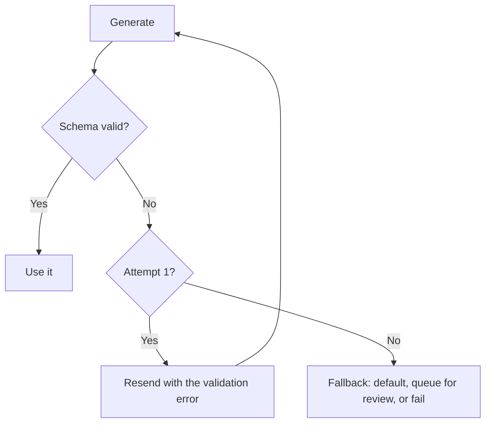

# Structured Output {#ch-structured-output}

> এমন JSON পান, যার ওপর আপনার code নির্ভর করতে পারে — আর যেদিন সেটা তবুও ভুল হবে, সেদিন কী হবে তা আগে থেকেই ঠিক করে রাখুন।

**এই অধ্যায়ে:** JSON পাওয়ার তিনটি উপায় · schema-constrained generation · boundary-তে validation · repair loop আর তার খরচ · যে schema design উত্তর বদলে দেয়

## 💡 মূল ধারণা

Model-এর output যখন কোনো মানুষের বদলে code-এ যায়, তখন prose ভুল মাধ্যম। আপনার দরকার একটি shape: নামওয়ালা field,
জানা type, একটি contract। **Schema-constrained generation আপনাকে সেই shape নির্ভরযোগ্যভাবে দেয়। কিন্তু এটা syntax-কে
বাঁধে, সত্যকে নয়।** একদম valid একটি object-এর ভেতরেও একটি hallucinated (বানানো) invoice number থাকতে পারে।

তাই কাজটা দুই ভাগে ভাগ হয়, আর দুটো গুলিয়ে ফেলাই এই ক্ষেত্রে সবচেয়ে সাধারণ ভুল। Constrained decoding guarantee দেয়
যে JSON parse হবে আর schema-র সঙ্গে মিলবে। আপনার boundary-তে validation guarantee দেয় যে value-গুলো এমন, যার ওপর আপনার
system কাজ করতে পারে। দুটোই দরকার, আর দুটো আলাদা জিনিস ধরে।

> Schema একটি type system, fact checker নয়। এটা বলে field-টা আছে। Value-টা যে সত্যি, তা বলে না।

## কীভাবে কাজ করে

### চাওয়ার তিনটি উপায়, নির্ভরযোগ্যতার ক্রমে

| পদ্ধতি | Mechanism | Failure rate | কখন ব্যবহার করবেন |
| --- | --- | --- | --- |
| **Prompt আর parse** | "JSON দিয়ে উত্তর দাও", তারপর `JSON.parse` | বেশি — শুরুতে prose, শেষে বাড়তি comma, code fence | Production-এ কখনো নয় |
| **JSON mode** | Provider valid JSON-এর guarantee দেয় | Syntax-এ কম, schema-র কোনো guarantee নেই | Shape খুবই সাধারণ |
| **Schema-constrained** | Provider decoding-কে আপনার schema-তে বেঁধে দেয় | সবচেয়ে কম | Typed যেকোনো কিছুর default |

Schema-constrained generation কাজ করে decoding-এর ধাপে। Provider প্রতিটি অবস্থানে কোন token বৈধ, তা সীমিত করে দেয়,
তাই output grammar-এর বাইরে যেতে পারে না। এ কারণেই এটা prompting-কে হারায়। কেউ model-কে ভদ্রভাবে অনুরোধ করে না।
Provider এমন ব্যবস্থা করে যে model ভুলভাবে গঠিত object তৈরিই করতে পারে না।

### Call

```typescript
import { generateText, Output } from 'ai';
import { z } from 'zod';

const Extraction = z.object({
  summary: z.string().max(300),
  severity: z.enum(['low', 'medium', 'high']),
  affectedVersions: z.array(z.string()),
  confident: z.boolean().describe('false if the document did not clearly state this'),
});

const { output } = await generateText({
  model: 'anthropic/claude-sonnet-4.6',
  output: Output.object({ schema: Extraction }),
  prompt: `Extract the fields from this changelog entry:\n\n${entry}`,
});

output.severity; // typed as 'low' | 'medium' | 'high'
```

ওই schema-র দুটি খুঁটিনাটি আসল কাজ করে। SDK `.describe()`-কে schema-র অংশ হিসেবে model-এর কাছে পাঠায়।
এটা একটি field-এর সঙ্গে জোড়া prompt text, আর একটি value-কে দিক দেখানোর সবচেয়ে সস্তা উপায়। `confident` boolean
model-কে সন্দেহ জানানোর একটি বৈধ উপায় দেয়। এটা না থাকলে অনিশ্চিত model-কে একটি বিশ্বাসযোগ্য value বানাতেই হয়, কারণ
schema ওই জায়গায় কিছু একটা চায়।

> ⚠️ **যা বদলাতে থাকে:** এখানে AI SDK 7-এর surface হলো `generateText` আর
> `streamText`-এ `Output.object({ schema })`। কড়া schema adherence-এর provider support model-ভেদে আলাদা। টেকসই নীতি হলো,
> schema যায় provider-এর কাছে, আর result validate করে তবুও আপনার দিক। API-র নাম বদলায়। এই ভাগাভাগি
> বদলায় না।

### তবুও validate করুন

Constrained decoding একটি provider feature, আর প্রতিটি provider এর আলাদা আলাদা অংশ cover করে। কিছু model JSON Schema-র
শুধু একটি subset support করে। কিছু model যে constraint enforce করতে পারে না, সেগুলো চুপচাপ বাদ দেয়, যেমন string-এর
দৈর্ঘ্য বা regular expression। যা-ই হোক, আপনার boundary-তে parse করুন।

```typescript
const parsed = Extraction.safeParse(output);
if (!parsed.success) {
  metrics.increment('llm.schema_violation', { field: parsed.error.issues[0]?.path.join('.') });
  return fallback(entry);
}
```

Field ধরে violation গুনলে এটা একটি `try`/`catch` থেকে একটি signal-এ পরিণত হয়। যে field 5% সময় fail করে, সেটা বলছে
তার description অস্পষ্ট। এর সমাধান prompt-এ, retry-তে নয়।

### Repair loop, আর তার খরচ

Validation fail করলে error-টা দ্বিতীয় চেষ্টার জন্য ফেরত পাঠালে প্রায়ই কাজ হয়। কিন্তু এতে সেই request-এর খরচ আর
latency দুটোই দ্বিগুণ হয়।



**একবার repair-এর চেষ্টা, তারপর একটি সিদ্ধান্ত — কাজ না হওয়া পর্যন্ত চলতে থাকা loop নয়।**

একটি retry-তে সীমিত রাখুন। একই input-এ দ্বিতীয় failure প্রায় কখনোই sampling-এর দুর্ঘটনা নয়। এর মানে schema আর
input-এর মধ্যে অমিল আছে, আর তৃতীয় call হলো একই দেয়ালে পৌঁছাতে টাকা খরচ। সীমার পরে আসে একটি product সিদ্ধান্ত: একটি
নিরাপদ default, একটি human review queue, বা একটি সৎ failure।

### Schema design উত্তর বদলে দেয়

Schema prompt-এরই অংশ। Field-এর নাম, ক্রম আর shape — সবই output-কে নাড়ায়।

| ❌ দুর্বল | ✅ শক্তিশালী | কেন |
| --- | --- | --- |
| `status: z.string()` | `status: z.enum([...])` | খোলা string বানিয়ে লেখার আমন্ত্রণ জানায় |
| `data: z.record(z.unknown())` | স্পষ্ট নামওয়ালা field | যে ঝুলিতে কোনো বাঁধন নেই, সেটা কিছুই বাঁধে না |
| উত্তরের field আগে | Reasoning field আগে | আগে generate হওয়া token পরের অংশকে প্রভাবিত করে |
| অনিশ্চয়তার কোনো field নেই | `confident: z.boolean()` | "আমি জানি না"-কে যাওয়ার একটি জায়গা দেয় |
| গভীরভাবে nested, 40টি field | Flat, 8টি field | Schema যত জটিল, adherence তত কমে |

Field-এর ক্রমটাই সূক্ষ্ম বিষয়। Generation বাঁ থেকে ডানে চলে। তাই রায়ের **আগে** রাখা একটি `reasoning` field
রায়কে মাপার মতো করে ভালো করে। পরে রাখলে সেটা আগেই নেওয়া একটি সিদ্ধান্তের সঙ্গে মানিয়ে লেখা একটি যুক্তি মাত্র।

### একটি object stream করা

ধাপে ধাপে render করার জন্য আপনি আংশিক object stream করতে পারেন। কিন্তু একটি আংশিক object সংজ্ঞা অনুযায়ীই এখনো
valid নয়। আংশিক field আশাবাদী হয়ে render করুন, আর validate করুন শুধু সম্পূর্ণ হলে। আধা-তৈরি object-এর ওপর কখনো কাজ
করবেন না।

## কখন ব্যবহার করবেন

| প্রয়োজন | পদ্ধতি |
| --- | --- |
| Output code, database write বা UI component চালায় | Schema-constrained, সঙ্গে validation |
| Output একজন মানুষ পড়েন | সাধারণ text — schema অকারণে খরচ আর অনমনীয়তা বাড়ায় |
| নির্দিষ্ট category-তে classification | এক-field-এর enum schema, eval পাস করে এমন সবচেয়ে ছোট model |
| Document থেকে extraction | স্পষ্ট অনিশ্চয়তার field-সহ schema |
| Value-কে সত্যি হতে হবে, শুধু ঠিক type-এর নয় | Schema, সঙ্গে আপনার নিজের data-য় lookup |

## সাধারণ ভুল

**❌ Schema-কে সঠিকতার guarantee হিসেবে বিশ্বাস করা**

> `invoiceId: z.string()` যেকোনো string পেলেই সন্তুষ্ট। Id-টা যদি সত্যিই থাকতে হয়, lookup করুন।

**❌ সীমাহীন repair loop**

> Fail করতে থাকা একটি schema-য় তিনটি retry মানে একই failure-এ পৌঁছাতে চারবার দাম দেওয়া। একটিতে থামুন, তারপর সিদ্ধান্ত নিন।

**❌ এমন schema, যেখানে "আমি জানি না" বলার কোনো উপায় নেই**

> প্রতিটি required field ভরতেই হবে। অনিশ্চয়তার flag বা nullable field না থাকলে model-এর একমাত্র বৈধ চাল হলো একটি
> value বানিয়ে ফেলা।

**✅ Schema-তে রায়ের আগে reasoning রাখুন**

> Model ক্রমানুসারে generate করে, তাই reasoning উত্তরকে সাজিয়ে দেয় না, সত্যিই প্রভাবিত করে।

## 🔑 মূল শিক্ষা

- Schema-constrained generation ভুলভাবে গঠিত JSON প্রায় অসম্ভব করে তোলে। ভুল value-র সম্ভাবনা এতে একটুও কমে না।
- যা-ই হোক, নিজের দিকে validate করুন, কারণ provider-এর schema support আংশিক আর model-ভেদে আলাদা।
- Repair loop-কে একটি retry-তে সীমিত রাখুন, তারপর ভেবেচিন্তে fallback করুন। দ্বিতীয় failure হলো schema-র সমস্যা।
- Schema design মানেই prompt design: enum খোলা string-কে হারায়, আর reasoning field-এর জায়গা রায়ের আগে।
- Model-কে অনিশ্চয়তা প্রকাশের একটি বৈধ উপায় দিন, নইলে একটি required field তাকে একটি value বানাতে বাধ্য করে।

## Interview-এর প্রশ্ন

**Q: একটি model থেকে নির্ভরযোগ্য JSON কীভাবে পাবেন?**

Schema-constrained generation দিয়ে। Schema যায় provider-এর কাছে, যে decoding-কে এমন token-এ সীমিত রাখে, যাতে output
grammar-এর ভেতরে থাকে। এতে syntax-এর সমস্যা প্রায় পুরোপুরি দূর হয়, যা prompt-and-parse কখনো করে না। তারপর আমি parse
করা object-টা নিজের boundary-তে validate করি। পুরো schema surface-এ provider-এর support অসমান, আর যে guarantee-র ওপর
আমি আসলে নির্ভর করি, সেটা আমার নিজের code-এরই enforce করা উচিত।

**Q: Schema validate হচ্ছে, কিন্তু data ভুল। এটা আপনাকে কী বলে?**

বলে যে schema নিজের কাজটা করেছে, আমার যেটা দরকার ছিল সেটা নয়। গঠন আর সত্য আলাদা বিষয়। Constrained decoding shape-এর
guarantee দেয়। কোনো identifier আছে কি না, বা একটি সংখ্যা ঠিক column থেকে এসেছে কি না, call-এর কোনো কিছুই তা যাচাই
করে না। Value-কে যদি সত্যি হতে হয়, একটি নির্ভরযোগ্য উৎসের সঙ্গে মিলিয়ে দেখুন: একটি lookup, একটি range check, বা
retrieve করা passage-এর সঙ্গে cross-reference।

**Q: Validation fail করলে কি retry করেন?**

একবার, validation error-সহ, যাতে model দেখতে পায় কী ভেঙেছে। এর বেশি নয়। একই input-এ দ্বিতীয় failure প্রায় সবসময়
মানে schema আর input-এর মধ্যে সত্যিই অমিল। আরও চেষ্টা মানে একই জায়গায় পৌঁছাতে টাকা খরচ। এরপর এটা একটি product
সিদ্ধান্ত: একটি নিরাপদ default, একটি review queue, বা একটি সৎ failure। কোনটা, তা নির্ভর করে ভুল উত্তর কোনো উত্তর না
থাকার চেয়ে খারাপ কি না তার ওপর।

**Q: Schema-র shape কি output-এর মান বদলায়?**

হ্যাঁ, অনেকটাই। Enum খোলা string-কে হারায়, কারণ এতে বানিয়ে লেখার সুযোগ থাকে না। Flat schema গভীর schema-কে হারায়,
কারণ জটিলতার সঙ্গে adherence কমে। আর field-এর ক্রম গুরুত্বপূর্ণ, কারণ generation ধারাবাহিক। রায়ের আগে একটি reasoning
field রায়কে গড়ে দেয়। একই field পরে থাকলে সেটা শুধু আগেই নেওয়া একটি সিদ্ধান্তের পক্ষে যুক্তি দেয়।

**Q: এমন একটি document থেকে field extract করবেন কীভাবে, যেখানে কিছু field সত্যিই নেই?**

ওই field-গুলোকে nullable করুন, বা একটি স্পষ্ট confidence flag যোগ করুন। Field description-এ বলে দিন, না থাকাটা দেখতে
কেমন। বেরোনোর পথ নেই এমন একটি required field model-কে সেটা ভরতে বাধ্য করে। Validate হয়ে যাওয়া একটি বানানো value
null-এর চেয়ে খারাপ, কারণ সেটা আমার সব check পেরিয়ে যায় আর পরের ধাপে চুপচাপ fail করে।

## এরপর কী পড়বেন

- [Chapter ?? — Tool Calling ও Tool Surface](#ch-tool-calling) — চারপাশে একটি loop আর side effect-সহ structured output
- [Chapter ?? — Eval, Retrieval Metric ও Error Analysis](#ch-evals) — shape নয়, value কত ঘন ঘন ঠিক হয়, তা মাপা
- [Chapter ?? — Engineering হিসেবে Prompting](#ch-prompting-as-engineering) — field description-ও prompt text
