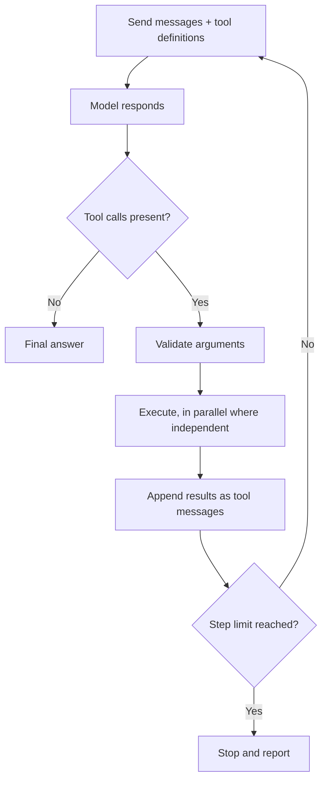

# Tool Calling ও Tool Surface {#ch-tool-calling}

> আপনার কোন function চলবে, তা model-কে বাছতে দিন। সেগুলো চালানোর loop নিজের হাতে রাখুন। আর tool এমনভাবে design করুন, যাতে model ঠিকটা বাছে।

**এই অধ্যায়ে:** loop আর তার থামার শর্ত · tool define করা · permission boundary · tool surface design করা · এমন error, যা দেখে model কিছু করতে পারে

## 💡 মূল ধারণা

Tool call মানে model আপনার code চালাচ্ছে, তা নয়। **Model ফেরত দেয় একটি structured request: tool-এর নাম আর argument। সেটা
চলবে কি না, তা ঠিক করে আপনার code।** ফলটা conversation-এ ফিরে যায়, আর model এগিয়ে চলে। আপনার code বসে আছে মাঝখানে।
বাকি প্রতিটি security গুণ দাঁড়িয়ে আছে এর ওপরই।

Tool-এর সেটটাও একটি API। এর একমাত্র consumer English পড়ে, আপনার description একবারই পড়ে, কোনো প্রশ্ন করতে পারে না, আর
প্রতিটি parameter কিছু একটা দিয়ে ভরবেই। এই consumer-এর কথা ভেবে design করুন, agent-এর বেশিরভাগ সমস্যা চলে যাবে। মানুষের
জন্য বানানো একটি API paste করে দিন, model বিশ্বাসযোগ্য argument দিয়ে ভুল tool call করবে।

> ⚠️ **যা বদলাতে থাকে:** যেকোনো AI SDK-তে সবচেয়ে বেশি নাম বদলায় tool definition-এর surface। Version 5 `parameters`-এর
> জায়গায় আনে `inputSchema`, আর `maxSteps`-এর জায়গায় `stopWhen`। Version 7 থামার helper-এর নাম আবার বদলেছে, `stepCountIs`
> থেকে `isStepCount`। নিচের protocol বদলায় না। Model একটি নাম আর একটি JSON object ফেরত দেয়। সেটা চলবে কি না, আপনার code
> ঠিক করে। ফলটা আরেকটি message হয়ে ফিরে যায়।

## কীভাবে কাজ করে

### Loop



**Tool calling-এর loop। প্রতিটি ধাপ একটি পুরো model call, আর bill হয় পুরো conversation জুড়ে দিয়ে।**

এ থেকে দুটি কথা আসে। ধাপের সংখ্যার চেয়ে খরচ দ্রুত বাড়ে, কারণ প্রতিটি ধাপ আগের সবকিছু আবার পাঠায়। আর loop-এর একটি কড়া
ধাপের সীমা লাগে। নইলে থামার শর্ত মেটাতে না পারা model চলতেই থাকে।

### Tool define করা

Documentation assistant-এর মূল tool একটিই: docs-এ search করা।

**Documentation assistant-এর একটি tool, আর যে loop সেটা চালায়**

```typescript
import { generateText, tool, isStepCount } from 'ai';
import { z } from 'zod';

const searchDocs = tool({
  description:
    'Search the product documentation and return up to 5 passages with their source paths. ' +
    'Use for questions about how the product behaves, its API, or its configuration. ' +
    'Do not use for customer account data — use lookupAccount for that. ' +
    'Returns { found: false } with a hint when nothing matches.',
  inputSchema: z.object({
    query: z.string().describe('Keywords, not a full sentence. Example: "rotate signing key"'),
    section: z.enum(['api', 'guides', 'changelog']).optional()
      .describe('Omit unless the user named a section.'),
  }),
  execute: async ({ query, section }) => {
    const hits = await docsIndex.search(query, { section, limit: 5 });
    if (hits.length === 0) return { found: false, hint: 'No match. Try broader keywords.' };
    return { found: true, passages: hits.map((h) => ({ path: h.path, text: h.text })) };
  },
});

const { text, steps } = await generateText({
  model: 'anthropic/claude-sonnet-4.6',
  tools: { searchDocs },
  stopWhen: isStepCount(6),            // the only bound on a loop the model controls
  messages,
});
```

### একসঙ্গে কয়েকটি call

Model এক ধাপে কয়েকটি tool চাইতে পারে। যেগুলো একটি আরেকটির ওপর নির্ভর করে না, সেগুলো একসঙ্গে চলা উচিত। আর কোনগুলো
স্বাধীন, তা ঠিক করেন আপনি, model নয়।

**শুধু-পড়ার call-গুলো একসঙ্গে চালান**

```typescript
const results = await Promise.all(
  calls.map((call) => (isReadOnly(call.toolName) ? run(call) : null)),
);
```

একই record-এ দুটি write স্বাধীন নয়, আর এরা যে সংঘর্ষ বাধায়, model তা জানেই না। Side effect একটি একটি করে চালান। নয়তো
tool-গুলো idempotent করুন, মানে দুবার চললেও সমস্যা নেই, যাতে duplicate call কোনো ক্ষতি না করে।

### Permission boundary

**Dispatcher: খুঁজে বের করা, authorise করা, validate করা, তারপর চালানো বা জিজ্ঞেস করা**

```typescript
async function dispatch(call: ToolCall, user: User): Promise<unknown> {
  const def = registry[call.toolName];
  if (!def) return { error: `Unknown tool: ${call.toolName}` };
  if (!can(user, def.permission)) return { error: 'Not permitted for this user.' };

  const args = def.inputSchema.safeParse(call.input);      // arguments are model output
  if (!args.success) return { error: describe(args.error) };

  return def.destructive ? requestApproval(call, user) : def.execute(args.data, { user });
}
```

Tool-এর argument অবিশ্বস্ত input। Model যে document পড়েছে, সেটাও argument-কে প্রভাবিত করতে পারে। তাই model-এর দেওয়া
path দিয়ে `deleteFile({ path })` মানে path traversal ঘটার অপেক্ষায় থাকা। Authorise করুন **user-এর** permission দেখে,
model-এর request দেখে কখনো নয়। ক্ষতিকর tool-কে মানুষের approval-এর পেছনে রাখুন। কেন এই নিয়ন্ত্রণটাই আসল, তা বোঝানো আছে
[Chapter ?? — Prompt Injection](#ch-prompt-injection)-এ।

## কখন ব্যবহার করবেন

| প্রয়োজন | বাছাই | কেন |
| --- | --- | --- |
| এখনকার বা private data, যা model জানতে পারে না | শুধু-পড়ার একটি tool | অবাধে দেওয়া যায়, একসঙ্গে চালালেও নিরাপদ |
| সত্যিকারের প্রভাব আছে এমন কাজ: পাঠানো, তৈরি করা, refund | নিজস্ব tool, নিজস্ব permission, একটি approval gate | Authorise আর audit করা যায় |
| প্রায়ই ঘটে এমন কয়েক ধাপের sequence | একটি composite tool | Round trip বাঁচে, ভুল হওয়ার সুযোগও কমে |
| প্রতিটি request-এ একই context | Tool নয়, call-এর আগেই retrieve করুন | Tool একটি বাড়তি round trip, আর বাদও পড়ে যেতে পারে |
| নির্দিষ্ট, জানা ধাপের sequence | Tool নয়, code লিখুন | একটি `for` loop-এ কোনো খরচ নেই, আর কখনো ভুল শাখা বাছে না |
| শুধু output-এর গড়ন | Tool নয়, [structured output](#ch-structured-output) | চালানোর মতো কিছুই নেই |

## Tool Surface design করা

Assistant কাজ করবে কি না, সাধারণত তা prompt-এর চেয়ে বেশি ঠিক করে tool-এর সেটটা।

### কতটা ছোট বা বড়

নিয়মটা হলো: **user-এর চোখে পড়া প্রতিটি উদ্দেশ্যের জন্য একটি tool।** একজন মানুষ যেটাকে একটি কাজ বলবেন, সেটা একটি tool।
"Docs-এ search করা", "ticket তৈরি করা" আর "build check করা", প্রতিটিই একটি। খুব খুঁটিনাটি tool বানানোই বেশি দেখা যায়, আর
সেটাই বেশি দামি ভুল। `openFile`, `seek`, `readBytes`, `close` মানে চারটি পুরো round trip, যেখানে `readFile(path)` একটি।
উল্টো প্রান্তে, একটিমাত্র `execute(command)` tool নমনীয়। কিন্তু তখন আর বলা যায় না agent কী কী করতে পারে।

### Description আসলে prompt text

কোনো tool *কখন* খাটে, model-এর কাছে তার একমাত্র সংকেত description। তাই ভুল tool-এর বেশিরভাগ bug আসলে description-এর bug।
`'Searches the index.'` লেখা এমন সহকর্মীর জন্য, যিনি source পড়তে পারেন। ওপরের `searchDocs`-এর description বদলে চারটি কাজ
করে। এটা বলে **কী ফেরত দেয়**, **কখন ব্যবহার করতে হবে**, **কখন নয়** আর তার বদলে কী, আর **failure দেখতে কেমন**। প্রতিটি
কথা এক এক ধরনের ভুল call সরিয়ে দেয়। Parameter-এর description-ও prompt text।

নামও জরুরি। `searchDocs` আর `lookupAccount` কেউ গুলিয়ে ফেলে না। `search` আর `query` সহজেই গুলিয়ে যায়। আর মিলে যাওয়া
tool-গুলোর মধ্যে model এদিক-ওদিক করে, কারণ কোনোটাই স্পষ্টভাবে ঠিক নয়।

### এমন parameter, যা model ভরতে পারে

| ❌ ভরা কঠিন | ✅ ভরা সহজ | কেন |
| --- | --- | --- |
| `userId: string` | `email: string` | Model-এর কাছে email আছে, আপনার internal id নেই |
| `filters: Record<string, unknown>` | নাম দেওয়া optional field | খোলা থলে বানিয়ে বলতে ডাকে |
| `mode: string` | `mode: z.enum([...])` | Enum বানানো যায় না |

প্রথম row-এর কথাটা সাধারণভাবেই খাটে: **এমন identifier কখনো চাইবেন না, যা model-এর জানার কোনো উপায় নেই।** Natural key
নিন, মানে একজন মানুষ যে নাম ব্যবহার করতেন, আর tool-এর ভেতরে সেটা থেকে id বের করুন। নয়তো একটি lookup tool যোগ করুন, যা আগে
id ফেরত দেয়।

### এমন error, যা পরের ধাপ শেখায়

Tool যা-ই ফেরত দিক, সেটা prompt text হয়ে যায়। অকাজের ফল থেকে আসে অকাজের পরের ধাপ, সাধারণত আবার সেই একই call।

| ❌ যা ফেরত আসে | ✅ যা ভালো | Model যা করে |
| --- | --- | --- |
| `[]` | `{ found: false, hint: 'No match for "foo". Try broader keywords.' }` | একবার অন্যভাবে বলে দেখে, তারপর সেটা জানিয়ে দেয় |
| `Error: 500` | `Search is unavailable. Answer from the conversation or say you cannot check.` | Retry থামায়, সৎভাবে কম কাজ নিয়ে চলে |
| `Invalid input` | `section must be one of: api, guides, changelog` | Argument ঠিক করে |

Agent loop-এ আটকে যাওয়ার সবচেয়ে সাধারণ কারণ খালি array। দেখে মনে হয় tool ভাঙা, তাই model আবার চেষ্টা করে। কী হয়েছে,
retry-এ লাভ হবে কি না, আর বদলে কী করা উচিত, সেটা বলে দিন।

> ⚠️ কাঁচা exception কখনো conversation-এ দেবেন না। Stack trace file path আর ভেতরের খুঁটিনাটি এমন একটি window-এ ফাঁস করে, যা
> log হতে পারে, user-কে দেখানো হতে পারে, বা যে attacker input-টা বসিয়েছিল সে পড়তে পারে।

### কী বাদ রাখবেন

সবচেয়ে জোরালো নিয়ন্ত্রণ হলো এমন tool, যা নেই-ই। প্রতিটি tool মানে অবিশ্বস্ত document পড়া একটি system-এর হাতে তুলে দেওয়া
একটি permission। শুধু-পড়া দিয়ে শুরু করুন, আর write যোগ করুন আলাদা, gate করা tool হিসেবে।
`cancelSubscription(accountId)` authorise আর audit করা যায়। `runSql(query)` যায় না। Model-এর কদাচিৎ যা লাগে, তা বাদ রাখুন।
Surface ছোট হলে model-এর পক্ষে ঠিক tool বাছাও সহজ হয়।

## সাধারণ ভুল

**❌ ধাপের কোনো সীমা নেই**

> যে model থামার শর্ত মেটাতে পারে না, সেটা tool call করতেই থাকে। `stopWhen` না থাকলে সেটা একটি সীমাহীন bill, যা ধরা পড়ে
> পরদিন সকালে।

**✅ কখন tool-টা *ব্যবহার করবেন না*, সেটাও বলুন**

> মিলে যাওয়া tool-গুলোকে আলাদা করতে আরও ইতিবাচক বর্ণনার চেয়ে "কখন নয়" বলাটা দ্রুত কাজ করে। এতে model সবচেয়ে কাছাকাছি
> দেখতে tool-টার দিকে হাত বাড়ানো বন্ধ করে।

## 🔑 মূল শিক্ষা

- Model tool call চায়। সেটা চলবে কি না ঠিক করে আপনার dispatcher, আর সব কর্তৃত্ব থাকে সেখানেই।
- Loop-এর প্রতিটি ধাপ পুরো conversation আবার পাঠায়, তাই খরচের একমাত্র সীমা হলো কড়া একটি ধাপের সীমা।
- User-এর চোখে পড়া প্রতিটি উদ্দেশ্যের জন্য একটি tool design করুন, আর description-এ বলুন কী ফেরত দেয় আর কখন ব্যবহার করবেন না।
- Error আর খালি ফলও prompt text: কী হয়েছে, retry করবে কি না, আর বদলে কী করবে, তা বলে দিন।
- সবচেয়ে জোরালো নিয়ন্ত্রণ হলো যে tool নেই-ই। User দেখে authorise করুন, আর ক্ষতিকর যেকোনো কিছু gate করুন।

## Interview-এর প্রশ্ন

**Q: Model যখন একটি tool call করে, তখন কী কী ঘটে, ধাপে ধাপে বলুন।**

Model একটি tool-এর নাম আর আমার পাঠানো schema-র সঙ্গে মেলানো JSON argument ফেরত দেয়, আর generation থেমে যায়। আমার code
argument validate করে, permission check করে, function চালায়, আর ফলটা tool message হিসেবে জুড়ে দেয়। তারপর লম্বা হওয়া history
নিয়ে আমি model-কে আবার call করি। Model উত্তর না দেওয়া পর্যন্ত, বা আমার ধাপের সীমায় না ঠেকা পর্যন্ত এটা চলতে থাকে। Model
নিজে কখনো কিছু চালায় না।

**Q: আপনার agent একই argument দিয়ে বারবার একই tool call করছে। আগে কী দেখবেন?**

কিছু না পেলে tool কী ফেরত দেয়, সেটা। খালি array বা শুধু একটি error দেখতে ক্ষণস্থায়ী failure-এর মতোই, তাই retry করাটা
যুক্তিসংগত আন্দাজ। স্পষ্ট একটি "মিল পাওয়া যায়নি", সঙ্গে একটি hint ফেরত দিলে যেকোনো prompt বদলের চেয়ে বেশি loop ঠিক হয়।
তারপর দেখব এমন দুটি tool আছে কি না যাদের description মিলে যায়, আর এমন কোনো থামার শর্ত আছে কি না যা model মেটাতে পারে না।

**Q: Tool calling-এর একটি feature যাতে production data মুছে না ফেলে, তা কীভাবে নিশ্চিত করবেন?**

বিপজ্জনক কাজটা শুধু নিরুৎসাহিত না করে পুরোপুরি অপ্রাপ্য করে দিয়ে। Surface শুধু ততটুকুই খোলে, যতটুকু feature-এর দরকার, আর
credential-ও ততটুকুতেই সীমিত। ক্ষতিকর tool থাকে মানুষের approval-এর পেছনে। Dispatcher authorise করে sign in করা user দেখে।
System prompt-এর একটি নিয়ম কোনো নিয়ন্ত্রণ নয়। Model অবিশ্বস্ত content পড়ে, তাই কেউ যুক্তি দিয়ে নিয়মটা উড়িয়ে দিতে পারে।

**Q: আপনার এখনকার REST API-টাই কি tool হিসেবে খুলে দেওয়া যায়?**

যায়, আর সাধারণত সেটা খারাপভাবে কাজ করে। ওই API ধরে নেয় caller-এর কাছে documentation আর internal id আছে, আর এর error
লেখা developer-দের জন্য। Model id বানায়, code ভুল পড়ে, আর এমন endpoint-গুলোর মধ্যে বাছে, যাদের নাম দেখে আলাদা করার কোনো
উপায় নেই। আমি এটা নতুন করে design করব এর আসল consumer-এর কথা ভেবে: natural key, enum, গদ্যে লেখা description, আর
instruction হিসেবে লেখা error।

## এরপর কী পড়বেন

- [Chapter ?? — Agent আসলে কী, আর কখন একাধিক Agent লাগে](#ch-what-an-agent-actually-is) — এই loop, শেষ পর্যন্ত চালানো
- [Chapter ?? — MCP (Model Context Protocol)](#ch-model-context-protocol) — ভাগাভাগির protocol হিসেবে tool definition
- [Chapter ?? — Prompt Injection](#ch-prompt-injection) — dispatcher কেন একটি security boundary
