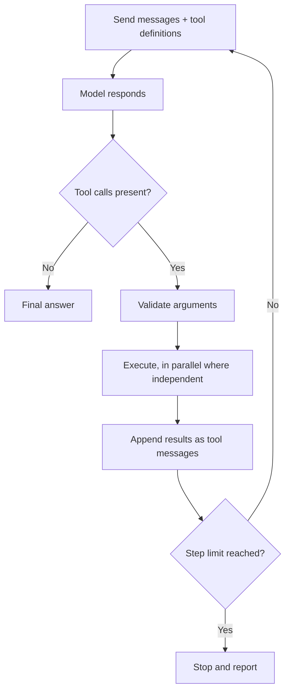

# Tool Calling ও Tool Surface {#ch-tool-calling}

> আপনার কোন function চলবে, তা model-কে বাছতে দিন, যে loop সেগুলো চালায় তার মালিকানা নিজের হাতে রাখুন, আর tool-গুলো এমনভাবে design করুন যাতে model ভালোভাবে বাছে।

**এই অধ্যায়ে:** loop আর তার থামার শর্ত · একটি tool define করা · permission boundary · tool surface design করা · এমন error, যা দেখে model কাজ করতে পারে

## 💡 মূল ধারণা

একটি tool call মানে model আপনার code চালাচ্ছে, তা নয়। **Model একটি structured request ফেরত দেয় — একটি tool-এর নাম আর
argument — আর সেটা চলবে কি না, তা ঠিক করে আপনার code।** Result conversation-এ ফিরে যায়, আর model এগিয়ে চলে। আপনার
code বসে থাকে মাঝখানে। বাকি প্রতিটি security বৈশিষ্ট্য এর ওপরেই দাঁড়িয়ে।

Tool set-ও একটি API। এর একমাত্র consumer ইংরেজি পড়ে, আপনার description একবার পড়ে, কোনো প্রশ্ন করতে পারে না, আর প্রতিটি
parameter কিছু একটা দিয়ে ভরবেই। সেই consumer-এর জন্য design করুন, তাহলে agent-এর বেশিরভাগ সমস্যা দূর হয়ে যায়।
মানুষের জন্য বানানো একটি API paste করে দিন, আর model বিশ্বাসযোগ্য argument দিয়ে ভুল tool call করবে।

> ⚠️ **যা বদলাতে থাকে:** যেকোনো AI SDK-তে tool definition-ই সবচেয়ে ঘন ঘন নাম বদলানো surface। Version 5
> `parameters`-এর জায়গায় `inputSchema` আর `maxSteps`-এর জায়গায় `stopWhen` এনেছে। Version 7 stop
> helper-এর নাম আবার বদলেছে, `stepCountIs` থেকে `isStepCount`-এ। নিচের protocol বদলায় না। Model
> একটি নাম আর একটি JSON object ফেরত দেয়। সেটা চলবে কি না, তা ঠিক করে আপনার code। Result ফিরে যায়
> আরেকটি message হিসেবে।

## কীভাবে কাজ করে

### Loop



**Tool-calling loop। প্রতিটি step একটি পূর্ণ model call, যার bill হয় পুরো conversation জুড়ে।**

এর দুটি ফল আছে। Step-এর সংখ্যার চেয়ে খরচ দ্রুত বাড়ে, কারণ প্রতিটি step তার আগের সবকিছু আবার পাঠায়। আর loop-এর
একটি কড়া step limit দরকার, নইলে যে model তার থামার শর্ত পূরণ করতে পারে না, সে চলতেই থাকে।

### একটি tool define করা

Documentation assistant-এর একটি মূল tool আছে: docs-এ search করা।

**Documentation assistant-এর জন্য একটি tool, আর যে loop সেটা চালায়**

```typescript
import { generateText, tool, isStepCount } from 'ai';
import { z } from 'zod';

const searchDocs = tool({
  description:
    'Search the product documentation and return up to 5 passages with their source paths. ' +
    'Use for questions about how the product behaves, its API, or its configuration. ' +
    'Do not use for customer account data — use lookupAccount for that. ' +
    'Returns { found: false } with a hint when nothing matches.',
  inputSchema: z.object({
    query: z.string().describe('Keywords, not a full sentence. Example: "rotate signing key"'),
    section: z.enum(['api', 'guides', 'changelog']).optional()
      .describe('Omit unless the user named a section.'),
  }),
  execute: async ({ query, section }) => {
    const hits = await docsIndex.search(query, { section, limit: 5 });
    if (hits.length === 0) return { found: false, hint: 'No match. Try broader keywords.' };
    return { found: true, passages: hits.map((h) => ({ path: h.path, text: h.text })) };
  },
});

const { text, steps } = await generateText({
  model: 'anthropic/claude-sonnet-4.6',
  tools: { searchDocs },
  stopWhen: isStepCount(6),            // the only bound on a loop the model controls
  messages,
});
```

### Parallel call

একটি model এক step-এ কয়েকটি tool চাইতে পারে। যেগুলো স্বাধীন, সেগুলো একসঙ্গে চলা উচিত। আর কোনটা স্বাধীন, তা ঠিক করেন
আপনি, model নয়।

**শুধু-read call-গুলো একসঙ্গে চালান**

```typescript
const results = await Promise.all(
  calls.map((call) => (isReadOnly(call.toolName) ? run(call) : null)),
);
```

একই record-এ দুটি write স্বাধীন নয়, আর model জানেই না যে এরা সংঘর্ষ করে। Side effect একবারে একটি করে চালান। অথবা
tool-গুলোকে idempotent করুন (দুবার চালালেও নিরাপদ), যাতে duplicate call কোনো ক্ষতি না করে।

### Permission boundary

**Dispatcher: খুঁজে বের করা, authorise করা, validate করা, তারপর চালানো বা জিজ্ঞেস করা**

```typescript
async function dispatch(call: ToolCall, user: User): Promise<unknown> {
  const def = registry[call.toolName];
  if (!def) return { error: `Unknown tool: ${call.toolName}` };
  if (!can(user, def.permission)) return { error: 'Not permitted for this user.' };

  const args = def.inputSchema.safeParse(call.input);      // arguments are model output
  if (!args.success) return { error: describe(args.error) };

  return def.destructive ? requestApproval(call, user) : def.execute(args.data, { user });
}
```

Tool argument untrusted input। Model যে document পড়েছে, সেটা এদের আকার দিতে পারে, তাই model-এর দেওয়া path-সহ
`deleteFile({ path })` একটি path traversal, ঘটার অপেক্ষায়। **User-এর** permission-এর ভিত্তিতে authorise করুন,
model-এর request-এর ভিত্তিতে কখনো নয়। ধ্বংসাত্মক tool-কে মানুষের approval-এর পেছনে রাখুন।
[Chapter ?? — Prompt Injection](#ch-prompt-injection) ব্যাখ্যা করে, কেন এটাই সেই নিয়ন্ত্রণ যা আসলে গুরুত্বপূর্ণ।

## কখন ব্যবহার করবেন

| প্রয়োজন | বাছাই | কেন |
| --- | --- | --- |
| বর্তমান বা private data, যা model-এর জানার উপায় নেই | একটি শুধু-read tool | অবাধে দেওয়া যায়, parallel-এ নিরাপদ |
| সত্যিকারের প্রভাবওয়ালা action — send, create, refund | নিজস্ব tool, নিজস্ব permission, একটি approval gate | Authorise আর audit করা যায় |
| ঘন ঘন ঘটা বহু-ধাপের ক্রম | একটি composite tool | Round trip আর ভুল হওয়ার সুযোগ বাঁচায় |
| প্রতিটি request-এ একই context | কোনো tool নয় — call-এর আগেই retrieve করুন | Tool একটি round trip যোগ করে, আর বাদ পড়তে পারে |
| নির্দিষ্ট, জানা একটি ধাপের ক্রম | কোনো tool নয় — code লিখুন | একটি `for` loop-এর কোনো খরচ নেই, আর কখনো ভুল branch বাছে না |
| শুধু output-এর shape | কোনো tool নয় — [structured output](#ch-structured-output) | চালানোর মতো কিছু নেই |

## Tool Surface Design করা

Assistant কাজ করবে কি না, তা সাধারণত prompt-এর চেয়ে বেশি ঠিক করে tool set।

### Granularity

নিয়মটা হলো: **user-এর চোখে পড়া প্রতিটি উদ্দেশ্যের জন্য একটি tool।** একজন মানুষ যদি এটাকে একটি action বলেন, তাহলে
এটা একটি tool। "Docs-এ search করা", "একটি ticket তৈরি করা" আর "build check করা" — প্রতিটি একটি করে। খুব সূক্ষ্ম tool
বেশি প্রচলিত, আর বেশি দামি ভুল। `openFile`, `seek`, `readBytes`, `close` মানে চারটি পূর্ণ round trip,
যেখানে `readFile(path)` একটি। মোটা দিকের প্রান্তে একটিমাত্র `execute(command)` tool নমনীয়। কিন্তু agent কী কী করতে
পারে, তা আর আপনি বলতে পারবেন না।

### Description মানে prompt text

একটি tool *কখন* খাটে, তার একমাত্র signal model পায় description থেকে। তাই ভুল-tool-এর বেশিরভাগ bug আসলে description-এর
bug। `'Searches the index.'` লেখা এমন একজন সহকর্মীর জন্য, যিনি source পড়তে পারেন। ওপরের
`searchDocs` description বরং চারটি কাজ করে। এটা বলে **কী ফেরত দেয়**, **কখন ব্যবহার করবেন**,
**কখন করবেন না** আর তার বদলে কী ব্যবহার করবেন, আর **failure দেখতে কেমন**। প্রতিটি এক শ্রেণির ভুল call দূর করে।
Parameter description-ও prompt text।

নামও গুরুত্বপূর্ণ। কেউ `searchDocs` আর `lookupAccount` গুলিয়ে ফেলে না। `search` আর `query` সহজেই গুলিয়ে যায়,
আর একটির ওপর আরেকটি পড়া tool-এর মধ্যে model দোলাচলে থাকে, কারণ কোনোটাই স্পষ্টভাবে ঠিক নয়।

### এমন parameter, যা model ভরতে পারে

| ❌ ভরা কঠিন | ✅ ভরা সহজ | কেন |
| --- | --- | --- |
| `userId: string` | `email: string` | Model-এর কাছে email আছে, আপনার internal id নেই |
| `filters: Record<string, unknown>` | নামওয়ালা optional field | খোলা ঝুলি বানিয়ে লেখার আমন্ত্রণ জানায় |
| `mode: string` | `mode: z.enum([...])` | Enum বানিয়ে লেখা যায় না |

প্রথম row-টা সাধারণভাবেই খাটে: **এমন কোনো identifier কখনো চাইবেন না, যা model-এর জানার কোনো উপায় নেই।** Natural key
(মানুষ যে নাম ব্যবহার করবে) নিন, আর tool-এর ভেতরে সেটা resolve করুন। অথবা একটি lookup tool যোগ করুন, যা আগে id ফেরত দেয়।

### এমন error, যা পরের ধাপ শেখায়

Tool যা-ই ফেরত দিক, সেটা prompt text হয়ে যায়। অকাজের একটি result অকাজের একটি পরের ধাপ তৈরি করে, সাধারণত আবার একই call।

| ❌ যা ফেরত আসে | ✅ আরও ভালো | Model কী করে |
| --- | --- | --- |
| `[]` | `{ found: false, hint: 'No match for "foo". Try broader keywords.' }` | একবার অন্যভাবে লেখে, তারপর সেটা জানিয়ে দেয় |
| `Error: 500` | `Search is unavailable. Answer from the conversation or say you cannot check.` | Retry থামায়, সৎভাবে মান কমায় |
| `Invalid input` | `section must be one of: api, guides, changelog` | Argument ঠিক করে |

খালি array-ই loop-এ আটকে যাওয়া agent-এর সবচেয়ে সাধারণ কারণ। এটা দেখতে ভাঙা tool-এর মতো, তাই model আবার চেষ্টা করে।
বলে দিন কী হয়েছে, retry-তে লাভ আছে কি না, আর তার বদলে কী করতে হবে।

> ⚠️ কখনো একটি raw exception conversation-এ বসাবেন না। Stack trace file path আর ভেতরের খুঁটিনাটি এমন একটি window-তে
> ফাঁস করে, যা log হতে পারে, একজন user-কে দেখানো হতে পারে, বা input বসানো কোনো attacker পড়তে পারে।

### কী বাদ রাখবেন

সবচেয়ে শক্ত নিয়ন্ত্রণ হলো এমন একটি tool, যার অস্তিত্বই নেই। প্রতিটি tool হলো এমন একটি system-এর হাতে তুলে দেওয়া
permission, যা untrusted document পড়ে। শুধু-read দিয়ে শুরু করুন, আর write যোগ করুন আলাদা, gate-ওয়ালা tool হিসেবে।
`cancelSubscription(accountId)` authorise আর audit করা যায়। `runSql(query)` যায় না। Model-এর কালেভদ্রে যা দরকার, তা
বাদ রাখুন। ছোট surface model-কে ঠিক tool বাছতেও সাহায্য করে।

## সাধারণ ভুল

**❌ কোনো step limit নেই**

> যে model তার থামার শর্ত পূরণ করতে পারে না, সে tool call করতেই থাকে। `stopWhen` ছাড়া সেটা একটি সীমাহীন bill,
> যা পরদিন সকালে ধরা পড়ে।

**✅ বলে দিন, কখন tool-টা ব্যবহার *করবেন না***

> একটির ওপর আরেকটি পড়া tool-কে আলাদা করতে, আরও ইতিবাচক description-এর চেয়ে নেতিবাচক নির্দেশনা দ্রুত কাজ করে। এটা
> model-কে সবচেয়ে কাছাকাছি দেখতে tool-টার দিকে হাত বাড়ানো থেকে থামায়।

## 🔑 মূল শিক্ষা

- Model একটি tool call চায়। সেটা চলবে কি না, তা ঠিক করে আপনার dispatcher, আর সব ক্ষমতা থাকে সেখানেই।
- Loop-এর প্রতিটি step পুরো conversation আবার পাঠায়, তাই খরচের একমাত্র সীমা হলো একটি কড়া step limit।
- User-এর চোখে পড়া প্রতিটি উদ্দেশ্যের জন্য একটি tool design করুন, এমন description-সহ যা বলে কী ফেরত দেয় আর কখন ব্যবহার করবেন না।
- Error আর খালি result prompt text: বলে দিন কী হয়েছে, retry করবে কি না, আর তার বদলে কী করবে।
- সবচেয়ে শক্ত নিয়ন্ত্রণ হলো এমন tool, যার অস্তিত্বই নেই। User-এর ভিত্তিতে authorise করুন, আর ধ্বংসাত্মক সবকিছুর সামনে gate রাখুন।

## Interview-এর প্রশ্ন

**Q: একটি model যখন একটি tool call করে, তখন কী কী ঘটে, ধাপে ধাপে বলুন।**

Model একটি tool-এর নাম আর আমার পাঠানো schema-র সঙ্গে মেলে এমন JSON argument ফেরত দেয়, আর generation থেমে যায়। আমার
code argument validate করে, permission check করে, function চালায়, আর result-টা একটি tool message হিসেবে যোগ করে।
তারপর আমি লম্বা হওয়া history নিয়ে model-কে আবার call করি। এটা চলতে থাকে যতক্ষণ না model উত্তর দেয় বা আমার step
limit-এ পৌঁছায়। Model নিজে কখনো কিছু চালায় না।

**Q: আপনার agent বারবার একই argument দিয়ে একই tool call করছে। প্রথমে কী check করবেন?**

কিছু না পাওয়া গেলে tool কী ফেরত দেয়। একটি খালি array বা শুধু একটি error দেখতে সাময়িক failure-এর মতোই, তাই retry
করাটা যুক্তিসঙ্গত অনুমান। একটি স্পষ্ট "match নেই" আর সঙ্গে একটি hint ফেরত দিলে যেকোনো prompt পরিবর্তনের চেয়ে বেশি
loop ঠিক হয়। এরপর আমি খুঁজি একটির ওপর আরেকটি পড়া description-ওয়ালা দুটি tool, আর এমন একটি থামার শর্ত, যা model
পূরণ করতে পারে না।

**Q: একটি tool-calling feature-কে production data delete করা থেকে কীভাবে থামাবেন?**

বিপজ্জনক operation-টাকে শুধু নিরুৎসাহিত না করে, একেবারে অনুপলব্ধ করে দিয়ে। Surface শুধু ততটুকুই দেখায়, যতটুকু
feature-এর দরকার, আর credential-ও সেই সীমায় বাঁধা। ধ্বংসাত্মক tool থাকে মানুষের approval-এর পেছনে। Dispatcher
sign in করা user-এর ভিত্তিতে authorise করে। System prompt-এর একটি নিয়ম কোনো নিয়ন্ত্রণ নয়। Model untrusted content
পড়ে, তাই কেউ যুক্তি দিয়ে সেটা সরিয়ে দিতে পারে।

**Q: আপনার বিদ্যমান REST API-টাই কি সরাসরি tool হিসেবে দিয়ে দেওয়া যায়?**

যায়, আর সাধারণত খারাপভাবে কাজ করে। সেই API ধরে নেয় caller-এর কাছে documentation আর internal id আছে, আর এর error
লেখা developer-দের জন্য। Model id বানিয়ে ফেলে, code ভুল পড়ে, আর এমন endpoint-এর মধ্যে বাছে, যাদের নাম কোনোভাবেই
তাদের আলাদা করে না। আমি এটাকে তার আসল consumer-এর জন্য নতুন করে design করব: natural key, enum,
prose description আর instruction হিসেবে লেখা error।

## এরপর কী পড়বেন

- [Chapter ?? — Agent আসলে কী, আর কখন একাধিক Agent লাগে](#ch-what-an-agent-actually-is) — এই loop, শেষ পর্যন্ত চালানো
- [Chapter ?? — MCP (Model Context Protocol)](#ch-model-context-protocol) — একটি shared protocol হিসেবে tool definition
- [Chapter ?? — Prompt Injection](#ch-prompt-injection) — কেন dispatcher একটি security boundary
